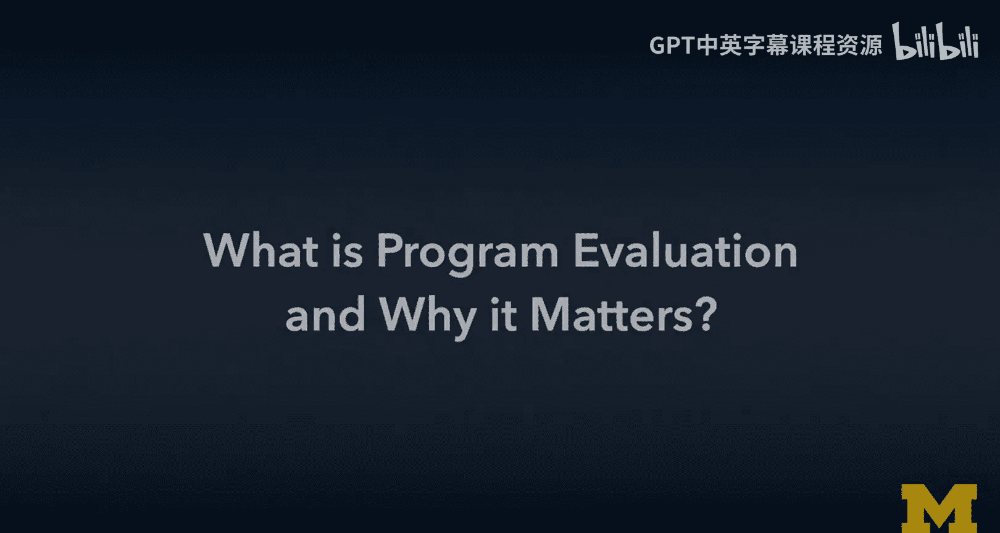
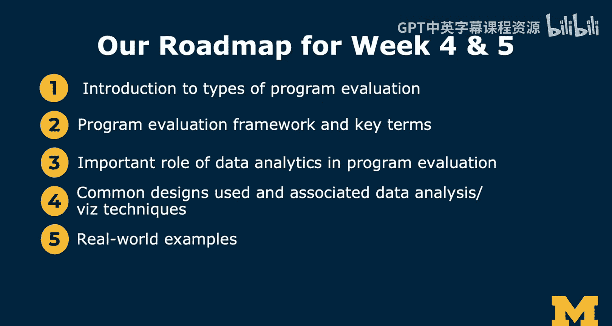
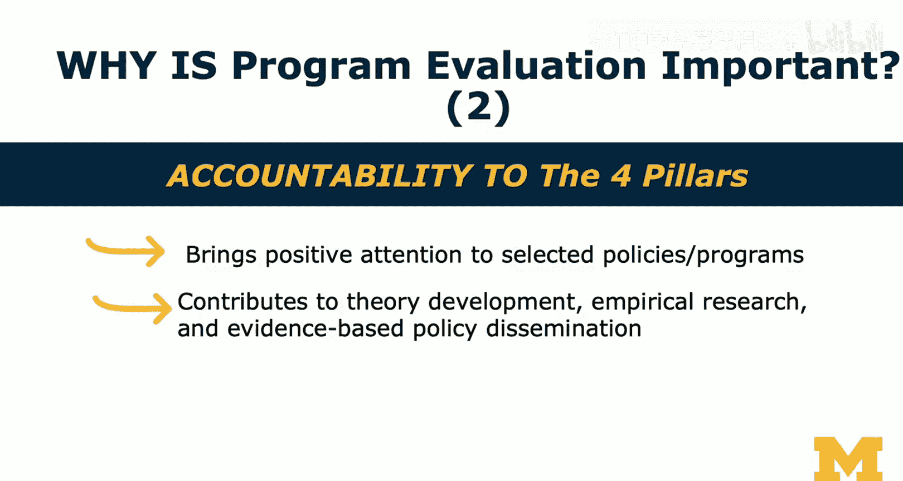
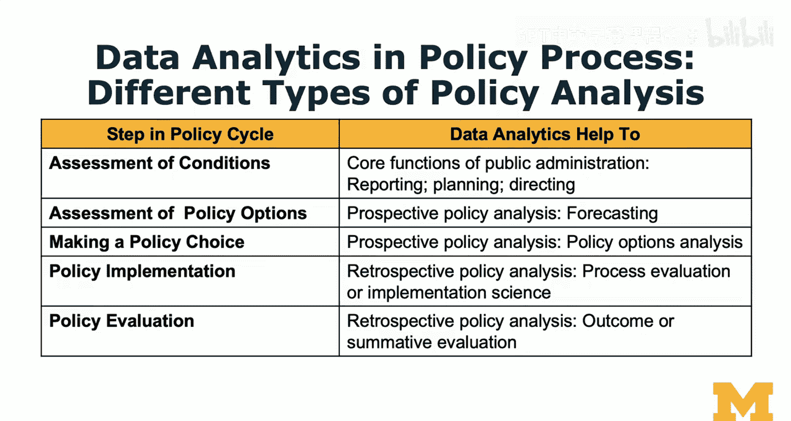
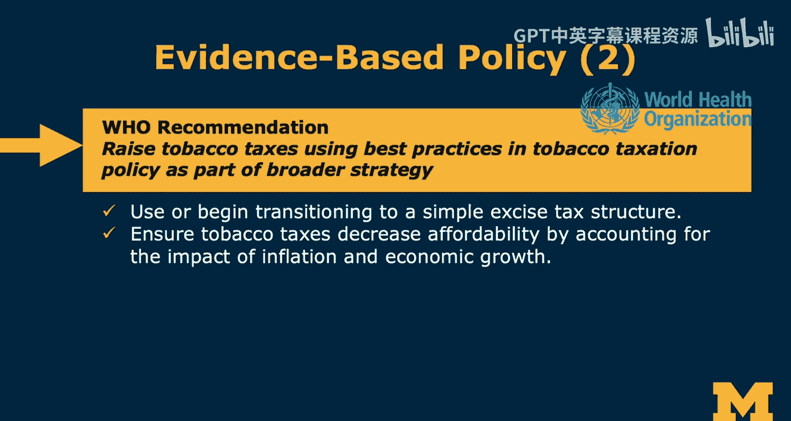
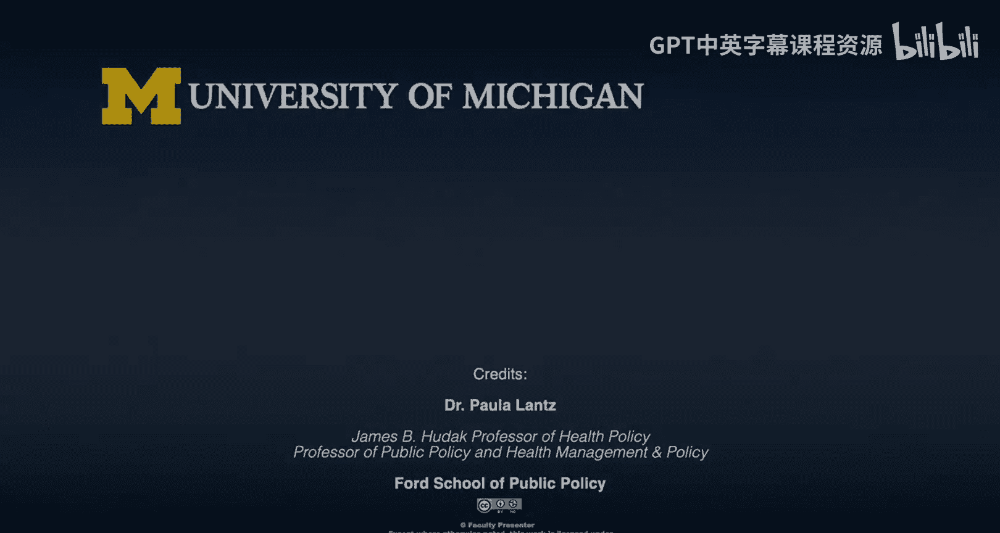

# 密歇根大学《公共部门的R数据分析（基础、数据探索、决策支持、）｜Data Analytics in the Public Sector with R》中英字幕 p103 24_项目评估定义及其现实意义.zh_en -BV1YZ421J7Fx_p103-

Hi， I'm Professor Paula Lance and welcome to a new module。In our series。

 and we are now going to be focusing on program evaluation and why it matters so much for public policy and public administration and the important role of data analytics in the process。

Here's our roadmap for the next few weeks。First， I'm going to introduce you to different types of program and policy evaluation。

To do this， we're going to use a program evaluation framework， and I'm sorry。

 but there's just a lot of jargon and terms we're going to have to define。

 and then we'll use them a lot。Also， we will talk in detail about the important role of data analytics in program and policy evaluation。

 we'll talk about some common designs used and associated data analysis and data visualization techniques。

 and also we're going to have a lot of real world examples， and a guest。

All right， so what is program evaluation， We talked about this a little bit already。

 It is a descriptive or retrospective type of policy analysis。And this means that we're not。

 as we talked about before， with prospective policy analysis。

 we're trying to predict what would the future look like if a policy or a set of policies were to be implemented with program evaluation。

 we're asking， did a public program policy are there kind of intervention that was implemented work。

It could involve analysis of the implementation aspects of a program， user experiences。

 but also more commonly it focuses on the impact and the effectiveness of policies and programs and interventions。

 their costs， and also it's important to look at different kinds of ethical and value issues。

 inequities that might arise， etc。So why is program evaluation so important Well， first of all。

 let's review our four pillars of public administration。

Program evaluation has to do with accountability to these four important pillars。 First of all。

 effectiveness。 government needs to know if the kinds of policies that are being implemented and reformed。

 programs that are being implemented are working well。

 are they meeting their goals and also to make sure they're actually not hurting people。

Also the pillars of economics and efficiency， of course are so important in government we're always working in the scenario of scarce resources。

 and so we want to make sure that these resources are being used and allocated efficiently。

 meaning that there's value for the amount of resources that are being expended to achieve a specific goal。

And then also equity， always an important pillar， and again。

 we need to know if programs or policies that are being implemented are raising any kind of equity issues or if they're actually meeting the goals of reducing inequities。

There's some other reasons that program evaluation is really important to what government does。

First of all， it can bring positive attention through the media but through other venues as well to selected policies and programs。

 it's a great way for government to communicate with the public about what it's doing。And also。

 program evaluation is important from a research sort of perspective。

 it can help contribute to theory development in a number of different disciplines。

 empirical research， and really high level evidence based policy， design and dissemination。

All right， you've seen this before but I'm going to remind you of the important role of data analytics in the policy process and how policy analysis comes into play so as you might recall the first step in the policy making process is the assessment of conditions when we use data to do that it ties back to those core functions of public administration。

 all seven of them， but especially for the functions of reporting and planning and directing。

Okay the second step in the policy cycle is an assessment of policy options。

 we've already talked about the important role of prospective policy analysis and policy simulation modeling for forecasting what might the world look like if certain policies were implemented。

Then policymakers have to make a policy choice and again。

 prospective policy analysis and we've done exercises in this policy options analysis。

 the role of data is so important in comparing and contrasting different policy options。

And making the choice。Then policy implementation and that's what we're going to be focusing on here and also policy evaluation this again is retrospective policy analysis so for the policy implementation。

We can engage in what's called process evaluation or implementation evaluation or implementation science and then for the evaluation part。

 we will be engaging in what's called outcome or summative evaluation。

 don't worry I'm going to define all these terms and give you plenty of examples for all of these different kinds of evaluation。

 but let's go through an example quickly with the hope to really underscore you how important this kind of policy analysis。

 policy evaluation is to what government does through policy let's take the example of tobacco excise taxes。

Now as we talked about before， this is an example of a formal policy using the tax policy lever。

 and it's based on the theory in economics that there's a negative price elasticity of demand between price and tobacco consumption。

 and in this case it means a unit change in price as a corresponding negative impact or decrease in consumption of tobacco products。

So an important policy question is what's the level of taxation needed to make the price of tobacco products have a price elasticity that actually produces a public health benefit？

So the price of a pack of cigarettes varies greatly around the world。

 and that's because different countries or states or provinces have implemented different levels of taxation onto the price of cigarettes。

Well， dozens of tobacco tax policy evaluations have been conducted。

 most of them have been done using what we call a time series analysis to estimate the change in demand following different levels of price increase through taxation。

The overall findings do show that price through taxation decreases demand just what economic theory predicts。

 however， the price does matter， the price elasticity does vary by tax level。

It's been shown in some research that only 38 countries in the world covering only 14% of the global population actually have tobacco taxes that are sufficiently high to have a public health impact which is defined as taxing cigarettes to cover at least 75% of the costs of tobacco related health care。

 loss of labor and other costs to the public， this is research done by the world health Organization。

 and so the World health Organization also recommends that countries or subcountry units， states。

 provinces， etc ce， raise their tobacco taxes to a level that will meet the public health impact goals and do that as a way part of a broader strategy and the point here is that it's not just simply about the tax。

 but they also have based on evidence。Policy recommendations for how to implement that tax and the World Health Organization suggests do make it simple。

You know， don't。Prce different tobacco products like cigars or smokeless tobacco or vaping products。

 which are nicotine products， not tobacco products or cigarettes differently。

 have a simple tax structure， ensure that the taxes decrease affordability by also accounting for the impact of inflation and economic growth。

I already made that point and so to sum up， the point is that this type of policy evaluation research is so important for recommendations and really understanding how policy can have the most value and the best impact on its goals。

