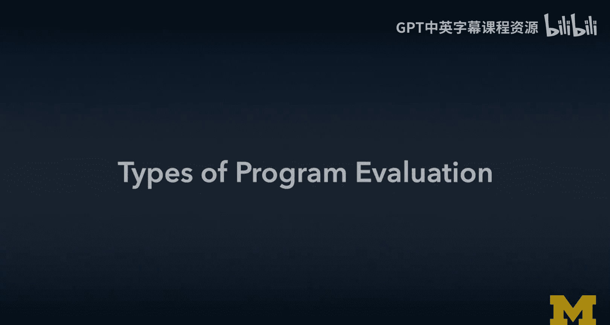
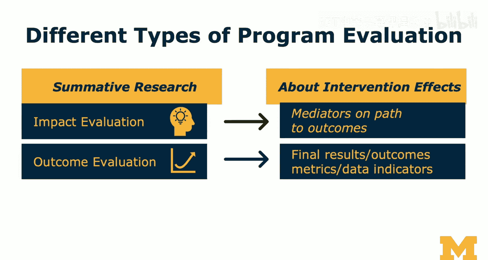
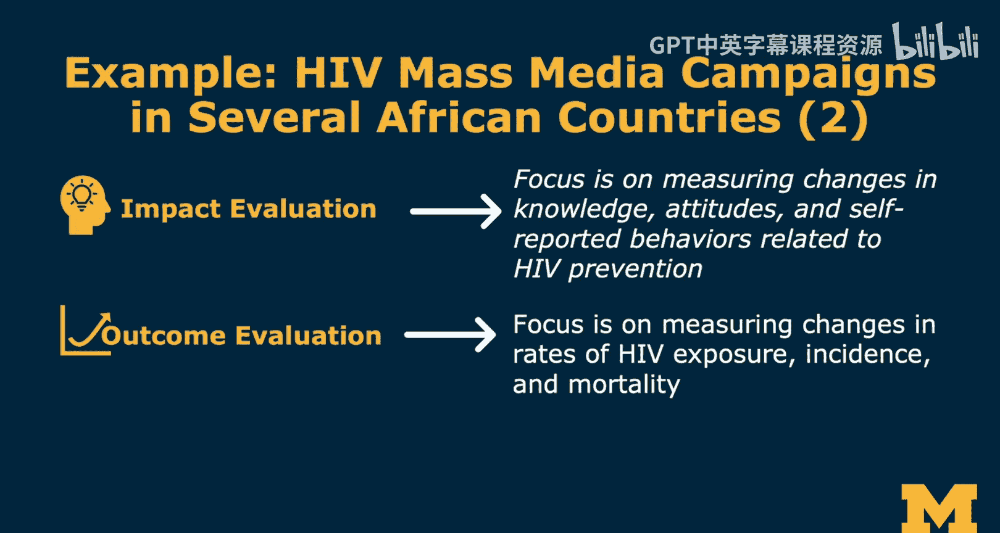
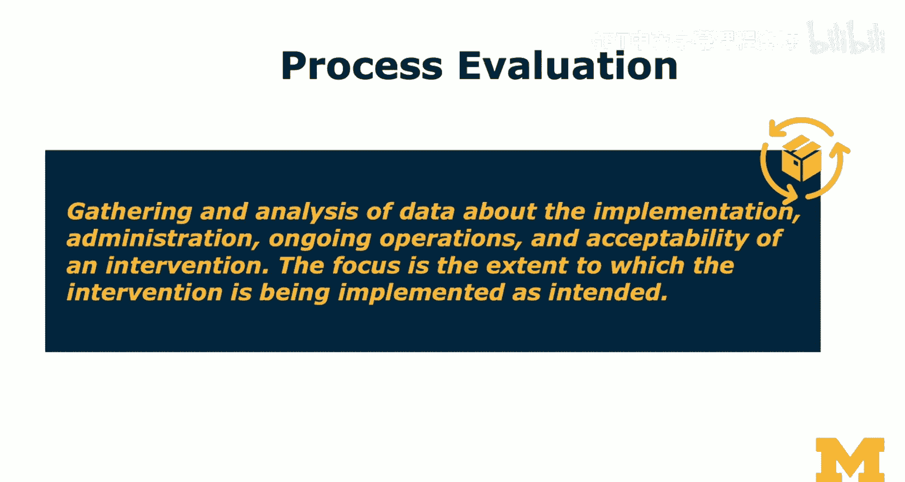
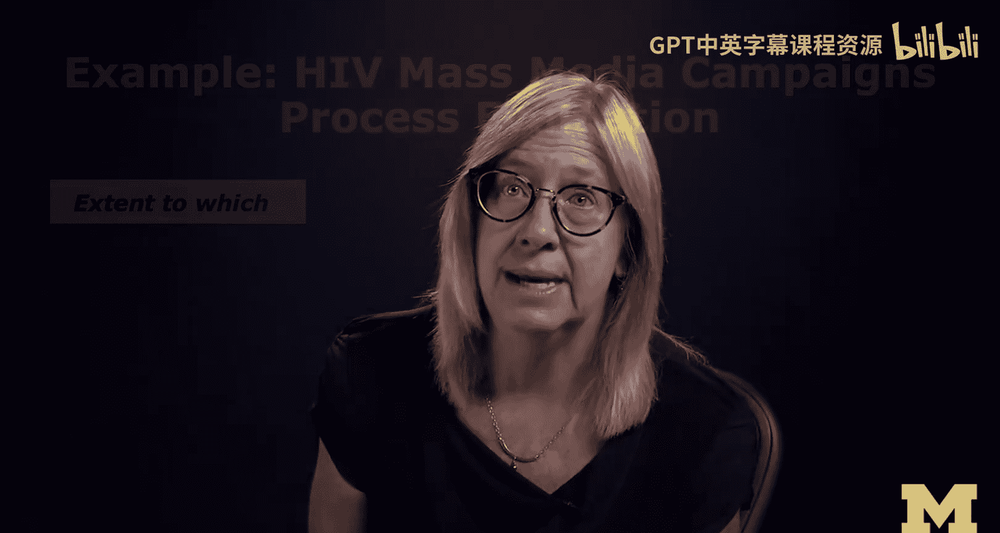
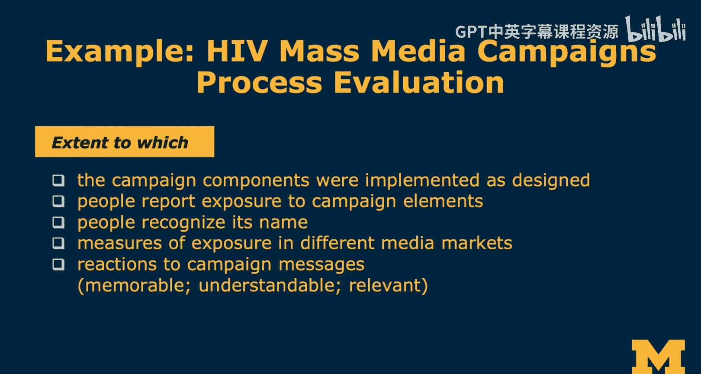
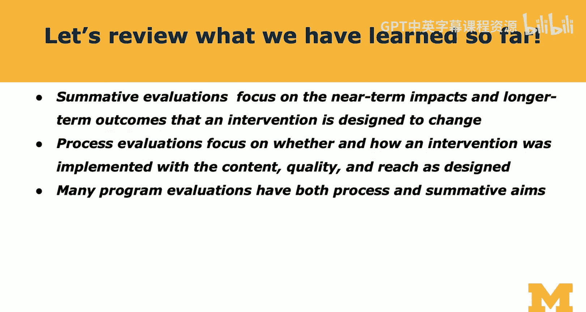

# 密歇根大学《公共部门的R数据分析（基础、数据探索、决策支持、）｜Data Analytics in the Public Sector with R》中英字幕 p104 25_项目评估主要类型.zh_en -BV1YZ421J7Fx_p104-

All right， let's jump in and talk about different types of program evaluation。

All right， there are two main types of program evaluation。

 The first bucket is what we call summative evaluation and。In that bucket。

 our impact versus outcome evaluation， I'll explain that more in just a minute and then implementation evaluation。

All right， so summative evaluation or summative research first we have impact evaluation and that's an evaluation where the focus isn't necessarily on what the end goals of the intervention or the policy are the focus is really on mediators or steps in a path to those outcomes。

 Sometimes it takes literally years and years to see the end result。

 hopeful impact of an evaluation and we can't wait that long。

 we really want to know well are the steps to that eventual outcome actually being met and that's impact evaluation。

Outcome evaluation is when you focus in the research。

 the evaluation research on those ultimate end outcomes。

All right， let's go through an example of this and to do that we're going to use what's referred to as a logic model of the intervention。

 which is how is the intervention supposed to work anyway。

 what are the steps in the process by which？Once an intervention is implemented and again。

 an intervention could be a policy or some kind of program that the government implements。

 how are we supposed to get from implementing that intervention to the ultimate goal？Now。

 several countries in Africa over the years have implemented mass media campaigns that relate to different kinds of public education to try to decrease exposure to HIV and then HIV incident and HIV death。

And so the logic model of these mass media campaigns is， first of all。If a campaign is implemented。

 people actually have to be exposed to it， it actually has to hit the targets。

 the people who they want to receive the information。Then that campaign actually has to do things。

 it has to increase people's knowledge or awareness。Change in people's attitudes。

 but then really importantly， the idea is that exposure to the information in the campaigns will result in a decrease in risky behaviors。

 but also an increase in safer behaviors， and then that behavior change should lead to a decrease in exposure to HIV and again。

 HIV incident and HIV deaths。So an impact evaluation would focus on measuring those more proximate steps in the logic model。

 it would focus on measuring changes in knowledge， attitudes。

 and selfreport behaviors related to HIV prevention。

An outcome evaluation would then focus on measuring changes rate and really HIV incidences and mortality rates。

 so hope you see here the difference between what an impact evaluation might focus on and also an outcome evaluation。

 some evaluations do both it's not in either or some might have both impact and outcome。

Aspects now process evaluation is different。 it's really about focusing on the intervention itself and how it was implemented。

So process evaluation is gathering and analyzing data about the implementation， administration。

 ongoing operations， and also about the acceptability of an intervention by the people it's targeted towards so the focus here is on the extent to which the intervention is actually being implemented as intended。

And this is important because interventions cannot work because they weren't implemented properly。

 it might be a great intervention， but something went wrong in the process of implementation。

Or interventions might not work because they just， they just don't work。

 They might have been implemented。Perfectly。In regard to the theory and the design behind it。

 but they just don't work so it's important to do both process and outcome evaluation so we really can f out is it faulty implementation or a faulty intervention if we don't see the results so again let's go back to the HIV mass media campaign type of example。

 a process evaluation might focus on the extent to which the campaign components were implemented as designed if it's a mass media campaign there's some print media。

 there's probably some electronic media， there's social media so where all the campaign components implemented as intended by the design。

Then did they reach people and did they reach the intended targets in terms of age group。

 geographic location and other characteristics of the people they were hoping to。

Reach sometimes mass media campaigns， process evaluations try to find out if there's actual name recognition of the campaign among people in the public。

Typically done through surveys， there are all different kinds of technical data driven measures of exposure in different media markets。

 and then also back to surveys， lots of times people are asked questions about if they say they have been exposed to a campaign。

 you， did they remember it， where the message is understandable do they feel it was relevant to themselves？

All right， so let's review what we've learned so far on these main types of evaluation， first of all。

 summative evaluation， we have impact and outcome evaluation。

 impact evaluations focus on more near term effects of an intervention。

 the more prox steps towards then longer term outcomes。

 that an intervention is designed to change and that's outcome evaluation。

 if we focus on the end goals。Process evaluations focus on whether and how an intervention was implemented with the content。

 the quality， and the reach as it was designed， and again。

 many program and policy evaluations have both process and summative aims。

