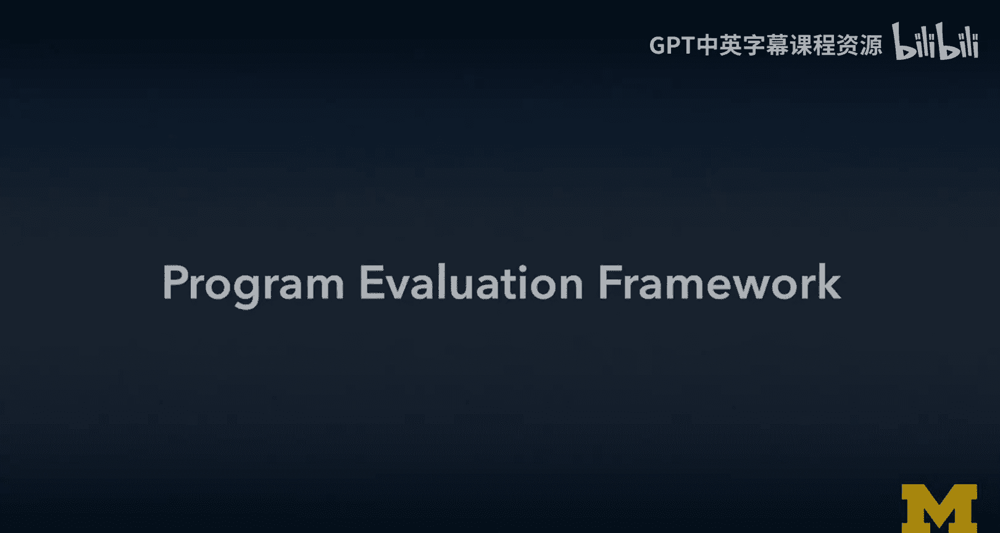
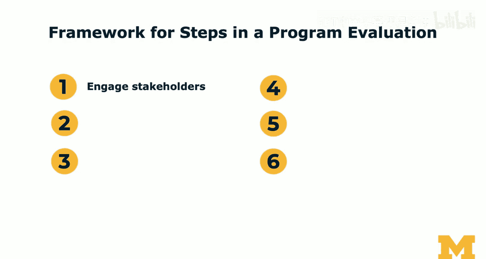
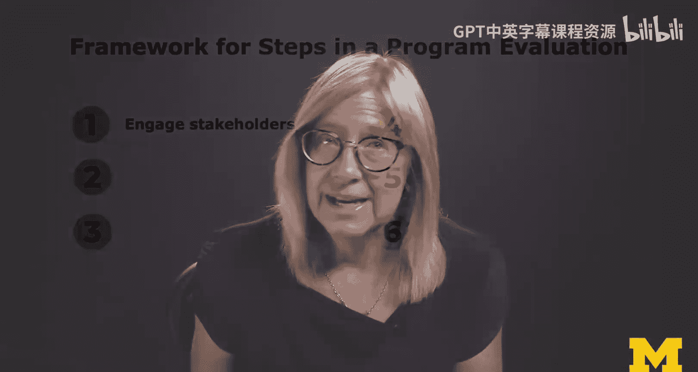
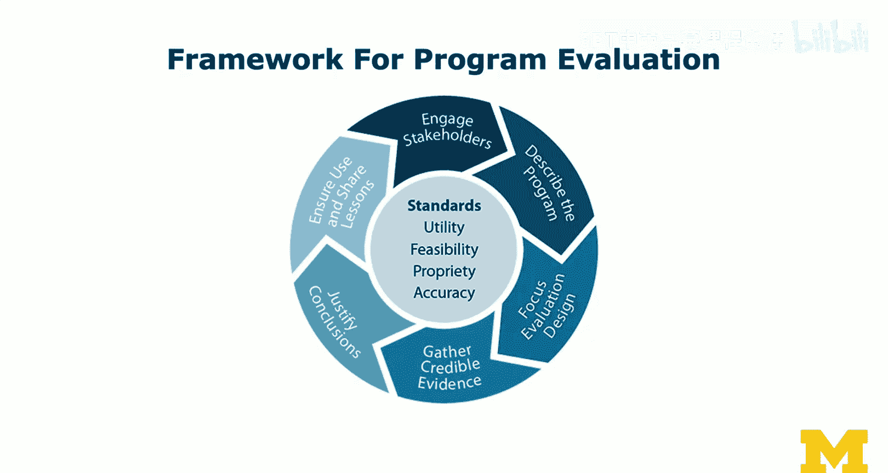
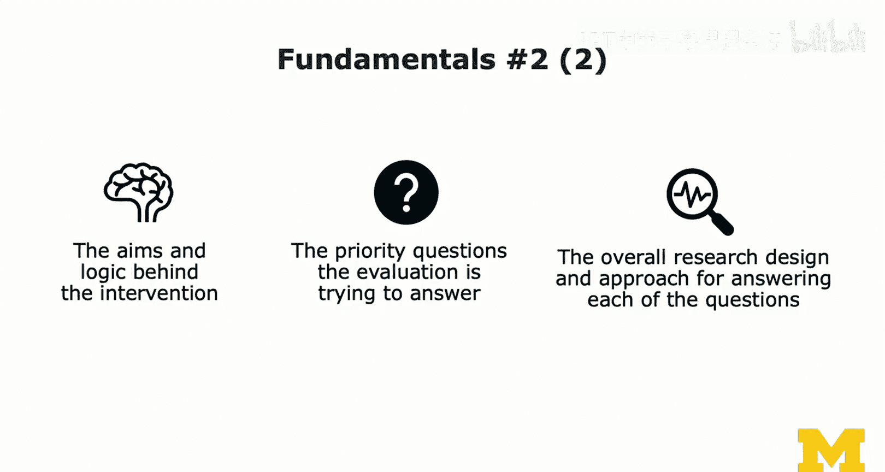
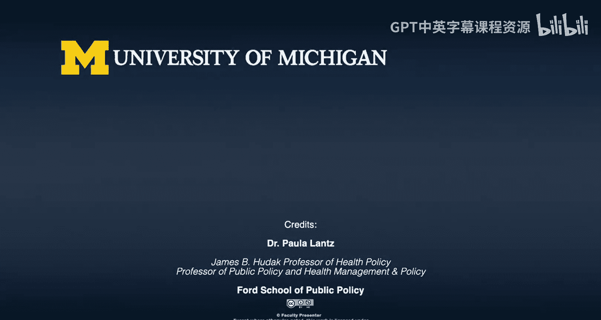

# 密歇根大学《公共部门的R数据分析（基础、数据探索、决策支持、）｜Data Analytics in the Public Sector with R》中英字幕 p105 26_项目评估方法论框架.zh_en -BV1YZ421J7Fx_p105-

嗯。Welcome back in this session， we're going to go over the program evaluation framework that's going to be so essential to how we think about this kind of policy analysis for the rest of this module。

We have a six step framework for all the steps that need to be taken in every program or policy evaluation。

Step number one， engage stakeholders。 What are stakeholders who are stakeholders， really。

 it's simply anyone who has a stake in the programme or policy and the results of the evaluation。

It's different for different situations， but really key stakeholders are those who are calling for an evaluation。

 they want to know if a program's working or not， and they need to be engaged because you really need to find out what is it they want to know there are literally dozens of questions that could be asked about any intervention and so the stakeholders have to be engaged from the start to find out you know what they want to learn。

The next step is to make sure everyone， including the stakeholders。

 has a similar understanding of the intervention， so the intervention usually using a logic model like the one I showed to you before regarding HIV。

 mass media campaigns。In African countries。Everyone needs to understand how the intervention was designed。

 What are the steps in its logic model and how it's actually supposed to work and achieve its goals。

 You might be surprised， but I've been involved with a number of program evaluations where not everyone agreed about how the intervention was supposed to work or even what the end goals were。

 So we've all got to be on the same page。Once that's done。

 then the evaluation design can be more focused， what are we trying to accomplish here and is this going to be an impact and or outcome evaluation。

 a summative evaluation， is this just a process evaluation， is it all of the above。

 we need to find out what wants to be achieved。Then we move into gathering and analyzing evidence。

Once that's done， then there are conclusions made， but we have to make sure we can justify the conclusions。

And then ensure that the evaluation results are going to be used and disseminated and what is learned from it will be applied。

 and then the cycle starts all over again。Here's a visual for the framework I just presented showing that the steps in program evaluation are not a linear process。

 it's really a cyclical process， and also we want to think about for every program evaluation。

 there is a unified set of standards。The first standard is utility and that means it's got to be useful。

 whatever data we're producing， collecting， analyzing and a program evaluation。

 someone needs to care about the results and wants to be able to use them， there has to be utility。

Also。Has to be feasible。Has to be able to be accomplished。

 the data have to exist to answer the questions that the stakeholders are posing。

 so what is being done in the evaluation again has to be feasible for the utility。

Proprity as a standard means that we need to follow the legal and also ethical guidelines for research program evaluation is a kind of research and it involves almost always humans when we're thinking about policy and government program service evaluation and so again we need to follow ethical and legal standards and also accuracy。

 we need to make sure we are producing really good research results that are accurate and are answering the questions being posed。

So the role of data analysts on the program evaluation research team is really important and remember as a data analyst。

 you're not just coming in down further down in the steps to analyze data。

 you need to make sure that you understand what has happened in all the steps if you're not directly involved。

 make sure you take the time to find out who are the stakeholders and have they been engaged to understand the intervention and what are the priority questions for the evaluation。

 you need to know that you can't just be asked to produce data if you don't know the context for it in an evaluation。

In terms of designing the research approach and focusing the evaluation， also as a data analyst。

 you need to be able to recognize the differences between process。

 impact and outcome evaluation questions。You also often you'll find you'll need to push some of the stakeholders to frame evaluation questions in ways that are measurable。

Again， I cannot tell you how many times I've worked to help design a program or policy evaluation where the stakeholders said to me。

 just tell us if it works。But what do you mean by does it work， what's your definition of work。

 how can we frame that in a way that's measurable， we have to be very specific。Also。

 you need to be able to communicate any limitations that you see with proposed data sources。

 you're the data expert， you need to be able to tell people what are the strengths and weaknesses in the data sources that are being proposed to be used。

Now， in terms of gathering and analyzing the data and the evidence， this is a little more obvious。

 of course， as a data analyst you might be assisting with data collection and preparation of data for analysis。

 you will be involved with performing analysis you might suggest additional analytic approaches that other members of the team haven't been thinking about。

Also， when it gets to the point of summarizing the results。

 saying here's what we found in our evaluation， you need to be that voice of reason that ensures that the conclusions are supported by the data again。

 you're going to know the data strengths and limitations better than most other people on the team so you need to play the role of communicating any limitations of the data and the analysis to make sure that people aren't over interpretterpreting results。

And also， in terms of communicating conclusions， a very important role。

 you might be performing the data visualizations for communicating the results to a variety of audiences。

 including audiences that don't have technical training。

 don't understand the researching and data kinds of issues。

 so you want to make sure that the results are being communicated clearly， but also truthfully。

We just went through the general steps in program evaluation， let's talk about some fundamentals。

Again， program and policy evaluation is a really important type of policy analysis。

Trying to answer an important question， did an intervention。

 a program or a policy reform or a new kind of policy implemented by government actually do anything。

 did it work？But again， as I said， any evaluation could potentially address lots of different more specific questions than did at work because that's not a good research question。

 so evaluations need to be focused in here they need to be focused on the priority questions of the stakeholders。

 not the data analysts， not the statisticians on the team， not the researchers on the team。

 but really again the stakeholders， what do they want to know。

All evaluations go through multiple steps， as has been outlined in this general six step circular framework。

And data analysts are important members of the evaluation research team at all six of these steps。

 not just coming in later on in the process when people are actually starting to play around with data。

And my advice to you is if as an analyst， you're not brought into an evaluation research project。

 if you're not involved in the process until the data analysis phase。

 just make sure you take the time to understand what happened in all the earlier phases of that process。

 you need to know the context。All right， also make sure you understand the aims and the logic behind the intervention。

 I think it'll make the work you're doing more interesting to you。

 but also it's really going to be important when you think about strengths and weaknesses of data and also different kinds of analyses that might be done。

You need to again understand the priority questions that the evaluation is trying to answer and also what's the overall research design and approach for answering each of those questions。

 I think these things will become more clear to you as we go through more of the details in this module。

