# 密歇根大学《公共部门的R数据分析（基础、数据探索、决策支持、）｜Data Analytics in the Public Sector with R》中英字幕 p106 27_设计聚焦与可信证据采集.zh_en -BV1YZ421J7Fx_p106-

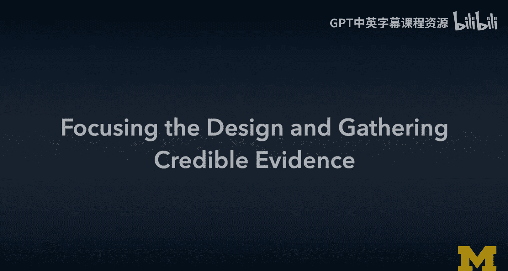

Welcome back。And in this session， we're going to talk about the third step in the program evaluation research process。

 which is focusing the design and gathering credible evidence。

So what I want to do in this session is go through some jargon with you。

 got some really important terms that are used in research designs。

For the evaluation of interventions and I need to make sure that these are terms that you understand well and are comfortable with so in this session we're just going to define some really important terms。

 one research design what do I mean when I say that also we're going to talk about independent and dependent variables in the context of evaluation research and then also a really important concept in evaluation research which is the counterfactual。

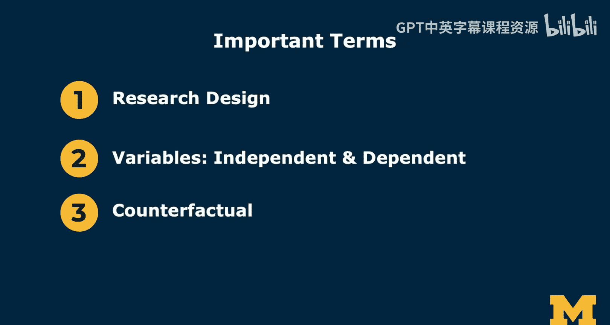

All right， research design， what is that all about？Well。

 a research design is the planning of some sort of scientific inquiry。So。Research designs。

 first of all， specify research questions， what is it that people want to ask and then answer about some kind of phenomenon？

This cuts across all different kinds of science， obviously。

 the research design also then specifies based on the research questions how the research will actually proceed。

So there are a standard set of components to any kind of research design。

 whether we're talking about laboratory research and microbiology or we're talking about anthropological research。

 and then certainly when we're talking about our kind of research。

 which is policy and program evaluation research。So the first component is the purpose is the purpose to just explore。

Is it to describe a phenomenon or is it to explain relationships？

And here we're talking about causal relationships between two or more things。

More on that in a minute。Research designs also have units of analysis。

 What's the unit that the research is focusing on and unit sounds very sort of。

 you know technical and abstract in our case， when we're thinking about government policies and interventions。

 The unit of analysis is almost always people，  individual people， but it also could be communities。

 it could be populations， the unit of analysis for program and policy evaluation also could be businesses。

 schools。Churches。Nonprofit organizations， so the unit of analysis needs to be clear。

 often individual people， but it could be groups of people or other kinds of organizations。Also。

 what's the topic， what are we looking at， are we looking at in our unit of analysis， actions？

Orientations， which means things like knowledge， attitudes， behaviors， practices。Conditions。

 environmental conditions。 So again， the topic needs to be clear could be one or more things in a one specific research design。

 but we have to be clear about what is it that we care about and we're。Focusing on。

 and then also every research design has a time dimension。

 which becomes very important when we're laying out in more detail the design。Now。

 back to the issue of purpose。Program evaluations are doing what is the hardest thing in science。

 and that is we're trying to explain， we're trying to explain what happens when a new policy or program is implemented。

 and that means we're actually trying to establish a causal relationship between the implementation of a program or policy and exposure to it。

And then something that happens afterwards。Casal inference is what we're talking about here。

 and again in science， establishing causal relationships is very， very hard to do。

It requires a specific kind of research design that makes comparisons between what happens when something is exposed to an intervention versus。

What would be the situation without exposure to that intervention？And that's the counterfactual。

All right， the counterfactual is， what would the world look like or what would our situation look like if we didn't have this new policy program。

Intervention。What would the world look like without it， what does the world look like with it。

 and then we compare the two and see if it's different。

Some of you might have experience working on research and laboratories the counterfactual and laboratory research is usually what's referred to as the control condition and we use that term control in program evaluation research as well。

Now， the control condition is what happens in the lab when there's no introducing of the experimental treatment or again。

 the exposure。In the real world of program and policy evaluation。

 the real messy world were' not in a controlled environment of a laboratory。

 So that makes us work much more hard。 We're trying to do the same thing。

 We're trying to establish a causal relationship。

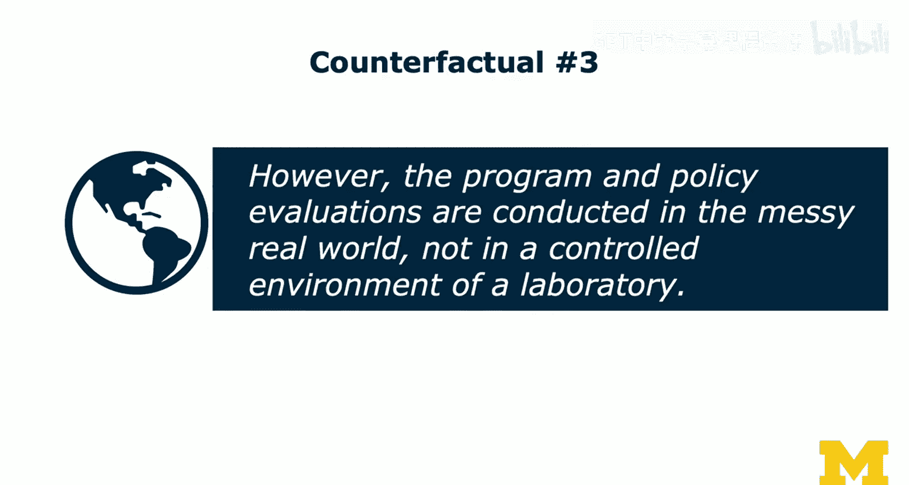

Between some kind of change， intervention， exposure and something that happens afterwards， but again。

 it's so much harder in the real world。

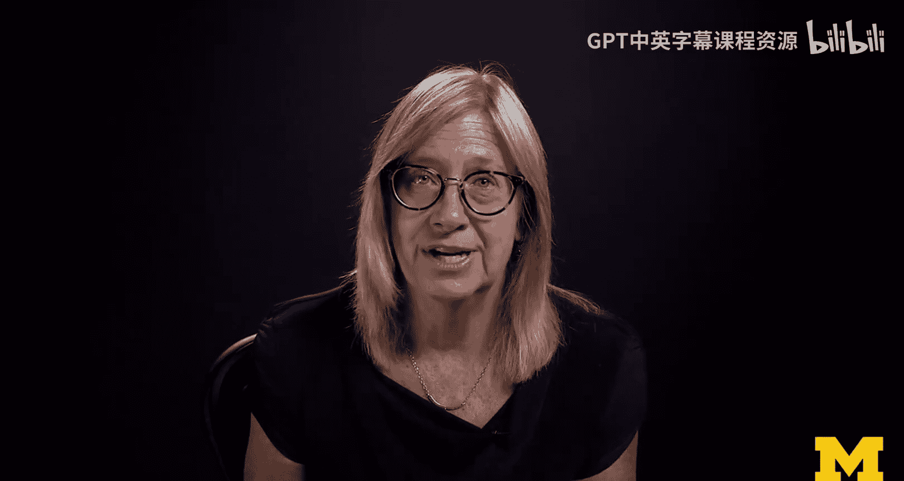

All right， so let's now also talk about independent and dependent variables。

 These are terms used in every kind of science， as well。

So and now I'm going to introduce a framework to you that uses a bunch of X's and O's when we talk about program evaluation research designs。

 we actually try to write them out， map them out on paper。Or in this case， a PowerPoint presentation。

 so we can actually sort of see the research design and see where we have a counterfactual and see where we have our independent and dependent variables。

😊，Now， the。X， in this case， is our intervention。Which is exposure to a program， service or policy。

 And oh。Is an observation of variables that the intervention is attempting to influence， and again。

 we're trying to establish a causal relationship between X， the intervention and O。

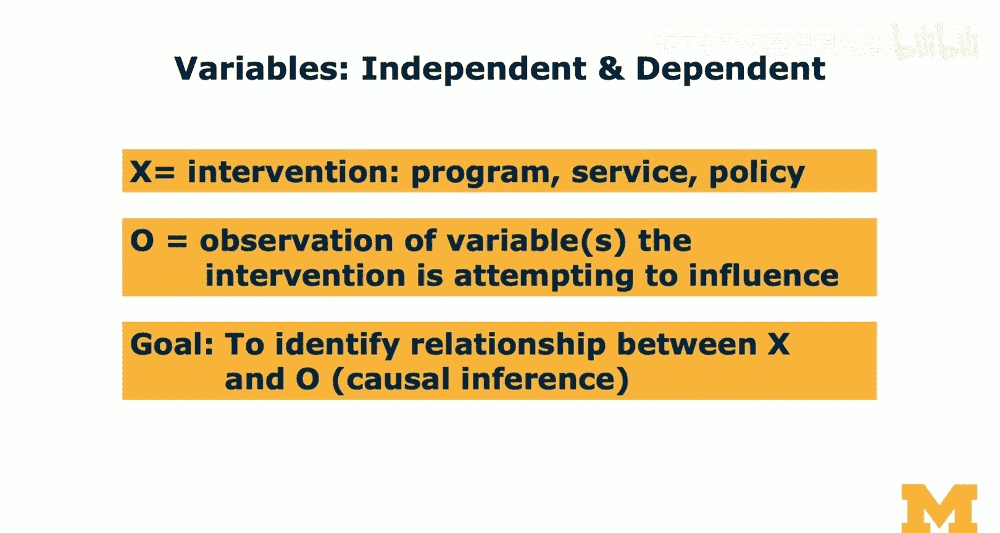

Observing the things we care about。Let me show you an example here we have a research design that's called the pretest postt research design。

 We have an observation of our units of the topics that we care about pretest and there's exposure of this group to an intervention and then we look at them again and in this design we're going to compare the pretest to the post test to see if there is a change and then we might attribute it to the intervention So again01 is the first data point pre intervention X is a new policy implemented and O2 is the second data point post intervention。

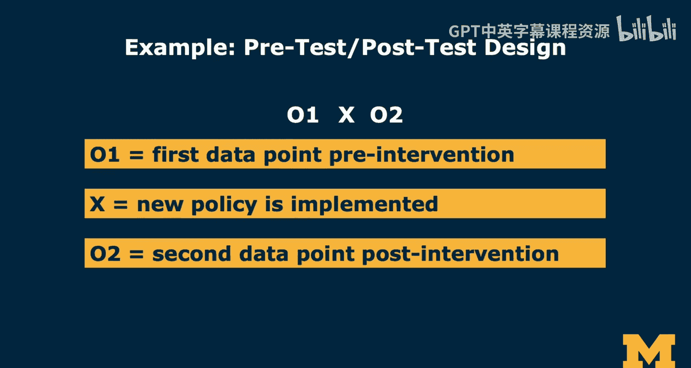

Alright， so variables are characteristics or attributes of units under observation that can vary。

 and they're of interest to us。 And so in this case， the dependent variable。

 a dependent variable is something that depends on exposure to another variable。

 an independent variable。 So a dependent variable is the outcome variable or the thing that we're trying to explain or predict in program evaluation。

 it's those O's， it's the outcomes that we care about and we think the intervention is going to affect。

The independent variable。Is the explanatory variable， the variable that we think。

Is causing changes in the outcome or the dependent variable。

Now we have other kinds of independent variables， we might， in addition to that explanatory variable。

 which in our case is the intervention。We might have some other independent variables that are correlated with the dependent variable that we might have to control in our analysis if you've taken statistics。

 here's where you want to think about control variables。And if you've taken statistics before。

 these terms independent and dependent variables should not be unfamiliar to you。

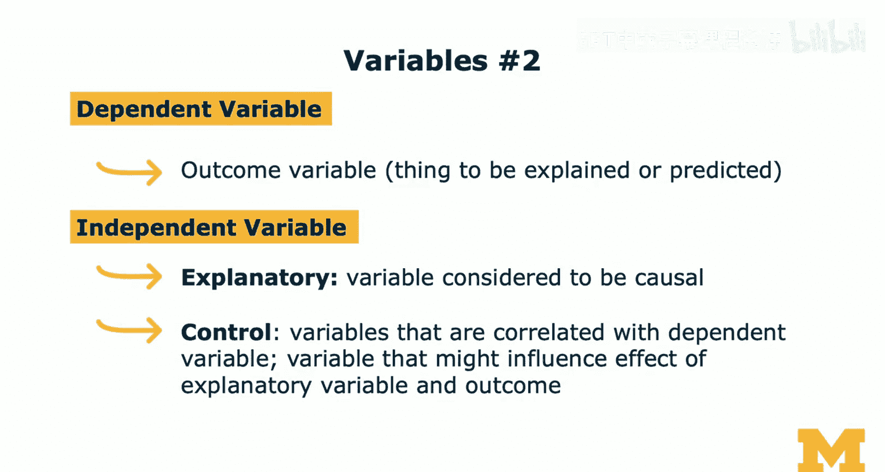

Let's visualize this again， here's our pre test post test design。And。

The O's are are dependent or outcome variables。 We're looking at these dependent variables。

Pre and post intervention。X is our independent variable。

 It's the thing we believe is going to cause a change in that dependent variable。So。

We look at the dependent variables at two points in time and then know that in between those two points in time。

 there is exposure to the independent variable， a program or policy change。

 and then we look to see if there is a change in this outcome variable。

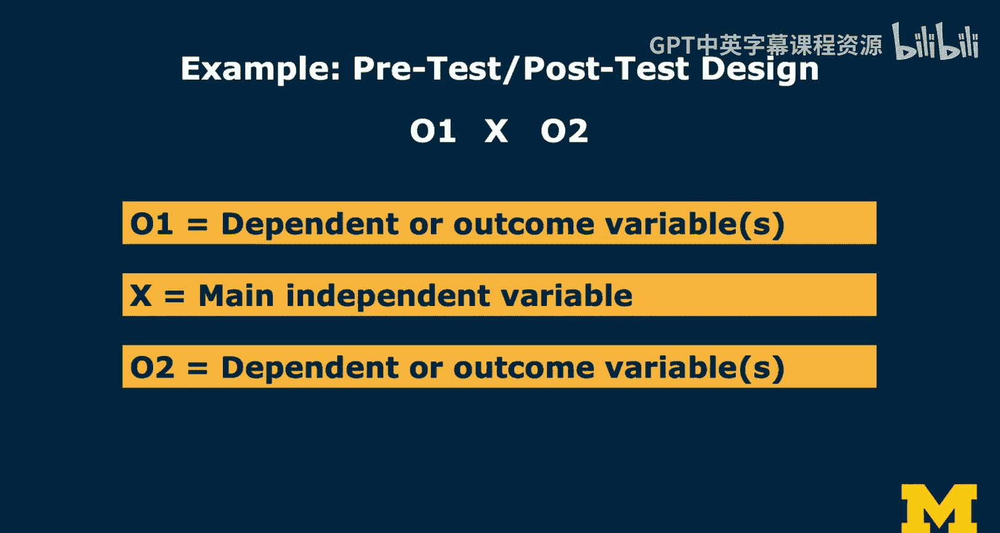

Now， a strong research design provides a valid assessment of the counterfactual， or again。

 what would have happened in the absence of the intervention， policy or program？

The counterfactual is what the world or are part of the world that we're looking at。

 What have looked like without the intervention。In this design。

 what do you think the counterfactual is， Is there even a counterfactual here。Well， yes。

 in this design。The first observation point is the counterfactual。

 We in this designer make making the assumption that the world would look the same as it did at time 1。

 at time 2。Without the intervention。 now， that maybe is kind of a leap that maybe is too strong of an assumption。

 But again， in this design， we look at pre post and assume that changes in post 2 might be the results。

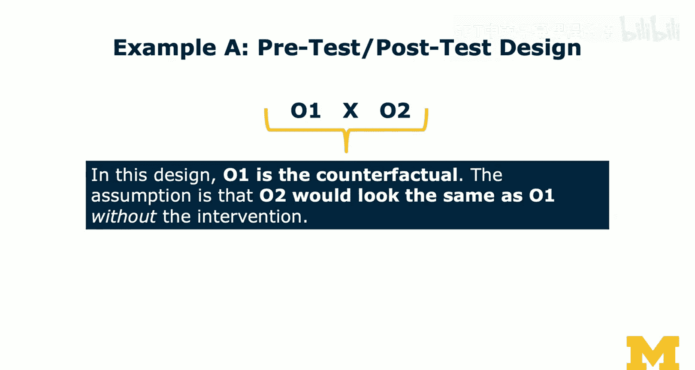

Of exposure to that intervention。Now。The design I showed you， we might worry a lot。

 There's a lot of things to worry about in that design is assuming that the point in time one。

 the observations there is a good counterfactual。We'll talk in more detail。

 there' are some concerns about that。 so here's another research design where we actually have a control group。

 we have a group that we're looking at at the same two points in time。

But they're not exposed to the intervention。 So this is a stronger research design， right。

 in this design， our counterfactual is actually the control group。 What happened in that group here。

 we're assuming these two groups would look alike should look alike at time2 because。

They do look alike at time one or close enough， and then if there are differences in the two groups at observation point number two。

 we might think that part of that or all of that is an estimate of the effect of the intervention。

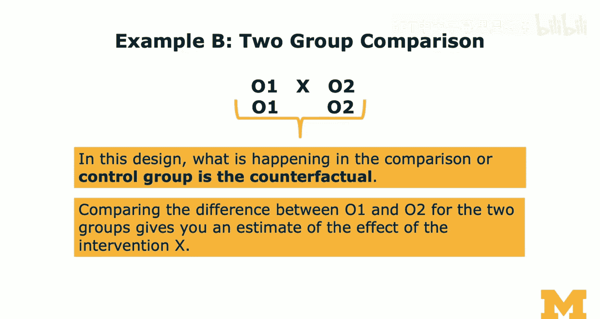

So I'm sure you have a lot of questions about this。

 so we are going to talk in a lot more detail about the strengths and weaknesses of different research designs and their counterfactuals。

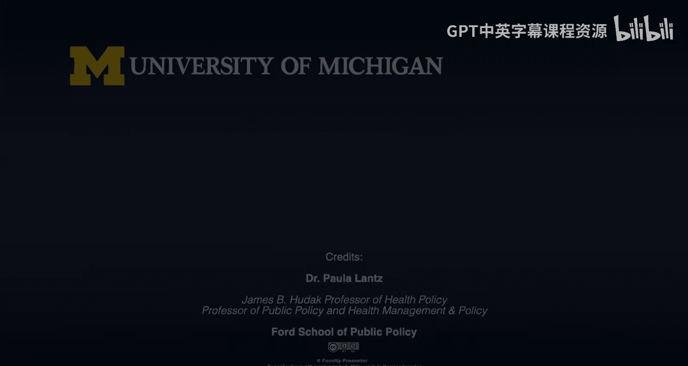