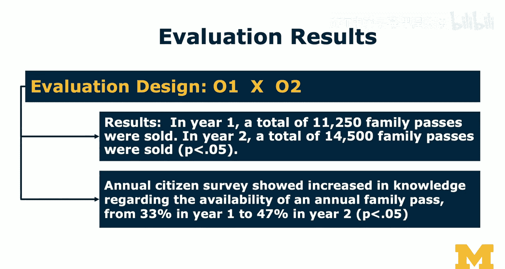
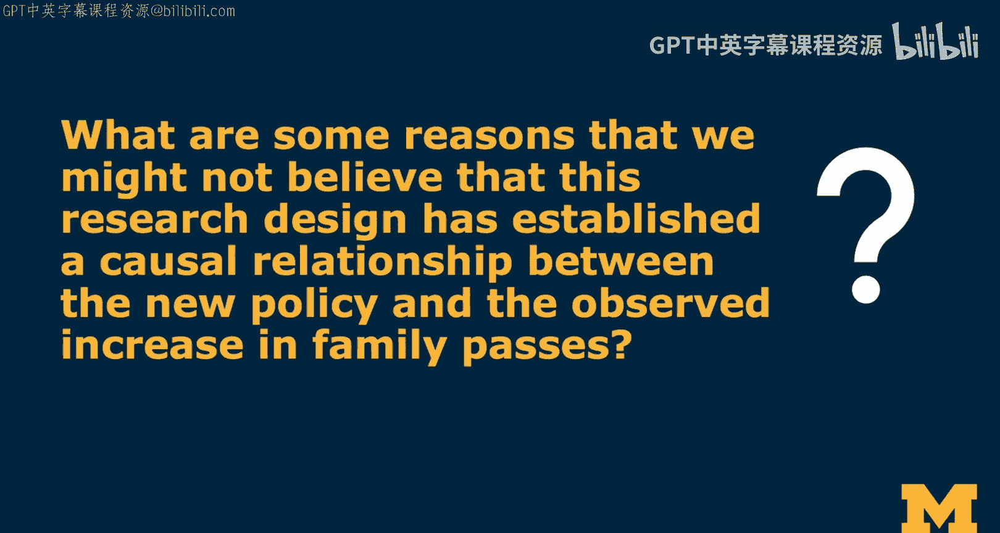
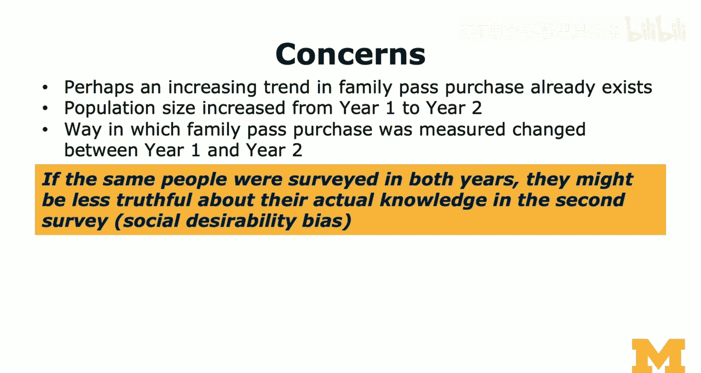
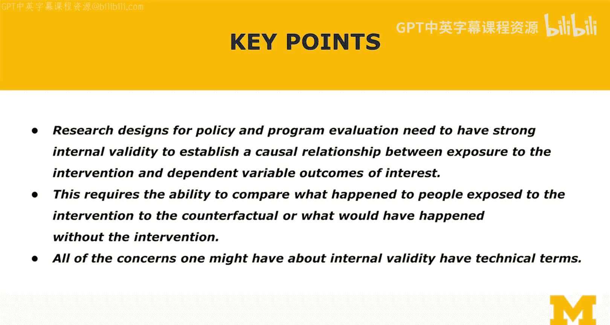

# 密歇根大学《公共部门的R数据分析（基础、数据探索、决策支持、）｜Data Analytics in the Public Sector with R》中英字幕 p107 28_研究设计方案实例解析.zh_en -BV1YZ421J7Fx_p107-

I've been throwing a lot of jargon at you， a lot of terms， many of which are probably new to you。

 so let's just take a moment and go through an example of a research design that's not as abstract。

So let's think about a city implementing a new policy。

We have a large city government that is implementing a policy that's going to reduce the cost of an annual family pass to the city's。

 public museums and zoo by 10%。Again， thinking about price elasticity。

 the hope here is that by reducing the cost of an annual family pass。

 the number of passes purchased will go up and more families in the city will be enjoying the public goods of museums and the city zoo。

All right， so now stakeholders want to know， are we losing money by reducing the cost of a family pass or is this actually going to increase demand。

 what's been the impact of this policy change？And so we could think about as an evaluation design。

 the simple pret post test design where X represents the policy change。

 a new price for the family pass。The observations here at both time one and time two are。

 first of all， the number of family passes sold in a year， that makes a lot of sense。

Also we can think about a process evaluation component again。

 process evaluation is about the implementation of a policy change and here you'd want to know whether or not people in the community in the city。

Actually know that a， a family pass exists and also that the price went down and so here we could think about using data from a citizen survey that gathers information on lots of things。

 but including knowledge about the availability and the price of the family pass。All right。

 so let's say we implement this design， we have a pre test post test design。Here's some results。

You as the fabulous data analyst， presented the results to all the stakeholders。

 so in year one there was a total of 11，250 family passes in year two， that one up to 14。

500 family passes being sold and running a statistical test on it。

 we show that that is a statistically significant difference from observation 1 to observation 2。

 with a P value of less than 0。05。Also， you found in analyzing the citizen survey data that there was an increase in knowledge regarding the availability and the price of the annual family pass from 33% of respondents in survey for year one up to 47% in year two。

 and again， that was a statistically significant difference。

All right， so thinking about our design， just the simple pret post test design。

 do you believe that the price reduction increased sales and knowledge？

Do we have really strong evidence of a causal relationship between this price reduction？

And the observed increase in sales and knowledge。Again。

 we're asking whether or not we have a strong research design and in this case I'm going to throw another new term at you and that's internal validity。

 the strength of a research design to be able to establish a causal relationship is referred to as internal validity so does this research design have a strong internal validity for establishing a causal relationship and that really begs the question is the pretest year of 101 or01 a good counterfactual。

So here what we always want to do is think about hm。

 what are some of the reasons that we might not believe that this research design has established a causal relationship between the new policy and the observed increase in family passes What are some rival hypotheses for why we might have seen a change from year one to year two that could be explained for reasons other than the policy change？

So what are some concerns？Well， perhaps there's already been an increasing trend in the family pass purchase。

 We only have one year of data。 We're looking at for an intervention change。

 Maybe there was an upward trend going on already， and we're just catching that。

 It wasn't the price change。This was just an increasing trend anyway。Also。

 we were just looking at numbers of passes sold。Well。

 what if our city population increased in size from year one to year two。

 that could explain the increase， not the price difference？

The ways in which family pass purchase was measured did the data change and you're the ones who are going to know that data systems。

 data collection systems， data management systems do change and are we observing a change maybe an improvement in capturing family pass purchase from year one to year two。

 that would explain the increase， not the price change。Also。

 if the same people were surveyed in both of these years。

 they might be less truthful about their actual knowledge in the second survey。

 We refer to this as social desirability bias。 So when you survey the same people multiple times。

 you have to be concerned about when there's changes in their reported knowledge。

 even attitudes or practices。That might reflect true changes it also might reflect， again。

 people say， oh， I should know this。I should report， I hate to say people are lying， but again。

 there is this concern about responses not being fully accurate and in many cases because of social desirability bias。

So I don't know if you can think of any other concerns and we always should。

 we should be very critical and very thoughtful about research designs。

 and if we think they are really strong enough do they have the internal validity to establish this causal relationship？

To wrap up， some of the key points I want to make right now are that research designs for policy and program evaluation need to have strong internal validity to be able to establish a causal relationship between exposure to the intervention。

And then the dependent variable outcomes of interest。

And having this strong internal validity requires the ability to be able to compare what happened to people or other units of analysis。

 being exposed to the intervention to a counterfactual。

 or what would have happened without that intervention。

And when we're thinking about the strength of a counterfactual and some of the concerns we have。

 I'm sorry to tell you that there's more jargon coming up real soon because all of the concerns that we might have about the internal validity of a research design have technical terms。

