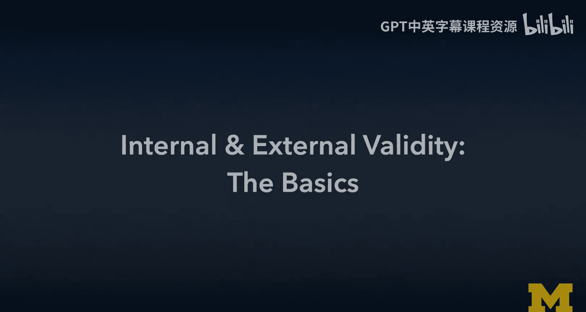
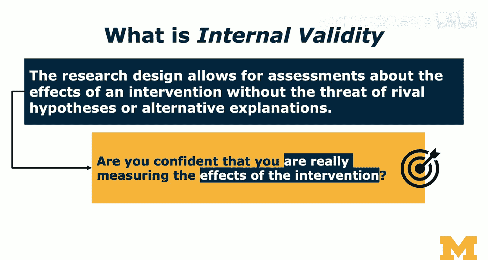
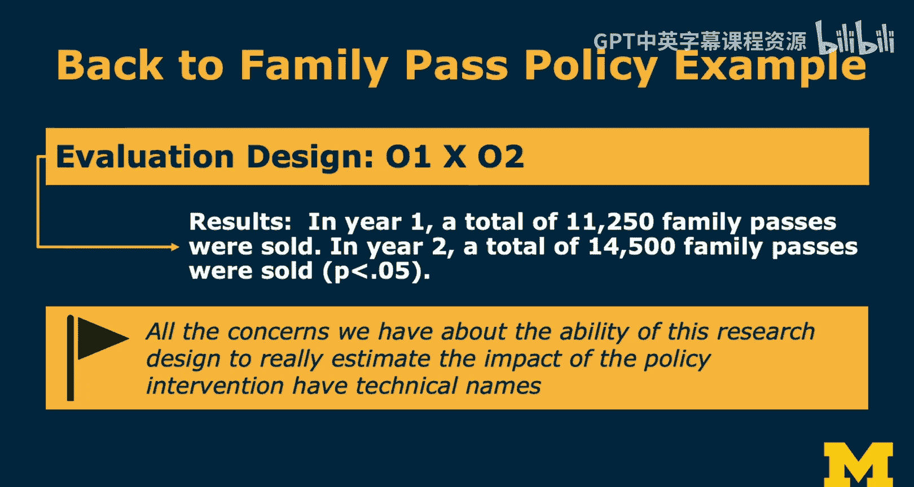
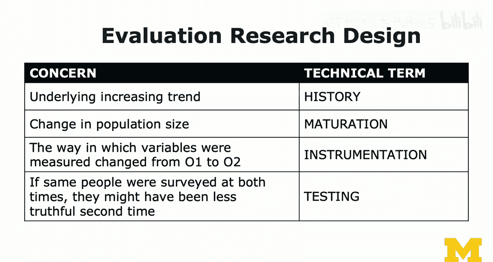
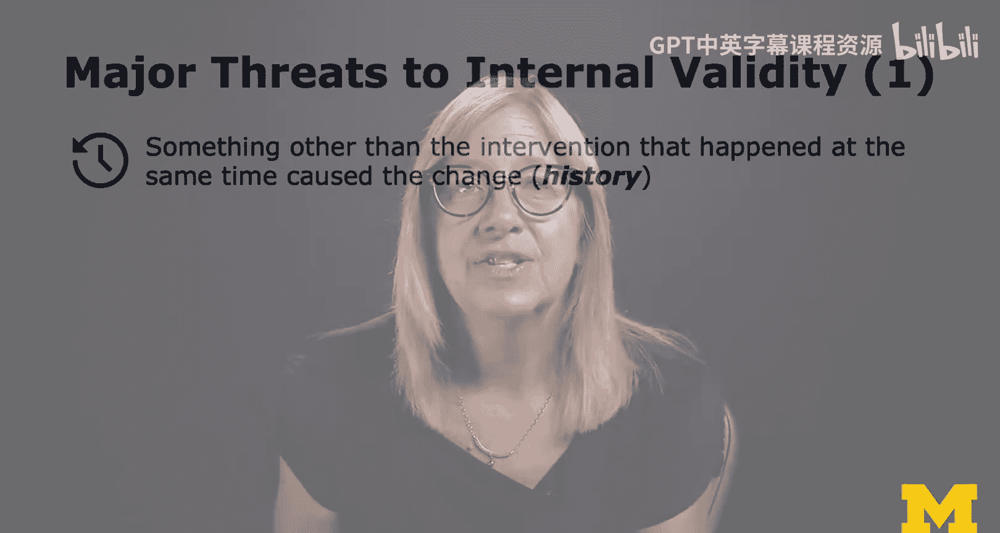
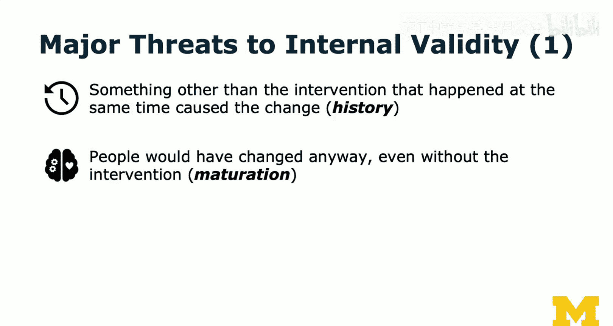
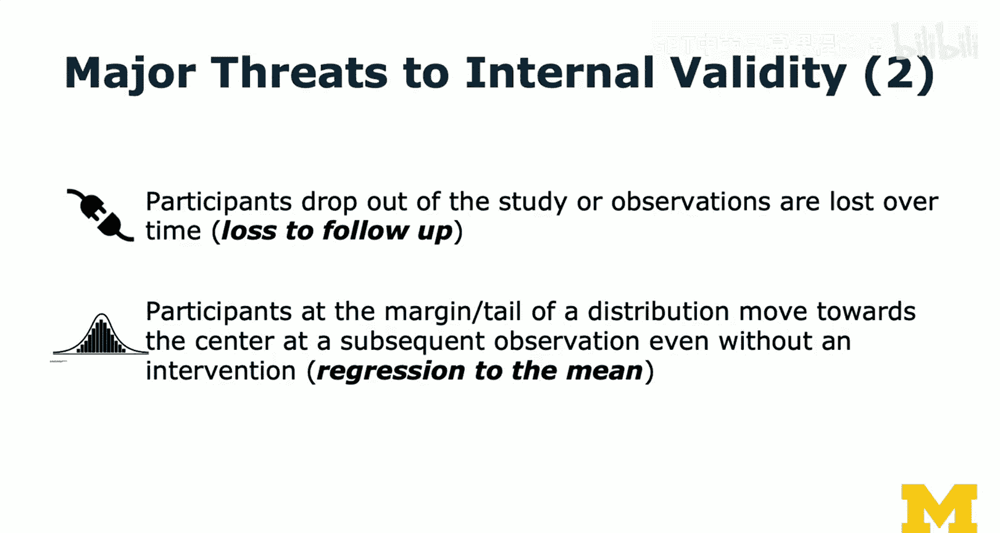

# 密歇根大学《公共部门的R数据分析（基础、数据探索、决策支持、）｜Data Analytics in the Public Sector with R》中英字幕 p108 29_内部效度与外部效度基础.zh_en -BV1YZ421J7Fx_p108-

Welcome back and we are continuing our journey through the jargon。

But really important terms associated with program and policy analysis and evaluation。

So in this session， we're going to talk in more detail about internal validity。

 and then also I will introduce to you the concept of external validity。

So what is internal validity？

When we think about internal validity of a research design。

 this is an assessment about the strength of that design for being able to understand the effects of an intervention without the threat of rival hypotheses or alternative explanations。

Really， a more simple way of saying that is， are we confident that we're really measuring the effects of the intervention and not something else that might be going on with our research design。

 Are we feeling that we can really assess a causal relationship between the implementation and exposure to the policy change or program intervention。

And what happens afterwards， let's go back to the family pass policy that we talked about before。

Remember that this used an evaluation design of the simple pretest post test design。

 and here we are looking at what is the impact of a price reduction for a family pass on the purchase of family passes for city parks and the city zoo。

The results showed an significant increase in the total number of family passes sold and also showed a change in citizens reporting knowledge of the availability and the price reduction of a family pass。

So when we think about the strength of this research design to actually establish that it was the price change in the family pass that caused the increase。

All of the concerns we might have。Have technical names。So more jargon again。All right， so。

What if there was just an underlying increasing trend going on already in the use of families getting the family passes and wanting to enjoy the city's parks and the zoo？

So the technical term for this is history， our evaluation might have just caught this increasing trend。

 so it's this historical trend that's going up that caused the change that we saw。

 not necessarily the price decrease。Also， what if there was a change in the population size。

 what if the number of families living in the city grew or just the number of people？

Grew that could explain the increase in purchase of family pass， not the price reduction。

 And the technical term for this would be maturation。 So the population size is changing。

That's a trend， it's different from something happening in history。

 but it's a change in the population that could be explaining the increase in the price the family pass purchase。

The way in which the variables were measured changed from time1 to time 2。

Better capture of family pass purchase， maybe something changed with the data being collected online。

 etc cetera。 The technical term for that is instrumentation。

 There was a measurement or instrumentation change that explains。Variation from time one to time two。

Again， not necessarily the price。Change。Also， if the same people were surveyed at both times。

They might have been less truthful in their answers the second time and here this is what we call a testing effect。

 there's lots of ways in which surveying people just the fact that you survey them more than once。

 people change their answers， that's a testing effect and it might be that testing effect。

 not the intervention of the price change that we're capturing So those are some examples of a major threat to internal validity for this particular example of the family pass and its price。

Let's go over them again in more generality here， so again。

 if something other than the intervention is happening outside in history。

 that might be what caused the change， not the intervention。

If people would have changed anyway， even without the intervention， and in this case。

 we were talking about population size increase， but there's lots of other ways that people change over time。

And that interventions just might happen at the time of a maturation change and it's not the intervention。

 it is just normal maturation， this is something I have worked on a number of program evaluations that are focused on adolescents and youth who are changing very rapidly in lots of ways and so you need to make sure that you're not just capturing maturation that actually you are also capturing what intervention effects might be happening above and beyond the maturation。

And again， we talked about the testing effect， getting information from humans is a tricky business。

 so we have to always be aware of that。Now another thing to be concerned about。

 not necessarily related to our city family pass intervention， but with other kinds of interventions。

 when we're looking at making comparisons between time one and time two。

 and if we're trying to follow the same people over time。

 participants drop out of study or we lose data on them。

 we don't have observations on the same group of people in time one and time two。

 this is considered loss to followup or study dropout。

 that's a threat to internal validity if we're not looking at the same group of people in time one and time two。

 then that could be explaining the change we see over time， not the intervention。Then， also。

Importantly， and I'll give you a good example of this coming up soon。

If we're looking at participants or people who are at the margin or the tail end of a distribution of something that we care about in the valuation。

 then if we look at them at time1， they're at the tail end of that distribution。

We look at them again at time， too， just because of normal fluctuations in data collection about populations。

 there's going to be a regression to the mean， a regression or a movement of that。

Data point more towards the average or the center of the distribution。

Again if you' take in statistics， I think you understand the concept of regression to the mean。

 this is something we have to worry about in evaluation when we're looking at people who are again very much at the edge of a distribution。

 the people whose income is the lowest people living in extreme poverty。

 people with the highest healthcare care cost， people with the most arrests in the past year。

 so again if we're looking at people at the margin or a tail of a distribution。

 those people get an intervention， the next time you look at them。

 they'll move in a to the average in a more positive direction even without an intervention and so we need to be aware of that。

