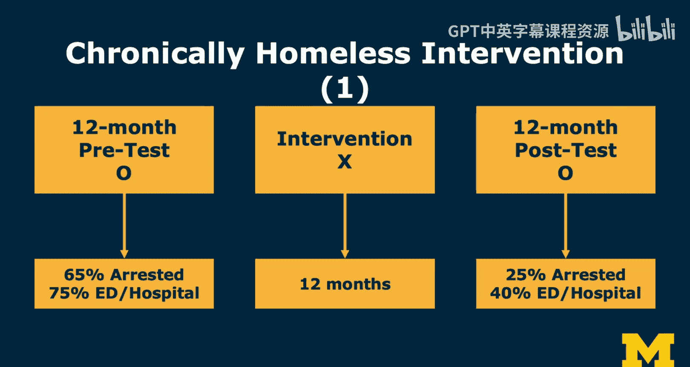
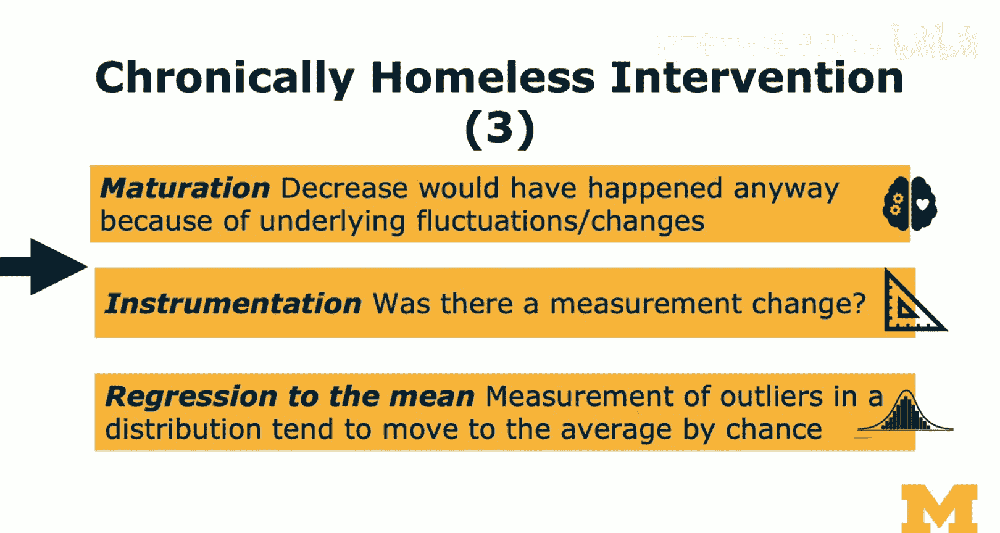
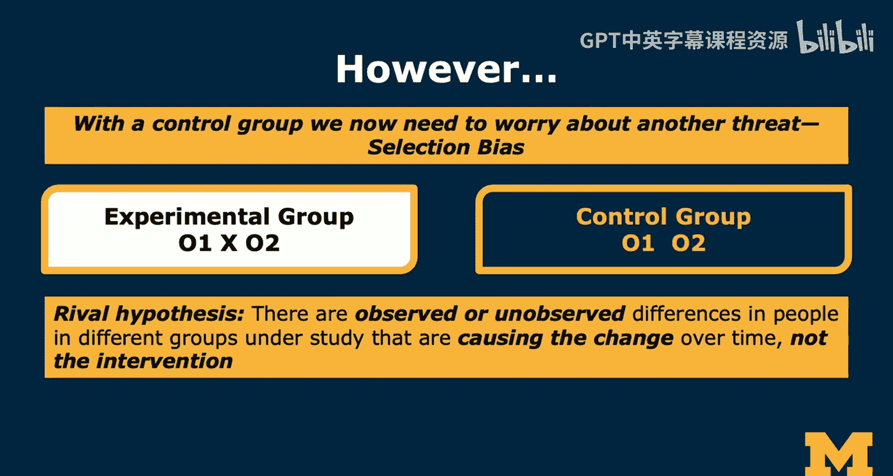
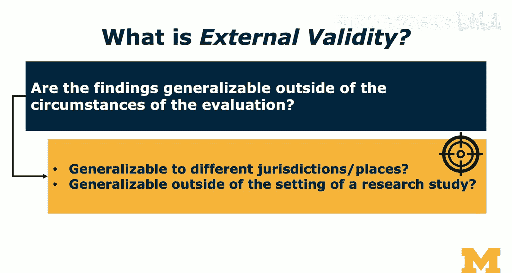

# 密歇根大学《公共部门的R数据分析（基础、数据探索、决策支持、）｜Data Analytics in the Public Sector with R》中英字幕 p109 30_内外效度典型案例分析.zh_en -BV1YZ421J7Fx_p109-

Let's take the example of an intervention aimed at people who are chronically homeless。

 This is a problem in any major city。On the planet， really， on in some cities in particular。

 there's very high rates of people who are chronically homeless。

And we also know that in a lot of places， people who are chronically homeless have much higher rates of being arrested and much higher rates of using the emergency department or hospital or other kinds of health services。

 and so an intervention was designed to assist people who are chronically homeless to give them housing but also give them what's referred to as supportive housing。

 and this is housing with additional social welfare services often implemented through a case management approach。

 so again， our intervention here is supportive housing with case managers who are assisting the participants in the intervention with getting connected with social welfare services and healthcare services。

So in the pretest in our steady population， we had arrest rates of 65% in a 12 month period。

 and 75% had had at least one emergency department visit or hospitalization。

The interventions implemented over a 12 month period and during that 12 month period。

Our data show that in the post test period。The arrest rate of the people went down to 25% and the emergency department and hospitalization usage rate went down to 40%。

Now what does that look like to you， does that look like that was a pretty effective intervention。

 it's designed to assist people。With housing， but not only with housing to see if there's a decrease in these other kinds of city resources that criminal justice system resources and then healthcare resources to see if the intervention reduces those as well。

Well， let's think about this design from an internal validity point of view。

 what are some rival hypotheses to the conclusions that it's the intervention that caused these drastic。

 significant drops in arrest rates and healthcare usage？All right， so maturation。

Would this have happened anyway， is this a group that had， you know， we looked at them for 12 months。

 they had high rates of arrest， high rates of healthcare usage？

If we looked at them again a year later， would they look better just because， you know。

 they're changing， you know， the fact of being arrested or having these healthcare shocks。

 as we might say， these underlying fluctuations and changes。

 they might have improved anyway without the intervention。We don't know。

Was there a measurement change in the time of the pretest to the post test。Got to look into that。

Regression to the mean tried to explain that before。

 but I think with this example you might see so these are people at the extremes of a distribution。

 these are people with you know high arrest rates and people with a lot of emergency health care usage that lands them in the emergency department and the hospital。

So even without the intervention， is it possible that these people might have had a better year。

 the second year， just because of regression to the mean？

And actually， we know from data that that is the case so how do we control for these important threats to the internal validity of this research design。

 the simple pret post test design shows there could have been a pretty important and significant impact。

Of this intervention。 But we do have some threats that we need to worry about。

 So how do we control for them。

Well， usually we do that with a control or a comparison group。

 so we would have an experimental group。Who got the intervention， But we'd have a similar group。

That looks the same without exposure to the intervention。

 But now we have to worry about another threat to internal validity。

 And that is the threat of selection bias。 Now， this is an important threat。

 but we only have to worry about it if we have a control group。 So， again。

 we have the experimental group and we have the control group。Where if we're comparing the two。

 you know， we want to say， well， the control group is the counterfactual and the experimental group。

 you know， any differences we see between the two is the effect of the intervention。

 well the rival hypothesis here is actually that maybe that control group isn't a good counterfactual。

 maybe there are either observeded or more concerning unobserved differences in the people in the experimental versus the control group and it's these differences that are causing the change over time。

 not the intervention。So just because we have a control group doesn't mean that we have good internal validity。

 we have to worry about is that a good control group and is there selection bias or is there know some difference between those two groups that could account for an interpretation of intervention effects when there aren't any？

Okay， so we've really been focusing on the internal validity of a research design and all these different threats to the internal validity of a research design that have very technical terms。

 so internal validity， did the intervention actually make a difference in the setting unders studydy。

 and are we measuring the effect of the intervention on an outcome without these threats？

To internal validity， which have all the technical names。Now， quickly。

 as opposed to internal validity， what is external validity。 We also want to think about that。

We also want to think about， well， are the findings of our program or policy evaluation generalizable outside of the circumstances of the evaluation？

Can we generalize to different jurisdictions or places？

So that I think typically when people think about generalizability。

 that's what they're thinking about。 Well， if we did this study， let's say in Rome。

 this supportive housing intervention study with a chronically homeless。

And got results。 Are those generalizable or transferable to cities in Africa。

 to cities in Southeast Asia， to cities in the United States。

 So can we generalize from one jurisdiction and population to other places。Sometimes we can。

 sometimes we we can't， so we want to think about that。

 but also we want to think about with external validity。

 are there issues with generalizing outside of the setting of the research study was there something about the way we were conducting the research？

That affects the level of the intervention effect or is in some other way affecting what we're seeing。

And so we'll talk more about that later， but again， for all your fun jargony terms。

 what I really want you to be thinking about is internal validity。

 the strength of a research design to establish causal relationships and the threats to internal validity and their technical names。

