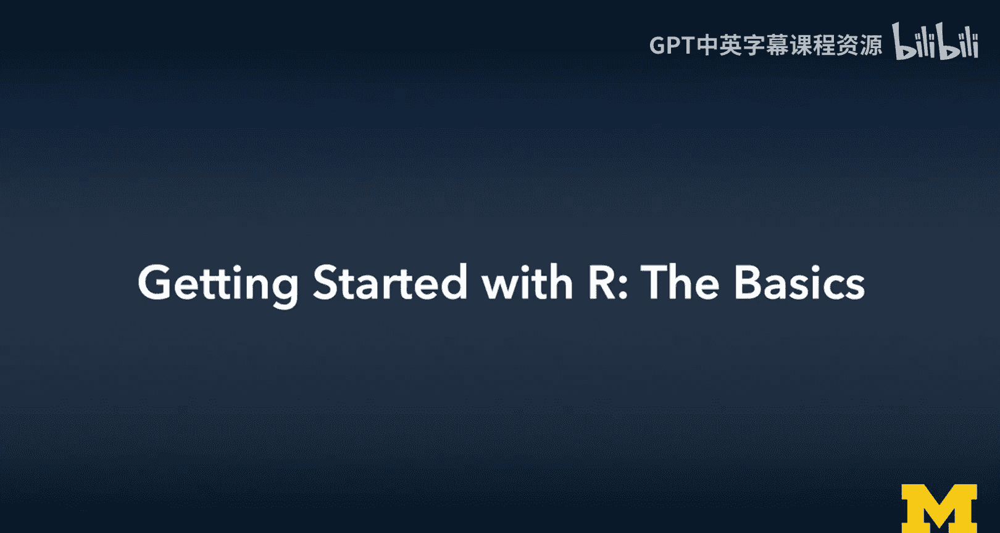
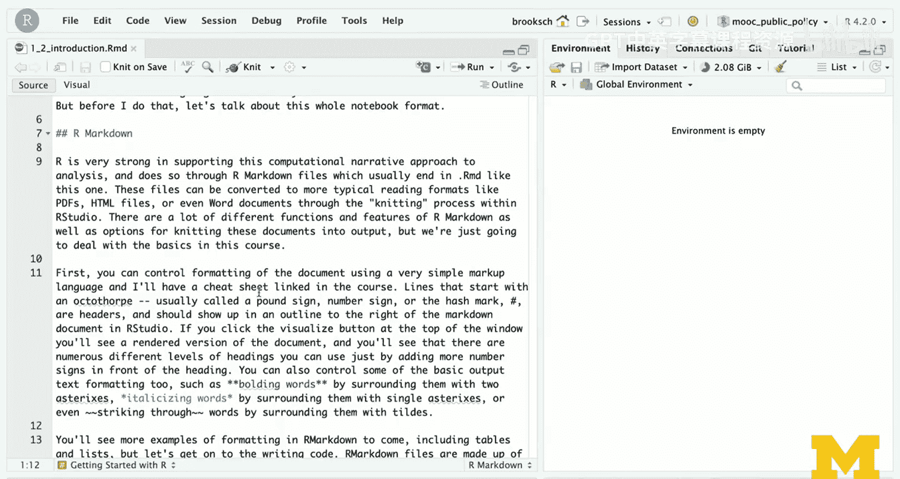
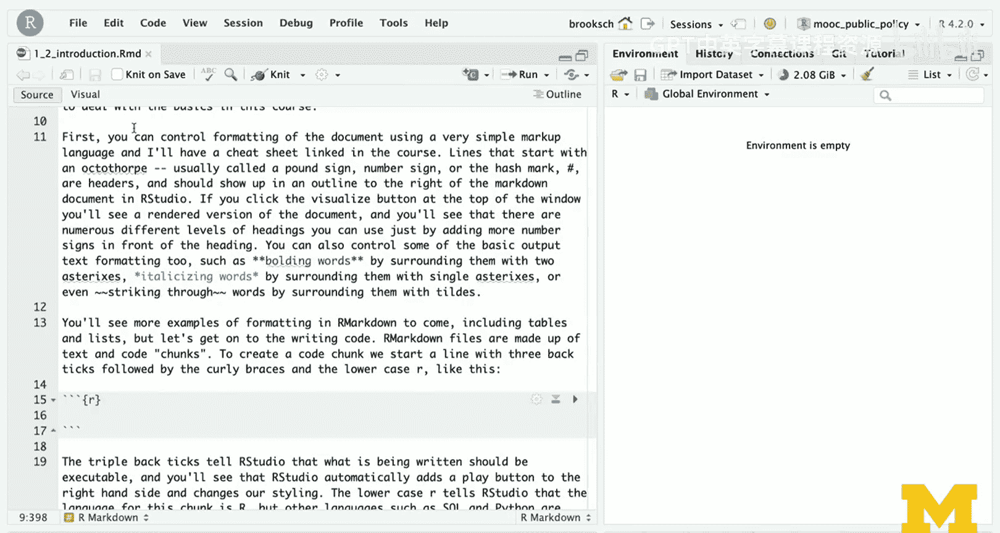
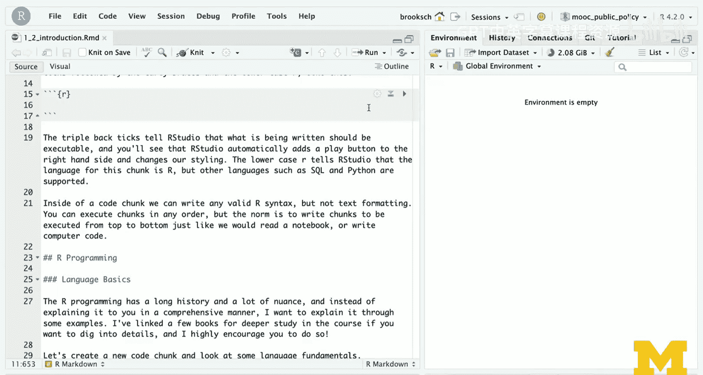
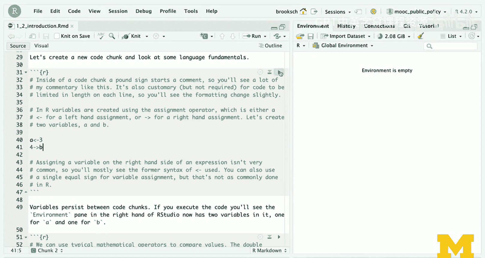
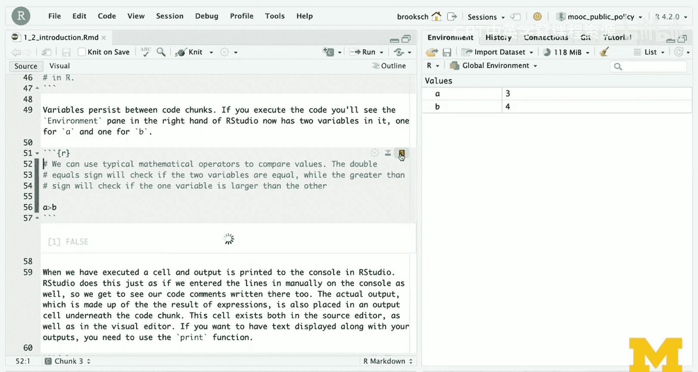
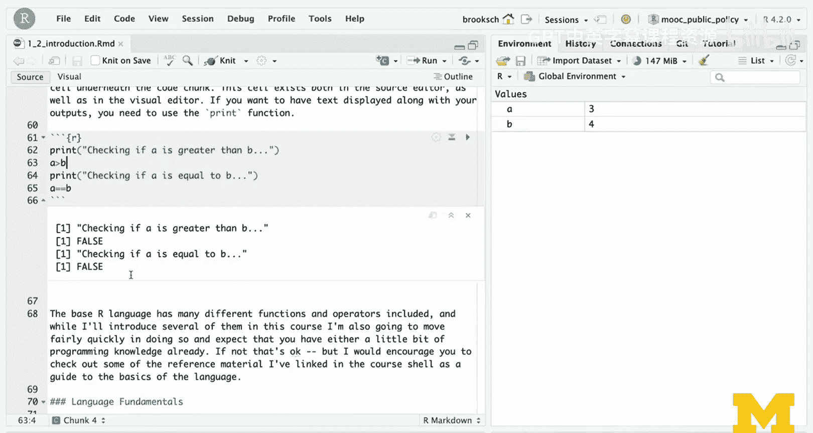

# 密歇根大学《公共部门的R数据分析（基础、数据探索、决策支持、）｜Data Analytics in the Public Sector with R》中英字幕 p11 10_R语言编程基础入门.zh_en -BV1YZ421J7Fx_p11-

In this course， we're going to write our analyses in a mixture of plain text。

 computer code and images。 This form of analysis is called a computational narrative。

 and it allows us to weave together discussion about the analysis。

 programming that actually does the analysis and the visuals to support and communicate our results。

Now I've tried to fully document my lectures in this format so that you can download these files to refer to later without having to rewatch videos。

 This means that you can quickly skim through lectures with both a transcript of what I've said as well as a code I've written。

 sort of like a hybrid between a textbook and a video lecture。In this notebook。

 I'm going to introduce you to some of the basic functions of R， but before I do that。

 let's talk about this whole notebook format。

Now， R is very strong in supporting this computational narrative approach to analysis。

 and it does so through markdown files， which usually end in dot RMD like this one。

These files can be converted to more typical reading formats like PDFs， HTML files。

 or even Word documents through a knitting process within our studio。

There are a lot of different functions and features of our markeddown。

 as well as options for knitting these documents together into some output。

 but we're just going to deal with some of the basics in this course。

First， you can control formatting of the document using a very simple markup language and all of a cheat sheet linked in the course Line that start with an  Oorpe。

 usually called a pound sign number sign or the hash mark are headers。

 and they'll show up in an outline to the right of the markdown document in our studio。

If you click the visualize button at the top of the window。

 you'll see a rendered version of this document， and you'll see that there are numerous different levels of headings you can use just by adding more number signs in front of the heading。

You can also control some of the basic output text formatting too。

 such as bolding words by surrounding them with two asteriskes， italicizing words。

 by surrounding them with a single asterisk， or even strike through words by surrounding them with tilts。

You'll see more examples of formatting in our markdown to come， including tables and lists。

 but let's get on to writing code。 Our markdown files are made up of text chunks and code chunks To create a code chunk。

 we start with a line with three back texts followed by curly braces and the lowercase R just like this。

The triple backtics tell our studio that what's being written should be executable。

 and you'll see that our studio automatically adds this little play button to the right hand side and changes our styling。

The lowercase R tells our studio that the language for this chunk is R。

 but other languages such as SQL and Python are also supported。Inside of a code chunk。

 we can write any valid R syntax， but not text formatting。 you can execute chunks in any order。

 but the norm is to write chunks in the order you want them to be executed from top to bottom。

 just like we'd read a notebook or write computer code。

The R programming language has a long history and a lot of nuance。

 And instead of explaining it to you in a comprehensive matter。

 I want to explain it through some examples。 I've linked a few books for deeper study in the course。

 If you want to dig into the details， and I highly encourage you to do so。

 But let's create a new code chunk。 and let's look at some of the language fundamentals。

So inside of a code chunk is pound signed， and that starts with a comment。

 So you'll see a lot of my commentary like this。 It's also customary but not required for code to be limited in length in each line。

 so you'll see the formatting change slightly。In R。

 variables are created using the assignment operator。

 which is either an arrow for the left hand assignment or an arrow for the right hand assignment。

 Let's create two variables。 And here I've created a and assigned it to3， and then I've created B。

 and I've assigned it to4。Signing a variable on the right hand of side of an expression isn't actually all that common。

 So you'll mostly see the former syntax of the left hand arrow used。

 You can also use a single equal sign for variable assignment， but that's also not very common。

Now if we execute this code junk， right， we see that we've created variables in the upper right here。

Now， variables persist between code chunks。 If you execute this code。

 you'll see that the environment pane in the right hand of our studio now is two variables in it。

 one for A and one for B。

We can use typical mathematical operators to compare values。

 The double equal sign will check if two variables are equal。

 while the greater than sign will check if one variable is larger than the other。

 So I'll put an A greater than B here and we'll execute this code junk。 All right。 So we see false。

When we've executed a cell， output is printed in the console in our studio。

 Our studio does this just as if we enter the lines in manually on the console as well。

 So we could see our code comments there。 too。 The actual output。

 which is made up of the result of expressions， is also placed in an output cell underneath the code chunk。

 This cell exists both in the source editor， as well as in the visual editor。

 If you want to have text displayed along with your outputs， you need to use the print function。😊。

So here I'll give an example， we'll create a new code junk。

 we'll print checking if A is greater than B， and then I'll just do our comparison。

 you'll note for the comparison I don't have to write a print function there。

 that expression will be evaluated directly and then print check if A is equal to B and we'll put that and let's execute this cell。

All right， so we see that all pieces of that output were added to the cell output。

The base R language has many different functions and operators included。

 And while I'll introduce several of them in this course。

 I'm also going to move fairly quickly and in doing so and expect that you have either a little bit of programming knowledge already or maybe even some R knowledge。

 If not， that's okay， but I want to encourage you to check out some of the reference material I've linked in the course shell as a guide to some of the basics of the language。

