# 密歇根大学《公共部门的R数据分析（基础、数据探索、决策支持、）｜Data Analytics in the Public Sector with R》中英字幕 p110 31_公共部门评估常用研究设计.zh_en -BV1YZ421J7Fx_p110-

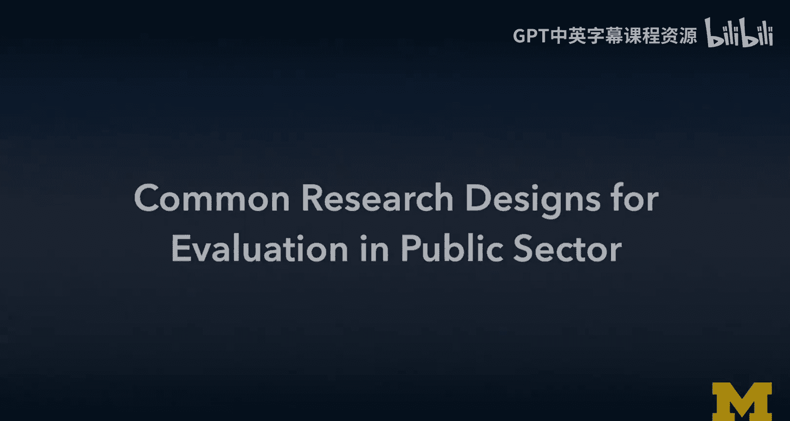

Welcome back。We're going to be reviewing some of the jargon and technical terms that we've been talking about in regard to program and policy evaluation and do this by going through some common research designs that are used for evaluation in the public sector。

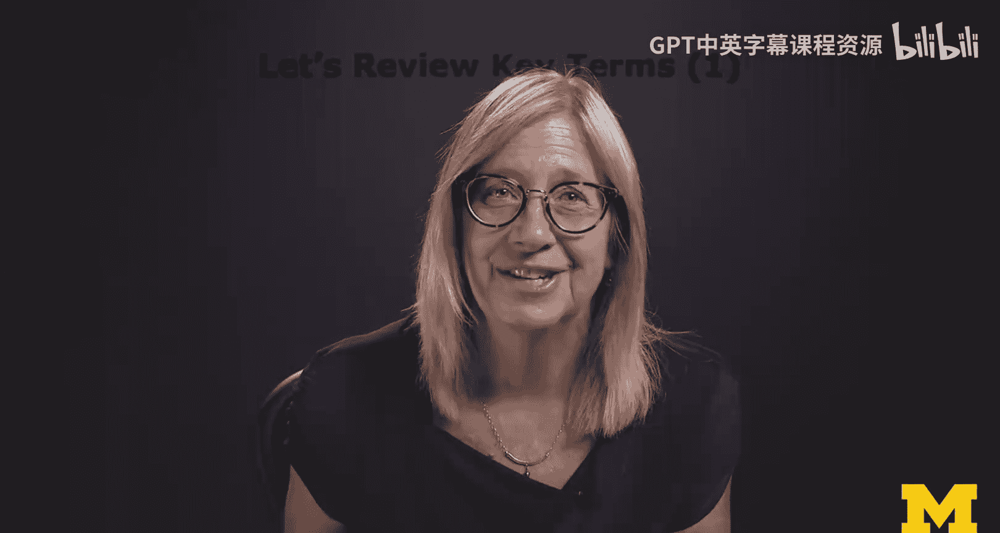

All right， let's review some of our key terms。Research design is the overall planning for evaluating a program or policy intervention。

Internal validity。This is the strength of that research design to measure intervention effects。

 which we are trying to establish a causal relationship。

 so we hope to have a strong research design that doesn't have any threats to internal validity。

And it also to do that needs a good counterfual。External validity is the ability to generalize the findings from a program or policy evaluation beyond the setting of the research and the research design。

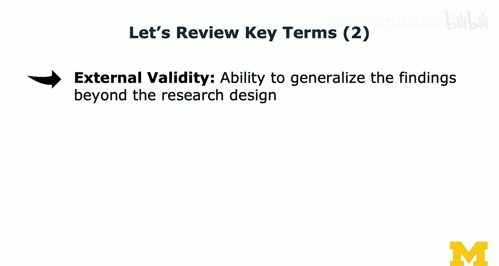

All right， now we have talked about this research design quite a bit so far。

 the one group pre test post test design。This is used in program and policy evaluation a lot for a number of reasons。

 but as we've also talked about， this is not a particularly strong。

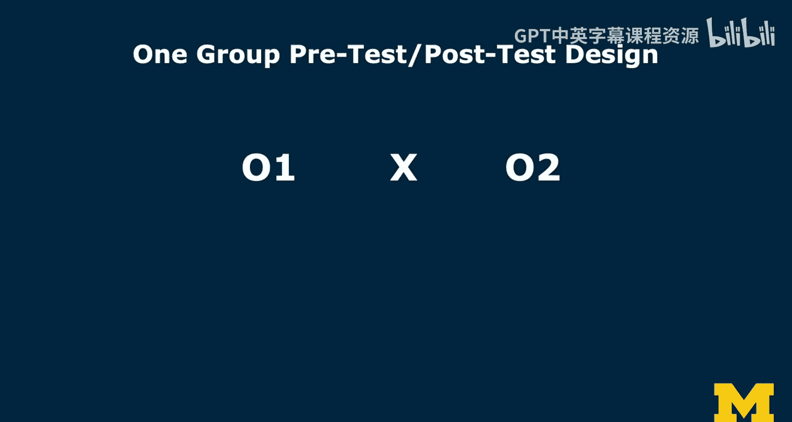

Research design from the point of view of internal validity。Alright。

 let's talk about both the strengths but also the weaknesses of the one group pre and post test design。

 So why is this used a lot？ Well， first of all， it's pretty easy to implement。

 and it often doesn't require a lot of data。2， it can be implemented retrospectively。

 So what happens a lot is that there's a policy change。 And then someone， usually a stakeholder says。

 hey， you know， we made that policy change。 Let's look at some data to， to see if it worked。

 And so then a data analyst is usually asked， oh， can you go back and get data on。

These variables， the year before the policy was implemented。And then we'll look at the year after。

 and we'll just compare pre and post and we'll see if the program worked。

Also， another strength of this design is pretty easy to communicate about the design and the results if you're not trying to communicate about threats to internal validity and all the technical sorts of stuff。

 you know it's easy to create data visualizations that show， hey。

 the world look like this before our policy was intervention and it look like this afterwards。

 What a great success。However， not so fast because there are so many threats to the internal validity of this research design。

 we talked about them。In both technical and non technical ways。

 we have to always be worried about the history， threat， maturation， instrumentation changes。

Testing effects， etc ce。So it's really easy to overestimate the effects of an intervention because a lot of the change from time one to time two could be because of all these other things going on。

And also a weakness of this design is that it's actually oftentimes used intentionally in politically motivated ways I should say it's misused。

 a lot of times people use it to show， hey。Since our administration took over or since we made this policy change。

 things have gotten better。But it might not be because of that at all。

And sometimes people know that they're intentionally overestimating the effects of an intervention。

 but it's good for political purposes， so they do it anyway。

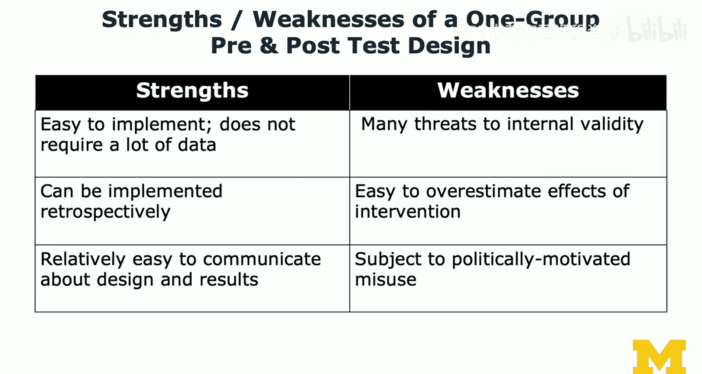

All right， so here's another research design that is used an awful lot in program and policy evaluation in the public sector。

This is called the two group post test design。 So here and I hope you're。

Feeling more comfortable reading the graphic representations of research designs。

Here we have one group， we have no pretest information about them。

 but the group gets exposed to an intervention and then there's an observation afterwards。

 and then we have another group， we have a group that didn't get the intervention。

 it could be a group in a different city or county or state or province or even a different country。

 it all depends on what the intervention is， but we have a group that got the intervention。

 a group that didn't and we're comparing them at the same point in time。

After the one group at the intervention and we don't have any pret。

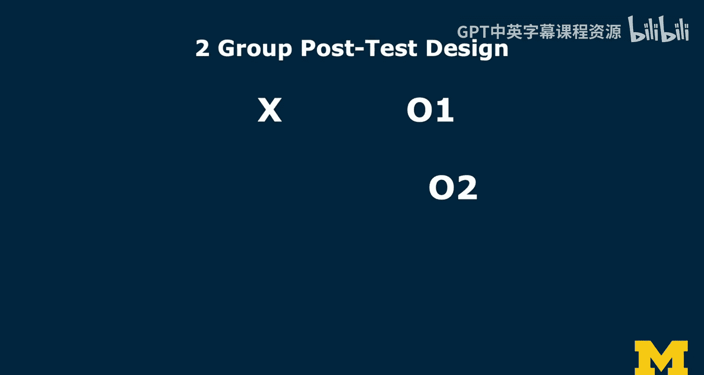

Information about the group。So what do you think might be some of the concerns we have here。

 What's the counterfactual， Well， it's the comparison group。

In their observation point in comparing the two， is this a good counterfactual。

 what are some of the threats to the internal validity of this research design？

Well， first， let's talk about some of the strengths。Again。

 this is a pretty easy design to implement and often doesn't require a lot of data。

 this design is often used when the data are already available for one place that got the intervention and another place that didn't and it' was like hey。

 let's compare this place made a policy change another place didn't let's just compare them and also it can be implemented retrospectively you don't have to be thinking about how to design program or policy。

Alysis from the beginning， you can just kind of， oh， let's go back in time。

 we have the data to do it。And also it's relatively easy to communicate about the design and the results like City X implemented a new policy。

 city Y didn't， here's the differences。But also， I hope you can see pretty clearly that the counterfactual here is extremely problematic。

 there are so many threats to internal validity， but the big one here is selection。Right。

 how do we say that those two groups are alike， except for exposure to the intervention。

 We can't say that at all。 These two groups are probably different in many， many other ways。

 And so this is not a good research design for establishing causal relationships。

 too many threats to internal validity。 This also means that this design is often used and misused to make arguments about programs and policies。

 politically motivated ways， unfortunately。

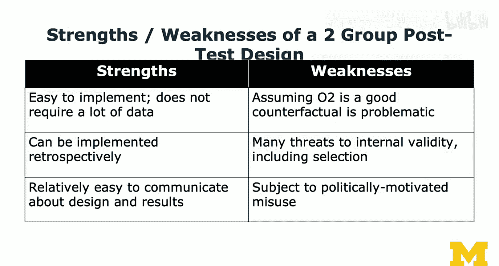

All right， well what about this design， this is called the nonequivalent control group design where we do have pre and post test information about a group that does get exposed to our X。

 our policy change or program， other kind of intervention compared to a group that's looked at at the same points in time preim post。

 but did not have that policy implemented。What do you think about this design is that control group a good counterfactual？

And here there's no random assignment to groups we're really just looking for again another city。

 another community， sometimes it might be schools， a group of schools made a new curriculum change。

 some other schools didn't let's compare the two so there's no random assignment to the groups here so what are some of the threats to internal validity This design is also sometimes called the difference in difference design。

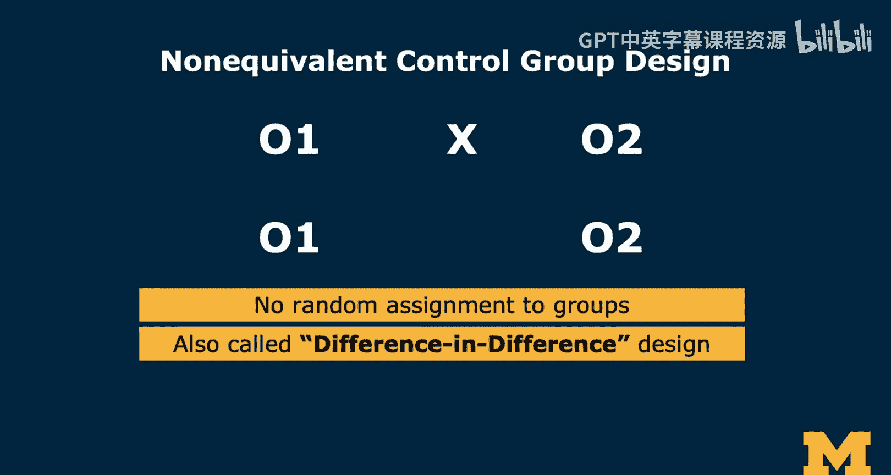

Well， here we do have some strengths。 We have a comparison group that could be serving as a good counterfual。

The idea for this is， again， it's a good counterfactual if we think the comparison group is just like the intervention group except for exposure to the intervention。

So we have to worry about that， but sometimes we can find good comparison groups。

 so that's a stronger counterfactual than the other designs that we've talked about already。Also。

 sometimes this design can be implemented retrospectively if the data for the pre test observations already exist。

Also， we're going to be talking a lot more about randomized control trials because that's the only research design where we really are controlling for all the threats to internal validity。

 but there are some ethical issues associated with randomization。

 especially with interventions in the public sector and so in this case there really aren't ethical issues about randomly determining what group of people might get some more resources or a new policy or a new program versus another group that does not get access to those resources。

 even if we don't know yet if it works or not。So those are some of the strengths。

 but some of the weaknesses， there are still threats to internal validity here and hopefully you already noted to yourself with a big one selection。

 we really can't say that those two groups are exactly the same and have the same maturation processes going on。

 the same exposure to historical events， the same data， instrumentation issues。

 we can't say they're exactly the same except for exposure to the intervention。Also。

 if the data don't already exist， it's really expensive to collect both pre and post test data in two groups of people。

And then here we're getting into a situation where the results are a bit more complicated to communicate to perhaps summit stakeholders。

 but also to the public。

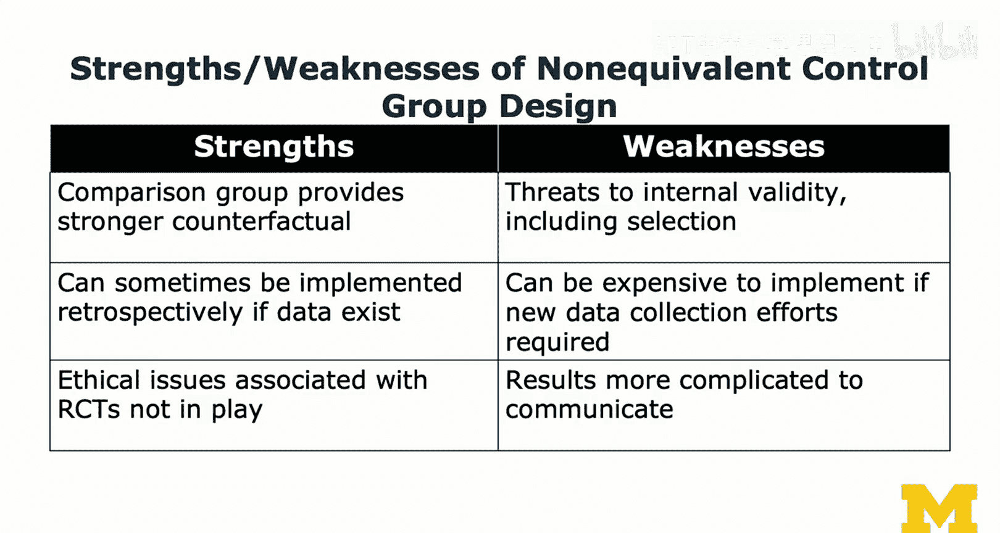

So we can pick on all of these research designs。 They all have threats to internal validity。

 unless we are operating。In a scenario where we're actually doing a true experiment or what's referred to as a randomized control trial or RCT。

In this case， we are randomly exposing。 and that's what the R stands for。 right， So here。

 when you see it an R。

In the graphical display of a research design， it means that these groups were randomly assigned。

To either get the intervention or not。And here then we have pre and post test information on people and we're comparing the pre and the post and the group that got the intervention in the group that did not。

Randomization， theoretically， means that these two groups should be exactly the same。

 except for exposure to that X， to that intervention or policy change。

And here we're not saying that there weren't testing effects or maturation effects， etc。

But here we're assuming that since we're getting rid of the selection issue that the two groups have the same maturation and testing effects going on and that if we do observe differences in the two groups。

 it's because of the intervention， this has such strong internal validity。

 we are really able to say that any changes from time one to time two that are different in the two groups。

Are the results of that intervention？So the randomized control trial theoretically controls for all the threats to internal validity。

 It is the strongest research design that we have at our disposal。

For trying to establish a causal relationship。

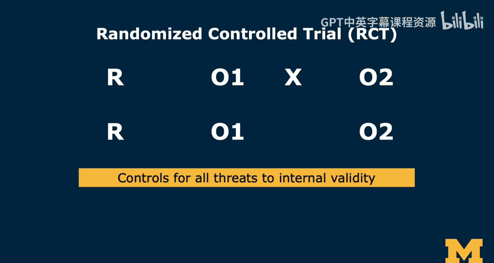

we will talk in much more detail with some examples coming up soon。

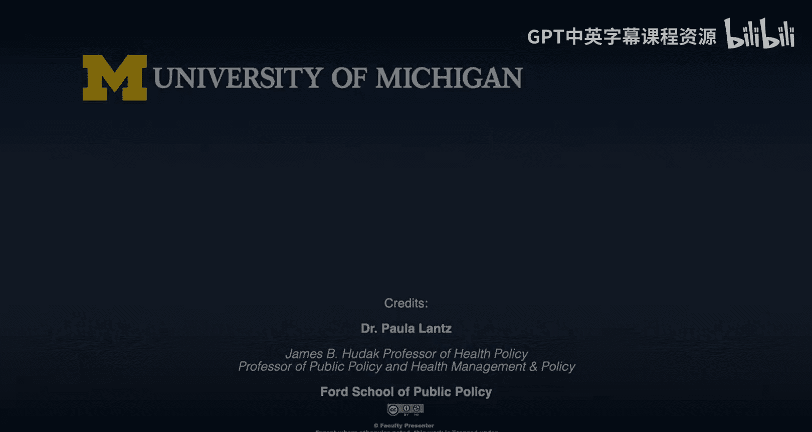