# 密歇根大学《公共部门的R数据分析（基础、数据探索、决策支持、）｜Data Analytics in the Public Sector with R》中英字幕 p111 32_实验设计方法论.zh_en -BV1YZ421J7Fx_p111-

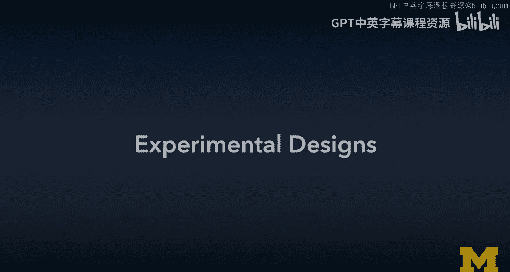

All right， let's talk about experiments。

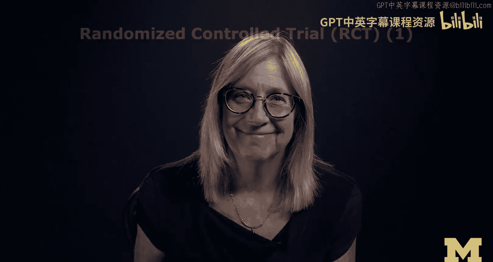

We've been talking about randomized control trials。Now they can look different ways。

 I've presented this graphic to you before。 this is your classic randomized control trial where there's two groups。

They were randomly assigned to get exposed to an intervention or not。

 and comparisons are made at two points in time。Now。

 randomized control trials can have a lot of theme and variation in their designs。

Here's another one for you to look at。And I hope you're getting more comfortable with looking at these graphic depictions of research designs and just intuitively knowing what happens in this case。

 we also have two groups randomly assigned to get an intervention， a new program policy change。

And they are both looked at pre exposures。To the intervention group getting the intervention。

 But then they're also observed。At three points in time after the intervention。

 a lot of times in especially in the public sector。

 we want to know not just what the short termm effects of an intervention might be。

 but how they kind of play out over time and so intervention effects are looked for perhaps immediately after an intervention but then six months later and 12 months later or one and three and five years later。

 so again there's a time dimension to these research designs we need to be very specific about。

 but just generally I want you to be aware that there are research designs where there is more than one observation afterwards and people are followed up over time。

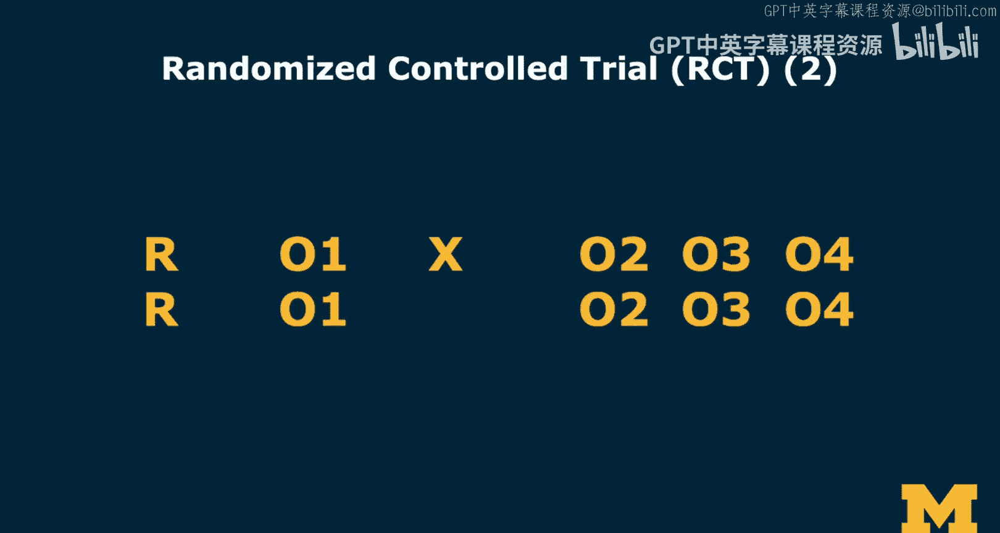

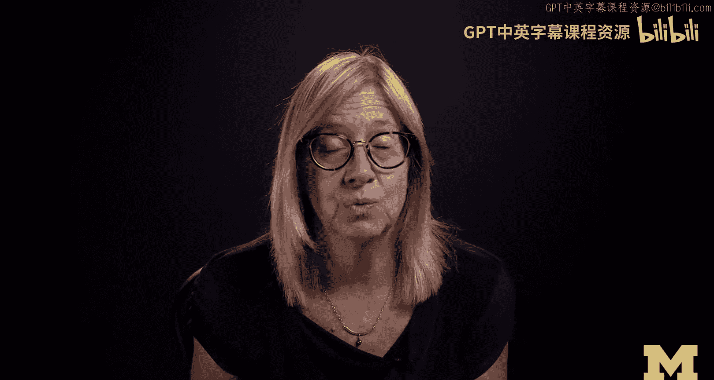

Now it also is the case that randomized control trials are used to test the effects of more than one intervention at the same time。

I hope when you look at this， you easily see that this is a research design where there's three groups。

Randomly assigned to either get intervention number one。Or intervention number two。

Or nothing status quo for that third group。All groups are observed pre。

Intervention exposure for groups1 and 2。 Then there's two different interventions。

 and a lot of times there may be slight differences in intervention that are being compared to each other because we really don't know if these slight variations matter or not。

 and then the groups are followed in this case for two times after intervention exposure。

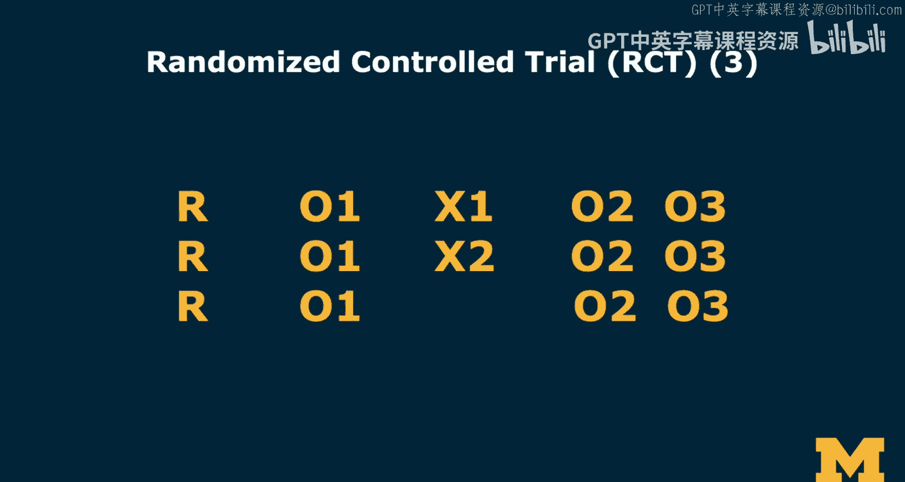

So the key to this， what makes something a randomized control trial is the random assignment of groups to either be in an intervention group or a control group。

And this is the key thing that is controlling the threats to internal validity。

 so in the research design， we're creating a situation through the random assignment where we're on pretty good ground assuming that these groups are the same except for their exposure to an intervention。

 this is our counterfactual。All right， well， what are the strengths and weaknesses of a research design that uses random assignment。

 a randomized controlled trial？The strengths are many。 It is the gold standard of research design。

 and it's what's used in laboratory research。 It's what's used in almost all clinical and medical research。

 It is the gold standard because it does control for the threats to internal validity。

It does that by having this strong counterfactual。 It's a control group that gives us a very good sense of what would have happened without the intervention。

 So in this case， we can be pretty sure about both the direction。

 positive or negative but also the size of an intervention effect and using this design。

 we not only can say， you know， did an intervention work that general question that is just way too vague。

 we can also say it worked。 and actually it worked by increasing something by X percent or decreasing a negative thing by。

X per， or we can be pretty sure this happens a lot。 There's no difference。

 The intervention didn't do anything。Now， what are some of the weaknesses they're very expensive to conduct。

Don't really need to say more about that， but for lots and lots of reasons they're expensive to conduct Also especially with their applications in the public sector。

 there are ethical issues in random assignment people don't like to feel like the government is experimenting on them communities don't like to think that they were being used as a control group that data were being used about people or organizations or institutions in their community for no benefit because they were the control group。

And also， from the point of view of external validity or generalization。

 it's sometimes hard to generalize from randomized control trials。

 everything is so controlled in this environment and oftentimes interventions are implemented with very。

 there's process evaluations that go on， they're implemented with very high quality。

From an implementation point of view， and then if we were going to generalize to the real world outside of the research environment。

 the effects might not be the same， so there are trade offs between internal validity and external validity。

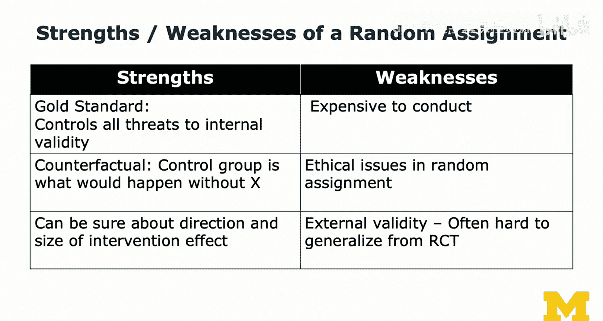

In the case of randomized controlled trials。Now， because of their expense。

 some of the ethical issues， when should governments think about doing randomized control trials？

Well， in cases where you really want to be certain about both the direction and the magnitude of an intervention effect。

Really good to be thinking about using an experimental design， a randomized controlled trial。Also。

 in cases where there's an intervention and there actually are concerns at this intervention。

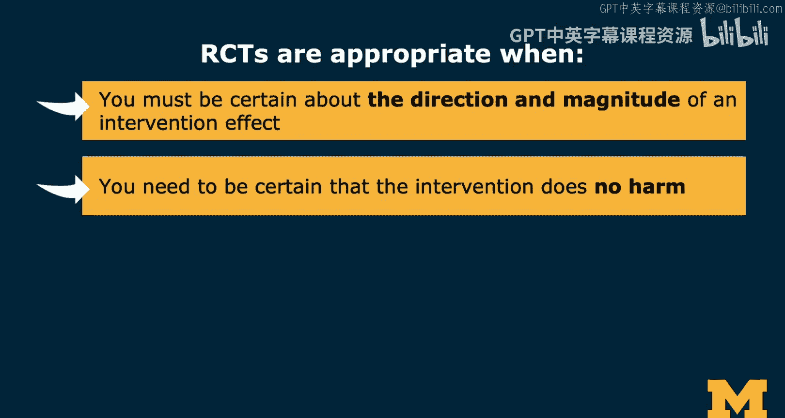

Might harm people。A lot of times interventions are designed to。

Serve purposes to meet aims and they might be meeting those aims。

 but they also might cause harm to people in unintended sorts of ways。

 and so if there's concerns that an intervention might have some downsides and some unintended but you know potential negative side effects。

 then it's really good to do a randomized controlled trial to be very。

 very sure about all the intervention effects， both positive and negative。

Also， a lot of people say， you know， if there's going to be a pilot program or a demonstration project that has resources for an evaluation。

 this is the time to use as strong of a research design as possible。

Because you don't want to have you know a weak research design and a pilot program that doesn't have good internal validity。

 you make erroneous assumptions about the effect of the intervention and then it gets spread and it gets scaled and it's really not working。

 so it's really good to be certain in a pilot situation by using a strong design。

 doesn't happen all the time， but that's a good situation for it。Also， you know。

 for people like me who do a lot of this kind of research and we're really interested in publishing the results in academic journals because we want to share what's learned with you know。

 other jurisdictions。Both the positive and negative effects of evaluation research。

 if you want to publish the results in an academic journal。

 they're going to want it strong research designs and so from a scientific standard。

It's good to think about using as strong of a design as possible and randomized control trials are that gold standard。

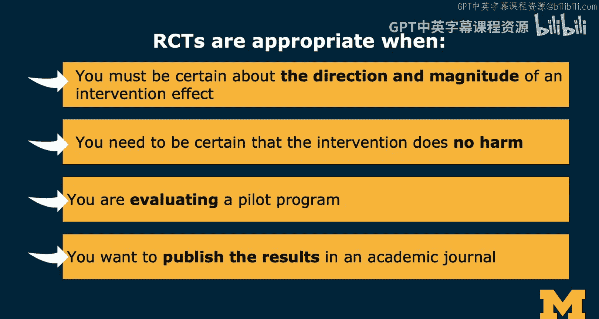

All right， so let's go through a few designs and think about their strengths and weaknesses。 Now。

 again， some theme and variation。 Here's a different design。 What's different about this one。

Give me a second to look。There's no pretest in this one。 So again。

 it's a randomized controlled trial。 We have two groups。 One group gets the intervention。

The other one doesn't。 and then there's observations only later。

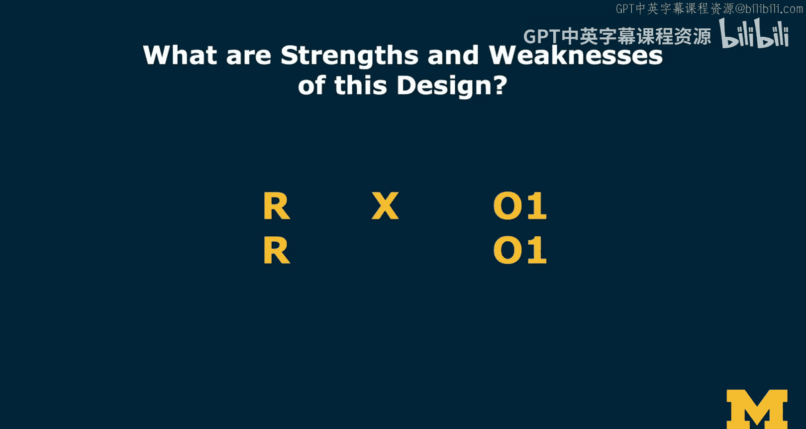

What do we think about this design？It's actually a strong design。But only in certain circumstances。

 so this is a strong design when you're positive， absolutely positive that both of these groups。

 the intervention and the control group， are equivalent regarding the main outcome or dependent variable at the baseline point of observation。

Let's do a couple of examples， so there's an example。

Of intervention done with smokers at public health clinics that used that design。

 and in this case it's a smoking cessation intervention and so what's being observed at  point2 is cessation rates。

The only people who are going to get this intervention are people who are already smoking。

 and so we know at baseline we're dealing with smokers。

 and then they're randomly assigned to get the cessation intervention or not。

 so we don't really need the baseline data because to get into the study they have to be smokers already。

As another example， there are a lot of interventions that have been aimed at teen pregnancy with the goal of helping teens who have babies achieve some of their life goals。

 including completing high school。So in this case， everyone in the research design is pregnant and they are in high school and the goal is to see if the intervention helps people complete high school and so we don't really need the。

Pre observation， the the post observation is completion of high school that's not relevant at the the pre test。

 So again， there are opportunities for having theme and variation on randomized control trials。

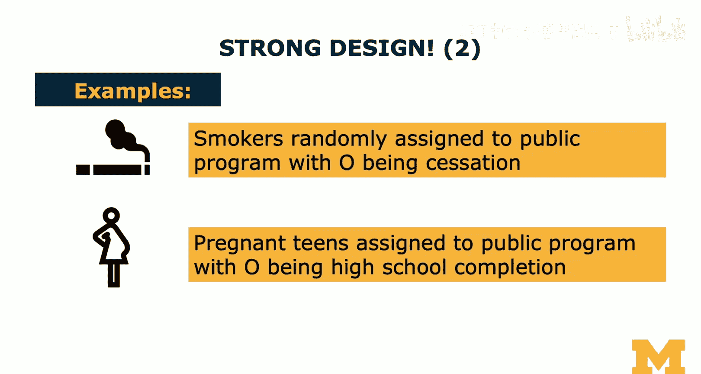

If there's randomization between the exposure to the intervention and the control group。

 we're on pretty strong ground in terms of internal validity。

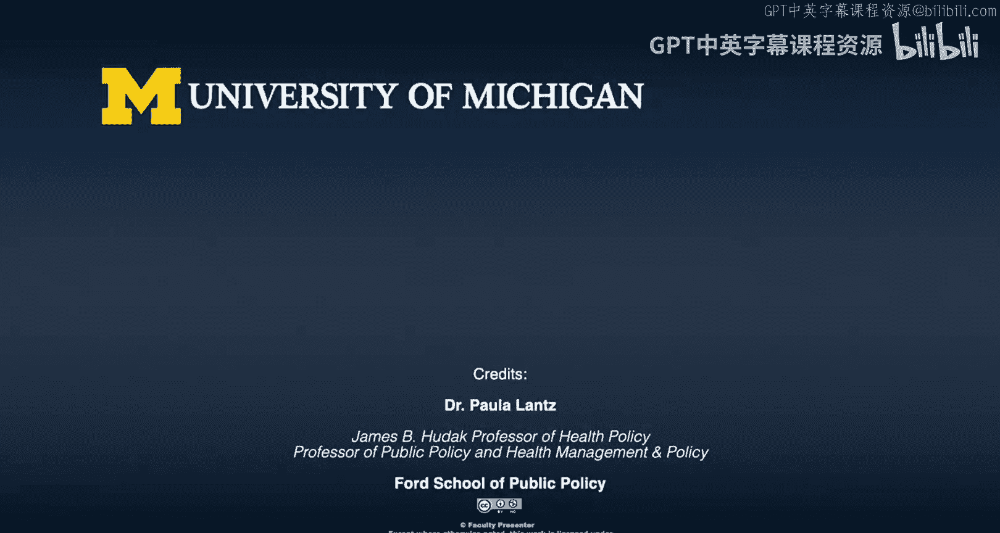