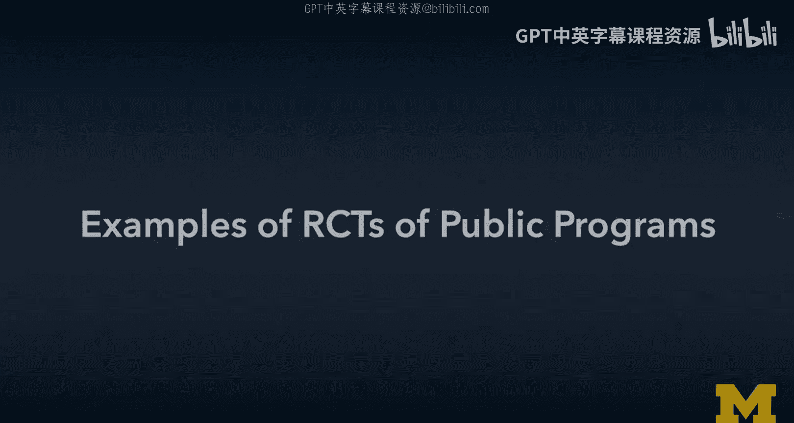
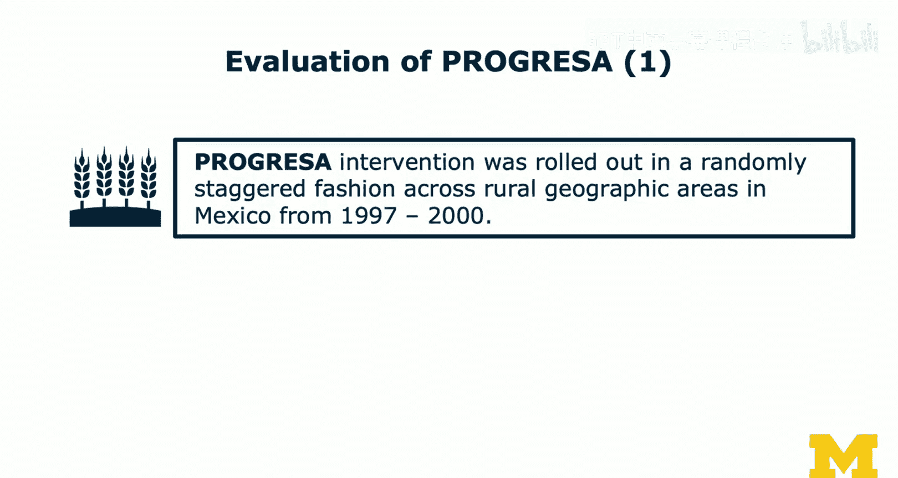
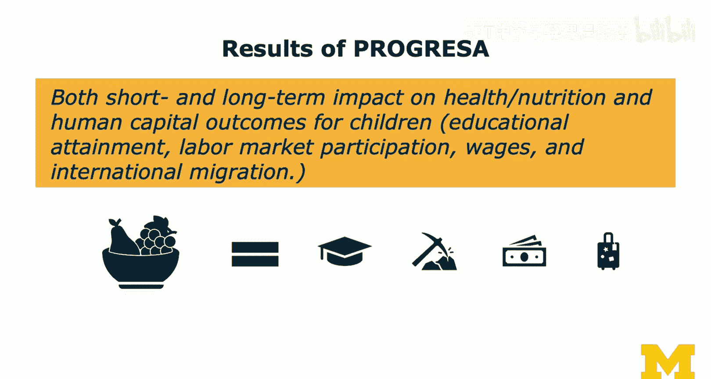
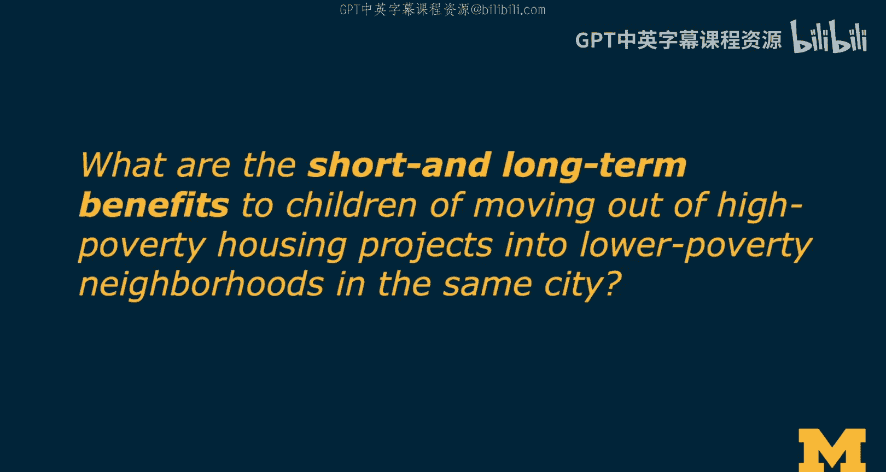
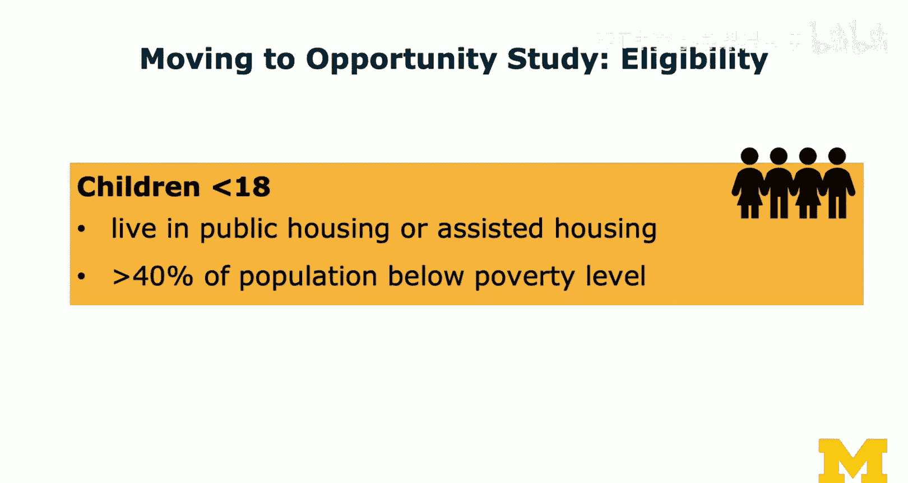
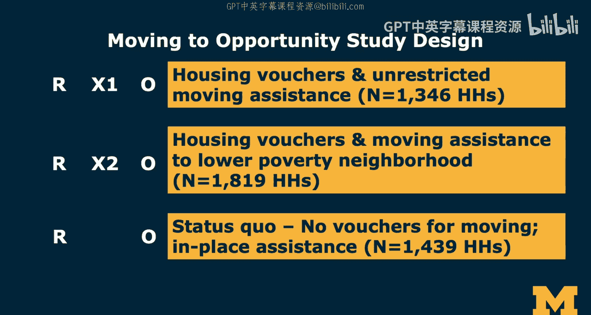
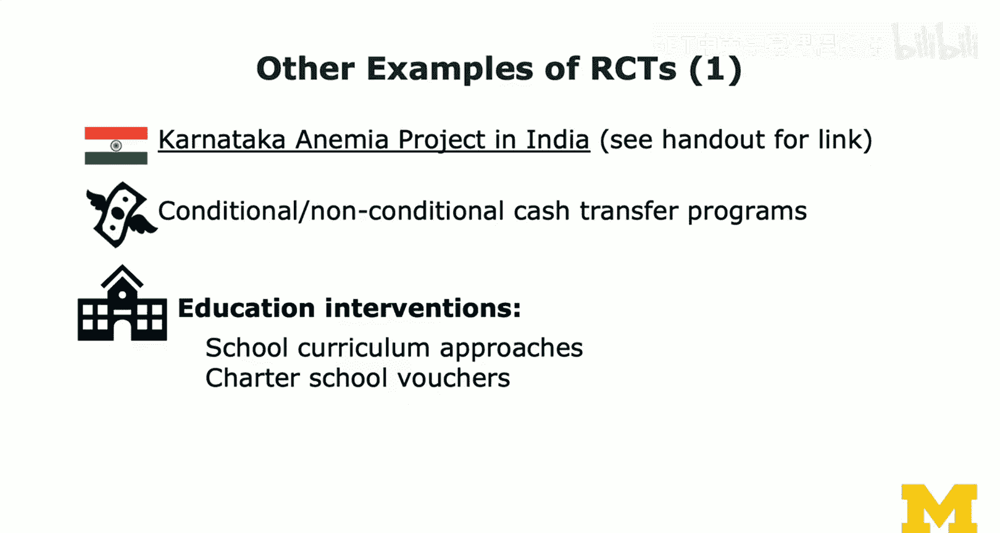
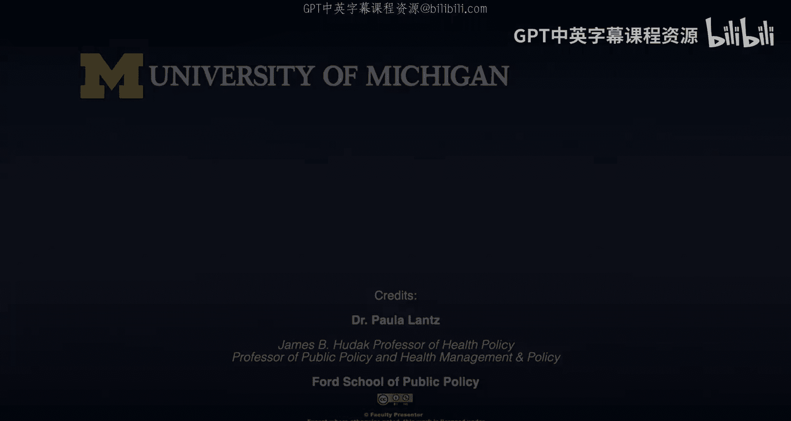

# 密歇根大学《公共部门的R数据分析（基础、数据探索、决策支持、）｜Data Analytics in the Public Sector with R》中英字幕 p112 33_公共项目随机对照试验（RCT）案例.zh_en -BV1YZ421J7Fx_p112-

Welcome back。Now you might be wondering how often are randomized controlled trials actually used by governments in the evaluation of public programs？

Maybe more often than you think。I've actually been involved with several over the course of my career。

But in this session I want to provide to you a couple of examples of RCTs of public programs that are actually pretty well known The first one is the randomized controlled trial evaluation of a large social welfare program in Mexico called Prograa。

And then also the moving to opportunity intervention in the United States。

So Pgraa in Mexico was an intervention that was really focused on improving the health。

Including nutritional status and the poverty status of families， children。

 and their parents in rural parts of Mexico。And the intervention in this case is something that's called conditional cash transfers。

And that is giving cash to families， but not just giving them cash。

 The cash transfer to families is conditional upon。

Certain behaviors that have to be met before you get the cash transfer。In this case。

 the conditional cash transfers were made to the female head of a household and the amount depended upon the conditions we met。

 but it could be up to the equivalent of one third of their monthly income and so this amount of additional cash。

Every month to a family could really make a difference。Now the conditions for Progressa。

 this intervention were， first of all， in the households。

 every family member had to accept the receipt of preventive health care。

 immunizations really important for kids， but also health checkups。

 and including dental checkups at local community health centers was one of the conditions the family members had to be willing to receive preventive health care。

Also， families that had children under five years of age and lactating mothers。

The mothers had to attend nutrition monitoring clinics。

 so there was a nutritional education intervention。Also。

 pregnant women condition was that they would visit these clinics for prenatal care。

 they would get nutritional supplements and additional types of maternal health education。All right。

 so the evaluation of Porea took advantage of the fact that it was going to be rolled out randomly in a staggered fashion across rural geographic areas of Mexico。

 this was back in 1997 to 2000 and so and this happens with government a lot too。

 there's not enough resources especially in a big country to roll out a new program across all geographic areas at the same time and or there might not even be there might not be enough staff to do the implementation well and so when things are rolled out in a staggered fashion。

 researchers can take advantage of that and actually randomly a term， the rollout。

 randomly determine the rollout and that helps with setting up the experiment。

And so that's what happened， this randomly staggered implementation was taken advantage of where the researchers could compare places who got the intervention and then places who didn't get the intervention。

 but were going to in the future。This was a very large study， there were about 90。

000 people from almost 14，500 households in 506 different communities across Mexico。

So what did they find？They found that both short and longterm impacts on the health and nutrition and human capital outcomes for the children occurred in the families with the conditional cash transfers so this included things like the educational attainment of the kids。

 their labor market participation and wages that they earned。

 they followed these families for quite a long time。

 also there were impacts on international migration and increased international migration because think it increased educational attainment and the ability to look for job opportunities outside of Mexico so Progressa is considered to have been an effective social welfare program and the results are pretty convincing based on the fact that it was rolled out as a randomized control trial。

So moving on。To a different issue， still a social welfare issue， but a different issue。

A lot of countries and places are interested in both the short and long-term benefits to children of moving them out of high poverty housing projects into lower poverty neighborhoods in the same city。

 there's a lot of public housing that has high density of families living in poverty living in the same area。

 and so one question is what are the impacts of that on children and what if children are moving out of these high poverty housing projects into different neighborhoods with lower poverty levels but within the same city。

This has been an important question in the context of urban areas in the United States。

 and so a study was designed to really answer this question。

 and this was called theMoving to Opportunity Sty。So again we're going back in history。

 but a lot of people still refer to the results of this study and also this study is held up as one way in which governments do engage in randomized controlled trials。

So the US Department of Housing and Urban Development enrolled families into this experimental study in five cities。

 Baltimore， Boston， Chicago， Los Angeles and New York。

 so five of the largest cities in the United States。Who is eligible？

 So families with children under the age of 18 in those five cities。

Who lived in public housing or publicly subsidized or assisted housing？

And we're living in a neighborhood where over 40% of the population using census data was found to be living below the poverty level。

All right， what was the study design for the moving to opportunity intervention？

Well， here's a case where there were actually two different intervention groups and then one control group。

In the first line you see there's X1， this is an intervention that gave families so the unit here of analysis was families。

 again they all had children， the families were randomly assigned to either get intervention one。

 which is housing vouchers and unrestricted moving access。

 so basically saying to families here we're going to give you vouchers for subsidized housing and you can move wherever you want to in the city。

 we're just going to move you out of this high poverty area and high density low incomecome housing。

The second group had the same， but also they were restricted to moving to a lower poverty neighborhood。

People in group one could move to lower poverty neighborhoods or not。 They weren't restricted。

 but people in the second group were restricted to where they could move。 and then the third group。

Randomly assigned， no vouchers for moving。 This is a control group。 Now。

 they were given some resources， some in place assistance to deal with some of the issues that their family might be facing。

 but they weren't given any assistance for moving。So again。

 we have three groups with two different interventions。

And I'm showing just one observation point afterwards， but in fact。

 these families and kids have been followed for years and years and these kids have been followed well into their future What are some of the major findings there's been a number of research publications from theMoving to opportunity study but some of the highlights are first of all。

That there did not seem to be any significant impact on child academic performance。

Or their involvement with the criminal justice system in either of the intervention groups。

 they did not look different from the control groups。

 So it didn't have the impact on children's academic performance or their involvement with the criminal justice system。

 unfortunately， there were some observed improvements in the mental and physical health outcomes of parents of the families involved。

 however， and those have lasted for a fairly long period of time。

 and also they did find that of the kids who moved at younger ages， the kids who moved before age 13。

While there wasn't an impact on their academic performance， they did see them again， as I said。

 they followed these kids for a long period of time。

 that they did have increased annual earnings when they moved into adulthood。

 but that was just for the kids who were younger at the time they moved。Allright。

 there's lots and lots of other examples of randomized control trials that have been used by governments and I'm not going to go through them。

 but we have links for you if you want to take a look at them。

 a large project in India trying to deal with the important public health problem of anemia。

 there's one that you can look at very nice study design。

 there's been lots and lots of conditional cash transfer intervention programs and also some non-conditional cash transfer programs a really interesting research literature。

 almost all of them use randomized control trials so if that's a kind of intervention you're interested in。

 there's a lot you can look at there and also a lot of education interventions。

 school curriculum approaches and the United States comparing educationalal outcomes for kids who are in public school versus private school versus this thing we have called charter schools。

 lots of those have used randomized control trials。So many。

 many other examples of randomized trials that are used in the public sector。

