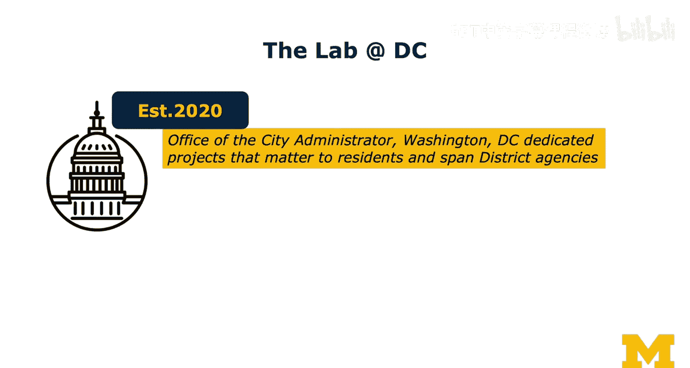
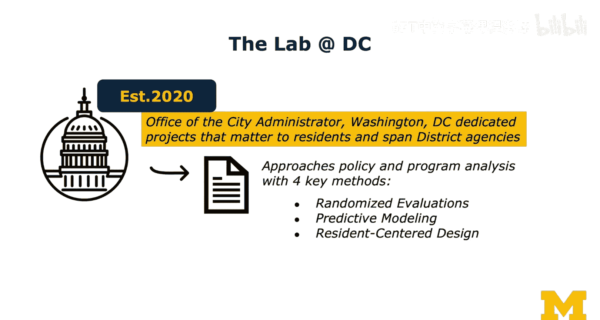
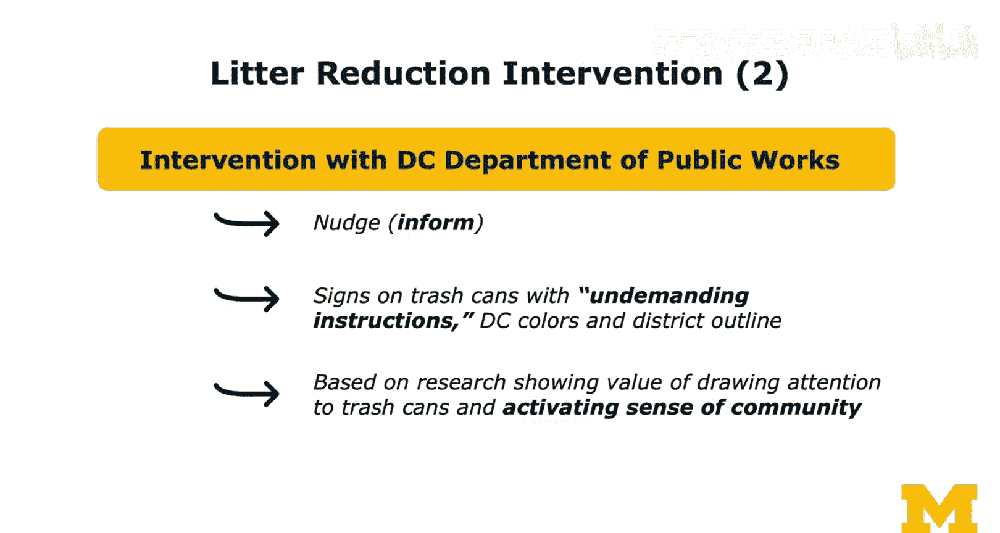
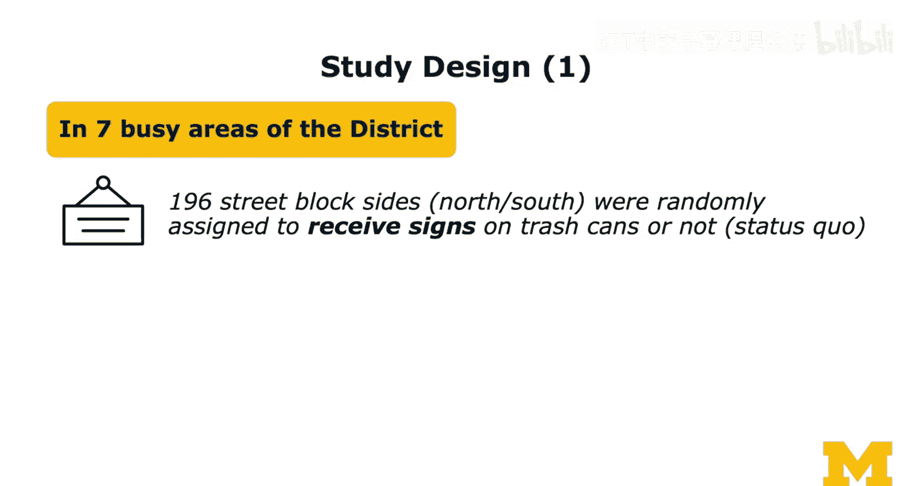
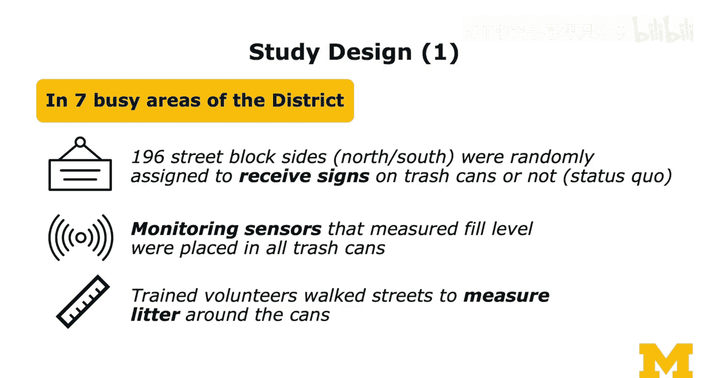
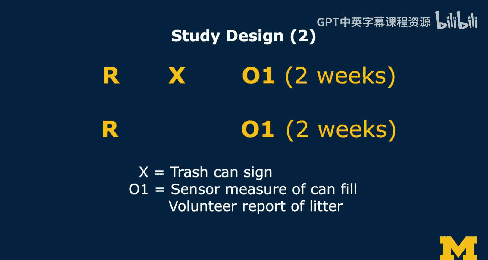

# 密歇根大学《公共部门的R数据分析（基础、数据探索、决策支持、）｜Data Analytics in the Public Sector with R》中英字幕 p113 34_下期预告：华盛顿特区垃圾桶干预案例.zh_en -BV1YZ421J7Fx_p113-

Hi again。

Before you jump into the data and our code for a randomized controlled trial that was conducted by the government of Washington。

 DC， I'm going to describe the background and study design for you。

Using the language of evaluation research design that we just covered together First。

 this is a study that was conducted by the lab at DC This is a really cool initiative in the district of Columbia established in 2020 out of the office of the city administrator the lab is a group of researchers and analysts on the staff in an office that is dedicated to projects that quoteMa to the residents of the district and that cut across government agencies。

 the lab approaches policy and program analysis with four key methods， randomized evaluations。

 predictive modeling。

Residentcented design and administrative data analysis Now the lab has undertaken a number of different program evaluations。

 we're going to talk about just one today and this is an evaluation of an litter reduction intervention so first what is the problem that DCc residents thought needed to be addressed litter or trash on the streets is a pervasive problem in the district of Columbia as well as in many other cities in the world in addition to being onsightly litter costs money to clean up so tax is spent on litter cleanup cannot be spent on other important things litter also can negatively impact property values in an area and finally some litter in Dc finds its way to a major river that cuts through the city and is contributing to water pollution problems so the lab designed an intervention and collaboration with the D Department of public works Now this intervention is。

Really simple it's an intervention using the policy lever of inform we talked about this before or a simple nudge to people through the use of signs on trash cans now these signs had what the lab labeled asundmanding instructions which is informing rather than imploring I hope you recall the difference we talked about that before the signage on the trash cans also used DC colors this intervention design was based on research showing that simple nudges can sometimes change behavior especially when they also draw attention to the solution in this case the trash cans and they also attempt to activate a sense of community which was hopefully achieved through using the colors and the shape of the district in the signage Here's a photo of the sign placed on a trash can Show some love to DC by not littering and placing your trash in the can。

On the ground now the evaluation study design was as follows in seven busy areas of the district 190 street block sides either the north or the south side of the street were randomly assigned to receive signs on their trash cans or not which is status quo so on certain streets。

 one side was randomly assigned to receive the intervention and then other streets in the district served as the counterfactual or status quo monitoring sensors were placed on all trash cans Also volunteers were trained to measure the litter around cans let's look at a graphical representation of the study design there were 196 streets and about half were randomized to get trash can signs on one side of the street and the others were left alone as status quo measurement for all trash cans occurred two weeks later with the sensor measurement of the additional fill in the trash can。

And also， volunteer observations of litter。

