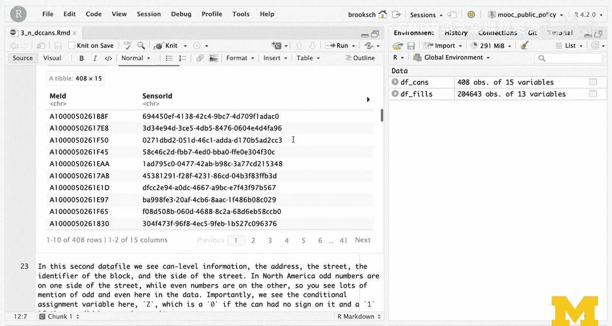
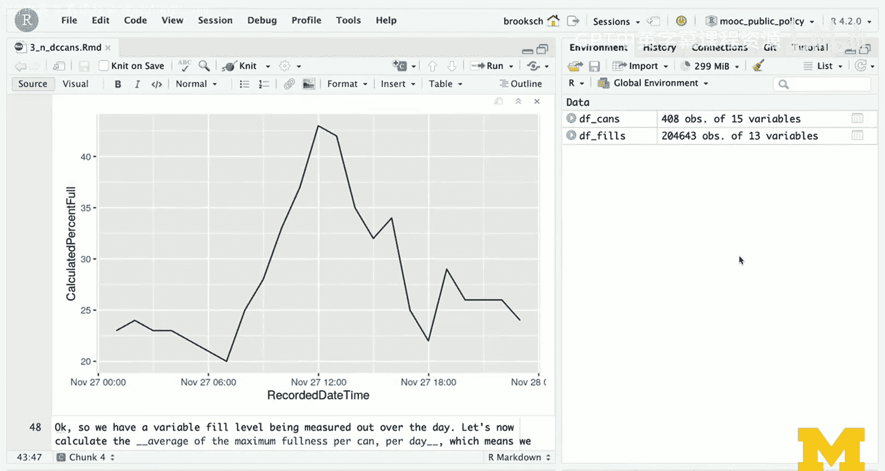
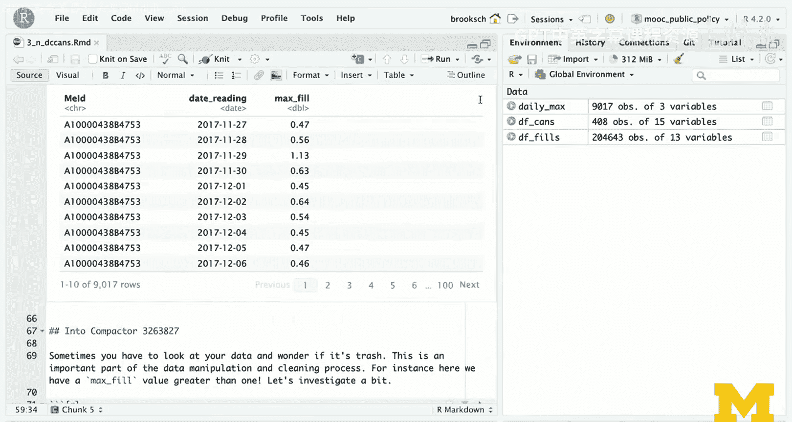
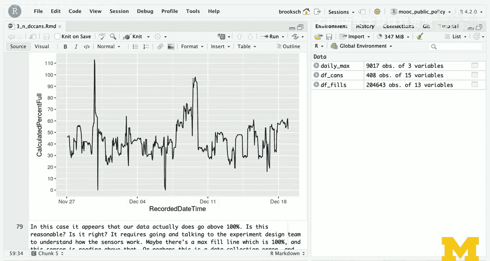
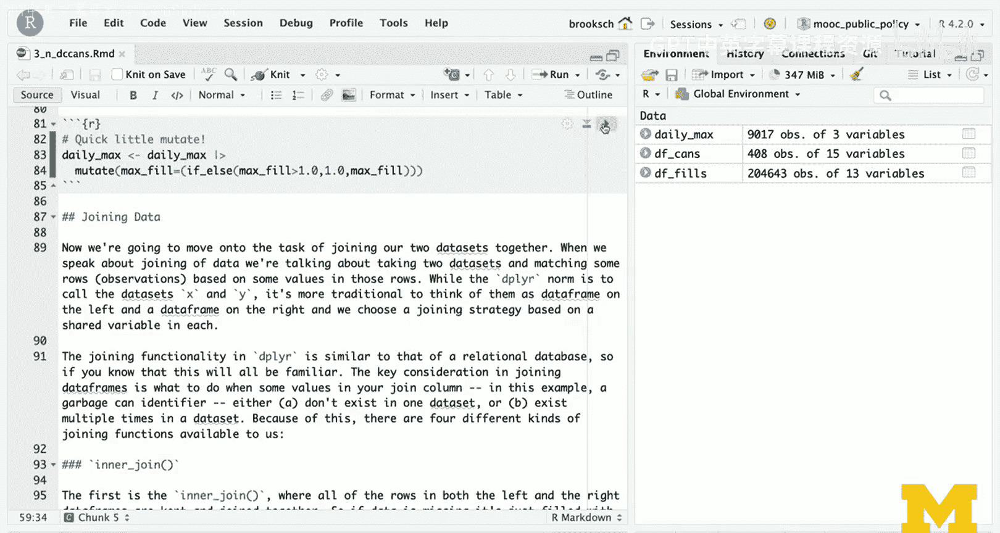

# 密歇根大学《公共部门的R数据分析（基础、数据探索、决策支持、）｜Data Analytics in the Public Sector with R》中英字幕 p114 35_华盛顿特区垃圾桶干预数据分析.zh_en -BV1YZ421J7Fx_p114-

The lab at D。 C is a remarkable initiative by the Office of the City administratorr of Washington。 D。

 C。 Now， Doctor Lance already introduced you to the work of the lab in the specific case it we'll be covering today。

 But I just wanted to touch on what I find remarkable about this group。

 where we are seeing more and more governments of all sizes open up their data。

 often required to by legislation。 The lab has gone much further and open up the whole scientific process they use。

 This is next level accountability and transparency。 And frankly， I hope this catches on。

 It gives everyone an opportunity to learn what works and what doesn't and importantly。

 it allows anyone to improve their skills， question assumptions and contribute with very low friction。

😊，That I could take the work that they've done and do a partial replication analysis for this lecture and not have to actually talk to anyone at the lab is incredible and rare。

Okay， enough of me heaping praise， let's consider the case that they were interested in。

Trash stinks and municipalities have different strategies that they can try and employ to reduce litter in high density areas like city centers。

Public garbage cans are common and the question asked in this work is。

 can a behavioral nudge in the form of a positive message on the garbage can itself reduce the amount of litter on the streets？

If so， this would be an extremely inexpensive intervention。

 which could be rolled out to all public garbage cans with minimal cost。 So to test this in 2017。

 the city chose a number of streets in busy areas and randomly assigned some garbage cans to have signs and some not to。

 The randomization methods， which Doctor Lance covered。

 are really important because we would expect that some cans might have a change in garbage。

 just based on traffic patterns in the city。Now， I'm going to focus on the analysis of the data which was collected。

 The outcome variable we are interested in is the average of the maximum fullness per can per day。

 and the sensors were installed on the garbage cans to measure this fullness by volume。

 Let's take a look at the data。 I'm going bring in the tidy verse。

 I'm going to load the data file called Li can fills do CSv。 and we'll take a look at it。 Okay。

 so we see here a bunch of data about garbage cans， sensors， the fill level， locations and dates。

 there's no information， though， on the condition with or without a nudging sign that a garbage cans been assigned to。

 So we're going to have to look in another data file for that。😊。

So I'm gonna to load in litter cas randomized CV into Df cans。

 We'll take a look at that in the second data file， we can see can level information。 the address。

 the street， the identifier of the block and the side of the street。 Now， in North America。

 odd numbers are on one side of the street while even numbers are on the other。

 So you can see lots of mention of odd and even numbers here in the data。 Importantly。

 we see that the conditional assignment variable here， Z， which is a0。

 if the can had no sign on it and a one， if the can did have a sign on it。 Now。

 this arrangement of data is pretty common。 We have one file which has all of the experimental observations that were taken。

 that's our Df fills。 we have another which has details about the assignment condition and information about the population of samples In this case。

 garbage cans in our experiment。 and that's our Df cans。

 We're going to have to join these two data frames together。

 and that means we get to learn a little bit more about R。

 We have a unique garbage can identifier in the data sets， me I D。

 and this is going to be key for our success。

But before we do that， it's important to note that this base data we have been provided with doesn't actually have that outcome measure that the team was interested in。

 remember this was the average of the maximum fullness per can per day so let's go back to DFs and take a look so let's look at a couple of the variables that we have here。

 the recorded datetime me IDD and the calculated percent full。

It looks like we have a can identifier a timestamp of when values were measured and a percentage of fullness。

 but if you look closely， you'll see that fullness is measured more than once a day。

So let's do a little exploratory data analysis on a single garbage cam。

 I'm just going to take this first one， I just looked at the table。

 grabbed one randomly and we're going to filter on the date of the November 27th and we'll just toss that into a GG plot。

Okay so here's our plot of the calculated percent full over time for that can for a day。

 So we have a variable fill level being measured out over the day。

 Now we want to calculate the average of the maximum fullness per can per day。

 which means we want to find the maximum fullness of a can on a given date and then calculate the average of that across all of the days for each can。

 you really already have these D per skills to pull this off。

 So now would be a great time for you to pause this video and try it yourself。 for my solution。

 I'm going to load in luber date here。 I'm going to convert this to an actual date object using luber date。

 this is going to get rid of the time component automatically。

 there's other ways that you can do this。 So of course， and you've already seen some of those。

 you can treat this as a string instead and just pull out the things that you're interested in。

 But here I'm just going to create a new variable date reading and turn this recorded date time into a recorded date。

😊。

Then I'm going to group the cans by IDs and dates and then I'm going to create a new variable which is just the maximum of the calculated percent full I'm going to actually divide this by 100 so that I can get a number between0 and1 and of course we create that with summarize and let's take a look at this。

Sometimes you have to look at your data and just wonder if it's trash。

 and this is an important part of the data manipulation and cleaning process。

For instance， here， we've got a single max fill value that's greater than one。

 What's this actually mean， Let's dig in and investigate this a bit。

 So I'm going update the line plot that we did with this new can and toss in some brakes so we can take a look at this data。

 Okay， so that's the can over a lot of time the whole period。 and we've got a number of breaks here。

 and you can see that it does indeed go above 100% goes close to 100 at one time。

 and it goes down to zero a couple of times。 In this case。

 it appears that our data actually does go above 100%。 So is this reasonable。 Is it right。

 It requires going and talking to the experiment design team to understand how the sensors work。

 Maybe there's a max fill line， which is 100%。 And the sensor is actually reading data that's been piled above that。

Or perhaps it's a data collection error， and the data needs to be further cleaned。Regardless。

 it's important for you， as an analyst to work with a larger team and explore the data to understand it。

In this specific case， the team in the DC lab chose to cap the values at 100%。

 so we're going to do that too。 All right， just a quick little mutate here。

 This is all old habits for you now。

