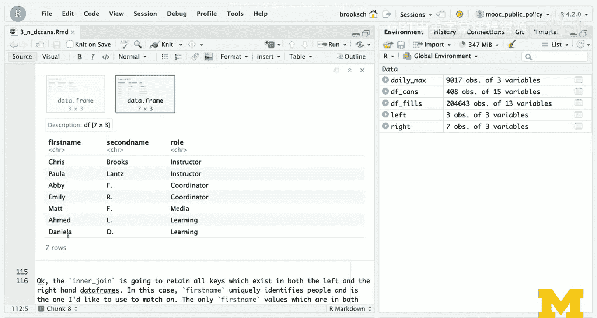
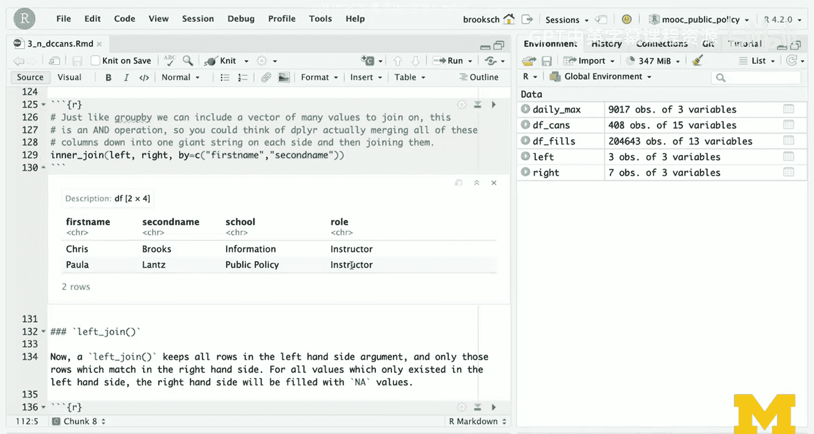
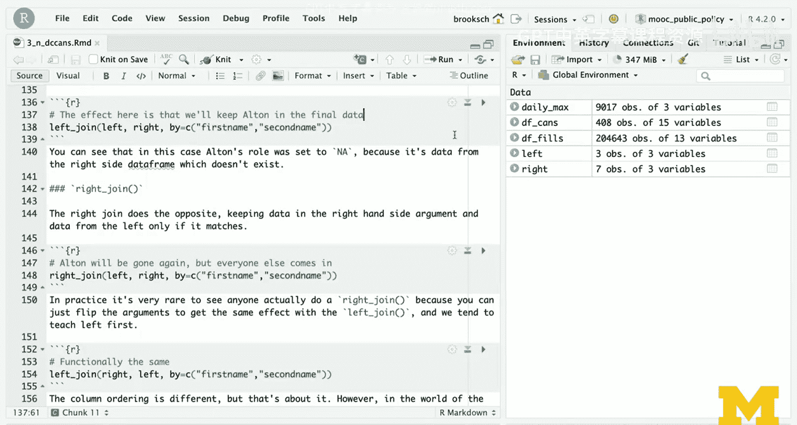
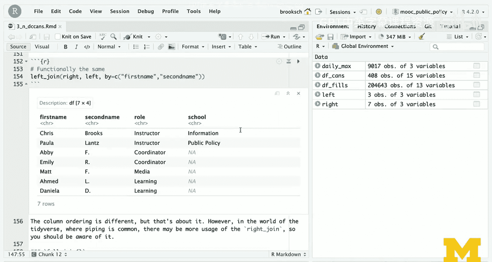
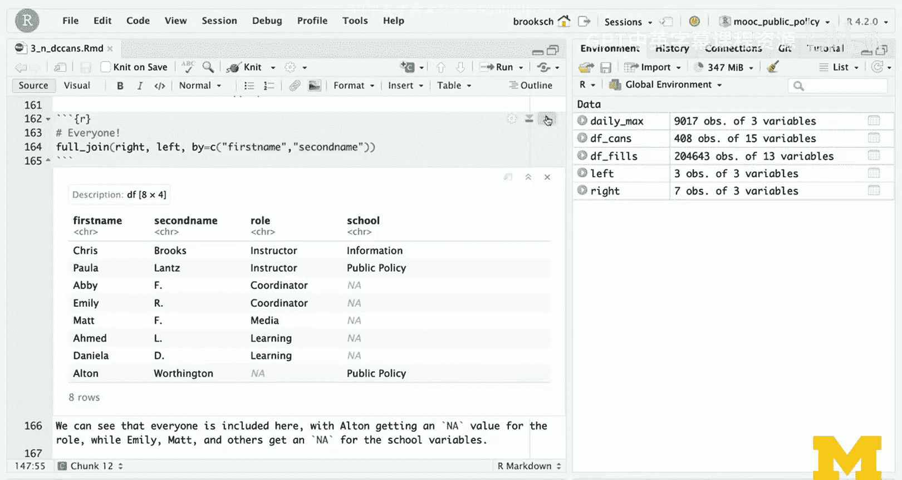

# 密歇根大学《公共部门的R数据分析（基础、数据探索、决策支持、）｜Data Analytics in the Public Sector with R》中英字幕 p115 36_华盛顿特区垃圾桶干预：数据整合.zh_en -BV1YZ421J7Fx_p115-

Now we're going to move on to the task of joining our two data sets together。

When we speak about joining of data， we're talking about taking two data sets and matching some rows observations based on some values in those rows。

 while the D playerer norm is to call the data sets X and Y。

 it's actually more traditional to think of them as a data frame on the left and a data frame on the right。

 and then we choose a joining strategy based on a shared variable in each。

The joining functionality and D are similar to that of a relational database。

 so if you know that this is all going to be familiar。

 the key consideration in joining data frames is what to do when some values in your join column In this example。

 a garbage can identifier either don't exist in one dataset or exist multiple times at a dataset。

 because of this， there are actually four different kinds of joining functions available to us。

The first is the inner join， where all of the rows in both the left and the right data frames are kept and joined together。

 So if data is missing， it's just filled with N A values for one side。

 If a key exists two or more times on one side， then its's joined two or more times。

 Let's take a look at how how this would work。

Okay， let's imagine that we have a little data frame about the people teaching this course in the specialization。

 I'm going to call this left。 We've got Chris Brooks， Paula Lance， Alton Worthington。

 and we've got the schools that are associated with information， public policy and public policy。

 Now， let's imagine that we have another data frame， which are the core development team。

 which helped put this course together。 These people are amazing contributors to this and other courses in the specialization。

 So I'm happy to recognize their efforts with this little example。

 So we've got a numerous people involved， of course， the instructors。 but we also have Abby， Emily。

 Matt， Ahmed and Daniela， some of whom you've gotten a chance to meet。😊。

And then I've put the roles here and I've just put some last initials。

 but I' put some roles here as well for media learning and coordination。

 and let's take a look at those two data frames。So this is the left data frame。

 you can see that it's got Chris Paula， Alton， and it's got our schools。

 and then this is the data frame on the right and it has Chris and Paula still in it。

 but then we've got Abby， Emily， Matt， Ahmed and Daniela。

Okay， the inner join is going to retain all keys which exist in both the left and the right hand data frames。

 In this case， first name uniquely identifies people and is the one that I'd like to use to match on the only first name values which are in both data frames are Chris and Paula。

 So when we match on this， we're going to get a single join data frame with two rows。

We see a couple of things here first， the second name variable is repeated because it actually exists with the same name in both data frames。

 the left and the right。Artists' want to throw away data。

 so it's going to add a suffix to each column to indicate where it came from if disambiguation is needed。

 One way we could suppress this is actually to join on the combination of names。

 since this is natural with a first and last name。So just like group by。

 we include a vector of the values that we want to join in now this is an and operation so you could think of D per actually merging all of these columns down into one giant string on either side and then joining them。

Now， a left joint keeps all rows in the left hand side argument and only those rows that match in the right hand side for all values which only existed in the left hand side。

 the right hand side will be filled with N values。

So for instance， if we do a left join and we pass in the left and the right data frames and we're going to look at first name and second name。

So for instance， if we do a left join and we pass in the left in the right data frames。

 and we want to look at joining on the first name and the second name。

 we're only actually going to end up keeping Alton in the final data along with Chris and Paula。

Now you can see in this case that Altton's rule was set to NA because it's data from the right hand side data frame that doesn't exist。

The right join just does the opposite， keeping data in the right hand side argument and data from the left hand only if it matches。

So in this case， Alton is going to be gone， but everybody else is going to come in and Chris and Paula will continue to be there。

In practice， it's very rare to see anybody actually do a right join because you just flip the arguments and get the same effect with the left join and we tend to teach left first。

So functionally， this is actually the same to the previous。

 you see here the column ordering is different， but that's about it。

 But in in the world of the tidy verse， where piping is column。

 there's actually a little bit more usage of right joints。 So I thought you should be aware of it。

Now the full join keeps all of the columns from the left and the right and fills in N values on both sides as appropriate。

So this will get us a list of absolutely everybody involved。

 and we can see everybody is included here with Alton getting an NA value for the role。

 while Emily Matt and others get an NA for the school variables。

