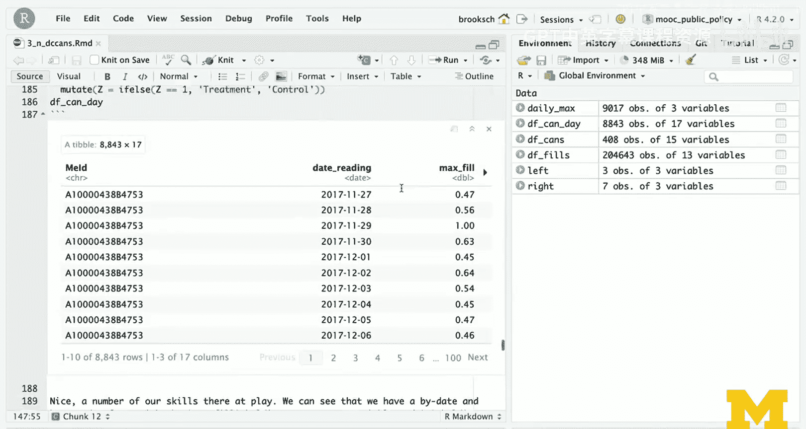
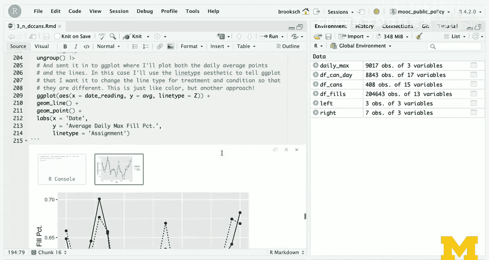
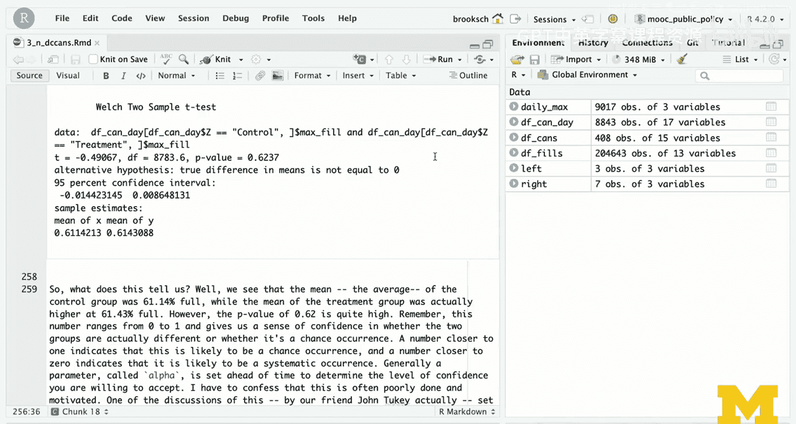

# 密歇根大学《公共部门的R数据分析（基础、数据探索、决策支持、）｜Data Analytics in the Public Sector with R》中英字幕 p116 37_华盛顿特区垃圾桶干预总结.zh_en -BV1YZ421J7Fx_p116-

Alright， now that we have a new tool in our toolbox， let's join some data sets。

 We have DF fills and DF Maxs already， but we want to bring in the condition argument。

 which is whether the garbage can has a sign on it or not。

 So let's create a new data frame based on the daily Mac， which has this information。

So I'm going to merge the daily Mac with the canN info。

 I'll just pipe the daily Mac data frame in as a left join with DF canNs。

 which is going to exclude CANs which don't have an average daily max value。

 I also want to get rid of CAs that don't have a treatment assignment These are in our data set。

 but they weren't chosen as part of this experiment。Now， remember that when you do a groupI。

 it actually changes the data frame by indicating what the grouping should be。

 but we don't want this after that operation， so we have to call ungroup to get rid of that grouping。

 and then to create a little bit more clear of an indication that something was in the treatment or to the control group。

 I'm going to change those zeros and ones to treatment and control。

Nice， a number of our skills here at play。 We'd see that we've got by date and by can data frame with this new max fill holding our outcome variable and Z holding our conditional assignment。

By the way， in addition to teaching me at Michigan that they call the color yellow maize。

 it also seems that they pronounce the letter Z as Z。 So my apologies， if I'm not so clear here。

 you'll also notice， actually in Giji plot that you can use two different spellings for many of the arguments。

 such as the correct spelling of color， which has a you in it and the American spelling of color。

 which doesn't。 It's an interesting design decision that I haven't actually seen in many other libraries and Hadley Wickham's  Kiwi。

 New Zealander roots are showing nicely here。Regardless of pronunciation， though。

 we should try and visualize this data before we do an inferential test of it。

My interest here is really to do a sanity check and get an intuition for the data along our hypothesis question are the two groups actually different。

 well if I plot the average of the max fill for the twoZ conditions。

 I should get nice curves which I can visually compare。So since this is date data by condition。

 I'll group based on values， so I'm going to group based on Z in our date reading and then I'm going to calculate the average for the two groups then of course we've got to ungroup that data too and then I'm going to send it to GG plot where I'll plot both the daily average points and the lines In this case。

 I'm going to use the line type aesthetic to tell GG plot that I wanted to change the line type for treatment and condition so that they're different。

This is just like color， but it's a different approach。

So what do you think are these the same， Are they different。

 Take a moment to go back to the data table above， how else might we visualize this data to get some insight into what it actually means。

As a second example， I thought it would be interesting to take a look at the data by the area of the city。

 since we only have seven areas， this is a pretty reasonable thing to put into one image。

 so my question to you is should we use a cow plot or facets for this task？

Since we're looking to have all of the same kind of plots line in points and we have a variable which indicates our different groups of interest。

 the area a facet approach is what we actually want so I'm going to group here now by area Z and date reading the rest is the D per work is the same and then the only thing that I'm really changing with the GG plot is I'm adding in a facet wrap and I'm down here saying facets equals remember we' got to wrap this vrs area so we don't just say facet equals area or tossing area here we actually have to wrap it in the vs and then you can set the number of columns and so forth。

Okay， these all look pretty similar to me by eye， so I think now we should do the T test based on the daily max fill across all of the cans。

A T test in R is pretty straightforward， you call T dot test and you pass in your two samples。

 in this case the control and the treatment garbage can max fill values。

So should it be a paired T test or an unpaired T test Well you only do a paired T test if your sample subjects。

 in this case， individual garbage cans are the same in the two conditions。 Now that's not true here。

 so we're going to do an unpaired T test， which is the default。

Now keep in mind we're not in the tidy verse anymore。

 This is straight base R for the first week of the specialization so be ready for that different syntax and go back there。

 so I'll just walk through this。 I want to take Dfcan and I want to pull some data out of Df can and I only want it where this Boolean mask Dfcan Do signs Z is equal to control so this comparison is going to broadcast all the way through and return a set of trues and falses whether it's actually equal to control or not and that's going to mask the can data and thus reduce it and then I'm just just want to pull out the variable from that of max fill I'm going to pass the second parameter into T test exactly the same except I'm looking for the treatment condition。

If this looks a little unfamiliar to you， just walk through it。 I'm pretty sure it'll come to you。

So what does this tell us？Well， we could see that the mean， the average of the control group was 61。

14%。 While the mean of the treatment group was actually hired 61。43% full。 However， the P value of 0。

62 is quite high。 Remember， the P value ranges from 0 to 1。

 and it gives us a sense of confidence as to whether the two groups are actually different from one another or whether it's just a chance occurrence。

 A number closer to1 indicates this is likely to be a chance occurrence and a number closer to 0 indicates it's likely to be a systematic occurrence。

Generally， a parameter called alpha is set ahead of time to determine the level of confidence you're willing to accept。

Now， I have to confess， this is often poorly done and poorly motivated。

 One of the discussions of this by actually our French John Tuki set an example threshold for alpha of 0。

05， which means accepting a result， which only has a 5% chance of being a random agreement。However。

 this is kind of stuck as a sort of hard and fast rule in the social sciences in particular。

 and it can mean that some promising findings are actually rejected outright instead of being discussed and followed up on。

As your observations grow in number， your P value will shrink。

 so an experiment that has a dozen garbage cans and a P value of 005 actually has a much higher signal than an experiment which has  a00 garbage cans and a P value of 0。

005。The meaning of the P value hasn't changed， but how we interpret it and what we do with it M。

 You also have to think about effect size。 How big a difference actually was if it was observed。

 And you must think about the cost of a given intervention when you're a decision maker。

 This intervention is cheap and could easily be rolled out all the garbage cans in D。 C。

 But our effect is actually in the wrong direction。

 So even if we were confident there was a difference， we wouldn't want to put these signs up。

In much of my work， I consider a range of P values and use them to inform my next action。

 For instance， if I have a relatively small study and I get a P value of 0。15。

 I'll usually think about what noise might be in the study。

 the different factors that impact the outcome and then plan a larger replication study。

 This is a critical part of my scientific inquiry。 And I think things are slowly changing away from the strict alpha values with the introduction of more modern methods。

One that's rapidly being adopted in medicine and health in particular is the use of confidence intervals。

 which are actually reports here if you go back。Another。

 which is being used more heavily in computational social sciences are Bayesian inferential methods。

 and speaking of Bayesian methods， the lab at DC didn't actually do a T test like we did。

 although they came up with a similar conclusion that there's likely no big difference between these groups。

They used a Bayesian predictive model to compare the two groups。

 and it's a bit out of scope for this class， although a reasonable approach for them to be using their code and data is all freely available on Gitthub。

 a centralized place that many people use to share data。 And since it's all written in R。

 you can dig in and see what they've done if you want to。

