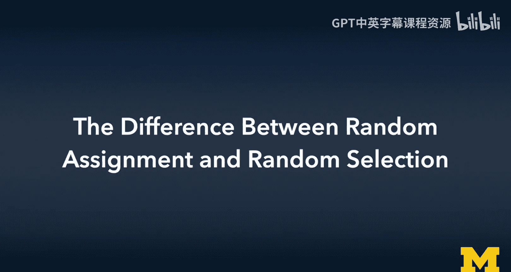
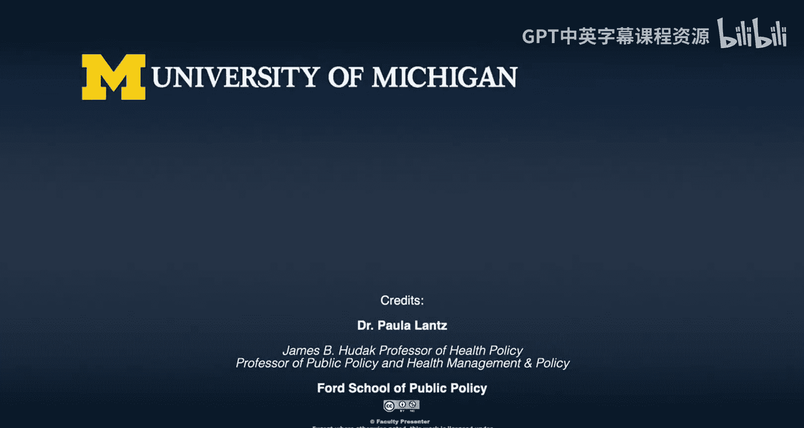

# 密歇根大学《公共部门的R数据分析（基础、数据探索、决策支持、）｜Data Analytics in the Public Sector with R》中英字幕 p117 38_本周补充：随机分配与随机抽样的区别.zh_en -BV1YZ421J7Fx_p117-

I have one more quick thing to mention to you this week。

I want to talk about the difference between random assignment。And random selection。

 both have the word random in them， and both are important concepts for research。

 but it's really important to understand the difference between the two。So random sampling。

 it's also called probability sampling or random selection。

Is a way of selecting members of a population to be included in a study。

Like for a survey or a focus group or user experience feedback。In contrast。

 random assignment is a way of sorting sample participants into control and experimental groups。

That is participants， and it's usually people， but it could be some other unit of study like a school or a neighborhood or a community health center。

Participants are assigned in a random way to be exposed to an intervention or not in a research design。

 we've been talking about that as we've talked about randomized control trials。

So while random sampling is used in many types of studies， including population based surveys。

 random assignment is only used in studies that are evaluating the effects of some sort of intervention or treatment。

So how is random assignment done Well there are lots of ways in which researchers randomly determine if a participant or a unit will be in the treatment or control group。

 this can include really simple methods like throwing a dice or flipping a coin。

 but most often it involves using random number generators。There are lots of different methods。

 but true random assignment only works if it's the case that each person or unit has the exact same chance of being in the intervention or control group。

There cannot be any bias or flaws in the method for randomly determining the group study group assignment。

And that's why randomized controlled trials work。 Again。

 we can get to that counterfactual that the control group is exactly like the treatment group because they're exactly the same。

 except for that exposure to the intervention。

