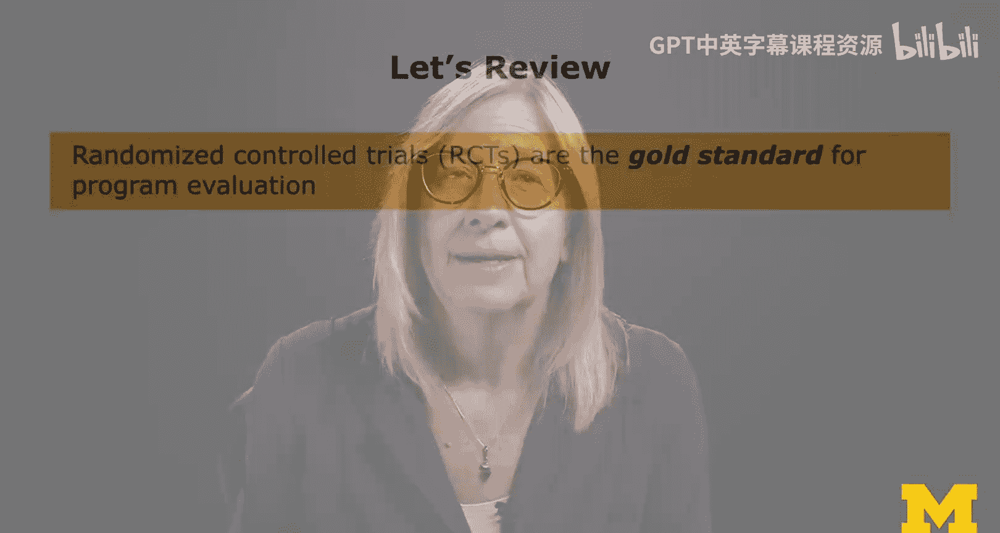
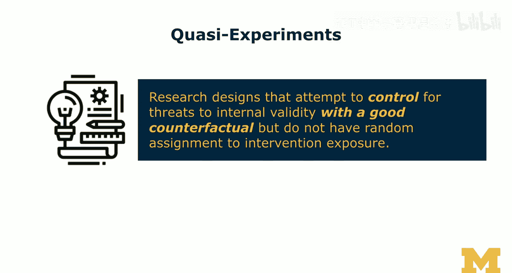
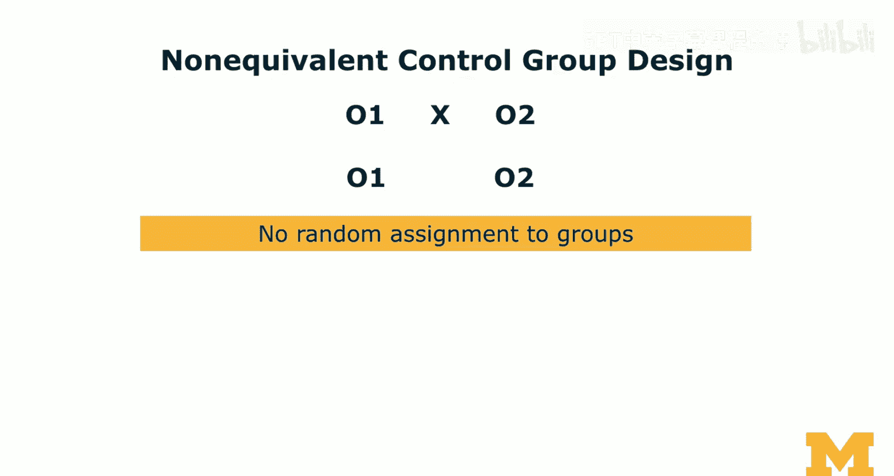
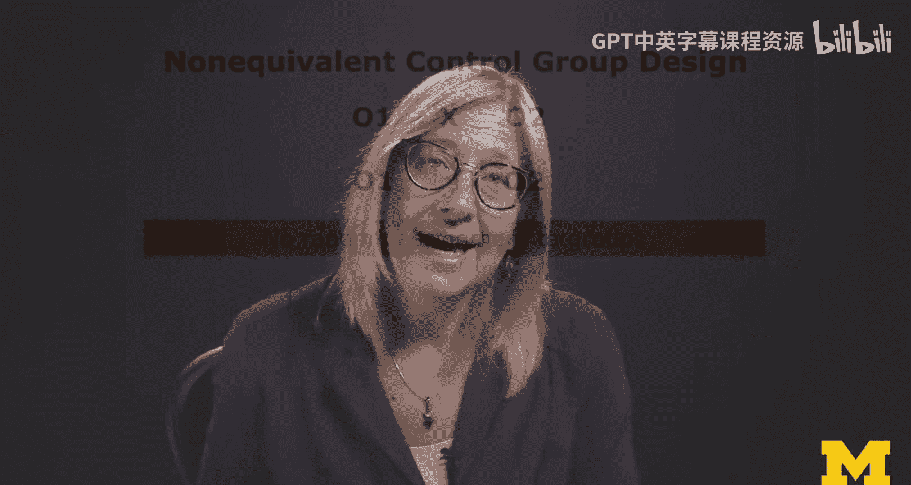
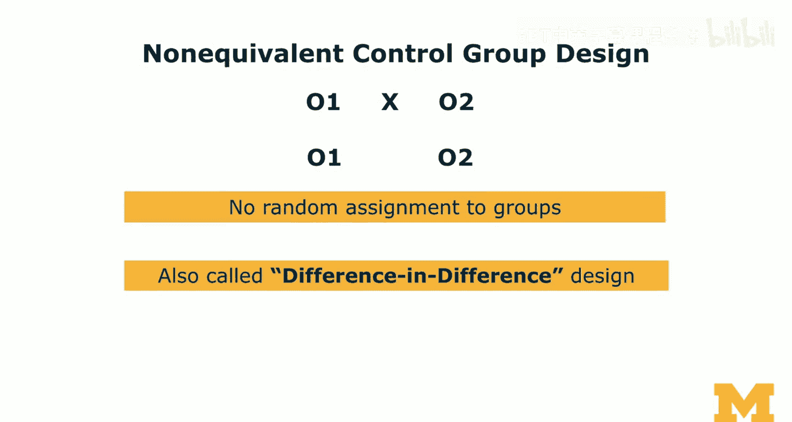
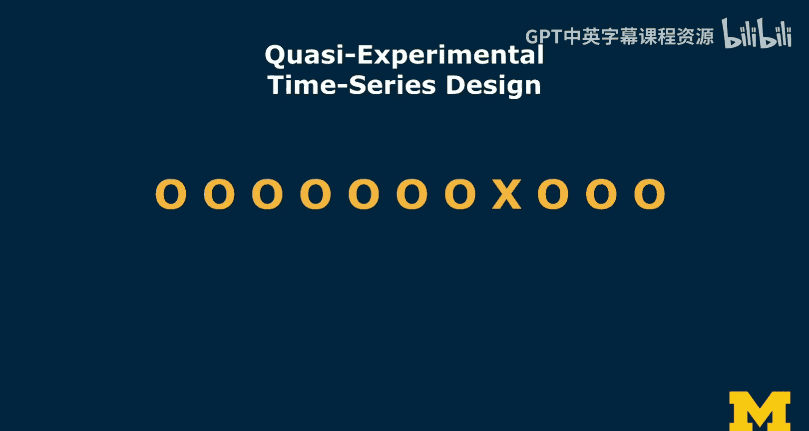
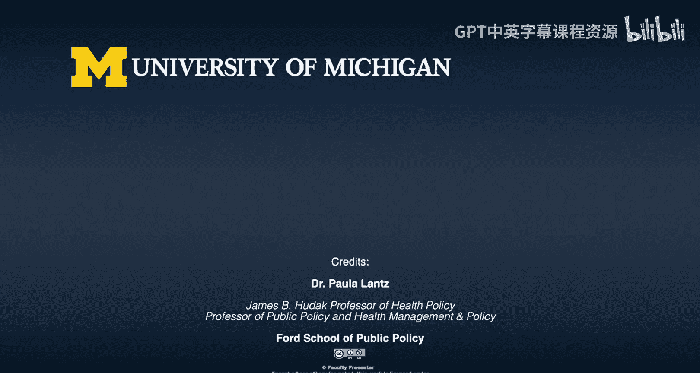

# 密歇根大学《公共部门的R数据分析（基础、数据探索、决策支持、）｜Data Analytics in the Public Sector with R》中英字幕 p118 39_准实验设计方法.zh_en -BV1YZ421J7Fx_p118-

Hi， I'm Professor Paula Lance， and today we're going to start a new module on quasi experimental designs。

 but before we really get into it， let's review where we've been already。

Especially our work that we just finished talking about randomized controlled trials now as we've discussed。

 they are the gold standard for program and policy evaluation and they're sometimes implemented in the evaluation of public sector programs and policies however。

 there are many downsides again we've talked about all this already on the pro side of randomized control trials。

 great internal validity they really are the gold standard as we keep saying for establishing a causal relationship between a program policy service program。

That kind of intervention and the outcomes that we're seeking to affect。However， on the other side。

 they're really expensive， they're complex and time consuming to implement。

 there are a lot of serious data challenges along with collecting the same exact same data for treatment and control groups。

 and also there are a number of ethical issues that we'll be talking about in Co four。All right。

 so quasi experiments what are those， There' are generally a whole class of research designs that attempt to control for all those threats to internal validity that we've been talking about with a good counterfactual。

 but they actually do not have random assignment to the intervention exposure。

So there are a number of different research designs that fall in this category of quasi experimental。

 there are two that are used quite often in public sector program and policy evaluation research the first one is called the non equivalentent control group design。

You can see it on the slide here and it looks like a randomized control trial except the two groups are not randomly determining who gets exposed to the intervention or not。

 there's no random assignment to the treatment groups I actually use this design in a community-based study that I conducted a while ago。

 but we had four counties that got a mass media intervention aimed at women regarding their cancer screening tests。

 mammograms and PAP tests and then in a different part of the state we used four counties as a control group we had baseline information from surveys about knowledge。

 attitudes and awareness and their cancer screening practices。

Then the four counties in the intervention group got their intervention， and then 12 months later。

 we did a second survey to see if the knowledge， attitudes and practices had improved in the intervention counties more than the control counties。

 and we found that they had。 So again， there wasn't random assignment here that's really hard to do when you're doing a geographically based sort of intervention。

 but this kind of research design。 again， it's used a lot in public sector evaluation and can work pretty well。

This is also called the difference indifference design， if you hear that term。

 just know that it's referring to this non equivalentent control group design。

Now the other design that is used a lot in public sector policy research is called the time series design。

 and that's where you observe， you have a number of observations over time， it could be years。

 it could be quarters， those O's represent whatever unit of time is the most appropriate。

 so you establish a trend line， then there's a policy or change or some kind of intervention and then you see what the trend line looks afterwards。

 and this is a really great design for policy evaluation work。

And so stay tuned because we're going to be diving into the time series design in much more detail coming up。

