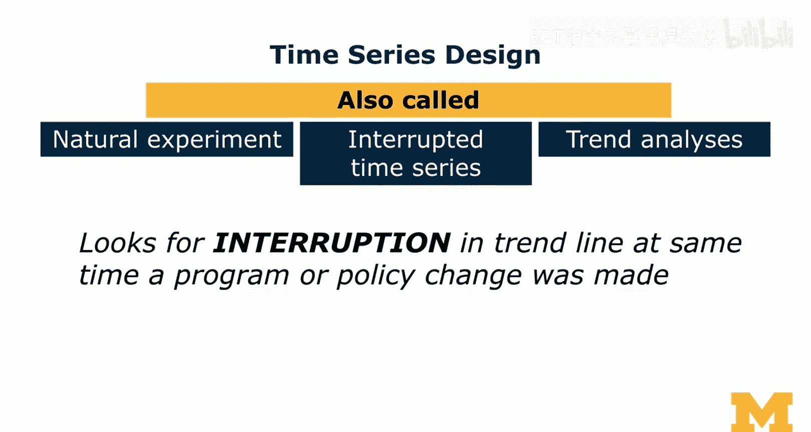
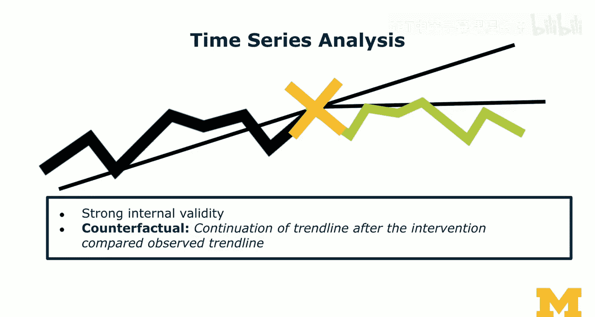

# 密歇根大学《公共部门的R数据分析（基础、数据探索、决策支持、）｜Data Analytics in the Public Sector with R》中英字幕 p119 40_时间序列设计基础原理.zh_en -BV1YZ421J7Fx_p119-

Welcome back。 Let's talk about time series designs。 And I have to say。

 if someone can have a favorite kind of research design， this one is mine。

All right， time series designs， they're also called natural experiments。

Interrupted time series or trend analyses。And what is happening in this research design is that we're going to look for an interruption in a trend line that occurs at the same time a program or policy change was made。

Trends， you know things things change over time and they bounce around a lot。

 we sometimes call that noise in a trend line， there's no trend line that's ever just perfectly flat or perfectly goes up or down in a straight linear fashion。

 but we can see patterns in trend lines and if you can remember back from high school geometry what we like to do with lines is try to figure out what's the slope of that line。

Is it going up or down or staying flat？ And then also。

 what's the intercept of that slope or that line。 And so that's what time series analysis does。

 It takes advantage of our ability to determine the slope and intercept of trend lines and see if they change at the time a program or policy change was made or a new intervention was implemented。

Now。Think back to our pret post test design if we're just looking at one point in time。

And then an intervention happens then we look at another point in time afterwards。

 but we don't really understand what's going on in the trend before it， or even after it。

 we might misinterpret that， we might think that there's been a change because of the intervention。

But it's really because we just captured part of that noise， that bumpiness and trend lines。

 and so going back further in time before a policy programme or intervention is implemented。

 gives us more information and actually the more points in time we have。

 the better we are able to again determine that slope and intercept of that line。

 before the policy change happens and then compare it to afterwards。So there's a lot going on here。

 But again， look at that straight black line。 That's a line that was fitted through data points before that X。

 that policy change and extend into the future。 So here we're sort of saying， well。

 there's a trend line with the slope and an intercept。 and we might project into the future。

 if all things were staying the same， that trend line would keep going。

At the same slope into the future， but the yellow。Line there that's bumping around because， again。

 that's what happens in the real world。 There's a new trend line。 We're fitting there。

 starting with the X。 So our intercept is where the X happens。 And we see that line is much flatter。

 So in trend analysis， very simply， what we're doing is comparing。

A trend line that we're observing after an actual intervention change with what we projected would happen if there was no change after the intervention。

 In this case， we see that something going on with a trend。

 and let's assume it's a negative trend actually stopped going up after the intervention was implemented。

All right， so。Does the time series analysis have good internal validity， it actually does。

Our counterfactual here is the continuation of that trend line after the intervention compared to the observed tread line。

 And we can be pretty sure that's what the world might have looked like without the intervention。

 Again， that's our counterfactual。 But there are some threats to internal validity that we need to worry about。

 We'll come back to that in a minute。

