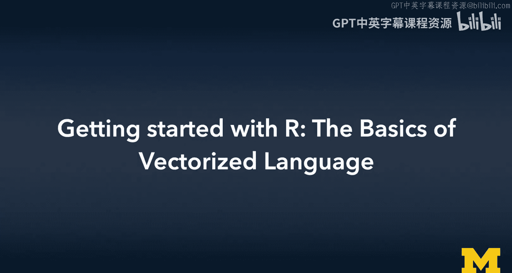
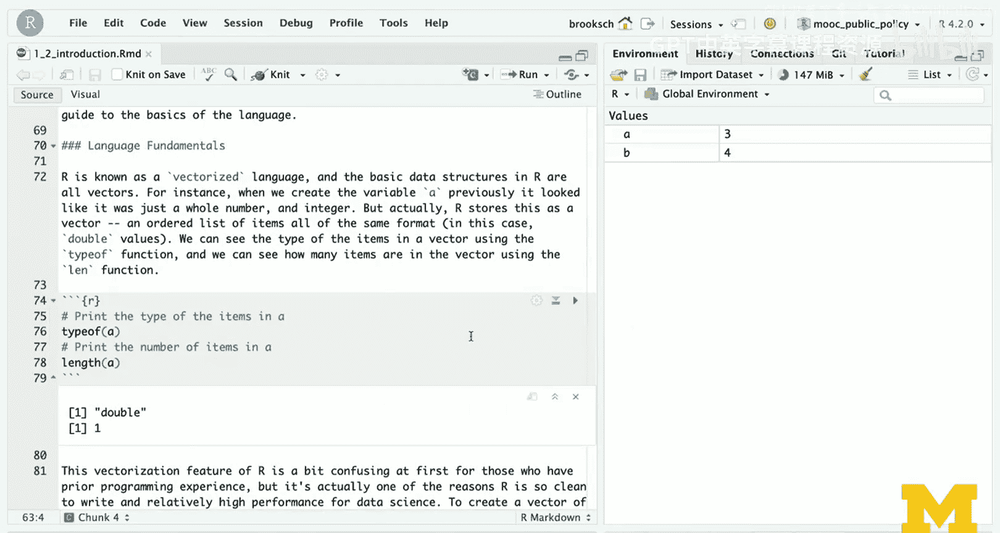
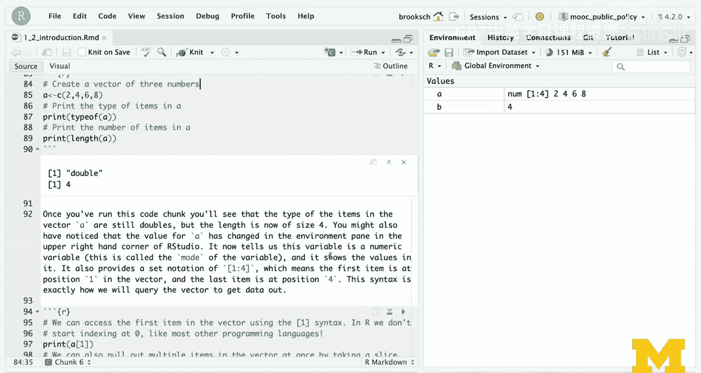
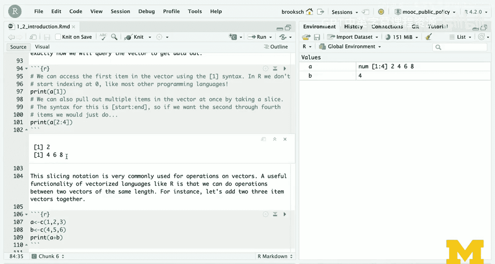
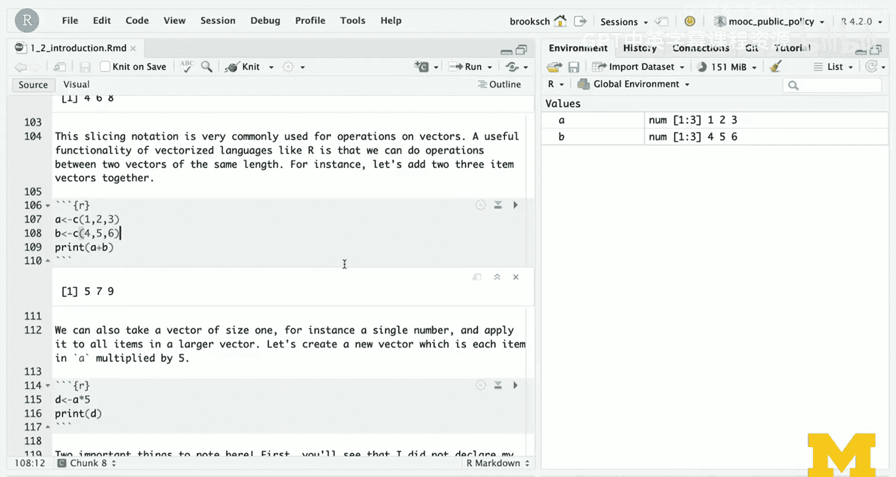
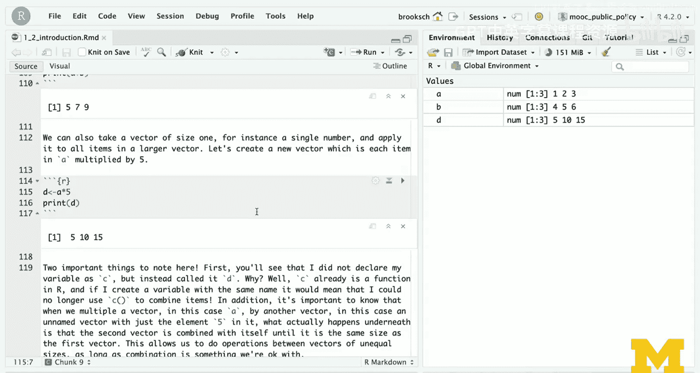
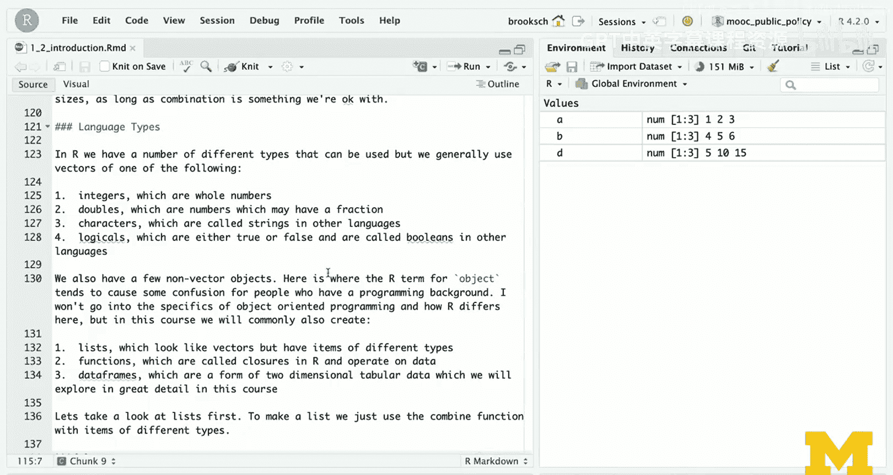
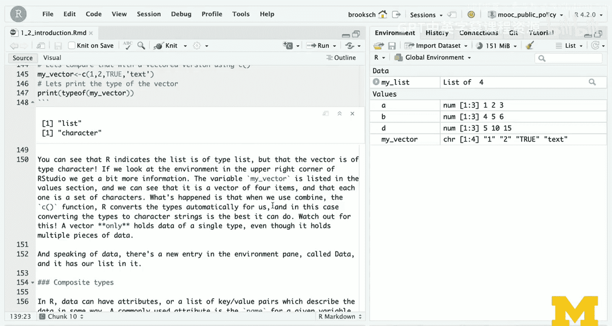

# 密歇根大学《公共部门的R数据分析（基础、数据探索、决策支持、）｜Data Analytics in the Public Sector with R》中英字幕 p12 11_R语言向量化运算原理.zh_en -BV1YZ421J7Fx_p12-

Now， R is known as a vectorized language and has some basic data structures in art are all vectors。

For instance， when we create the variable A previously， it looked like it was a whole number。

 just an integer。 But actually， our stores， this as a vector。

 an ordered list of items all in the same format。 In this case， double values。

 And we can see the type of items in a vector using the type of function。

 And we can see how many items are in a vector using the lens function。 Let's take a look。

 So I'm going to print the type of the items in a using type of。

 and then I'm going to print the number of items in a using length。😊。

So we can see it's actually a double and it's a one。

This vectorization feature of R is a bit confusing at first for those who have prior programming experience。

 but it's actually one of the reasons R is so clean to write and relatively high performance for data science。

To create a vector of multiple different values， we just use the combined function called C for short。

 This just combines all of the inputs given into a single vector。

 So I'm going to create a vector of three elements。

 So I'm going to say is assigned to and I'll use this combined syntax 2，4，6。

8 So I'll make four elements here。 then print the type of items inside of a。

 and then we're going to print the length of a as well。 So let's execute this。All right。

 so we see that double value and that there's four items。Now， once you've run this code chunk。

 you'll see the type of the items in the vector A are still doubles。

 but the length now has increased to size 4。 You might also have noticed that the value for a has changed in the environment pane in the upper right hand corner of our studio。

 It now tells us that this variable is a numeric value。 This is called the mode。 actually。

 of the variable。 And it shows the values in it。It also provides a set notation with a square bracket。

 a one a colon and a4， and then another square bracket。

 And that means the first item is at position 1 in the vector， and the last item is at position 4。

 This syntax is exactly how we're going to query the vector to get data out。

So we can access the first item in the vector using the square bracket one syntax。

 sometimes this is called the Seter or getter operator you are we don't actually start indexing at zero like most other programming languages so that's a little bit of a tip and a gotcha for a lot of programmers。

Now， we can also pull up multiple items in the vector at once by taking what's called a slice。

 The syntax for this is the square bracket operator。

 and then we just have start and and separated by a colon。

 So if we wanted to grab the second through fourth items here。 We would just print a sub2 to4。

 So let's execute this。 Allright， so we see that the first item in there is a two。

 and then we take two sub4， and that's actually three items。 So it's two to four inclusive。

 This slicing notation is very commonly used for operations on vectors。

 a useful functionality of vectorized languages like R is that we can do operations between two vectors of the same length。

 For instance， let's add two， three item vectors together。 So I'm going to create a new vector A。

 and I'm going to make it equal to the numbers 1，2 and 3。 Again， we use the combined operator。

 the C function。 I guess I should say for this。

And then I'm going to make B， and I'm going to make it a 4，5，6。

 And then we're going to print out the value of a plus B。

 And so you can see it just added those items in a row。

 So the first item in A added to the first item of B and put it into our resulting vector that we then printed second item in A。

 second item in B and so forth。 And you can see in the environment pane that it's updated those values。

We can also take a vector of size 1， for instance， a single number and apply it to all items in the larger vector。

 So let's create a new vector in which each item is multiplied by 5。

 So I'm going to create a new vector D and I'm going to assign that to a times 5 and then we'll just print out what D is。

All right， so we've got 5， 10， and 15， so we took one， two and 3 in that vector。

 we multiplied each element by 5 and we get this new vector D and we can see the D is up and in our environment pan。

2 important things to note here。 First， you'll see that I did not declare my variable as C。

 but instead skip that and called it D。 Why？ well， C is already a function in R。

 And if I created a variable with the same name， it would mean that I can no longer use C to combine items。

 And that's really quite fundamental in R。In addition。

 it's important to note that when we multiply a vector in this case， I took a。

 which had three items by another vector。 In this case。

 it was an unnamed vector with just the element 5 in it。

 What actually happens underneath is that the second vectors combined with itself over and over and again until it's the same size as the first vector。

 This allows us to do operations between vectors of unequal sizes as long as the combination is something we're okay with。

Now， in R， we have a number of different data types that can be used， but generally。

 we are using vectors of one of the following integers。 These are whole numbers， doubles。

 These are numbers which may have a fraction associated with them。 charactersers。

 These are called strings in other languages and logicals。

 These are either true or false and are called Booleions in other languages。

We also have a few non-ve objects， and here's where the R term for object tends to cause a little bit of confusion for people who have a programming background。

 Now， I'm not going to go into the specifics of object oriented programming and how R differs here。

 but in this course will commonly also create lists。 These look like vectors。

 but they have items of different types functions， and these are actually called closures in R and they operate on data and data frames。

 which are a form of twodimensal tabular data， which will explore in quite great detail in this course。

Let's take a look at lists first to make a list， we just use the combined function with items of different types。

 So I'm going to create a new R block here。 I'm going to create a new list。

 And here I'm going to use the list function to do it。 So I'll say my list is assigned to list。

 And then I'm just going to throw in whatever I want here， a one。

 a two true here with Booleions and R， we capitalize them。

 You can actually use the first letter as well in caps to represent a Boolean。

 and then a character vector text。Now we can print any of the items of the list。

 so I'm going to print the type of the list， and then I want to compare that with a vectorized version using C。

 so I'm going to create a vector called my vector instead of my list and instead of using the list function。

 I'm going to use the C function and print out its type。Okay。

You can see that R indicates the list is of type list， but the vector is of type character。

 So if we look at the environment pane in the upper right hand corner of our studio。

 we're going to get a bit more information。 The variable my vector is listed in the values section。

 and we can see that it's a vector of four items。 and that each one of these as a set of characters。

 What's happened is that when we use combined the C function。

 R converts the types automatically for us。 And in this case。

 converting the types to character strings is the best that R can do。

 you've got to watch out for this。 a vector only holds data of a single data type。

 even though it holds multiple pieces of data。😊。

