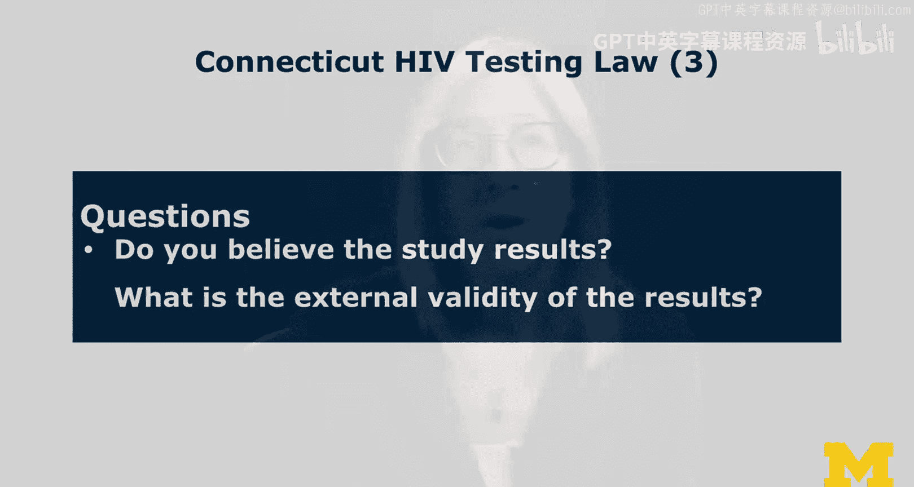
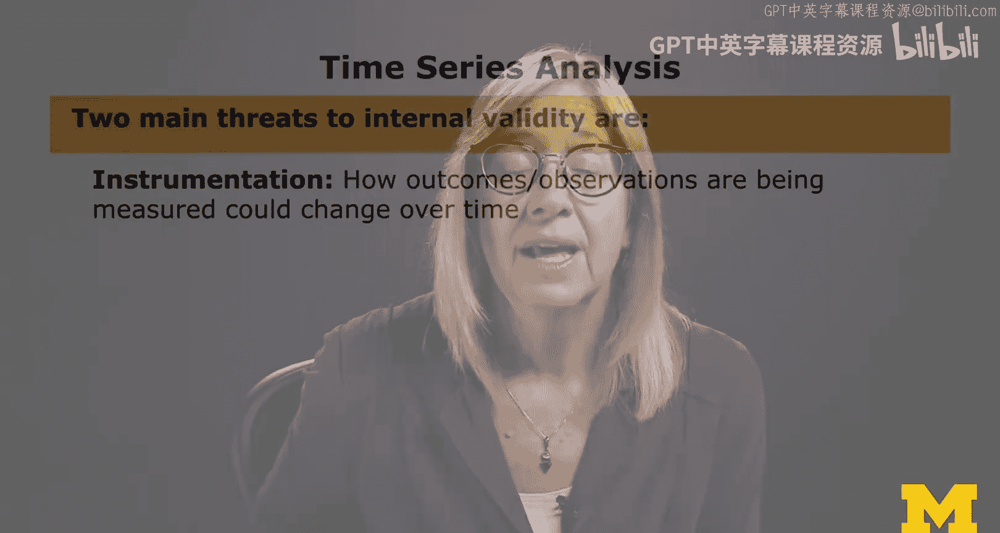
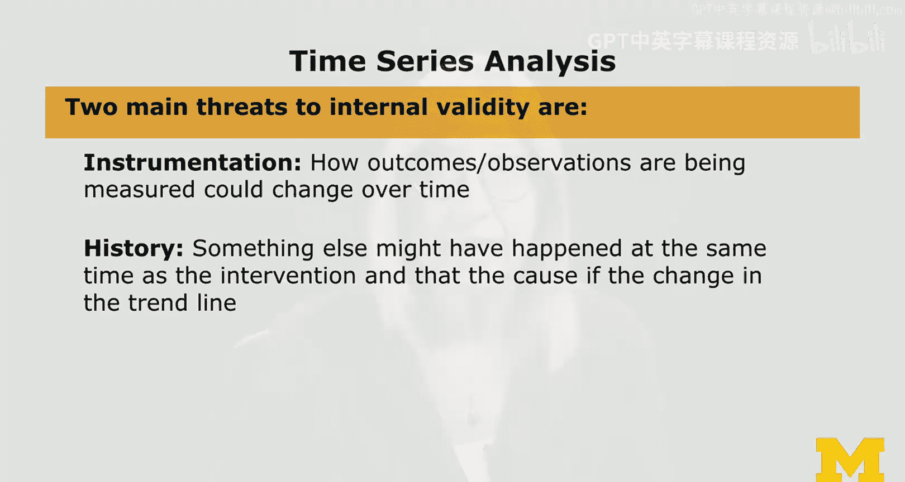
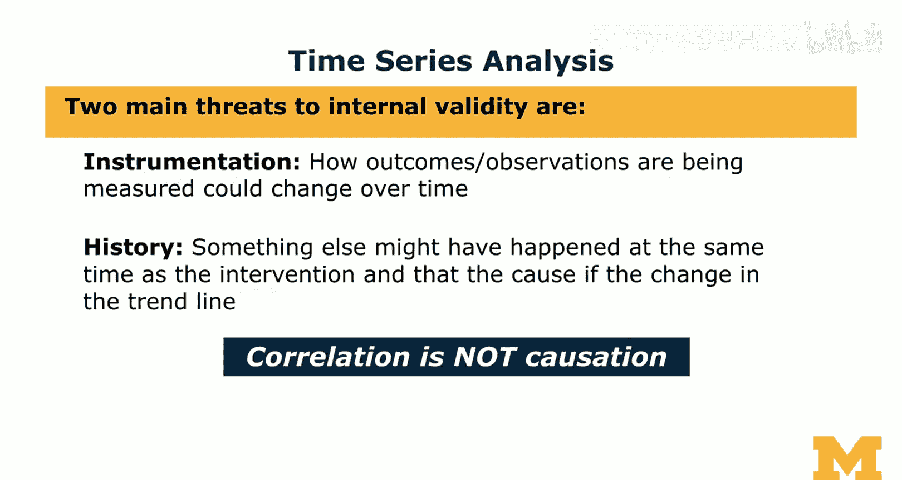

# 密歇根大学《公共部门的R数据分析（基础、数据探索、决策支持、）｜Data Analytics in the Public Sector with R》中英字幕 p120 41_时间序列设计应用实例.zh_en -BV1YZ421J7Fx_p120-

Today I want to talk about a law that changed in the state of Connecticut regarding its HIV testing laws。

 so we'll time travel back to October in 1992， and that's when a law change in Connecticut went into effect and the law change was that before this date。

 minors had to get parental consent to get an HIV test， but after this date， minors。

 people under age 18 no longer had to have a parent's consent to get HIV testing。

So people wanted to know did this have any impact on testing among adolescents in the state。

 the hope was actually that it would， that this would reduce a barrier and that more adolescents who are worried about HIV exposure would actually get tested if their parents didn't have to find out。

So the evaluation design that was implemented was a timed series design and it was looking at the number of visits and the number of HIV tests that occurred at publicly funded clinic sites both 12 months before and after the law change in here I always write out research designs with our X's and O' so here's what it looked like in each O here represents observations of number of visits and tests at these publicly funded clinics。

Each month， 12 months before that October 1992 policy change and then 12 months after。

So what did they find。Here is a very simple data visualization of what they found now again。

 you see October。92 is when the law went into place and you can see。

 I hope the red line of is the number of people tested， these are minors tested at all the clinics。

And it looks like that line jumped up， the slope of that line changed pretty dramatically when the law went into place。

And the blue line on the bottom is the number of miners who visited the clinics but did not get tested。

 and that line went down， and so what the data are telling us is that the number of people going in for testing dramatically increased and that increase happened right at October 1992。

Statistical testing showed that these were significantly different。

 so the number of visits between the pre policy and post policy increased by 44% that was statistically significantly different。

 the number of HIV tests conducted among minors doubled。

And visits and tests among what is considered high risk minors。

 so those minors who are engaged in high risk activity。

 both drug use activity and sexual activity actually tripled and those were the youth that the law was hoping to target。

All right， so let me ask you some questions。 Do you believe the study results。

 and that all gets to the internal validity of the study design。

Do you think that the way the researchers went about this is showing that this law change had an impact on the testing for HIV among minors in the state of Connecticut？

So that's the internal validity question。 And then also we have to ask。

 what's the external validity of the results， So let's say you believe the results。

 what can we learn from this study， Is this something that you think can be generalized outside of the state of Connecticut at publicly funded clinics to other states to other countries in the world。

 These are always important questions for program evaluation。

All right。Internal validity。 Now， there are two main threats to any time series analysis related to internal validity。

 The first one is our old， good friend instrumentation。

Which means maybe there is something about the measurement of the thing we're tracking over time that changed。

 And in this case， it would have to have changed right when that policy change was made。

 But we always want to ask the question， We outcomes or observations that are being made over time。

 Did the methods for that change。 And could that be explaining some of the change over time werere seeing or not。

And then the other issue we always have to worry about with a time series design is history。

 did something else happen at the same time as the intervention。

 and that's what's causing the change in the trend line， not the actual intervention itself。

So in the case of the Connecticut HIV law change for minors， testing for minors。

There was no instrumentation change， these clinics were collecting data the same way before and after and so we don't think that's explaining the change observed over time and then history did something else happen and we again we always want to think about that。

 but there's really no rival hypothesis here， there's nothing that anyone could think of there's no celebrity that was diagnosed with HIV there's nothing else。

 no other policy change， no other mass media campaign and the change was so abrupt at that exact time of the law change that we don't think history is a threat here。

But we do always have to worry that correlation is not causation。

 and so we really want to think about these threats to internal validity when we're looking at the results of time series analyses and asking。

 do we believe it or are there internal validity threats now to control for both of these internal validity threats there is what's called the multiple time series design and this is actually used a lot in policy and program evaluation where you have another。

In this case， let's think of the Connecticut example。

 there could be another state we could have compared what happened in Connecticut to another state or multiple other states。

 this is a design sometimes used to compare countries。

Looking at over time， one country passes a law change related to， say。

 drunk driving or raises their tobacco tax by way， you know， a huge amount。

 And compared to other another country or many other countries。 Again。

 the multiple time series design gives us more ability to explain away these rival hypotheses。

 especially the one of history。 And so this is considered a very strong design from the point of view of internal validity。

 This is one I've actually used quite a lot in in my career。

 taking advantage of the fact that states implement policies at different points in time。

 Sometimes states implement policies， and then they take them away。 And as researchers。

 we can take great advantage of these changes。Across units or across states and other things to see if we can really narrow in on whether or not that X。

 that intervention change is what's causing the change in the trend line。

