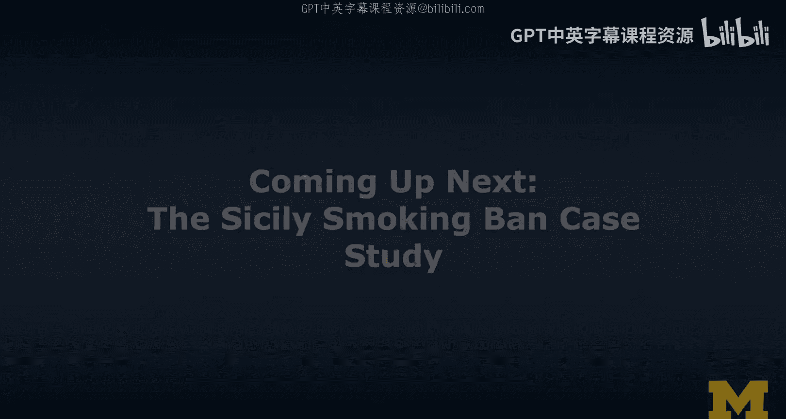
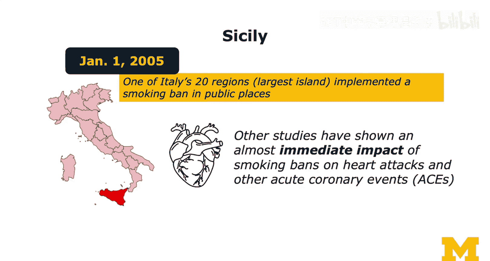
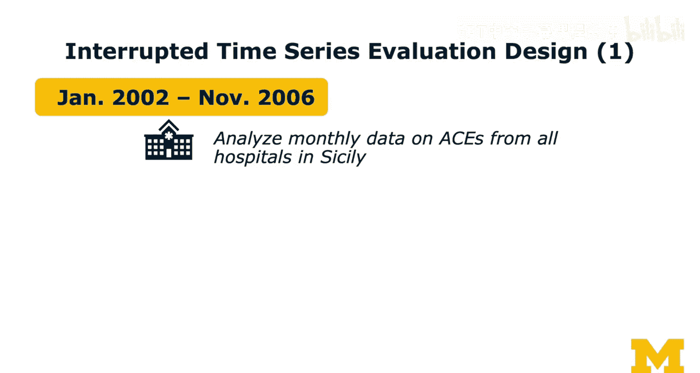
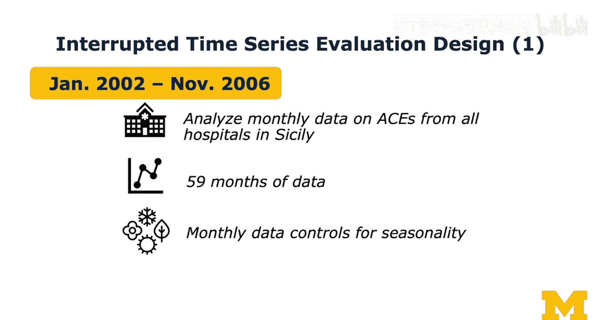
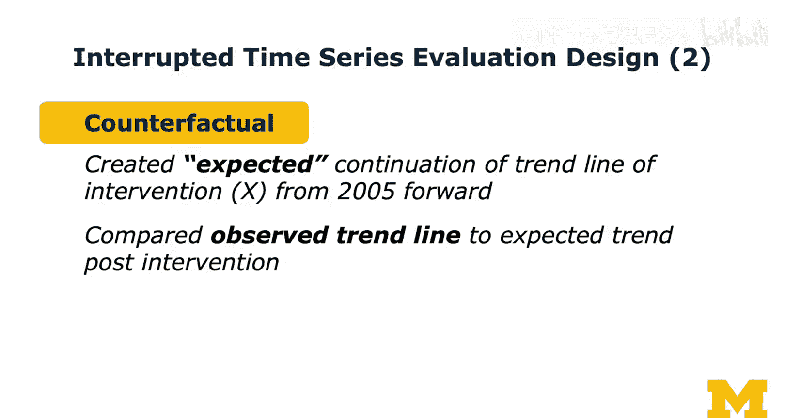
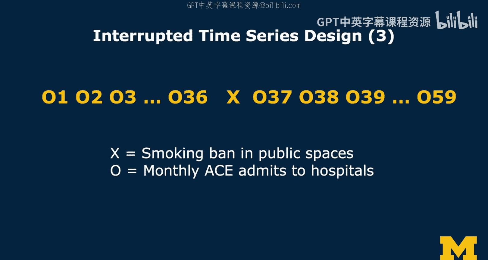

# 密歇根大学《公共部门的R数据分析（基础、数据探索、决策支持、）｜Data Analytics in the Public Sector with R》中英字幕 p121 42_下期预告：西西里岛禁烟令案例研究.zh_en -BV1YZ421J7Fx_p121-

Hi again。 I'm back。Before you jump into the data and our code for the evaluation of a policy change on the island of Sicily in Italy。

I'm going to describe the background and study design for you again using the language of evaluation research design that we've covered together Sicily is one of Italy's 20 regions and the largest island I've never been there but I do hear it's beautiful on January 1。

 2005 the government of Sicily implemented a new tobacco control policy that placed a ban on smoking and public buildings and spaces this type of smoking ban has been implemented in many jurisdictions and several evaluations have shown an almost immediate effect on heart attacks and other kinds of acute coronary events or ACEces Now there's actually a biological mechanism at play here by which exposure to secondhand smoke can trigger an acute coronary event in someone with severe heart disease so Sicily wanted to evaluate its new smoking ban in multiple ways。

 but also to see if this type of immediate health outcome was。

Oserved on the island after the policy change to do this。

 an interrupted time series evaluation design was used monthlythly data on ACEces from all hospitals in Sicily were analyzed from January 2002 through November 2006 Now remember that a study design is a time series if there are multiple observations both before and after an intervention is implemented so we can see if there's a change in the interceptor the slope of a trend line that happens at the same time as the intervention is introduced researchers took advantage of 59 months of data I'm sorry I'm not sure why they did not use data from December of 2006 to make it 60 months or five full years of data but we have 59 months of data and the unit of analysis for the data is months full years or not even quarters they used month as the time and the time。

ries and this is important because smoking like almost all other kinds of human behavior has a seasonality to it and in fact。

 people tend to smoke less in summer months or hotter months than when it's colder so using monthly data gives more observations and also helps control for fluctuations due to the season of the year the counterfual in this study design is the expected trend line after 2005 when the new policy was introduced using data from before the policy change from 2002 through 2005 and expected trend line is forecasted into the future then this actual or the actual or observed trend line from actual data from 2005 and 2006 is then compared with the expected or projected trend line and these kinds of studies we're often comparing what we might expect if a trend line continues under。

With what was observed after an interruption or a policy change。

 and it's this comparison of the expected or counterfactual with what was actually observed that allows us to measure。

The impact of the smoking policy change the picture of what the study design looks like is somewhat what I've pictured here now I'm not writing out all the 59 observations points that is too many O's for one slide or for anyone to be able to read and digest but I hope that you see in this study design there are three years of monthly observations or 36 months of data before the X or the policy change and then there are 23 more months or almost two years of monthly data to observe after the policy change in this design the O's or monthly observations are the rates of hospitalization in Sicily due to acute coronary events so that's the study design have fun learning more about the data and the analysis。

