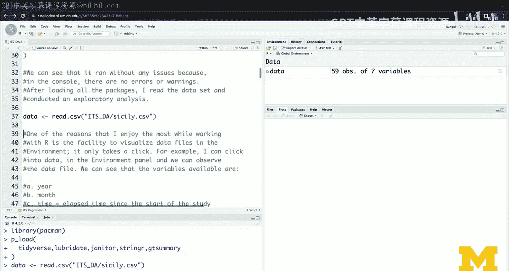
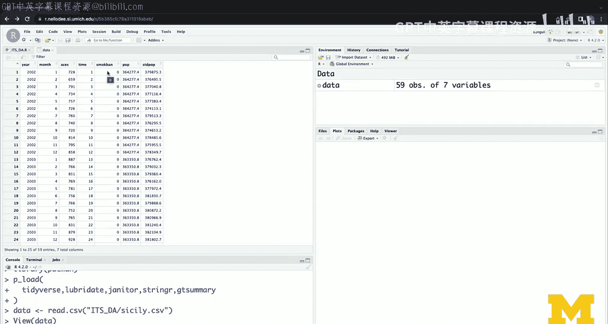
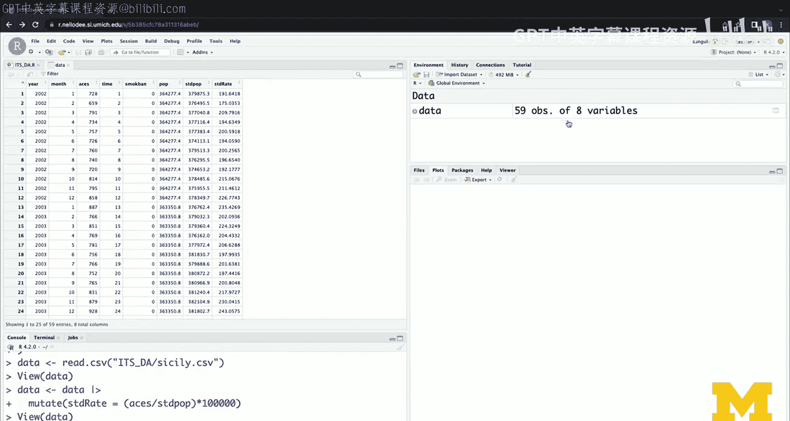
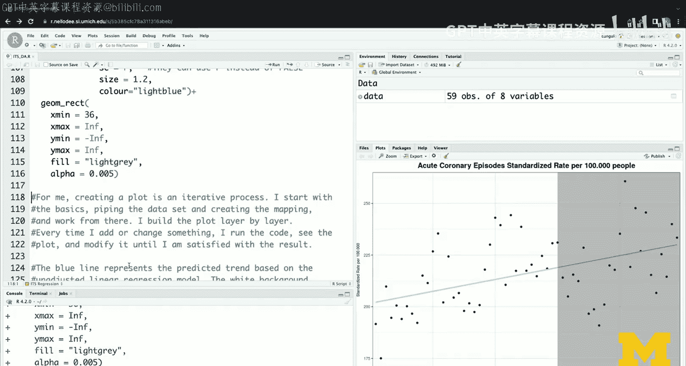
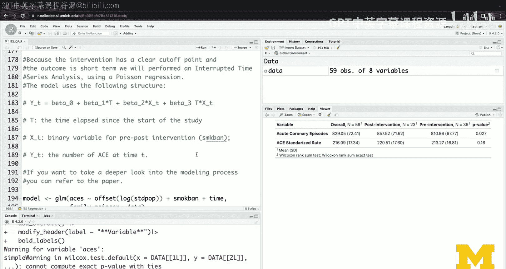
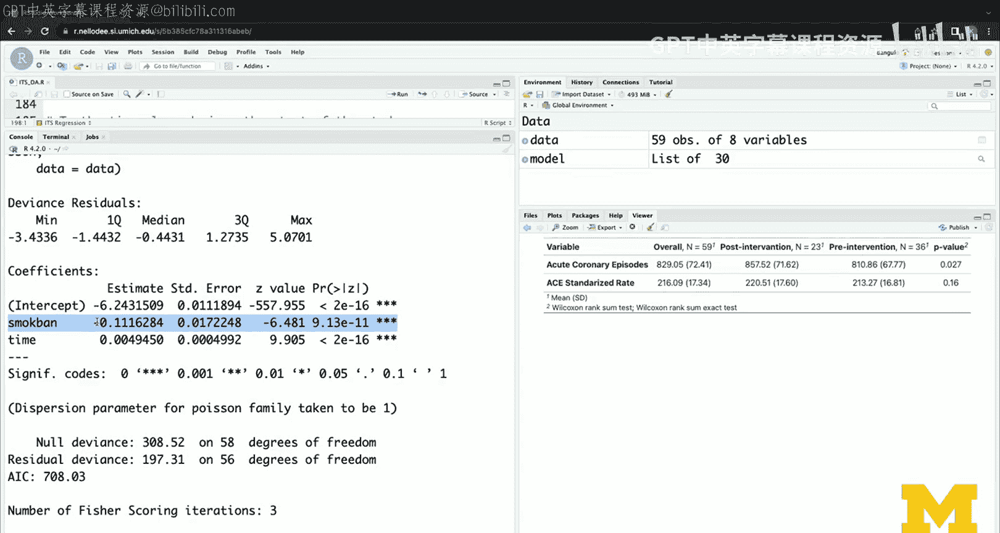
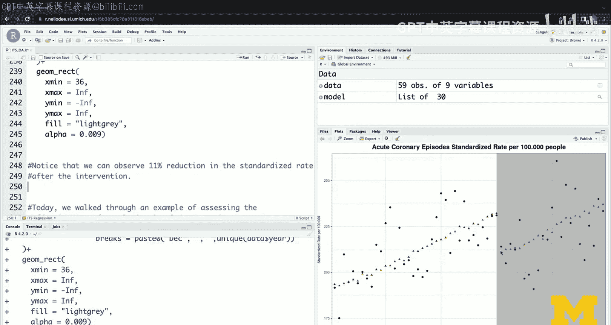

# 密歇根大学《公共部门的R数据分析（基础、数据探索、决策支持、）｜Data Analytics in the Public Sector with R》中英字幕 p122 43_西西里岛禁烟令：流行病学实证研究.zh_en -BV1YZ421J7Fx_p122-

My name is Danielanggulo and today we're going to talk about interrupted time series analysis。😊。

In this lecture， we will reproduce the Interted time series tutorials results from the London School of Hygiene and Tropical Medicine。

 we will also discuss the typical data analysis process and which parts you would jump in as a policy analysis。

As Dr。 Lance said in a previous lecture， the data set contains information about the number of acute coronary episodes in Sicily。

 Italy per month before and after a population level health intervention。

Our goal is to evaluate the effectiveness of such intervention As you can see I am using an R script because it is what I usually do as a data analysis and a statistician I'm using a library called PACman that loads which means installs and calls the package into the R script using the P load function I like it better than writing library and then the name of the package because I feel it saves me time I don't necessarily use it use all the packages at once but they are already loaded in case I need them since I am working with a R script instead of an arc mark down to run the code I'm going hit control enter into each code line。

😊。

We can see that it ran without any issues because in the console there are no errors or warning messages After loading all of the packages I read the data set and conduct an exploratory analysis I'm using the read CSB function because the the file I'm using is a CSB file one of the reasons that I enjoy the most while working with R is the facility to visualize data files into the environment it only takes a click so for example I can click into the data in the environment panel right here and observe the data file we can see that we have 59 observations and seven different variables we have the year month aces which is the number of acute coronary episodes the time which is a variable that goes from1 to 59 a smoke ban which is our intervention variable which is coded zero for the period。

Before the intervention and one for the period after the intervention。

 the population and the standardized population to achieve our goal which is to determine the effectiveness of the intervention。

 we first create a variable for the standardized rate of acute coronary episodes per 100 and000 people amusing mutate to create a new variable called a standardized rate that is the ratio of two variables in the data set multiplied by 100。

000。

We can the code run without any problems because if I open the data set one more time。

 there's one new variable that its called a standardized rate。

 we will first create some visualizations， then some statistics and at the end we will run a model and assess the results。

Since we have multiple observations over time， we can create a scatter plot of the standardized rate of acute coronary episodes over time and assess visual whether there is a difference in the tendency before and after the intervention I start by piping the data set and then created a Gplot object mapping into the X axis the date and in the y axis the standardized rate I'm also using geo point because it is a scatterpl I use team underscore BW because it creates outstanding aesthetics that are easy on the I however I'm using team。

😊。

The function team to override some aspects of the title I'm also using labs to modify the title and the X axis Additionally to create a linear tendency line I'm using GM smooth and finally I created a light grade rectangle to indicate the post intervention period using GM rec。

We run the code， we can see that there's no issues because we have the plot for me created a plot is an iterative process I stuck with the basics piping the data set and creating the mapping and then work from there I build the plot layer by layer every time I add or change something I run the code and see the plot and modified it until I'm satisfied with the result so if we see the plot right here the blue line represents the predicted trend based on the unadjusted linear regression model the white background represents the prein period and the gray background the post intervention period the plot shows that most points in the post intervention period are below the trend line rather than distributed randomly across the line the latter will imply a significant decrease in the acute coronary episodes after the intervention。

From this point on， the analysis is in charge of the statistician， given the study design。

 the available data and the hypothesis， the statisticians will perform some statistical models to test the validity of the hypothesis。

Before digging into a statistical and a statistical method appropriate for this particularly studio design。

 we will test if the mean of acute coronary episodes before and after the intervention it's significantly different I will use TBBL underscores summary which is a function from the package GT summary to customize a summary table of descriptive statistics I find it especially useful when created a table1 which is usually the descriptive statistics of the study population while writing a paper first I pipe the data and then select the variables I want to display on the table then I use the TBL summary function to create a statistics by the intervention bur。

Always remember that you can use question mark and then the name of the function。 So in my case。

 DBL summary。To find out more about what type of things you can change or modify in this function we will run the code right now and we can see that in the viewer panel we have a table very similar to the tables one that you will find in any paper we have for every variable we have the overall mean and in parenthsesis the standard deviation and then we also have mean standard deviation for the post intervention period and the preinterion period and finally we have the Pvalue comparing pre and post intervention we can see given that the Pvalue using a significance level of 5 percent we can see that the number of acute coronary episodes is significantly different between the pre and the post intervention period however when we account for the standardized population we don't see any difference at a 5% significance level because the intervention has a clear co of point and the outcome。

Is short term we will perform an interrupted time series analysis using a poison regression The model uses the following structure The outcome variable is the number of acute coronary episodes in each time and we use as variables the time eapse since the start of the study and a variety variable for the pre and post intervention period if you want to take a deeper look into the modeling process we can refer you to the paper we will run the model。

And use the summary function to assess the results the results of this particular model appears in the console so right here we can see for the intervention variable first that the P value is less than 5% which is usually the significance level that we use therefore it's a significant variable and also we can see that the estimate is negative which means that for the post intervention period there is a decrease in approximately 11%。

 the model shows that there is a strong evidence because the P value is less than 0。

01 of a reduction in the number of acute coronary episodes following the smoking bad with an average decrease of 11%。

We save the model predictions and then plot the same as scattered load as before。

 but instead of using a linear trend， we will use the model predictions here I'm using。😊。

The money symbol to create a new variable instead of using the mutate function， however。

 you could use the mutate function here。As you can see I'm using mostly the same code as before。

 the only difference is that instead of using GMMS mode I'm using the model prediction as a secondary set of points to display。

 so first I pad the data then I create the Ggi plot and I use two GM points one for the real data and one for the predicted data and then the rest of the plot is basically the same I use。

😊，Theme underscore BW， I use labs to change the title and the axis。

 I override some aspects of the team。Notice that。 in the new plot。

We can observe the 11% reduction in the standardized rate。

 so in the pre interventiontervention period we can assess that the trend line goes here。

 however in the post intervention period there is a decrease and the line starts around here and goes from there today we walk through an example of assessing the effectiveness of population level intervention。

We use some compelling visuals to see the phenomenon and quantify the effectiveness using some statistical models。

Sometimes these models are hard to understand， however。

 that is the beauty of working in an interdisciplinary team。

 interacting with statisticians and people from various backgrounds will be an essential part of your role。

