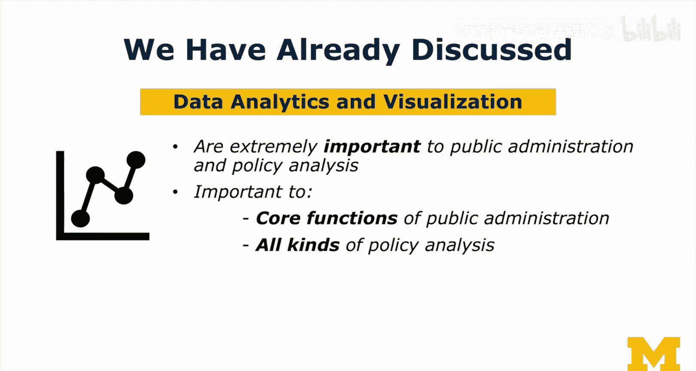
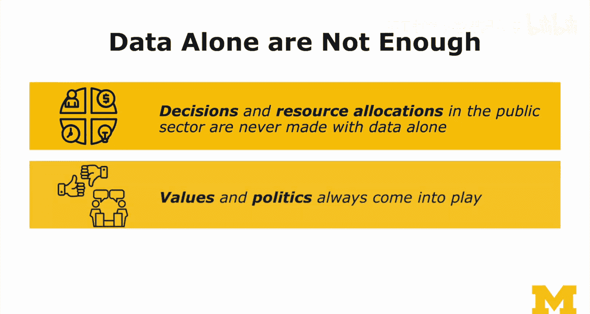
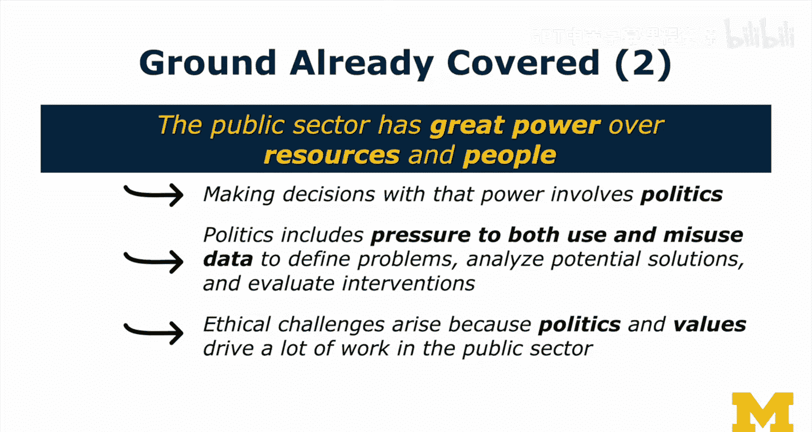
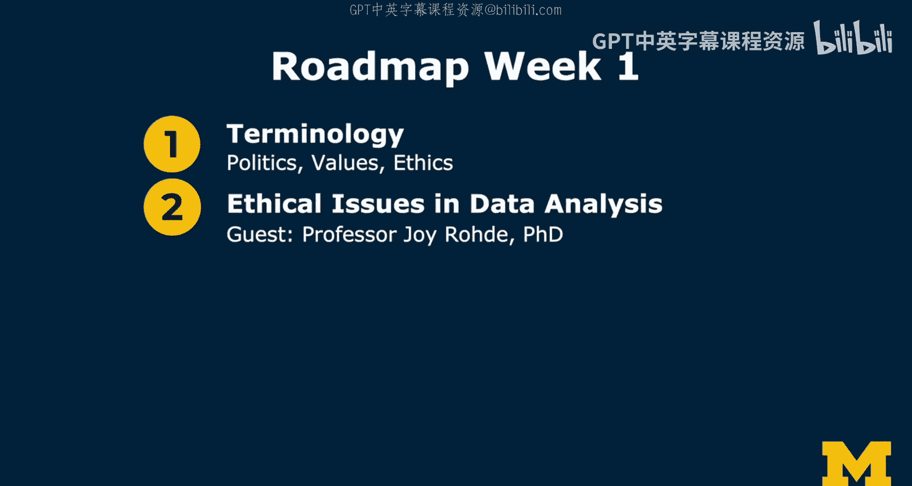
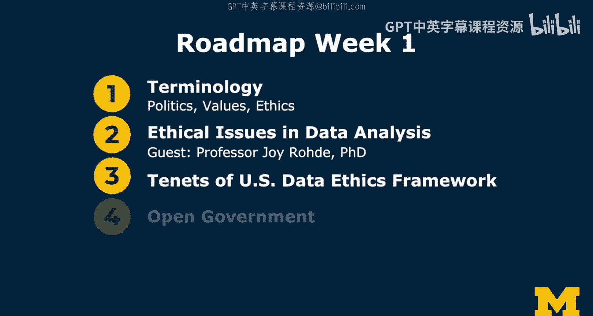

# 密歇根大学《公共部门的R数据分析（基础、数据探索、决策支持、）｜Data Analytics in the Public Sector with R》中英字幕 p125 1_政治伦理回顾.zh_en -BV1YZ421J7Fx_p125-

Hi， I'm Professor Paula Lance， welcome to Cose 4 in your specialization which focuses on the role of politics and ethics and data analytics for the public sector As you well know。

 we've been talking about politics and ethics all the way along in this series so before we jump into new content。

 let's quickly review some of the ground we've already covered Now as you well know we've been focused on the important role of data analytics and data visualization to all the core functions of public administration and also for all types of policy analysis。

 including prospective policy analysis and retrospective analysis or policy evaluation Professor Brooks and I have also emphasized all along that data alone are not enough in creating informed evidencebased administrative and policy decisions Public sector decisions and resource allocations are never made from data analytics alone as both values and politics always come into play the four pillars of the public sector that we have been。

Discussing in all of the courses are all valuebased and values that sometimes actually compete with each other economy。

 the first pillar involves decisions regarding which goods and services the public sector should be bringing to the marketplace and providing to the public efficiency is the value that public sector resources should be used in the most optimal fashion resources should be used in ways that get the most out of the investment effectivenessff is that the work of the public sector should be making change in having a positive impact It should be achieving specified objectives and goals and equity This involves understanding that all public policies come with burdens and benefits and that the distribution of these burdens and benefits needs to be fair which is a value Also as you know。

 equity involves the perspective that all peoples and communities deserve and in many cases have the right to have the opportunities and resources they need to achieve equal outcomes the public sector has great power over social economic。

Polittical opportunities， resources and over people。

 how we live our lives and along with this power to make such a wide array of decisions comes politics politics includes the pressure to both use and misuse data and information to define problems analyze potential solutions and evaluate policies。

 programs and other kinds of interventions and as such all kinds of ethical challenges arise because politics and competing values drive so much of the work in the public sector so springboarding from what we've already discussed we're going to cover the following new material in week one of this fourth course in your series first will take a deeper dive into some terminology including politics values and ethics second my colleague Profesor Jo Rody from the University of Michigan Ford School of public policy is going to join you to provide a great summary of the ethical issues that are a fundamental part of data systems and data analytics Professor Rody is a historian with great expertise in the history of science and technology。

And she also has great expertise in the role of values and ethics in the work of public policy。

 I'll be back with you to discuss a data ethics framework that was recently developed and implemented by the United States and fourth。

 I will also introduce you to the concept of open government data so let's get going。

