# 密歇根大学《公共部门的R数据分析（基础、数据探索、决策支持、）｜Data Analytics in the Public Sector with R》中英字幕 p126 2_核心术语：政治、价值观与伦理.zh_en -BV1YZ421J7Fx_p126-

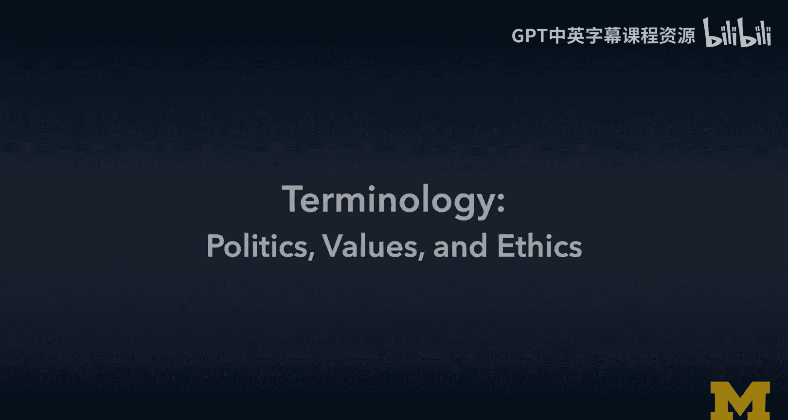

Welcome back。In this lesson we're going to dive a bit deeper into some important terms。

 politics values and ethics First politics， what is meant by this word in our context。

 in its most simple definition， politics means the process by which groups of people often with differing perspectives。

 values and levels of power and influence， attempt to make decisions。

 the term politics is generally associated with behavior within civil governments。

 and it often has a negative connotation， politics people think involves cutthroat strategizing。

 wielding power， playing games， lying， etc， however politics are actually observed in all human group interactions。

 including in corporate environments and academia and religious organizations and families， again。

 every place in which groups of humans have to make decisions。

 and because group dynamics and comps social relations involving authority and power。

 politics refers to the strategies， methods and tactics。

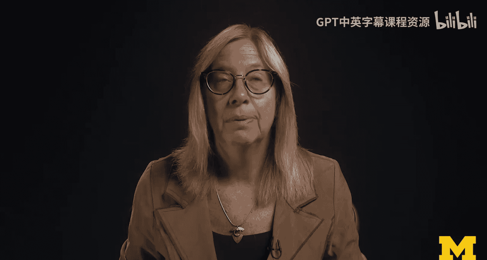

Peopleop used to influence， formulate and execute decisions within groups so let's talk about power just a bit more political scientists have identified four main types of power First there's legitimate power this is power that's formal or codified power that comes along with having a position of authority like a mayor。

 a governor a magistrate， prime minister president。

 minister secretary of a government agency director of some kind of program etc someone has power because of their role in legitimate power reward power is having the ability to reward others who comply with rules or honor others' preferences for example lobbyist in the unit States can reward congressional representatives for voting in alignment with their preferences by making campaign contributions another example is regulators who have the power to reward businesses that comply with the rules by not issuing fines or criminal charges。

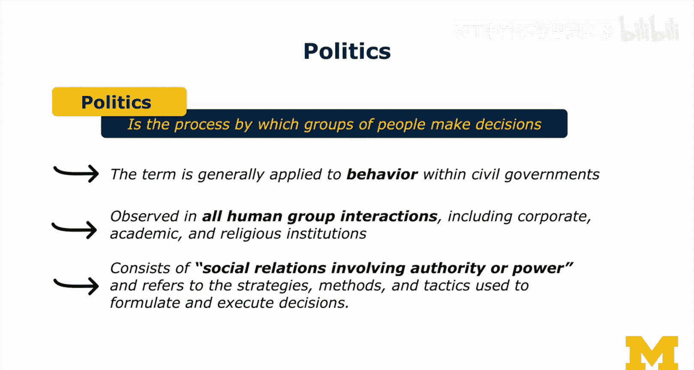

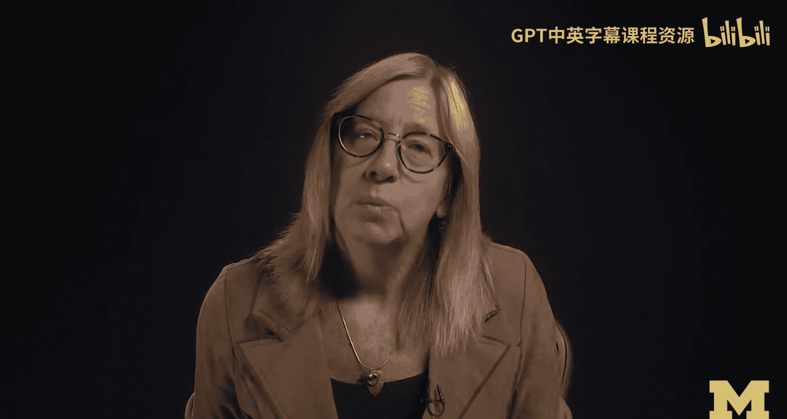

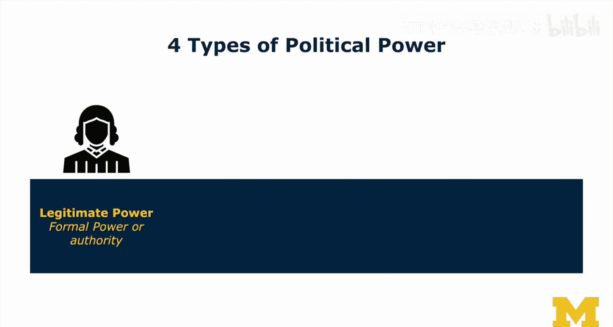

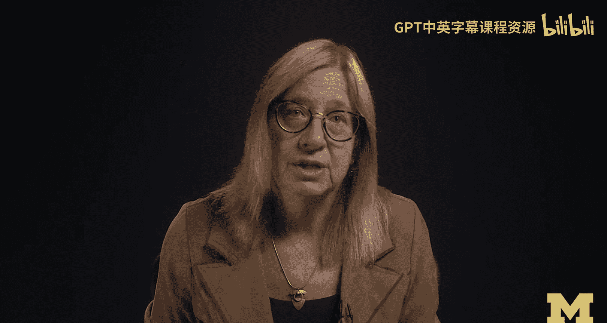

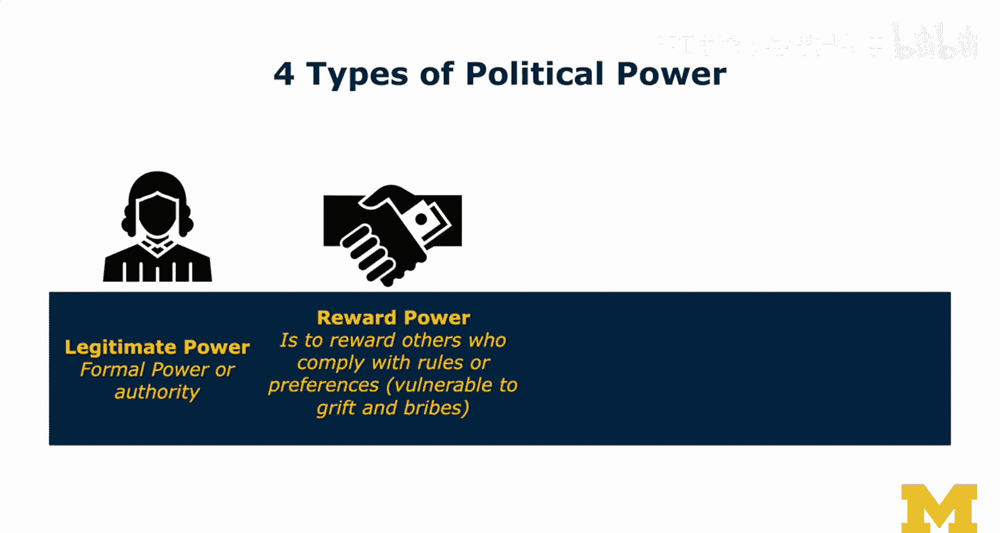

Now， reward power is vulnerable to abuse in the form of bribes or grif。

Or undue influence in some cases one big example is that of government contracts when governments buy goods and services through contracts。

 the people who can award these contracts have serious reward power and thus can be vulnerable to misusing this power third kind of power expert power is a bit different this is the kind of power that comes along with having specific expertise that is relevant to the administrative and policy decision making for example。

 scientific or legal expertise can come along with the ability to influence decision outcomes。

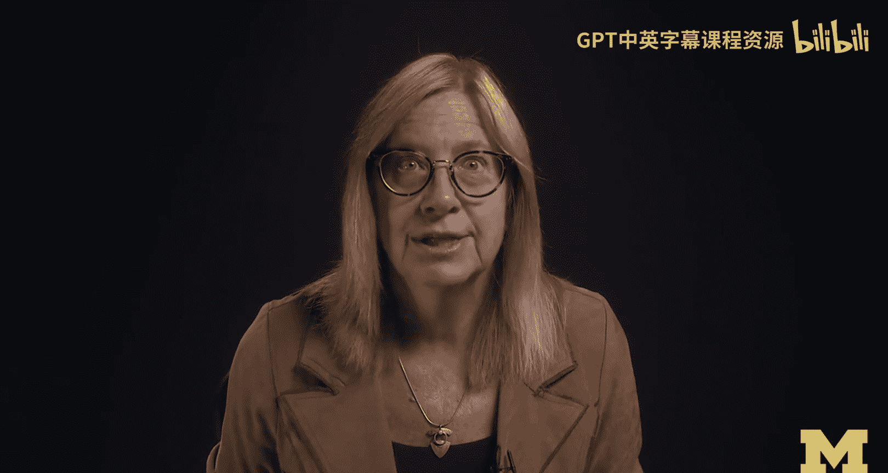

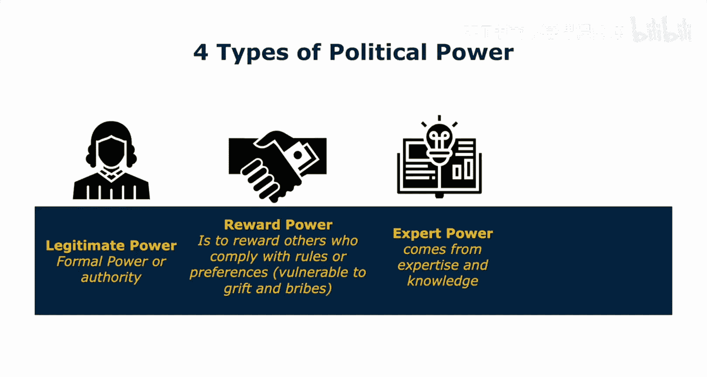

And data science and data analytics are another important example of expert power you have expert power bringing data to decision making should and often does have an impact on the outcomes and finally we have referent power this kind of power comes from others wanting to emulate or to be loyal to an individual or a group or a cause people can often have power because they are charismatic or have other characteristics that allow them to have influence over others and over decisionmaking processes in their outcomes world leaders often have this type of power along with of course legitimate and reward power one person can have multiple types of power let's move on to values what our values well values very simply are broad beliefs about what is good and what ought to be promoted and achieved Now we could talk a long time about values but there's two main kinds of values we want to think about in the work of the public sector instrumental values are preferences regarding the means or the process。

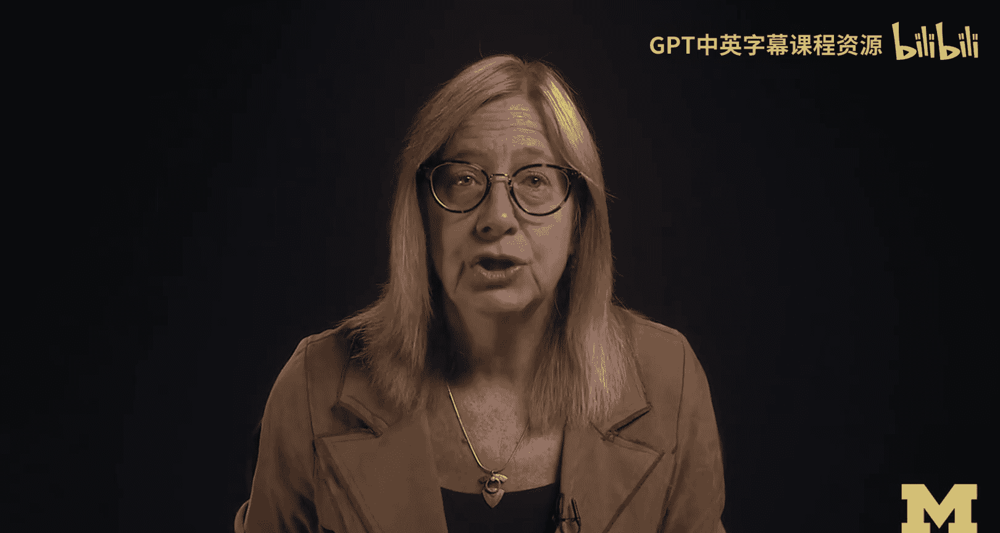

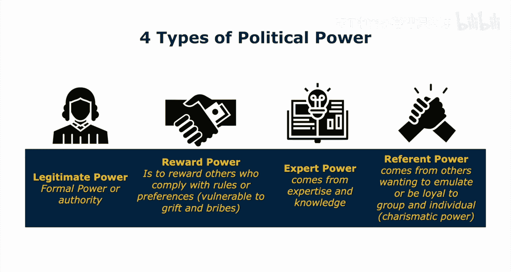

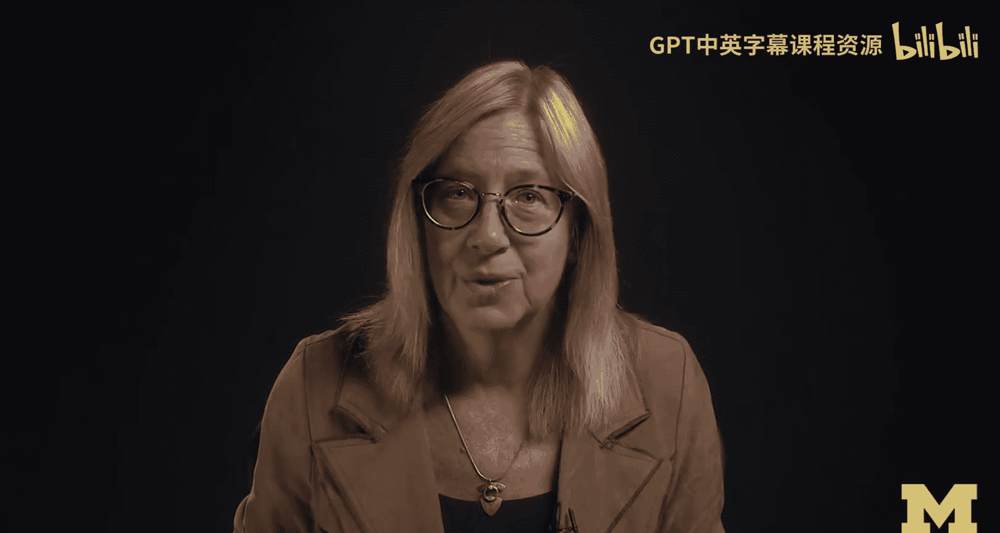

To achieve desired endsT values are preferences regarding desired end states or outcomes public administration public policy involve both big buckets of these values。

 for example， a terminal value might be that everyone be able to live a long and healthy life with instrumental values for that end goal。

 including values to have access to nutritious foods， clean environments， high quality medical care。

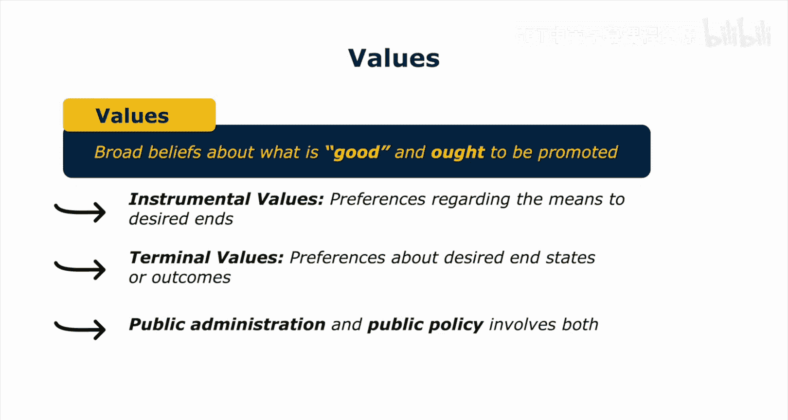

As another example， a terminal value is that judges need to be fair and impartial in their rulings with some instrumental values to achieve that end goal value being codes of professional ethical conduct many。

 many different values inform the work of the public sector Of course you already know about the values of economy efficiency。

 effectiveness and equity are for core pillars， Other values that are commonly voiced in regard to the public sector include objectivity。

 accountability， transparency， openness， trust， respect， community engagement， equal representation。

 sustainability and so on and so on there are also values that are commonly associated with the work。

 and really the behavior of public servants are those who are working in the public sector this includes such values as professionalism。

 responsiveness， expertise， integrity， impartiality， accountability， leadership and many many。

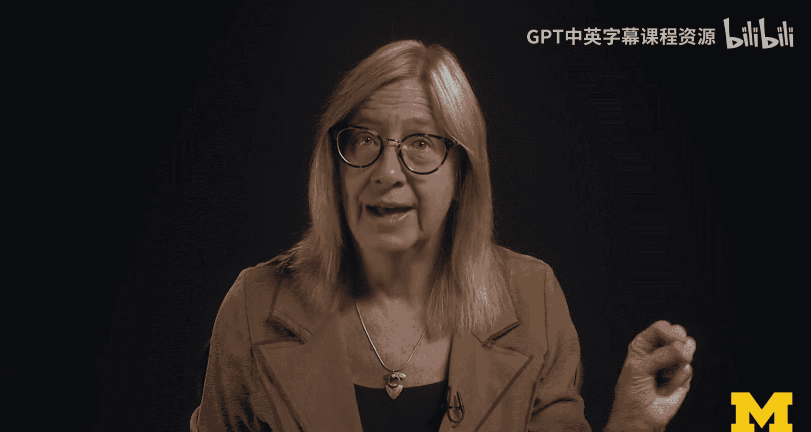

Other valuesFinally， let's turn to ethics and it is first important to understand that ethics are value driven ethics are codes of moral or value drivenven standards for conduct behavior and action regarding what is good or right versus what is bad or wrong and obviously what's good or right or bad or wrong is a set of values ethical behavior is that which is considered good or right in the context of an overarching or governing moral code so here's one more term for you moral reasoning this is the application of a moral code it is critical analysis using logic and decision rules to determine what is right versus what is wrong and what ought to be done or not be done in a specific situation Now examples of moral reasoning systems include utilitarianism。

 deontology， virtue ethics and so on and don't worry we are not going to jump into。

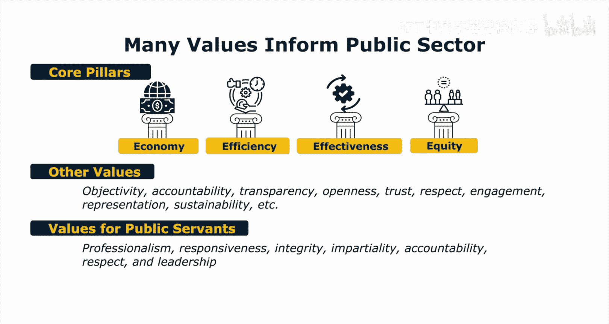

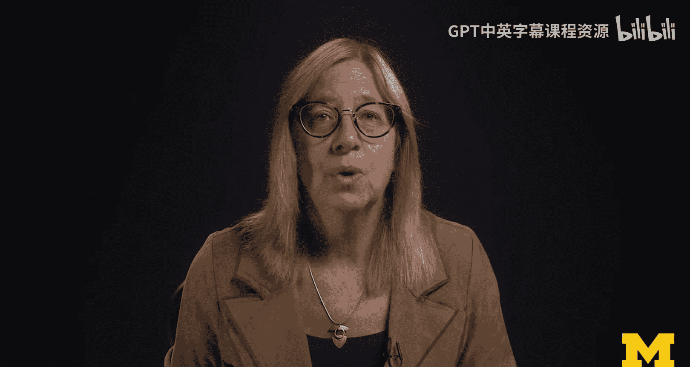

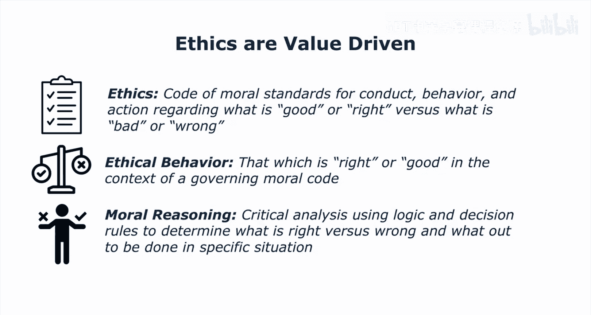

A philosophy lesson right now。However， let's take one more minute to think about ethics in the context of government and how governments themselves reflect different cultures in historical contexts。

 and this includes religious context。When we talk about ethics and moral reasoning。

 can we ever do that as something that's universal。

 something that cuts across countries and their different forms of government well one perspective on this deep question is called ethical universalism which purports that standards of what is right versus wrong are indeed universal and thus transcend or rise above culture。

 society， religion and time or a current historical context that's ethical universalism。

 there's a competing school of thought called ethical relativism。

 this proposes that what is considered ethical or unethical must be judged in light of local and temporal moral standards。

 this means that ethics are relative and thus can and do vary across place。

 culture and time a final school of thought puts these first two schools together it's called integrative social context theory。

 but it's really pretty simple this perspective believe。

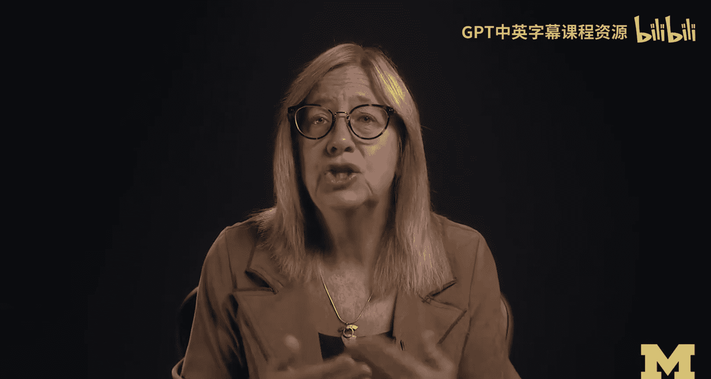

That it's both that there are some first order universal ethical norms and that these should take precedent over second order more temporal ethical norms。

 for example， that murder is bad is a first order ethical norm， most people agree。

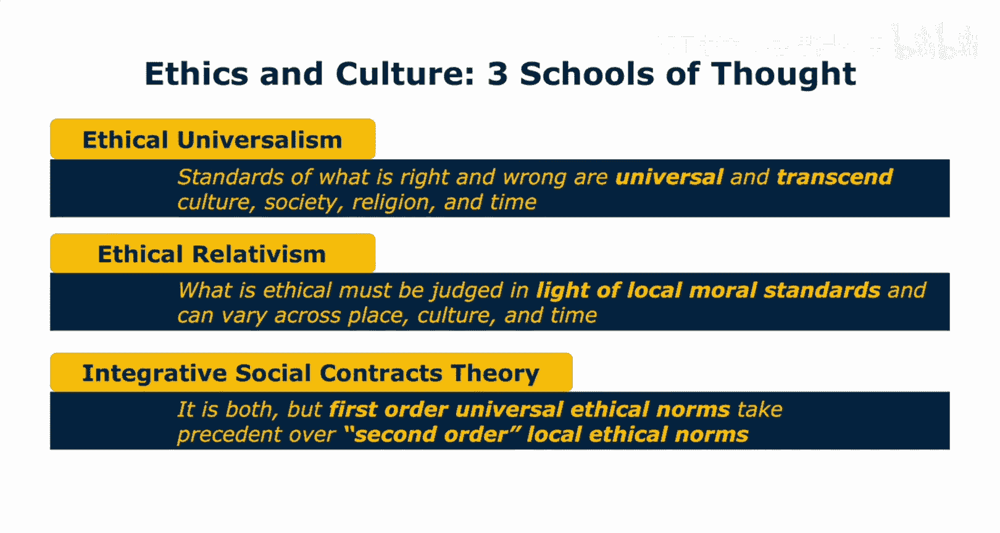

Well， the consumption of alcohol is a relative ethical norm that varies across culture。

Religion and time。Okay， so here's a summary of why we are covering this fun philosophical content。

 but more importantly， why it is so critical to the work of the public sector。

 including data analytics， values and ethics play important and essential roles in five key areas first how social problems are even defined or framed as problematic in the first place in identifying and prioritizing which societal conditions or issues need and deserve public intervention in designing public sector administrative and policy responses in the important work of policy analysis and also in the behavior of public servants we'll be talking more about all of this thanks。

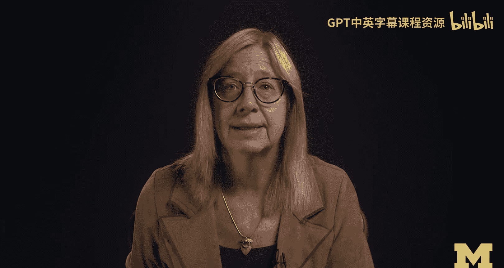

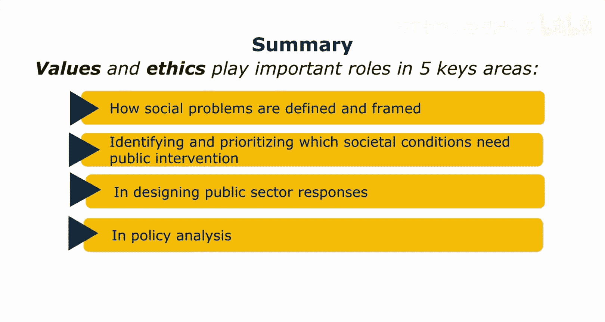

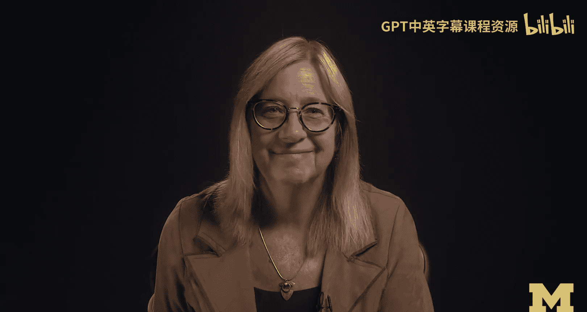

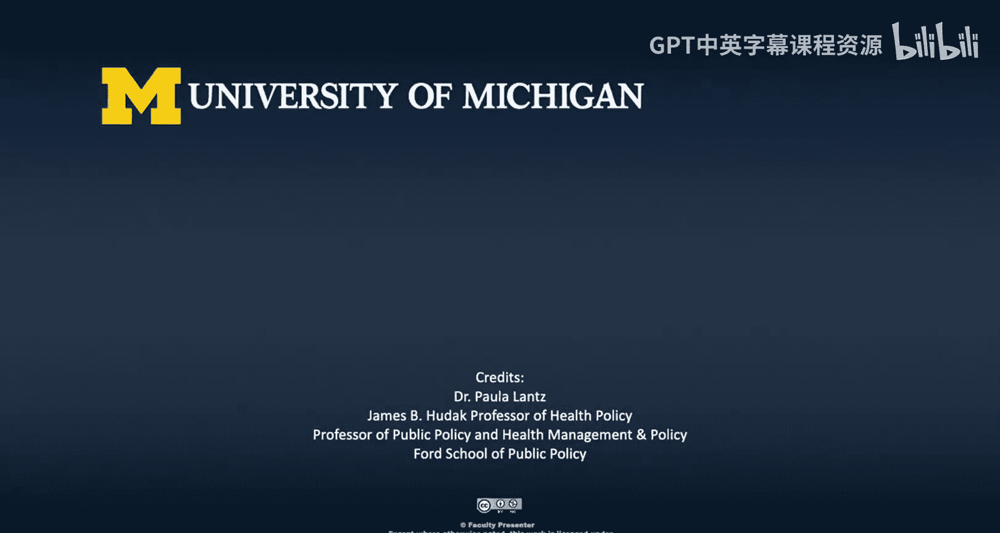