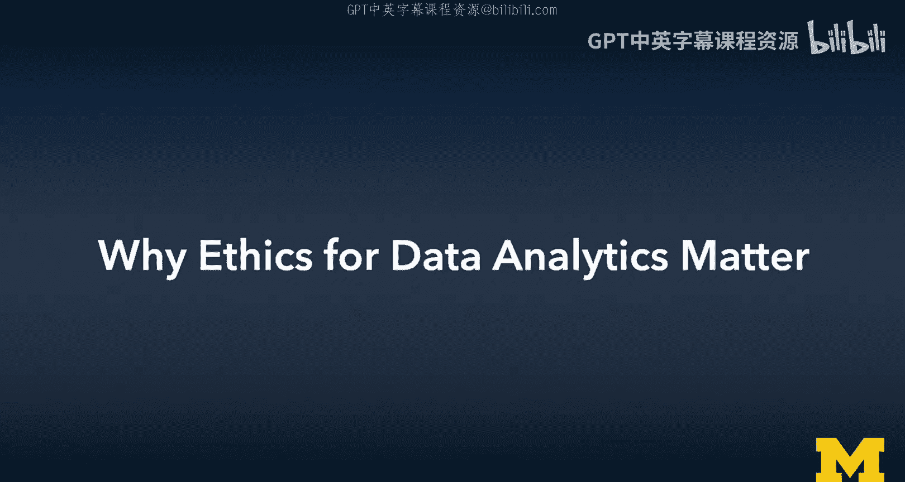
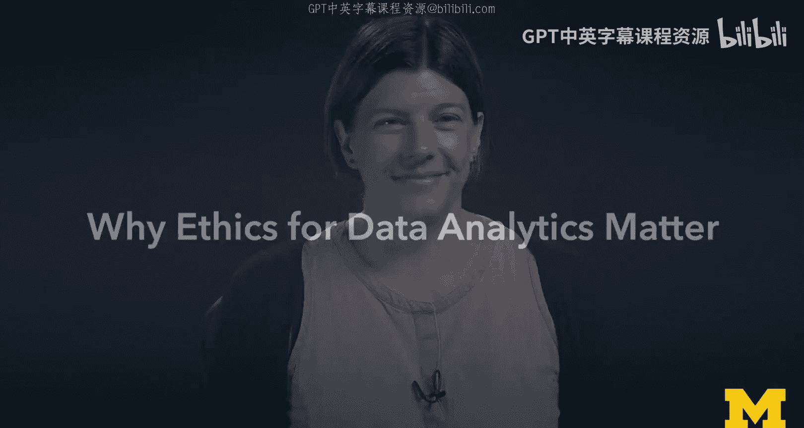
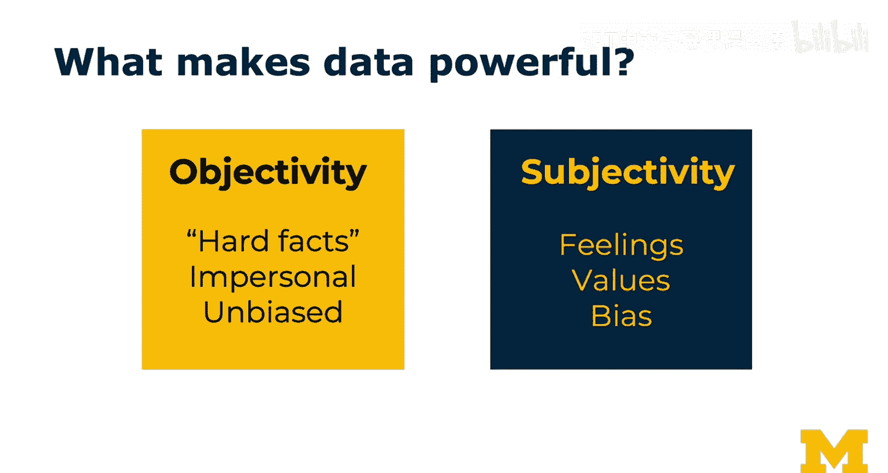
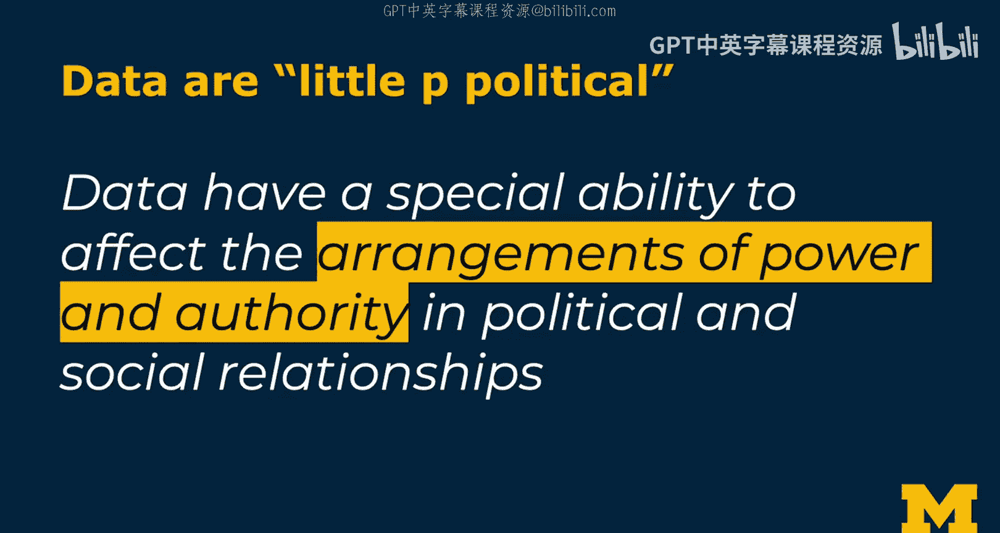
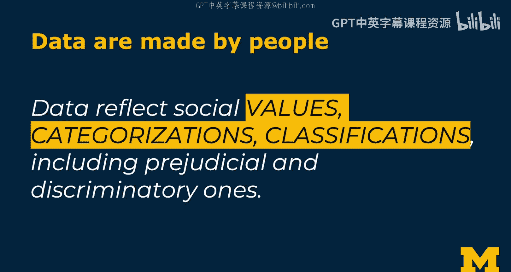
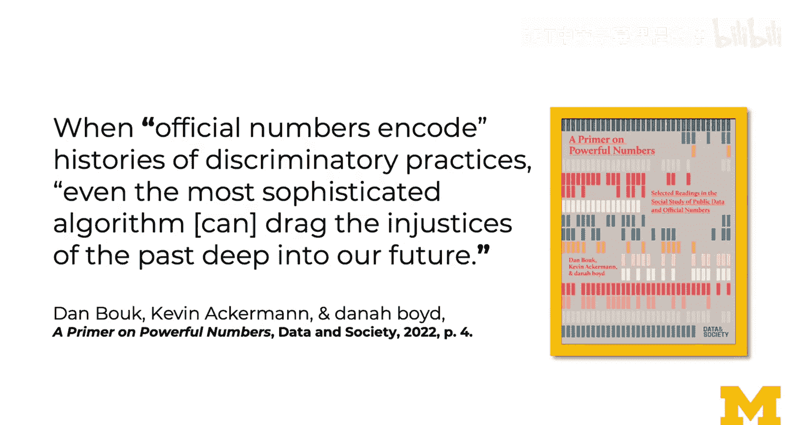
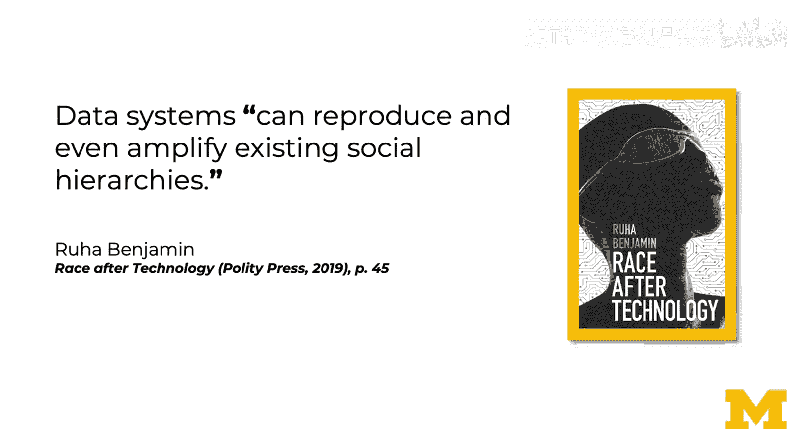

# 密歇根大学《公共部门的R数据分析（基础、数据探索、决策支持、）｜Data Analytics in the Public Sector with R》中英字幕 p127 3_数据分析伦理的重要性.zh_en -BV1YZ421J7Fx_p127-

Hello， my name is Joy Rody， and I'm an associate professor of public policy and history at the University of Michigan。

😊，My work focuses on the history and the uses of policy knowledge。

 what kinds of knowledge and expertise we use and trust， and how that changes over time。

In that capacity， I teach and advise policy institutions about data ethics for public policy。

Data are powerful。 You've learned a lot about how data analytics can provide powerful tools for better governance。

😊，But as the old adage goes with great power comes great responsibility。

 When you're working with data， collecting， analyzing and using them for policy analysis or to inform decision making。

 you are wielding power。Thus， whenever you're working with data。

 you are always working in areas that raise important ethical issues。

Why do ethics matter for data analysts， Why is this your problem。

Because violating ethical norms even accidentally can erode the public trust that's central to good policy practice。

 being knowledgeable about and attentive to the ethics of data analytics will help you provide and even build public trust。

Ethics will help you use data for public good。In this segment。

 we will examine what makes data a powerful in public policy in order to understand the kinds of ethical challenges data analytics pose。

Why do data have so much power in public policy？To answer this。

 I have to get just a little philosophical for a few minutes。In our modern societies。

 we generally view data so long as they're properly created and used as accurate and transparent descriptions of the world around us。

We think of data as objective， as separate and insulated from the personal views or interpretations of the people who create and use them。

We associate data with things as they exist in the world， we think of them as hard facts， as givens。

And we think of things that are objective as the opposite of things that are subjective。

 Subjectivities are things like personal feelings， tastes， opinions and biases。

 They are also things like political ideology。The Association of Data with Obivity is a large part of what gives data special power in public policy。

Policy officials are not supposed to make decisions on the basis of subjectivities。

 they're not supposed to let their personal benefit， their personal interests。

 the good of their particular political party， or their particular government office or agency alone color their actions and choices。

😊，They're supposed to rise above that subjective stuff。

To make decisions that benefit the interests of the publics that they serve and represent。

 So by using data， policy analysts and officials signal that they've drawn their conclusions and made their decisions on an impersonal objective basis。

They signal that the public should trust them， should trust their decisions。

So the upshot of that little philosophical interlude is that while data might be objective。

 they're not neutral when it comes to the relationships of power that are always present in human and social relationships。

Data are what I like to think of as little P political。 When I say little P political。

 I'm not talking about political parties， conservative or liberal values。

 I think of that stuff as big P political。

When I say data are little P political， I mean that data have a special ability to affect the arrangements of power and authority in political and social relationships。

Our belief that data are objective gives data a special power。

A power that other forms of knowledge and argument don't have。

You can probably imagine a few important implications that come from this insight Here's one。

Data collection， data sharing and data analysis can harm as well as help。

 and those harms can often be unintentional or unanticipated consequences of data gathering and analysis。

For example， census data， which is so important for governments to know their populations。

 can be used for harm。In World War I， census data was used by the occupying Nazi governments in the Netherlands and Norway to locate。

 imprison and murder Jewish citizens。The United States government used census data to locate and detain Japanese Americans in internment camps in World War I when they labeled them potential enemies of the state。

Confined to the camps for years， they lost their homes and their livelihoods。

This doesn't mean we shouldn't collect and share census data。

 but it means that government data can have serious material consequences for people's lives。

 We need to take care to ensure that our data making， data analysis。

 sharing and use attend to potential harms， as well as benefits。Often。

 the political power of data is more subtle than these examples。

 because we think of data as objective。 We sometimes make the mistake of thinking that data come from nowhere。

 that they're just out there in the world waiting for us to collect them。

But data are made by people and institutions， and they reflect the values and ways of thinking of the people in societies who make can use them。

Data reflect the categorizations and classifications that we use regularly and often without even noticing to understand and think about our social worlds。

😊，Thus， data can reflect the biases of the societies that they come from。

Take the case of pretrial risk assessments。These are database algorithmic tools created by data scientists in the United States that assign a risk score to people who have been accused of a crime and are awaiting trial。

The scores intended to help judges decide if the person might commit crimes while waiting for their trial。

 in which case they should stay in jail or if they probably won't and can be released to wait for their trial。

It makes sense that we would want to base such a consequential decision on the best data。

The stakes are high for public safety and for the accused individual。

 Those who are released on bail are more likely to be able to keep their jobs。

 pay their mortgage or rent and maintain continuity of care with their children and families。

But audits of risk assessments found that the system was discriminatory。

It was twice as likely to label African Americans in comparison to white Americans as needing to remain jailed because they posed a high risk of committing more crimes。

But a study of actual population behaviors， I。e。 the ground truth from the real world showed no such thing。

The reason why the system was wrong and discriminatory was because the data designed to use it were unintentionally but indelibly marked with the history of racial discrimination in the United States。

The data reflected decades of over policing and over prosecution of African American communities。

As experts have written， when official numbers encode histories of discriminatory practices。

Even the most sophisticated algorithm can drag the injustices of the past deep into our future。

If you're paying careful attention， you might have noticed that data might not always be as objective as we like to think。

Data are not just transparent reflections of the world outside our political and social systems。

 Data， especially policy relevant data， reflect our histories， our societies and our values。

 And so we need to use them with thought and with care。

As Princeton University expert Ruha Benjamin says，Da systems can reproduce and even amplify existing social hierarchies if we don't pay attention to how social norms and structures shape them。

So to wrap up， the old adage that the numbers speak for themselves is rarely true。

Data are not neutral。They have a special power because we think of them as objective as separate from the messy world of values and interests and thus as more reliable than other kinds of knowledge and other inputs to decision making。

But data， especially data that's about people and society， can embody and reflect the values。

 worldview and even the biases of people and societies。And this means that they need to be created。

 stewarded， shared and used with sustained attention to ethics。

