# 密歇根大学《公共部门的R数据分析（基础、数据探索、决策支持、）｜Data Analytics in the Public Sector with R》中英字幕 p128 4_数据分析伦理情境案例.zh_en -BV1YZ421J7Fx_p128-

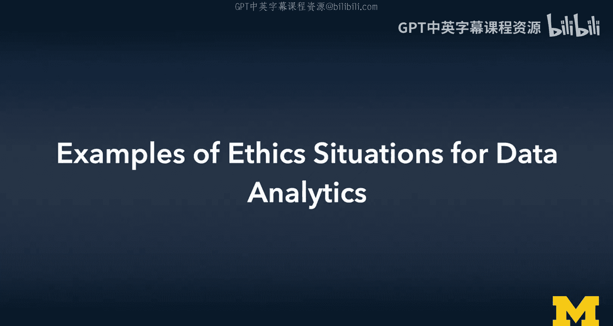

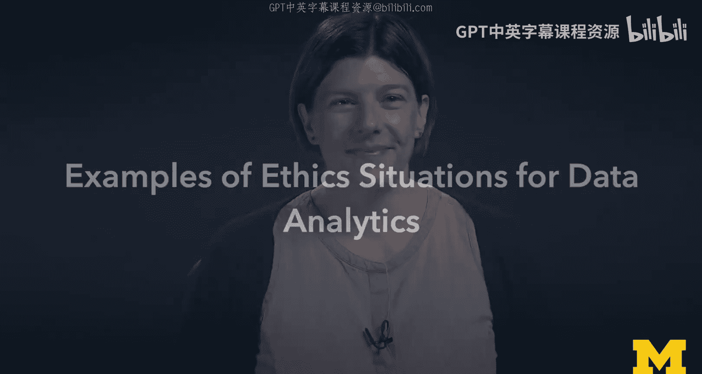

Hello， my name is Joy Rody and I'm Asiate professorfessor of Public Policy and history at the University of Michigan。

I'm back again to talk to you about the ethics of data analysis。

Now that you know something about the political power of data。

 you're hopefully aware that data analytics requires some ethical expertise。

So what are data ethics？As one expert explains， the overarching aim of data ethics is to promote responsible and sustainable use of data for the benefit of people in society。

 and to ensure that knowledge obtained through data is not used against the legitimate interests of an individual or group。

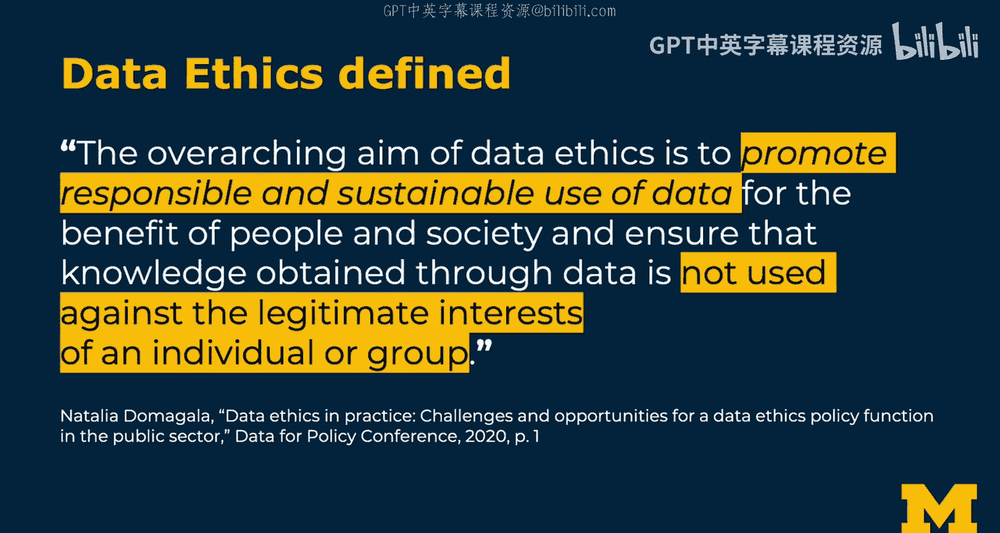

Data ethics does not begin and end within the confines of analytical practice。

 Eical issues arise throughout the stages of the data value cycle， which include data creation。

 curation and cleaning， storage， sharing， use and disposal。That's a lot of territory。

 and the theory and practice of data ethics is a real growth area。

It's also an area that differs by jurisdiction and that has a lot of gaps。

 There's no single accepted legal system for data analytics。 Some jurisdictions have relevant laws。

 and it is important that if you work in those jurisdictions。

 you and your organization are aware of them。But ethics is about more than law。

 It's about what is right or wrong in your broader moral， political and cultural context。

This means that data ethics must be attuned to concerns that people have with how their governments and other organizations collect and use their data。

Some jurisdictions and organizations， for example， the United Kingdom， Canada and Australia。

 as well as the organizationization for Economic Cooperation and Development， or the OECD。

 have suggested ethical frameworks that can guide you， but these are works in progress。

Data ethics continues to develop as new data sources， data sets and analytical methods are developed。

 They also continue to develop as data analytics spreads to new areas of public policy。

 from economics to social welfare services to national security。😊。

All of this is to say that data ethics education is not a onetop shop。

 but an ongoing project that I encourage you to integrate into your professional development and practice。

 remember， data are powerful， and their use and policy cannot only lead to better or worse decisions。

 they may if not used carefully， reproduce and deepen inequalities。Data analytics。

 if not done ethically， may erode people's trust in government。

So in light of the Apache official landscape guiding data ethics。

 what are some good practices and ideas that can guide you？

First。Because data ethics is about maintaining and building public trust。

 good data ethics practice is human centered。

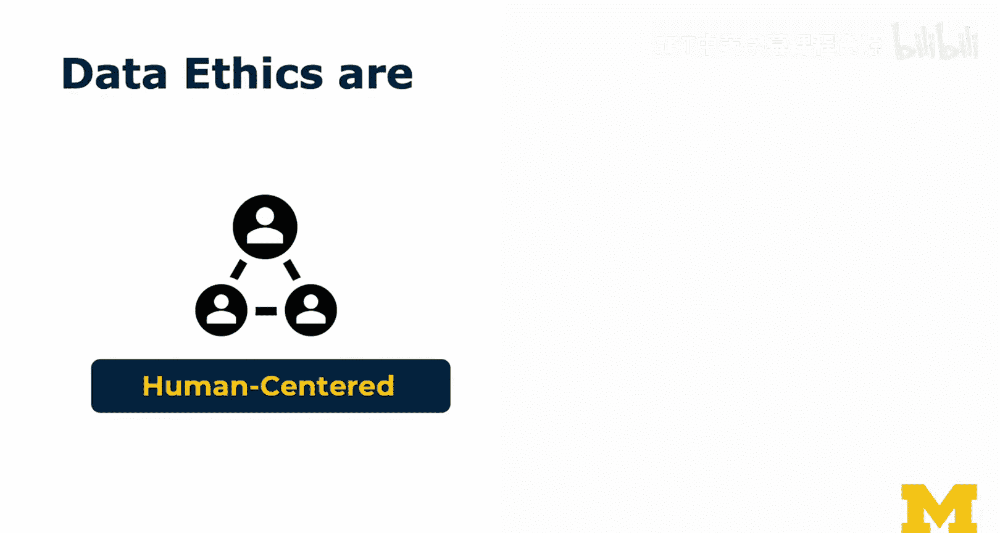

It is aware of and responsive to how publics think about data。

 what they think of as public data and as private data， for example。

It's also responsive to what kinds of government actions and decisions publics think are appropriate。

And how much publics do or don't trust certain governments and even certain specific government agencies。

For example， as a citizen of the United States， I'm probably comfortable with my government using information I provided to get my state identification to provide me with information about elections。

 but I'm not comfortable with an intelligence agency mining my Twitter feed to know what I think about the latest political news。

Second。Data ethics are highly contextual。 They are not one size fits all。

 Ethics must be assessed within the context and function of particular data analytical projects。

 and their ethics are deeply connected to the ethics of the broader policy projects that they are designed to support or inform。

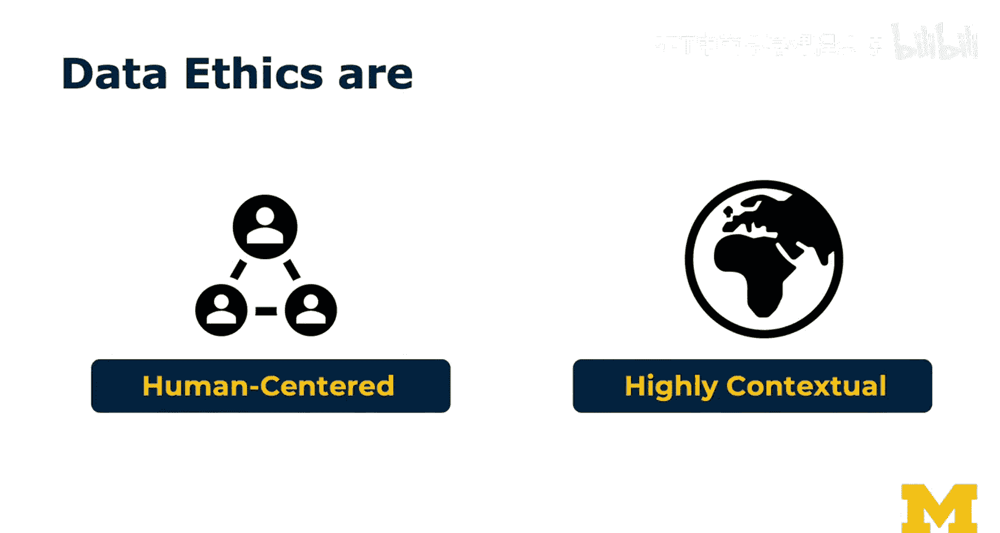

Let's explore this by looking at some real world potential data projects。

Here's an example。An Office of National Statistics scrapes price information from supermarket websites to monitor economic issues。

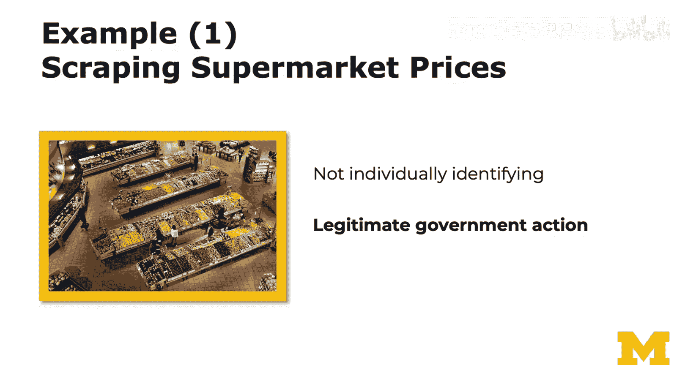

This seems pretty benign it does not identify individuals。

 the data probably do not reproduce stigmas or biases against certain groups of people。

And in many national contexts， citizens expect and desire that the government track economic issues that affect them as consumers。

Let's take another example。An Office of National Statistics uses data from Twitter to track the movements of population groups in order to plan for providing local services。

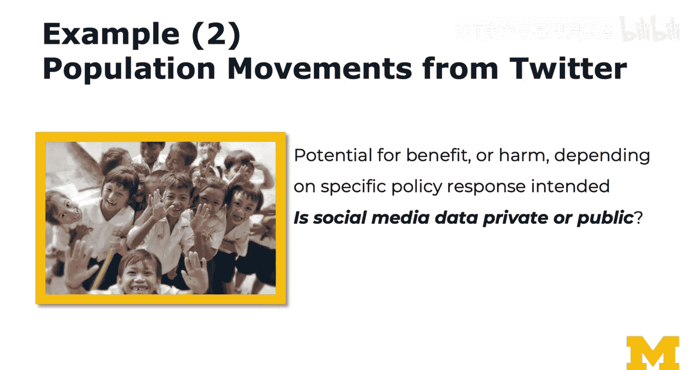

Anticipating changing needs for local services could be very beneficial for populations。

But before we can be sure， we need to ask at least two questions。 First。

 what services are we talking about。Are we talking about the creation of new schools and health clinics in growing communities？

Are we talking about increased security forces directed at controlling a disadvantaged or marginalized population like refugees？

The use matters， and data ethics cannot be considered outside of the context of application。

The second question that we need to ask， what do the Twitter users whose data is being analyzed。

 think about government， mining their social media。In the age of big data。

 data are quite often literally made by thousands， even millions of individual people。

People who are often not thinking of themselves as making public data through their social media posts and other digital traces。

Studies indicate that people have different views on whether social media are personal or public。

So this example raises questions about public expectations。

 about the provenance and use of their data。Questions that need to be answered in the context of your particular society's norms and expectations。

Here's a final example。A public health office uses data analytics to understand the broader needs of people receiving certain public health related benefits。

They have found in their study that different groups have different needs。How do we assess this？

First， health data is very sensitive。 So ethical practice here requires careful anonymization。

 Second， similar to the previous case， use really matters here。 This could be very beneficial。

 but it could be potentially discriminatory， For example。

 if the data the conclusions are based upon already have inequalities hidden in them。

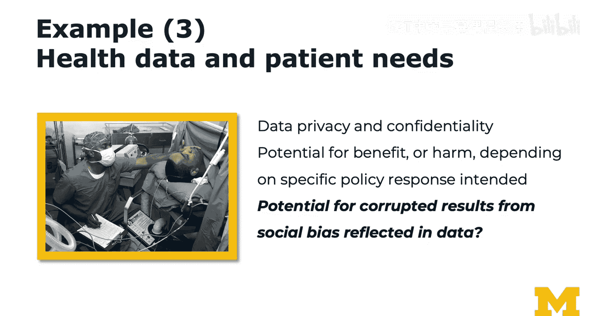

In the United States， for example， analysts have found that some health data sets reflect a history of racial disparities and healthcare provision。

A study based on such data could show that white patients need more public support than African American patients。

 reflecting that historical disparity rather than ground truth。So in this case。

 ethical practice would have to work to ensure that the study does not accidentally recapitulate biased norms and social structures。

The upshot of these examples among the ethical questions that you need to consider are the security of the data。

Are individuals deidentified and protected？The provenance of the data in question。

 do people consider it public or private？Is it ambiguous and therefore still sensitive？

The data itself。Does it recapitulate historical or existing inequalities？

Can you analyze it in a way that avoids extending those inequalities into the future？

The policy context。What is the data for。What is the public trust in the institutions that are using it？

What are the potentials for benefit and harm， answerswers to these questions will often be complex and will require a careful balancing of benefit and harm。

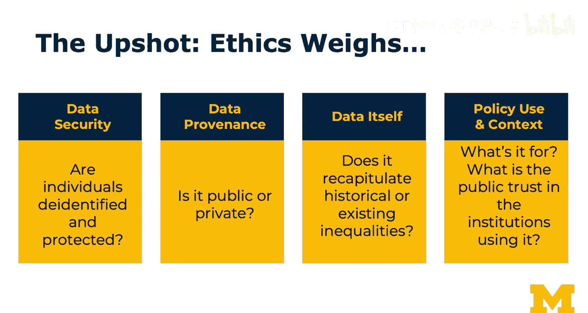

These are just a few considerations to get you started。

 I want to stress that data ethics is not a box to check at the beginning or the end of a project。

 but an ongoing iterative， holistic and contextual process。As a data analyst。

 you are not alone in your responsibilities。 good ethical practice should be distributed across your institutions or organizations。

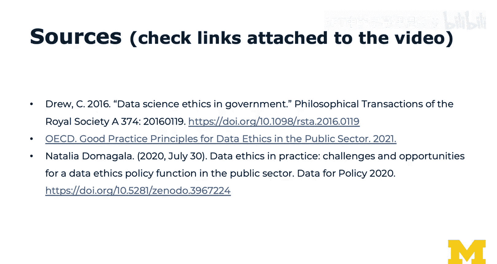

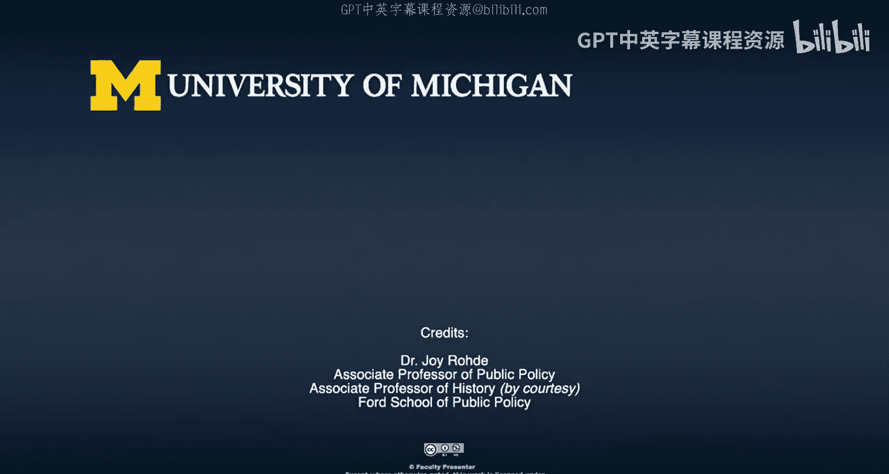