# 密歇根大学《公共部门的R数据分析（基础、数据探索、决策支持、）｜Data Analytics in the Public Sector with R》中英字幕 p129 5_美国数据伦理框架基本原则.zh_en -BV1YZ421J7Fx_p129-

。Welcome back。Let's start this session with a quote from David Hand from the Imperial College of London。

 who said this about data and data science。

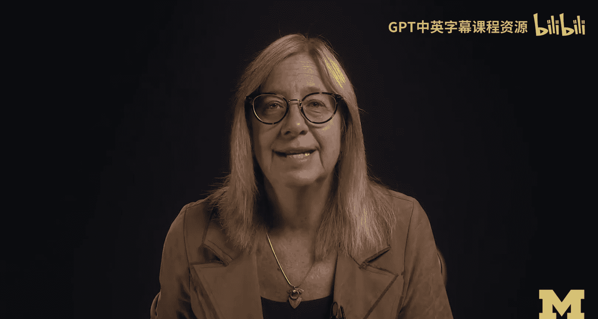

Although sometimes described as the new oil， because of the way data and data science are revolutionizing society。

 just as fossil fuels did earlier， data have such unique properties。

 leading to correspondingly unique ethical challenges。

 such considerations do not permit simple formulaic answers。

 since these must be context dependent and dynamic。

 instead solutions must be principles based with higher level considerations guiding decisions and any particular context。

 kind of a mouthful， but the point that。

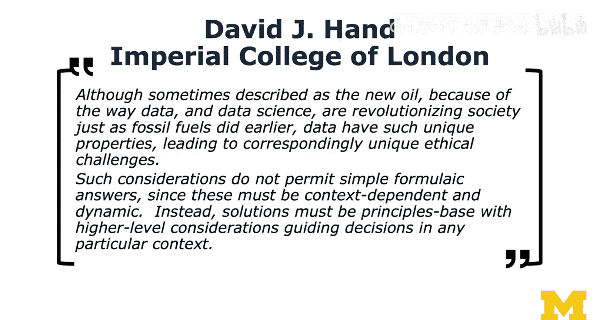

Mr。 Hand is making here is that there needs to be a roadmap with a set of principles or guidepost for recognizing and responding to the myriad ethical challenges that are our large part of the explosive and revolutionary new world of data science。

 data technology and data analytics the United States federal government which is one of the largest producers and users of data in the world rose to this challenge recently by having a large diverse set of stakeholders work together to produce the federal data strategy and an associated action plan within this plan the general services administration of the federal government was tasked with developing a data ethics framework this framework had the purpose of assisting federal employees。

 managers and leaders in making ethical decisions as they acquire。

 manage and use data This data ethics framework has seven tenets or。

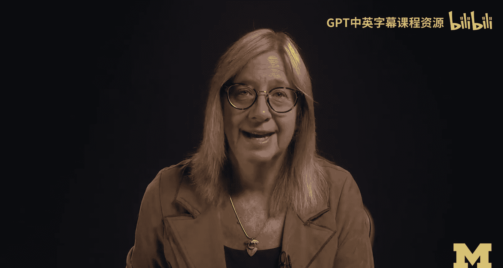

All of which promote a number of values and corresponding ethical behaviors the framework presents these tenets as steps as they build upon each other with the lower steps providing a strong foundation for the subsequent steps。

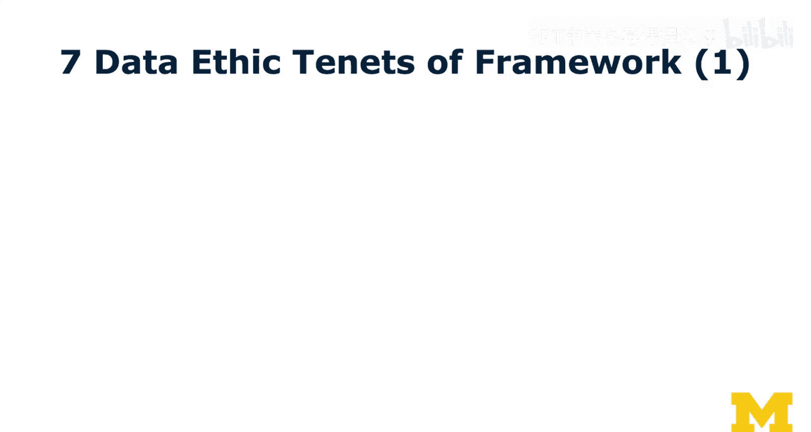

You can read more about this， but let me summarize these tenets for you now The first tenet or step is uphold applicable statutes。

 regulations， professional practices and ethical standards that is don't break the law regulations and follow already existing codes of professional ethics that cover your work Tenet or step2 is respect the public individuals and communities。

 respect their conditions， their interests， their priorities and their opinions。

 step3 respect privacy and confidentiality and as you well know these are core values for data systems and data analytics step4 act with honesty。

 integrity and humility in your work and step5 related to that and hold yourself and others accountable step6。

 promote transparency in your work step7 stay informed of developments in the fields of data management and data science。

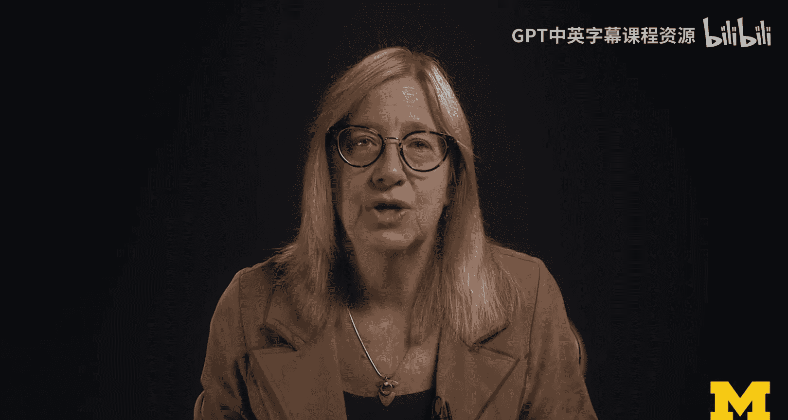

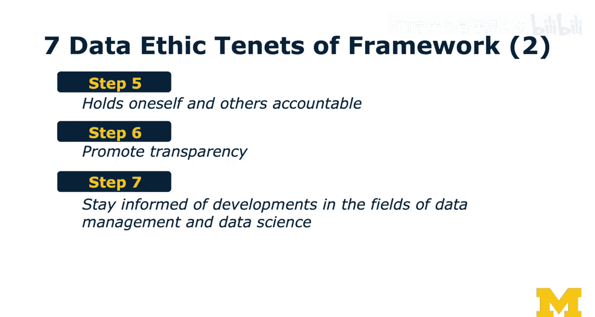

And this includes not only technology developments but also evolving developments and considerations of ethics again。

 I really urge you to read this report and learn more about each of these steps or tenets。

I think this framework can be very helpful to you and your work。

Also having this type of ethical guiding framework offers many benefits to the field of data analytics in the public sector it provides everyone with an important set of principles to consider and navigating ethical dilemmas and considerations it can help to improve and make for better data-driven decision- making it also can help with risk mitigation governments are at great risk for lawsuits and other negative consequences for unethical behavior and this includes misuse of data following these tens can also increase government transparency it can help to bring in and consider also a wide group of stakeholder perspectives all of this is important all will help improve public trust which is essential for the work of the public sector。

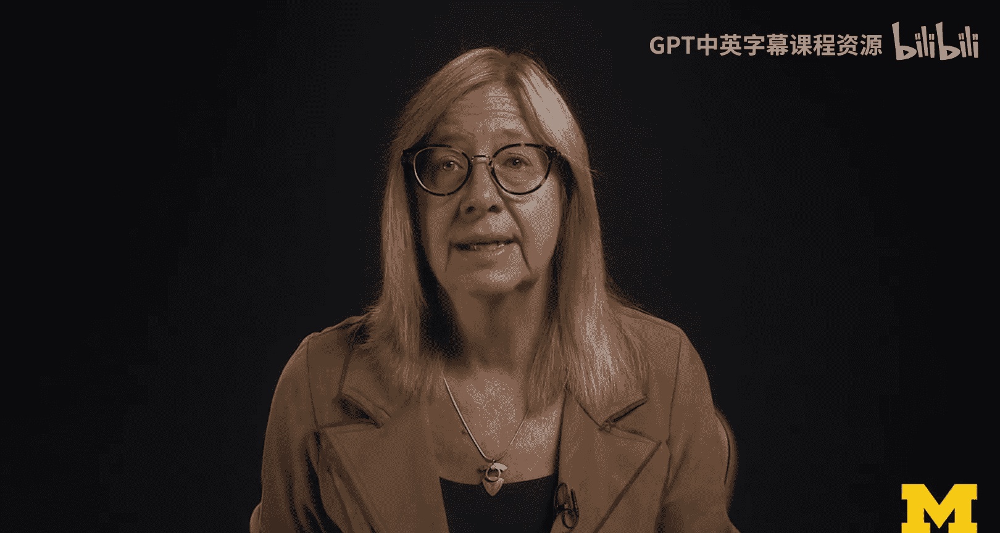

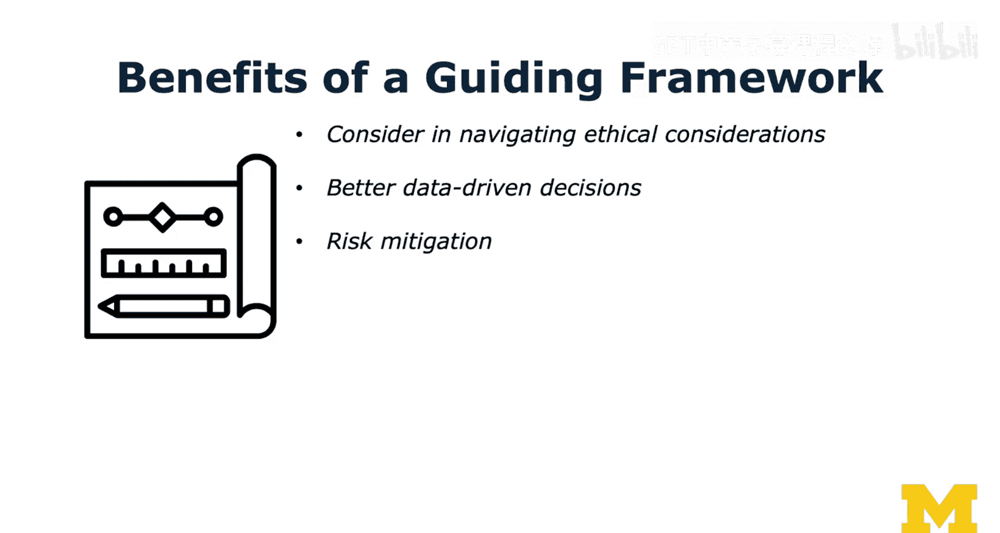

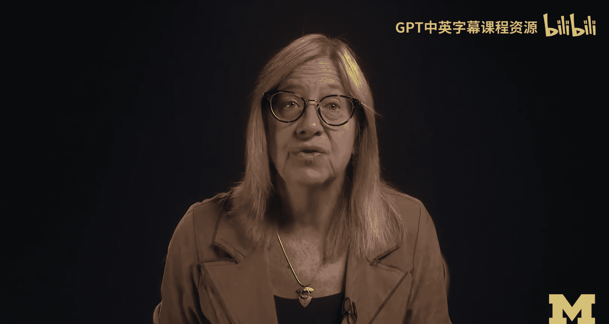

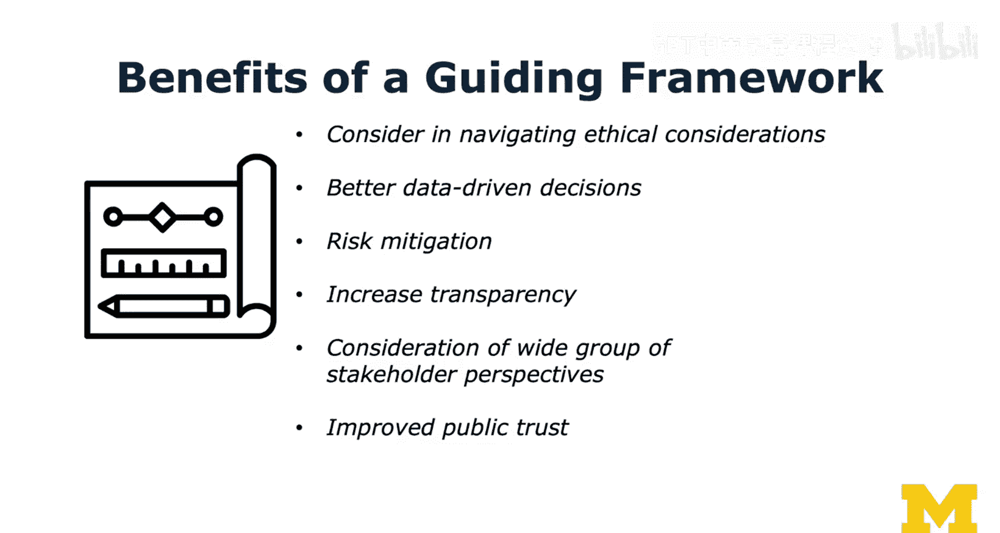

Thank you。

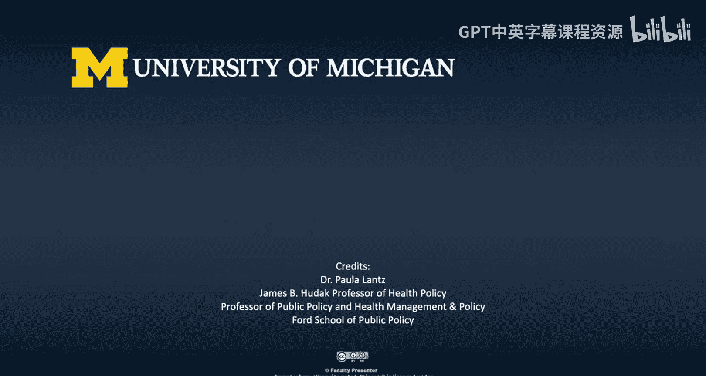