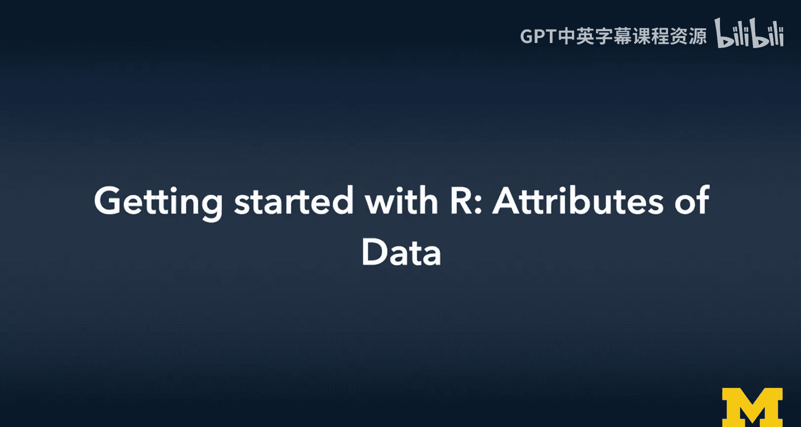
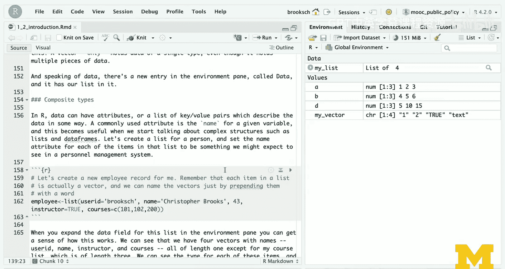
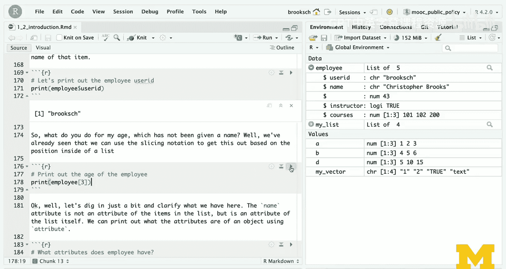
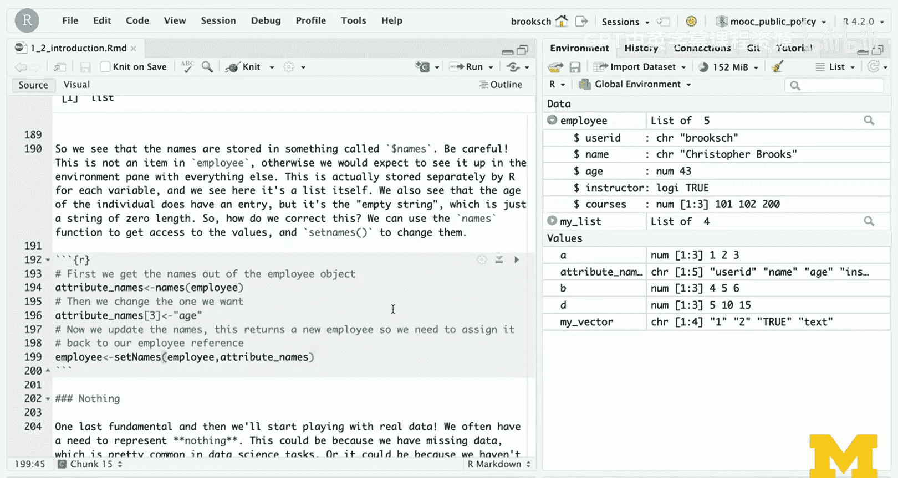
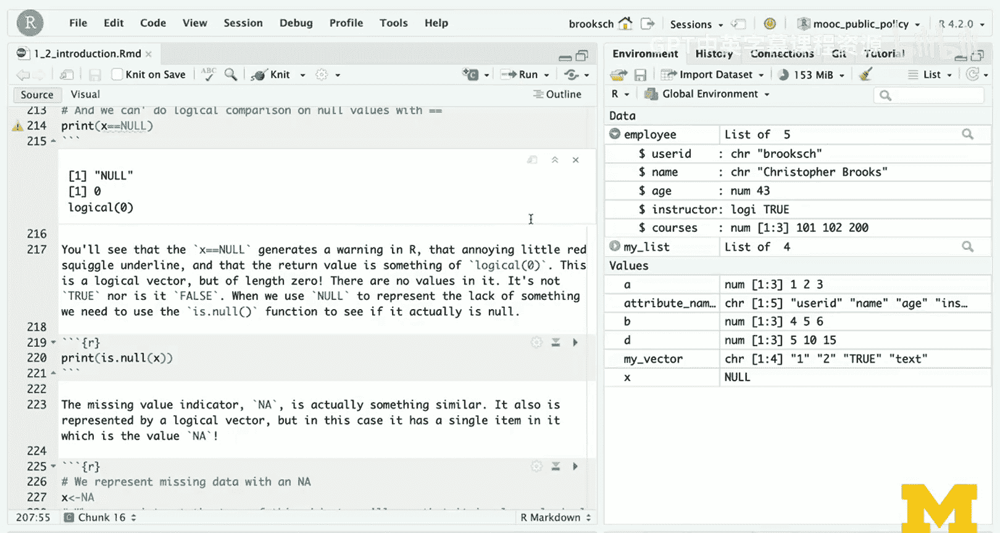
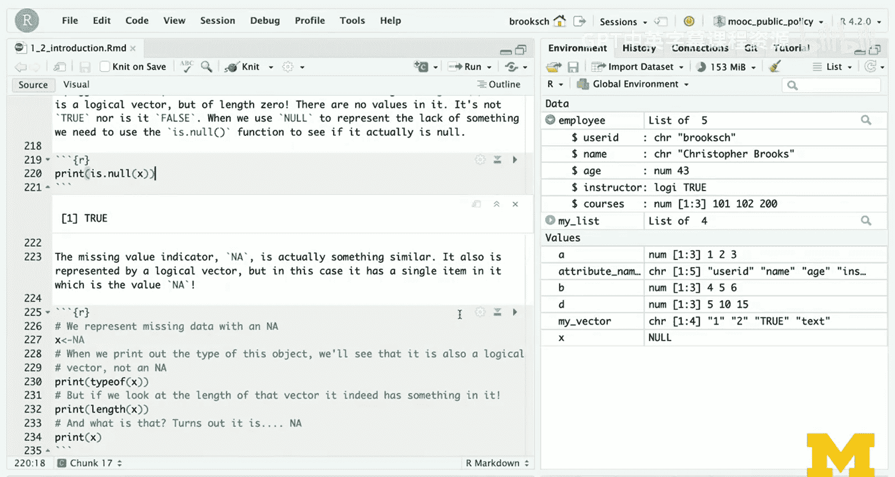
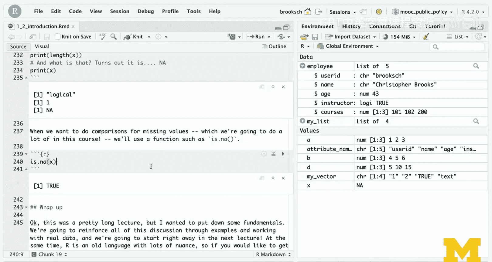

# 密歇根大学《公共部门的R数据分析（基础、数据探索、决策支持、）｜Data Analytics in the Public Sector with R》中英字幕 p13 12_R语言数据属性解析.zh_en -BV1YZ421J7Fx_p13-

And speaking of data， there's actually a new entry in the environment pane called data。

 and it has our list in it。In R data can have attributes or a list of key value pairs。

 which describe the data in some way。 A commonly used attribute is the name of a given variable。

 and this becomes useful when we start looking at complex data structures。

 such as lists and data frames。

Now， let's create a list for a person and set the name attribute for each one of the items in that list to be something we might expect to have for a person in some sort of personnel management system。

So I'm going to create a new employee record for me Now remember that each item in a list is actually a vector and so we can name the vectors just by prepending them with a word so here I'm going to say employee I'm going make a new list and I'm going to say the user ID is Brooks CH This is my Umi user ID the name is Christopher Brooks I'm going to put a 43 in the third element here and then say the instructor is true and the courses。

 well why not I'll just make a vector of the different kinds of courses I teach 101102 and 200 and we can execute this。

When you expand the data field for this list in the environment pane。

 you can get a sense of how this works。 We can see that we have four vectors with names， user I D。

 name， instructor and courses， all of length 1， except for my course list， which is of length 3。

 We could see that the type for each of these。 and we could see that there is one item。

 which has no name， the number 43。So we're starting to deal now with our first really structured data and being able to read this environment pain is going to be critical to your understanding of your work。

We see a dollar sign in front of each of these names， and that's a very important cu。

 You can use the dollar operator to select out an item from a list based on the name of that item。

 So let's take a look at this。 So let's print out the employee user I。

 So here I'm just going to print employee。 And then I just use that dollar sign operator and follow it by the name of the item。

Al right， So we see that Brook C， H is printed。 So what are you going to do for my age。

 which hasn't been given a name。 Well， we've already seen that we can use this slicing notation to get this out based on the position inside of a list。

So because this is a list， we could just print out the age of the employee because we know it was the third item that was put in there。

 so we can use employee sub3 to print out just that element。

Okay， well let's dig in a bit and clarify what we have here。

 The name attribute actually isn't an attribute of the items in the list。

 but is an attribute of the list itself so we can print out what the attributes are of an object using the attribute function。

 So here I'm going to print out all of the attributes of employee and then I'm going to print out the data type of the attributes result we'll just execute that。

So we see that the names are stored in something called dull sign names。 So be careful。

 this isn't actually an item in employee。 Otherwise。

 we would expect to see it up in the environment pane with everything else。

 This is actually stored separately by R for each variable。 And we can see here it's a list itself。

 We also see that the age of the individual does have an entry。

 but it's just this empty string of these two quotes， which is just a string of zero length in R。

So how do we correct this， Well we can use the names function to get access to the values and the set names function to change them。

So here I'm going to use the names function on employee so I'm going to take the names just this list that was in there out and I'm going to make it into a new variable called attribute names。

 then I'm going to take attribute names sub3 and I'm going to set it to age now that's just a character vector and then I'm going to call set names on employee with the attribute names Now set names will actually change employee but it doesn't change it in place it returns a copy and so we want to assign that back to employee so I'll execute that。

And we can see up here that we now have the age correctly identified in the data。

One less fundamental， and then we'll start playing with real data。

 We often have a need to represent nothing。 and this could be because we have missing data。

 which is pretty common in data science tasks， or it could be because we haven't yet defined a field in an object。

 but we know that there will be。 and this is actually pretty common in computer science tasks。

Underneath computers represent everything in binary ones and zeros。

 So how do we represent the lack of something in a sequence of ones and zeros。 Now。

 this problems not unique to R。 It plays a lot of different programming languages and paradigms。

 And in short， we've got two different cases， missing data and unknown object references。

 And R handles both of these differently。 So we represent the lack of a reference to something as a null value。

 So here I'm going to assign x， a new variable to null and we use all capitals for this。

 And then I'm going to print out the type of this object。

 and we can actually see that it's going to be null。 And we know that it's a vector。

 So like let's print out the length of that vector。

 And it's important to note that we can't actually do logical comparisons on null values with double equals。

 So I want to show you what happens when you try and take X， which we know to be null。

 and compare it with a new null value， just the word null。

So you'll see that this x double equalal null generates a warning in R。

 that annoying little red sququiiggle line underneath and that the return value is something of a logical0。

 Now， this is actually a logical vector， but it's a vector of length 0。 and there's no values in it。

 It's not true。 and it's not false。 When we use null to represent the lack of something。

 We need to use the is null function to see if it actually is null。

 And this is a paradigm of programming that you'll get used to as you go throughout this course。

 So don't worry too much if you don't quite understand this now。

So let's instead print out the Is Nll of X。Allright， the missing value indicator。

 NA is actually something similar。 It's also represented by a logical vector， but in this case。

 it has a single item in it， which is the value of NA。

So we can represent missing data as opposed to missing references with an NA。

 so we'll do this a lot in this course， and I'll take x and I'll assign it to NA。

 When we print out this type of object， we're going to also see that it's a logical vector。

 not an NA， but if we look at the length of this vector， it actually has something in it。

 So when we print the length of x or the length of NA， it's not going to be a logical zero。

 it's going to actually have something in it， and it turns out that that's actually an NA inside of it。

When we want to do comparisons for missing values and we're going to do a lot of that in this course。

 we're going to use a function called is NA and if you don't quite grab the difference between null and NA here。

 don't worry it's something that you'll get to experience as we go through this。

 it'll make more sense as we go through the course We're going to use this function is na of X quite often。

And we can see that that returns a boolean value of， in this case， true。

Okay， this was a pretty long lecture， but I wanted to put down some fundamentals。

 We're going to reinforce all of this discussion through examples and working with real data。

 and we're going to start with that right away in the next lecture。 At the same time。

 our is a really old language with lots of nuance。 So if you'd like to get under the hood a bit and understand how it works。

 or even if you just want a reference guide to join you on this journey。

 I've got some resources listed in the course to help you。

 and I'm looking forward to the next few lectures。😊。

