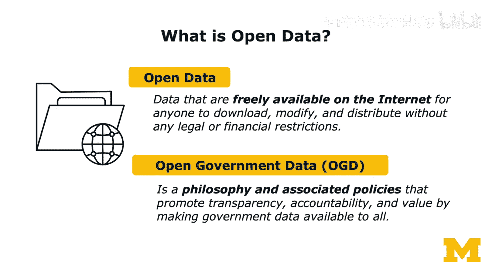
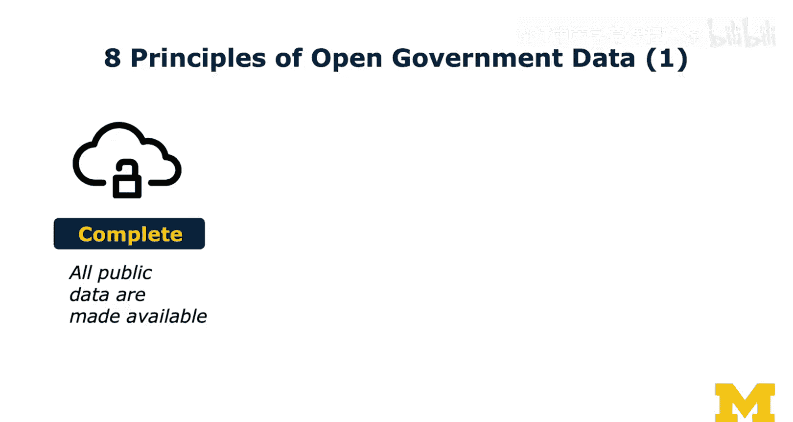
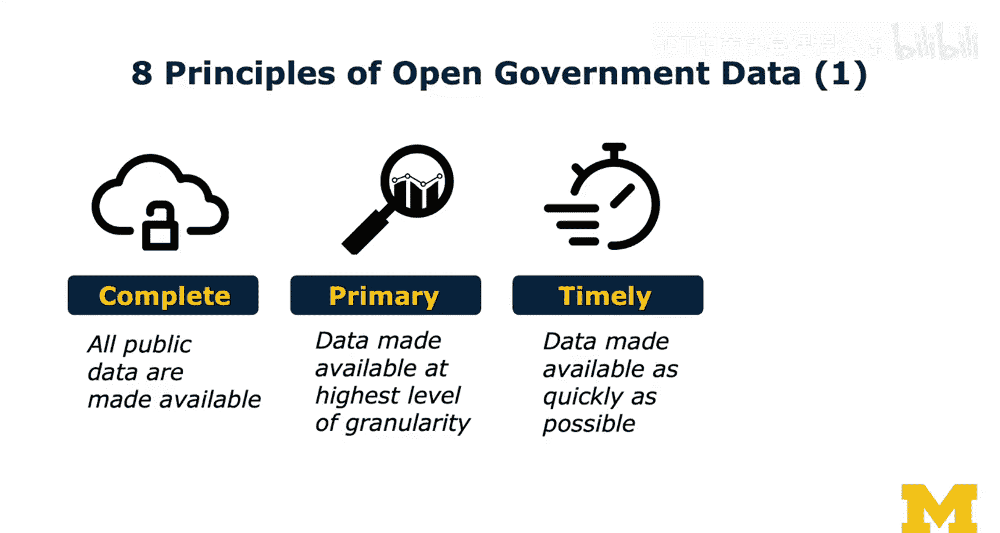
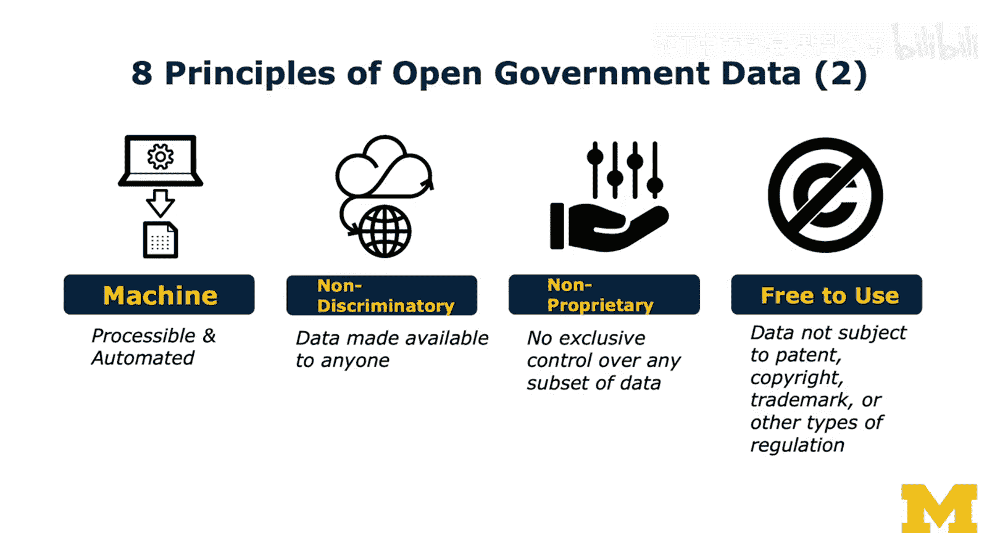
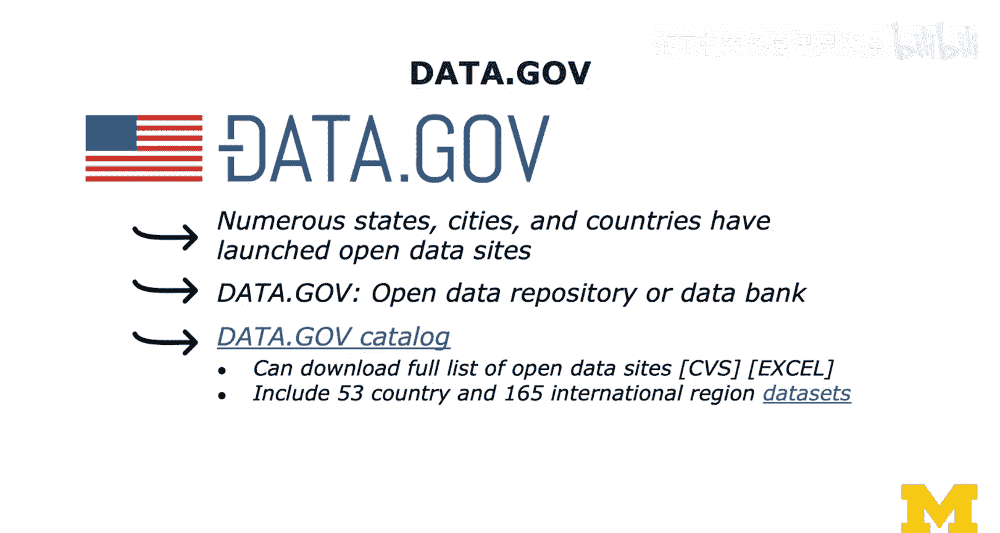
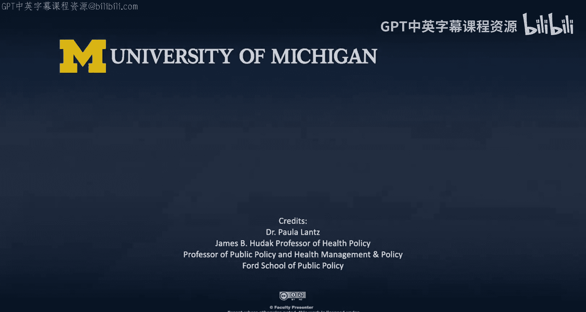

# 密歇根大学《公共部门的R数据分析（基础、数据探索、决策支持、）｜Data Analytics in the Public Sector with R》中英字幕 p130 6_本周补充：开放政府数据八项原则.zh_en -BV1YZ421J7Fx_p130-

Hey， I'm back to talk to you quickly about one more thing open government data open data very generally are data that are freely available on the internet for anyone to download。

 modify， analyze and distribute without significant legal or financial restrictions open government data is a philosophy with associated policies that promote transparency。

 accountability and social value by making government data available to all some value-based principles of open government data include completeness now this doesn't mean that every bit of government data needs to be made public personal data related to healthcare。

 public health care programs， pension system， contributions and payments， individual census， answers。

 etc need to be protected and need to remain private however。

 data that legally can be made public should be made public。

And in as complete manner as possible。And as you well know。

 it's also feasible to make deidentified data or data that's been stripped of all identified identifying information available for public use the next principle of open government data is primary and this means that data should be made available at their most primary level or highest level of granularity。

 this also means making deidentified individual level data available versus making only making available aggregated data by city or neighborhoods or counties or even higher levels of aggregation third principle timely now as people who do this work。

 you know that it takes time to clean data strip off identifiers deal with missing variables。

 missing data etc， there's a lot of work to do with data before it could be publicly released however this work should be done as quickly and efficiently as possible so that the data are still timely。

and important and relevant at the time of their release assess is another principle of open government data and this means that data should be made available and accessible to the widest range of users for a wide range of purposes Another principle is that data that are publicly released ought to be machine readable the data need to be processable by computers and the public release of data needs to be nondisriminatory anyone should be able to access and use it you should not have to submit a proposal for what you want to do with the data you should not have to have certain credentials or certain standing in any way to get access to the data you should not have to pass any criteria at all for access Open government data should also be nonpropriet and that means that neither the government or any other entity should not have exclusive control over data or any subset of the data and finally the data should be license free or really not have。

Any significant regulatory barriers for access and use Open government data should not be subject to patent。

 copyright， trademark or other kinds of rules and regulations just a moment and have some fun exploring an open data repository that's run by the U government which is called and you can find it at data this website provides links to a number of state county and other country open data sites it includes data from multiple countries in international regions of this as a rich library or repository for open data sites from all around the world the data website a catalog in the form of an Excel spreadsheet where you can see a full list of open data sites and there's links to each of them there's a lot to explore here open government data sites in 53 countries and 165 world regions again please just take a moment to see what data are available to you。

Anyone else through the open government data movement？

