# 密歇根大学《公共部门的R数据分析（基础、数据探索、决策支持、）｜Data Analytics in the Public Sector with R》中英字幕 p131 7_人口偏差测量方法.zh_en -BV1YZ421J7Fx_p131-

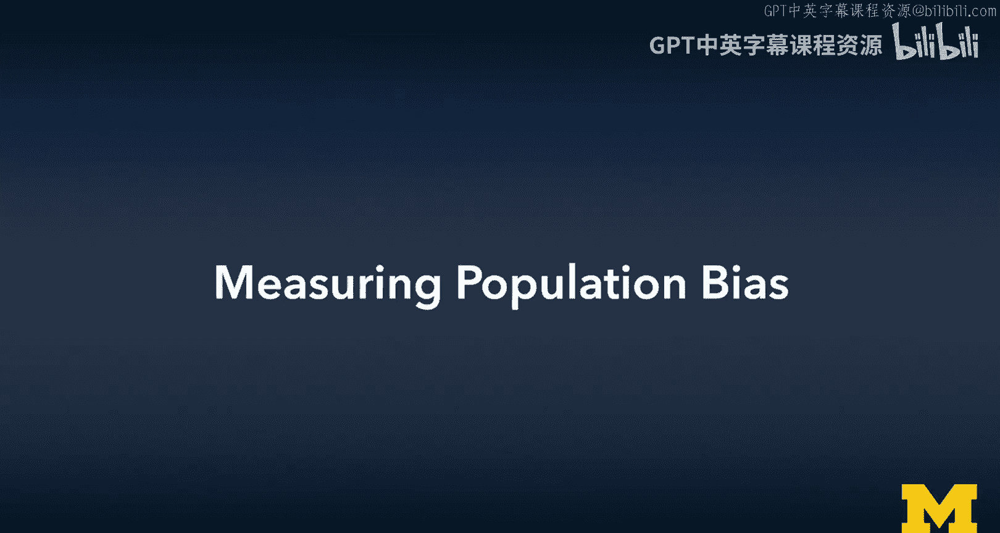

It's my pleasure today to introduce you to Warren Lee。

 a PhD student here working with me at the University of Michigan School of Information。

 Warrens in his fifth year of his PhD and his research focuses on learning and how learners interact with data systems。

 artificial intelligence and data collection systems。

The work that he's here presenting today was done with Florence Schwaba。

 a collaborator of mine and Kaiwen Sun， another PhD student whom I advise Now my research focuses on learning analytics。

 I'm interested in using data science to understand learning as a phenomena and how to help learners。

 often this involves building predictive models of learners。

There's a huge interest in making sure that this data is meaningful and we've talked a little bit in this course about bias and population bias and that's the subject of Warren's work here so Warren thanks very much for joining me I'm looking forward to hearing what you have to say thanks for having me I'm happy to be here and thanks for that great introduction as well so as Chris mentioned today we will be talking about disparities in students' propensity to consent to learning analytics so that's a bit of a mouthful there so propensity meaning their likelihood to share data and learning analytics here just refers to using data to better understand learners and help improve their learning。

So to give you an example， one area where we might use data in the classroom is predictive models。

 so for instance， let's say that students are in a class， they're engaging with course material。

Right we might have different companies that are creating software to help identify students that might be at risk so here's an example you have a student and says okay they have D in the course we're afraid that they might not pass and so the hope with this is to be able to for instance help give them an intervention maybe we can provide them with some support so that this we can you know turn things around In fact in this course in the Coursera learning management system they use predictive models as well now I don't do much with them myself but the students themselves may have actually noticed throughout the course that they'll get little nudges things like if you complete this assignment your chance of passing this course as a little greater I mean I'd love to hear from them what they think about about those but I think it's really interesting that there's a lot of work being done by vendors to just build these systems regardless of what institutions want but there's also a lot of interest in institutions。

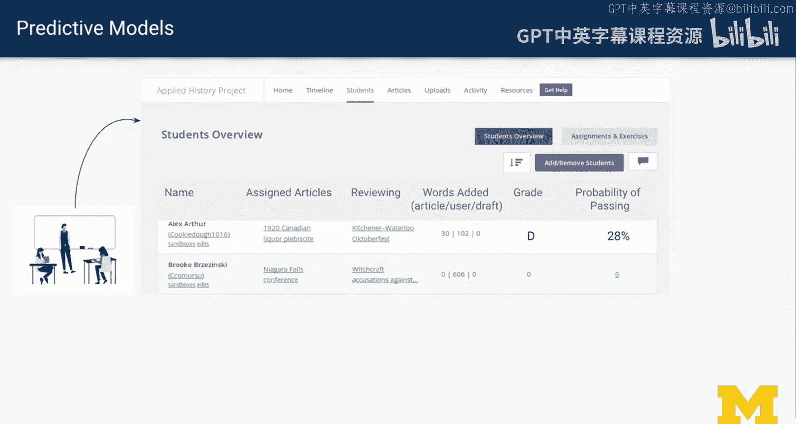

Like the University of Michigan where we build some of our own predictive analytics and our own dashboards absolutely and we're actually going to talk about some of those concerns when you're sharing data。

 for instance， with other companies this leads to of course some privacy and ethical issues so as you sort of hint that。

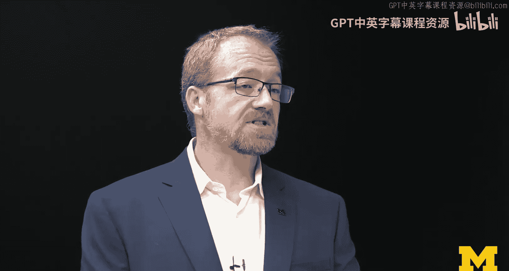

Many of these systems lead to increased data collection they're based on sort of AI and machine learning algorithms and to be able to make these models we need lots and lots of data and then that begs the question of course what is the data and sort of for who and unfortunately a lot of the time it's sensitive data so perhaps your academic record。

 perhaps demographic information， something things that some people might not always be comfortable sharing with and it complicates things because they're unclear sharing arrangements with third parties。

 external companies and so forth Well even like research with researchers like ourselves。

 I mean on campus we have to go through a number of different procedures in order to get access to student data as an internal researcher and so there's a lot tied up in here there's legislation that's involved and then there's local policy and of course the student' best interest which is what we all volunteer exactly and that's the perfect segue there because there have。

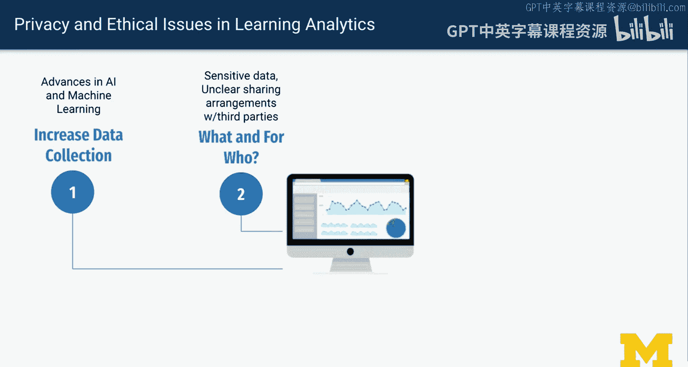

been many researchers and as well as students themselves who want agency and state that we should be giving students agency because this helps demonstrate respect for their decisions and that we should you know sort of view them as collaborators rather than data producers and we're not just here generating data we're part of the process together but there are also some unintended consequences sometimes so for instance we know that bias samples so when you have models and they're not representative of the full population this can have disparate effects on different subpopulations and so if we say allow everyone to opt out and everyone chooses to this could lead to negative effects on some of those models and for particular groups as well and this is particularly concerning since we know there are disparities in educational achievement absolutely and so often in the United States we think about these groups based on ethnicity or race and we've seen in this course we've looked at some of that data with the BRFSS and other。

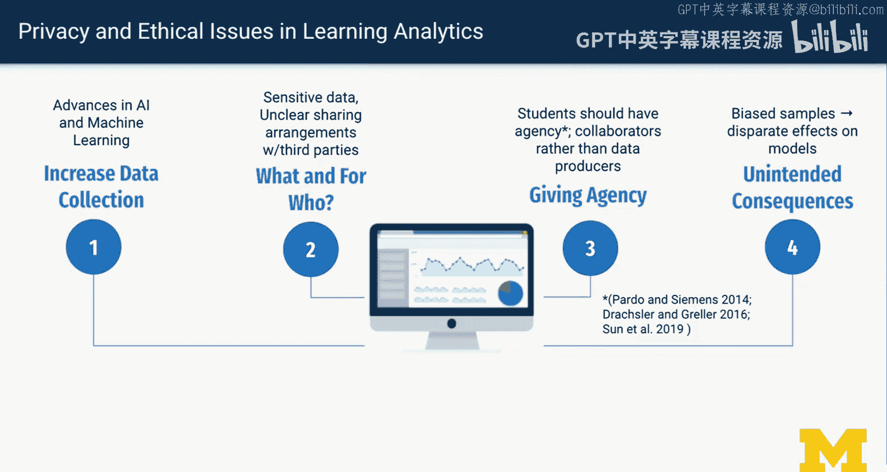

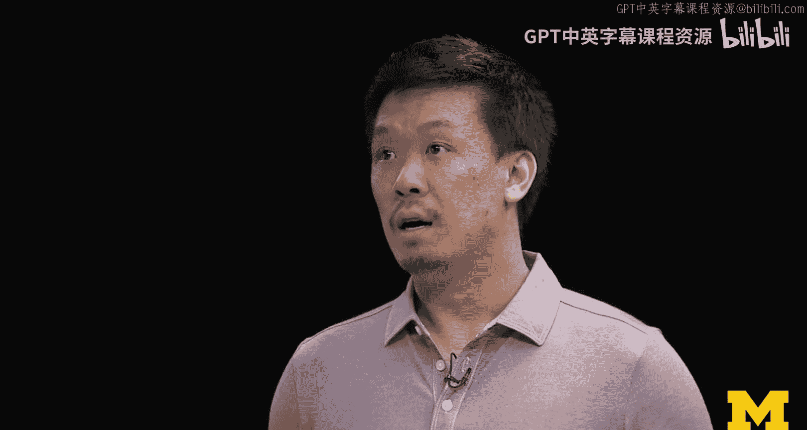

Other behavioral systems， but this is actually a very global issue and it's not just ethnicity and race。

 it also breaks down along any line where you can demark a group so gender lines but also disciplinary and also educational preparedness。

 first in family for instance， first generation college students absolutely yeah and so just for some context i'm glad you brought that up because in this particular study we are looking at gender and ethnicity but as you mentioned there's lots of different groups and even different cultures in different countries。

 what those groups are might look a little bit different。

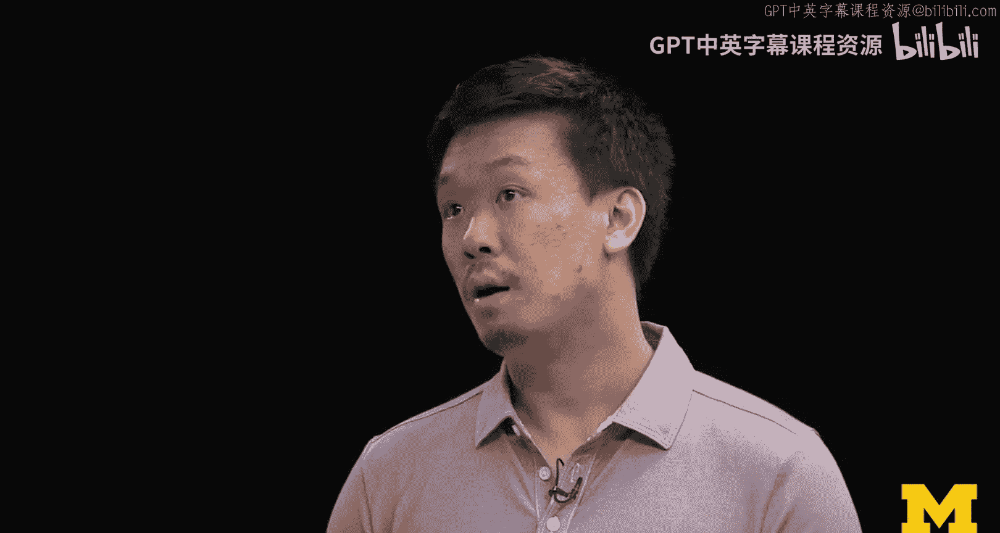

So to give a particular example of some inequities from predictive models so in the recent years on a comic here on the right hand side it sort of mentions that over the years there's been a lot more interest in fairness in machine learning and I'm going to give one example right here so Ocompal and others in 2014 they train this model and an affectc detector here is just a fancy way of saying we tried to model students will say emotions so for example。

 perhaps someone is frustrated in class or maybe their bored so we're trying to detect those behaviors and so what they did was to take a lot of data from urban。

 suburban and rural students。

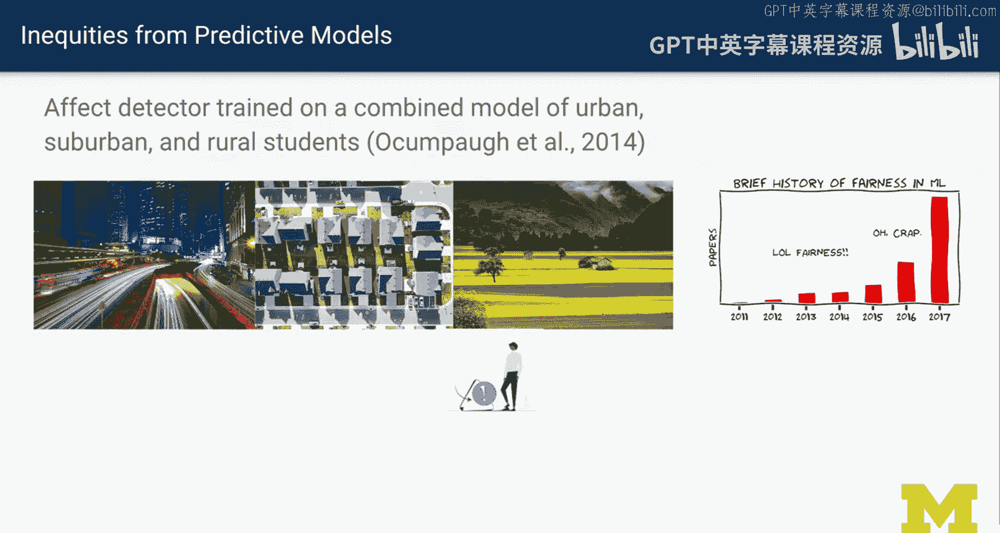

And what they find is that it performed pretty well for the urban students。

 pretty well for the suburban students， but not so much for those in rural areas。

 and part of the reason for that is because there's a lot fewer students in rural areas， right？

So that's what we mean。When we're talking about those disparate impacts and models and so for instance you might need to separate them and train these models separately Yeah I think it really speaks。

 this was wonderful research coming out of Penn and I think it really speaks to the need to collect data from the populations that you're interested in supporting and we actually face in the field of education in the learning sciences。

 a huge replication crisis it's very expensive to run these surveys or to run full on experiments as you well know and it takes a lot of time and so often we only have one or two data points even if we have a0 students a thousand students in there if those students all come from the same group what we can really generalize is limited and I think this was excellent work that really brought that to the forefront in the field of educational data mining and so as you mentioned this is。

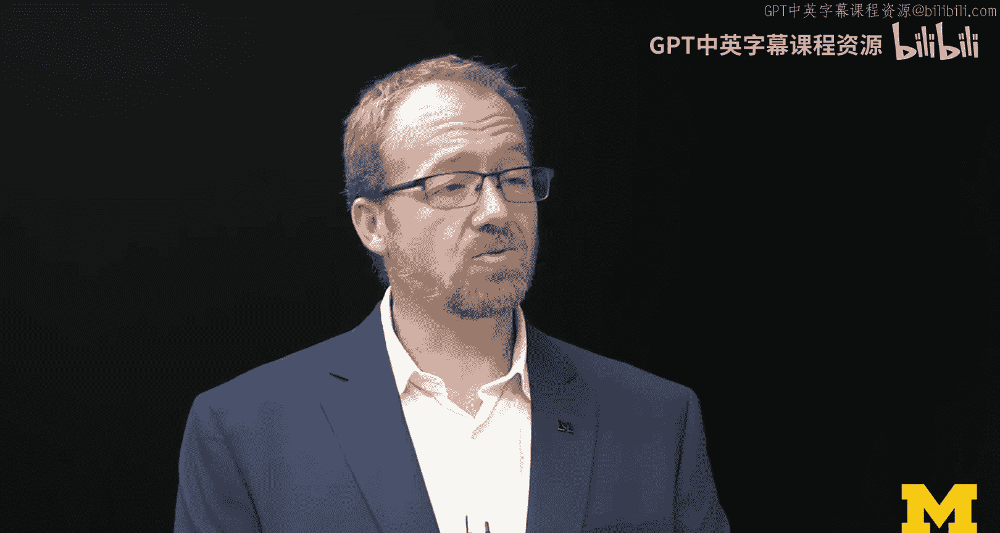

Extremely important and so let's also talk about some of the consequences of what you know getting it wrong might be so for instance。

 if someone is labeled at risk， this carries a negative stereotype right so we don't want to go and just say well let's just label everyone at risk because this comes with some some negative consequences Similarlyly if we mis interventions this also if we rather if we misclassify students will'll end up missing some interventions where we could have perhaps supported students a little bit earlier on Yeah I think that one of the challenges that I face in the research that we do is that there's a difference between prediction and intervention but they really need to go hand in hand we need to be identifying the students who need help and then we need to be able to intervene to actually help those students Now of course some interventions we can use to help everybody sending an email the night before the assignment saying like hey here's a hint or sending it maybe a week before saying hey remember go do that。

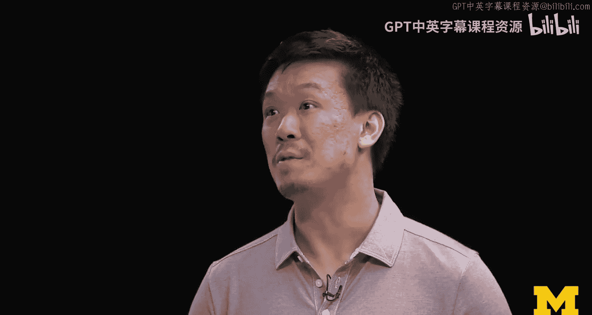

That's something lightweight and easy， but it's hard for a big institution。

 even one like Michigan to give like an individual tutoring advice or to pick up the phone and phone someone。

 but we do for students that we identify most at risk and so these two pieces intervention and prediction really need to go hand in hand exactly and there is a complicated puzzle as you mentioned right there are those simple interventions such as sending an email to everyone but also some are more costly for instance if you recommend a whole different class to someone right that's going to make a huge difference。

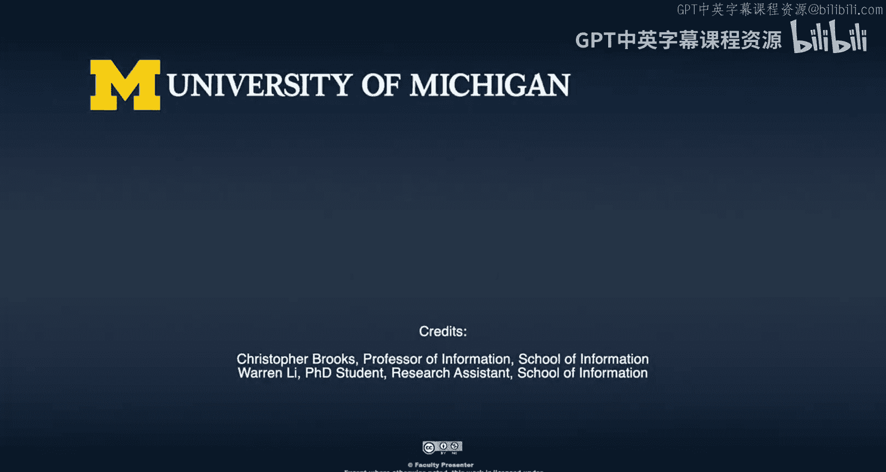