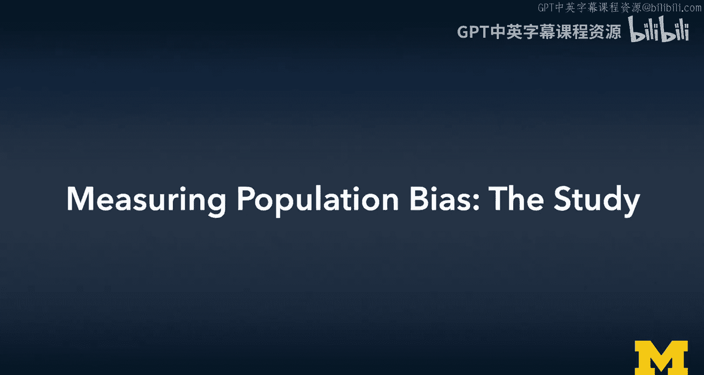
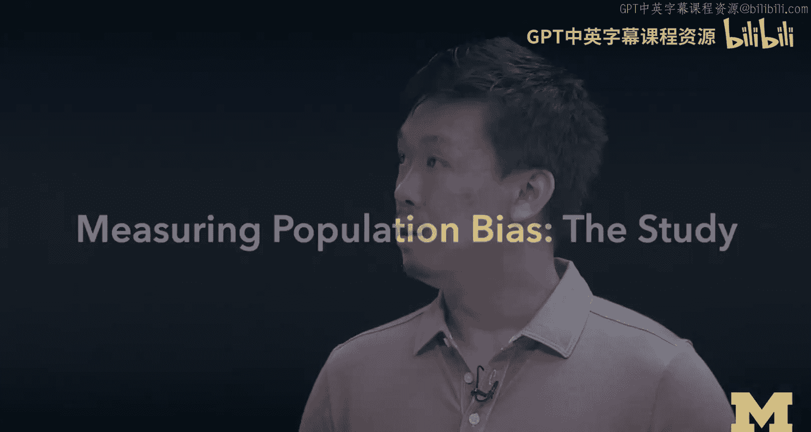
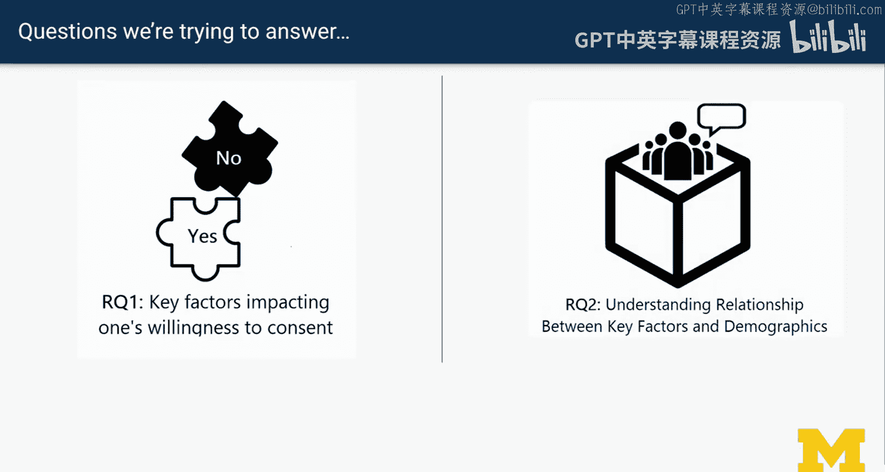
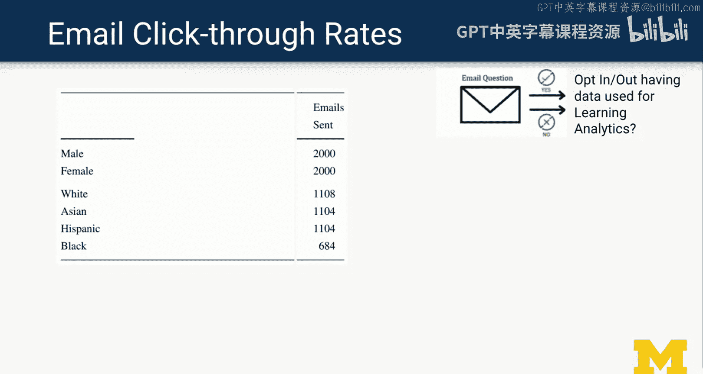
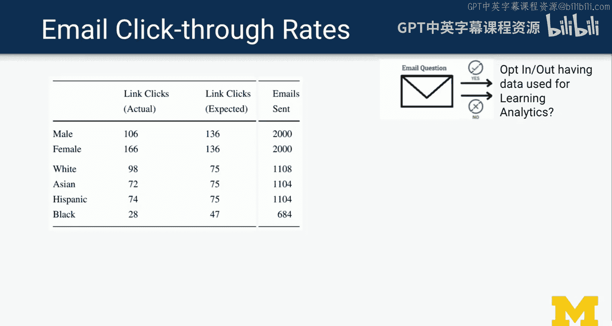
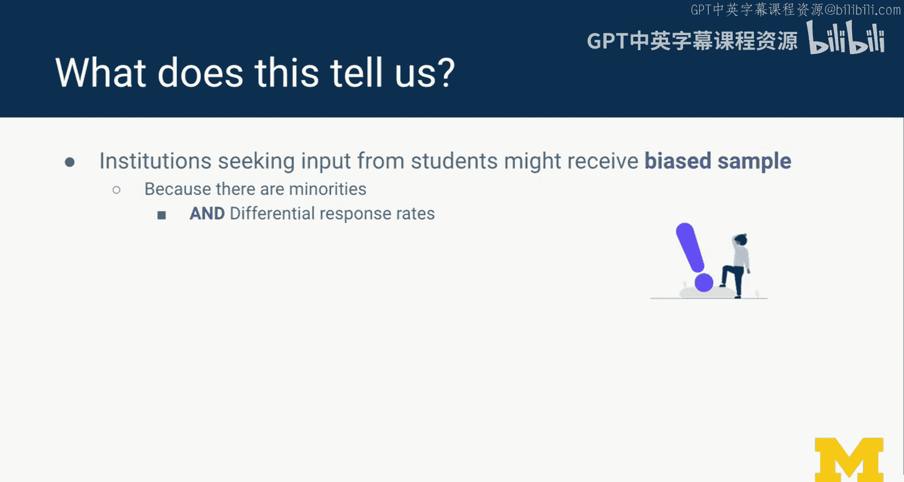
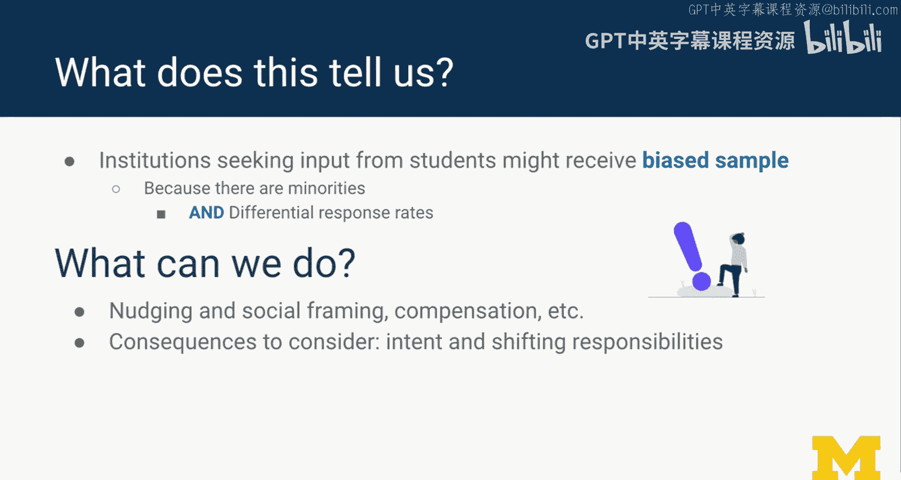

# 密歇根大学《公共部门的R数据分析（基础、数据探索、决策支持、）｜Data Analytics in the Public Sector with R》中英字幕 p132 8_人口偏差测量实证研究.zh_en -BV1YZ421J7Fx_p132-

So with that said that sort of leads to the questions that I was trying to answer or I guess all of us were interested in answering in this study。

 so there are two questions here， the first one is sort of what are the key factors that impact people's willingness to consent right what helps drive their decision？

And then the second question we'd like to understand is to link those key factors that we find in that first part with demographics To do that we sent out a one question email to 4。

000 students here at UM so pretty much just on the side there you'll see whether they would opt in or opt out of having their data used for learning analytics。

And so on this table on the left hand side here， notice what we sent to emails stratified by both gender and ethnicity so what we mean by that is that we tried to balance it as equally as possible among these groups so'll notice for male and female right there are 2000 emails per group there is something a little bit odd with ethnicity as you'll see there。

Mostly the same you'll notice there's a few more for students identified as white and in a few less for those identified as black Yeah so this is a huge challenge even at an institution the size of Michigan so we want to make sure that we're representing the students who are in the minority as far as numbers there and definitely on this campus black students fall into that category and so we I think we emailed probably almost every black student who was in their first year so this was we looked at what they call freshmen or first year student enrollments because we wanted to see what their perceptions were coming in and that makes for a lot of challenge and in some of the courses in this specialization we've talked about waitinging variables is one way to deal with this when you get quantitative results so for instance this happened in the BRFSS data when you get quantitative results you can then。

We weight those results based on the population sizes and the response rate Our interest here wasn't in that weighting per se but was in actually trying to understand whether these different groups responded differently to our prime to begin with exactly and I would say that the norm is you send out a survey you take in the results and then you think about the results and run some policy based on that and so this is really critical to understand if those results actually don't fit your population or aren't a balanced view from the populations you want to be able to talk to exactly and that actually brings up a great point because in this case it wasn't particularly be balanced as we'll see in a second here so now here we have sort of two columns one says link clicks expected and one's link clicks actual so for the expected column。

I think roughly 7% of people actually ended up clicking some option on the email and so if we assume that that 7% applied to every single group equally and everyone responded at the same rates。

 then those are the numbers that we would see under link clicks expected actual。

 of course are the actual number of clicks that we receive from students and so you'll notice here。

Those who identified as white， when we compare those those to students who didn't。

There are significantly。wayay more clicks than than we were expecting and just a comment on this comparison so this is actually white versus all of the other classifications of students so in this case Asian Hispanic and black kind of pooled together I think that this is really important this slide in these results I mean it really demonstrates two things one your populations aren't of equal size so when you get responses from them it's not going to be stratified across all of your buckets。

 it's not going to be equal across all of your buckets so you have to think about that but two the responses that you get are not going to be indicative of the same size of the buckets I think in this example for instance we also see women tended to respond more than men did versus the expected rates which is also you know a concern if you're looking to if you believe that that demographic has some impact on the thing you're trying to measure in this case propensity to consent。

Even beyond that though， for this research I think it was really interesting that only 7% of the students we inhaled responded right you would think our hypothesis going in was that students want to have agency but the vast majority of students actually' didn't even want to engage with this email around there now some other institutions have actually made it a requirement for students to answer this question and then others just say and in fact one of our reviewers on this paper said why are you bothering to ask them we don't have to ask them that's also a reasonable response here and I think it really there's a lot of pieces of the question of consent agency and representation that come up in all three of these phenomenon here exactly it is a complicated puzzle right even though we don't have to ask them in this study we're interested in that hypothetical what if we did because as I mentioned before think consent is important but we'd like to see what are the effects of that I think we're also starting。

To see at various legislative levels that getting consent from the people you're collecting data about is starting to become more and more important in California there's some requirements here in Europe there's some requirements here in Canada there's some requirements here in fact most jurisdictions have some requirements here it's not always full requirements but I'm curious actually I wonder how many of the learners here have read Coursera's terms of service which outline how Coursera collects data and uses data and know what we know about them as learners here and that would be interesting actually to hear from them that would be an interesting question I mean I have to admit there's been multiple times where I've scrolled through a terms of service right without reading it full so I mean in the software world we call them click through Es because you just click through and there's even question about whether these are legally binding and I think it's really interesting space absolutely with that let's continue here。

So once again。Similar sort of comparison that we see here， those who identified as black。

 if we pull white Asian Hispanic here and compare those。

 there are way fewer clicks right and so as Chris already sort of hinted at there。

Institutions seeking input from students might receive the buy sample and maybe that's not a big surprise because yes。

 you know there are minorities but not just that between those groups are differential response rates so as sort of you saw even though we stratified across those groups equally and so one might expect。

 hey， you know should be a。

Pretty representative sample that's not always the case That's right And so there's multiple levels of analysis you really need to do to see what that bias looks like and I think stratifying is great that's a great way to start things weighting variables is great too but you got to actually look at the response rate by your demographic groups or your other protected entities as they call them that you're interested in in order to really understand the bias that's coming in in the data even before you start actually visualizing it and trying to make sense of it well then thats sort ofs the question what can we do given this information and so Ive already mentioned some of this so nudging for instance。

 that might be one way social framing， perhaps explaining why it might be helpful to share your data perhaps compensating students for them so saying we'll give you X dollars or not to share your data but this also comes with some consequences as well so。

ending on the actor， we might want to encourage people to share or to give some sort of consent decision。

 but not to pressure people to have to say yes In fact， in this area。

 there's a huge amount of behavioral psychology being done and anybody who's used any mobile app or website is feeling this maybe not even knowing about it and sometimes there are negative things called dark patterns on the web and sometimes they're very positive things and when we nudge people in order to provide data。

 I think that there's lots of interesting questions like door nudge is actually change the data that they're going to provide does it put them into a different frame of mind for instance。

 if we nudge people here in this case by telling them how important it was for the institution to be able to make good decisions out of it。

 my guess is there would be more people who would not only respond but also respond positively to sharing data we wanted to know authentically？

Was there interest in this so these interventions to improve questions of bias and response rate can actually change your data as well。

 adding even further more dimensions of bias to the data exactly and so I think it's a very interesting question to look at for future studies。

 even though we didn't necessarily look at that here。

And so one question I have for you Warren is in this research we're just looking at their propensity to respond。

 we didn't what did students actually say across all of these different groups as to whether they would or wouldn't share data。

 do we get anything interesting we it's a bit of a complicated picture。

 but for instance we did find that there are three sort of major factors that students indicated。

 so across all students if their data general concerns around data collection， if those were higher。

 of course they were less likely to consent but the other two parties that were particularly influential were there trust in the institution and even more importantly the trust in the instructor。

