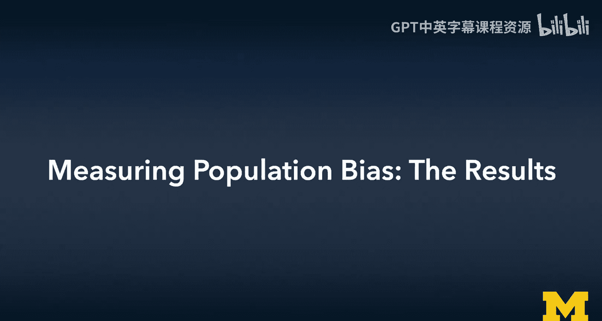
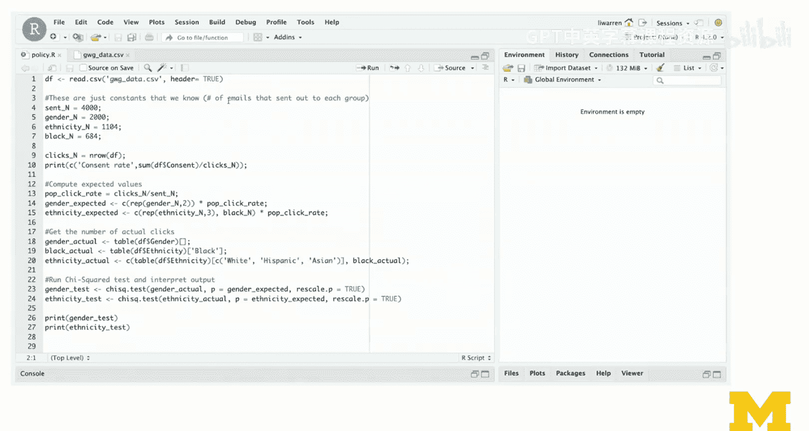
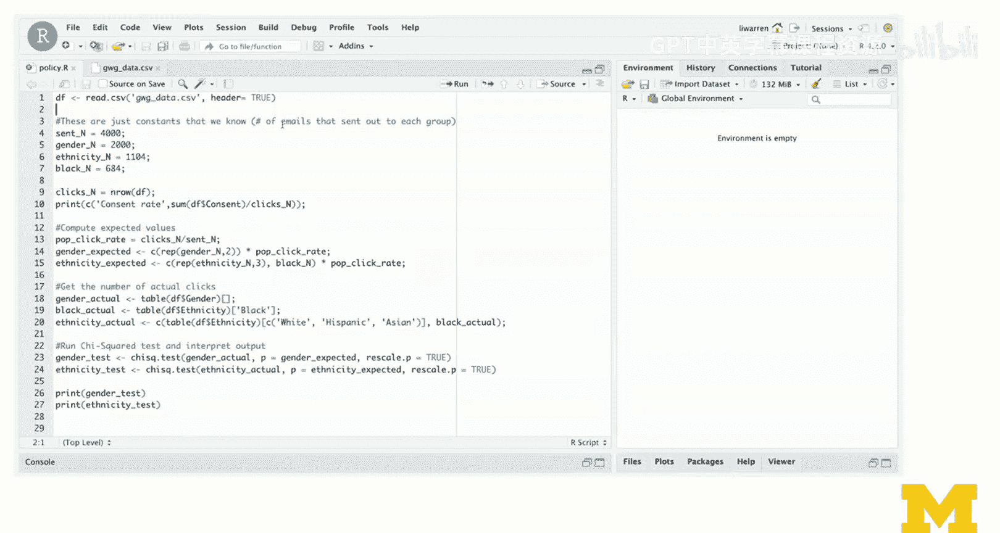
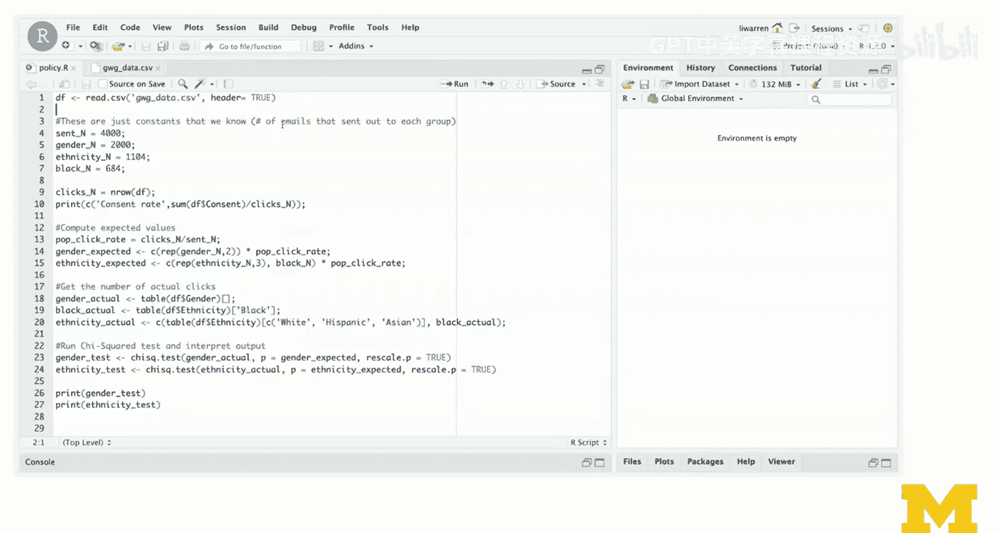
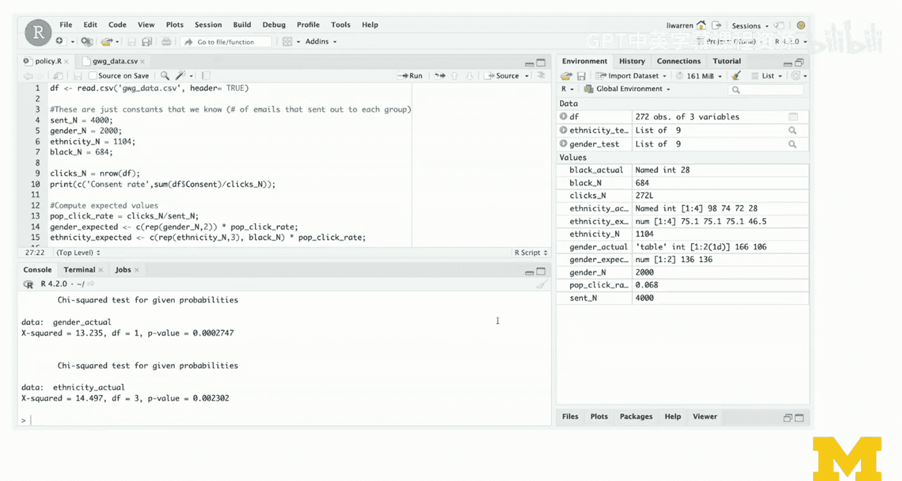
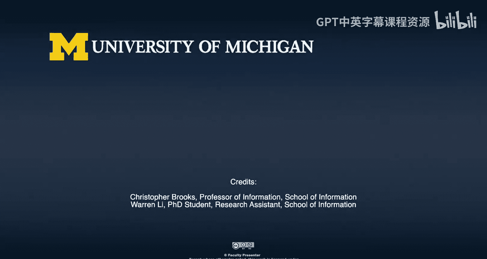

# 密歇根大学《公共部门的R数据分析（基础、数据探索、决策支持、）｜Data Analytics in the Public Sector with R》中英字幕 p133 9_人口偏差测量结果分析.zh_en -BV1YZ421J7Fx_p133-

I think that one of the interesting and important parts about the design of the study we did here in the paper is freely available。

 it's open access， so I encourage anybody who's interested to go check it out is that qualitative analysis that came with it as well。

 not just measuring what but trying to measure or understand why because that'll really help shape the kinds of interventions we might do or the kinds of nudges we might do or're even just understanding better the perspective of the learners in this case。

 keeping in mind that those who responded to the why it's a biased sample so we've got to build that in。

How about we look at the R code for this， Yeah， that sounds good。So here's the R script at the top。

 you'll see we're going to read in the data file that CSv so I'm just going to。

Let you take a quick look at what that file looks like， so here's it's pretty simple。

 so we have three columns consent， it's either one。You know。

 they did consent or zero if they denied use of their data， and then we have gender and ethnicity。

So if we go back to the code here， near the top there are just some constants that we know because we know how many emails we sent out。

 so sent in is 4，000， because there are 4，000 emails in total for gender 2000 ethnicity here。

 see there's a 1104， you'll notice that there's a separate variable for。

Black students right our minority population that we couldn't get 1100 samples from exactly so that's what that's there for。

 And then below that we just printed out some sort of summary statistics so for instance the consent rate。

 how many people consented in total followed by two other chunks so first we computed the expected values so we have the gender ethnicity multiplied by that population click rate and population click rate is just the total number of clicks we got over the total number emails that we sent out right that's pretty straightforward way and if if we were able to kind of evenly stratify this it would be even cleaner to do but of course given a representation challenges at the institution then we had to go with this exactly and then below that we have the number of actual clicks so this is just grabbing。

Gender ethnicity from that data file so the data file only contains students who clicked so we just counted or summed up those counts and the data actually came from the student information system right and so these are the categories that exist in that and one of the things I've mentioned in a couple of places in this course is how those don't always match with kind of social definitions right so in this case gender was actually a binary of sex thats reported in that system and same with ethnicity with ethnicity there's about six I think federal categories that we need to report back up to the government and so these are those categories minus a few there are others like two or more I think is one category or American Indian is another category and those categories generally have extremely small numbers and so we had to limit our analysis so even on top of the issues that we're looking at with respect to bias in。

In our sample， there's yet another which is just people who were omitted from this or their data incorrect。

 at least as far as gender and sex goes and the complications there so it's important to keep in mind that this isn't the complete picture either after we get the actual number of clicks we want to compare the expected in actual numbers so what the chi squared test does down here is we want to see if two variables are independent do they have a relationship with each other so we're comparing both the clicks with for instance gender and then clicks with ethnicity so I see that you've rescaled the P here and you' set this P value so normally when I run a chi squared test I just toss in my couple of variables maybe can you tell me what that's all about Sure so this P here is pretty much proportion so for instance if we have。

TheThe two genders here and let's say we expect that the proportion should be the same then I will put in one half and one half instead of doing that I just put in 2000 and 2000 and this will automatically normalize for me so I see yeah yeah it's a handy right to be able to do that so what don't we run this and see what the results are Sure。

So if you look here， there's the consent rate， so roughly 72% of people consented。

And then below that we'll see the chi squared test results for both gender and ethnicity。

 so you've noticed the P values for both are quite small and so we would reject the null hypothesis that there isn't a relationship so in this case there is a relationship between the click。

Rates and gender ethnicity Yeah in a lot of social science。

 we set a threshold for alpha or the P value in this case to be 0。

05 or 5% that's a little bit of a challenge sometimes and Tki even when he was proposing this kind of suggested that everybody's got to determined for their own data what matters as your size of data gets bigger you get tighter p values because you're going to find with more confidence that there's a difference but it doesn't necessarily mean the difference is meaningful right now we've already seen the size of that difference on the previous slides and I think for this size of population a couple of thousand in each these P values are really strong in showing that that difference isn't spurious or isn't just made up exactly and so in the paper we also dive a little bit deeper into the relationships between specific genders or ethnicity as well so if interested you can take a look at that as well。

Thanks a lot for joining me this was great to be able to share this work I think that there's a lot of issues that have come up with respect to bias just in this one sample and as you start to think about those in your own work either as a data scientist as a policymaker or dealing with other stakeholders there's a lot of different considerations that you need to think about everything from your statistics your data collection your data cleaning and just the design overall so Warren thanks again for coming and sharing that with us thanks for having me Chris。

