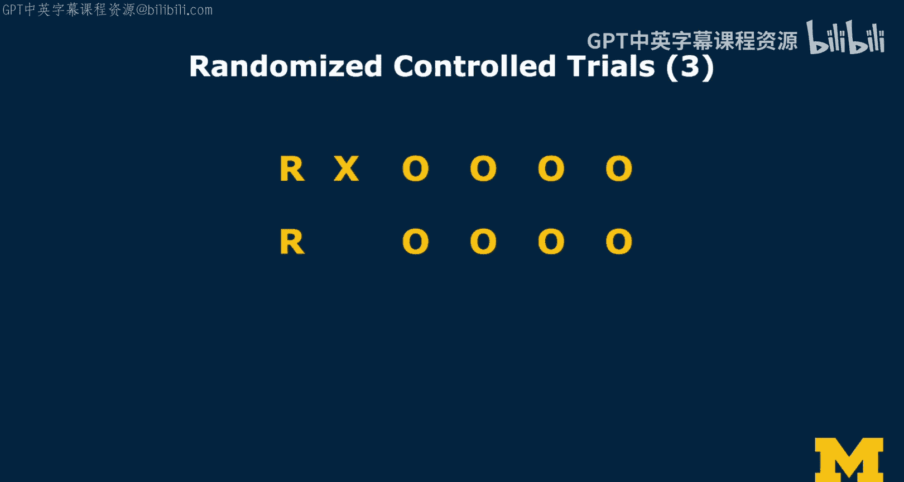
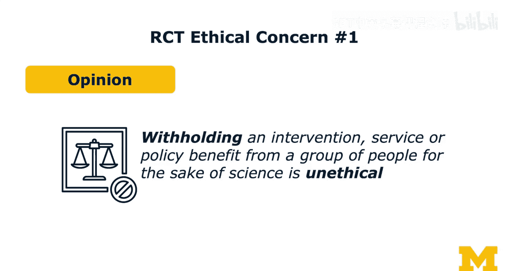
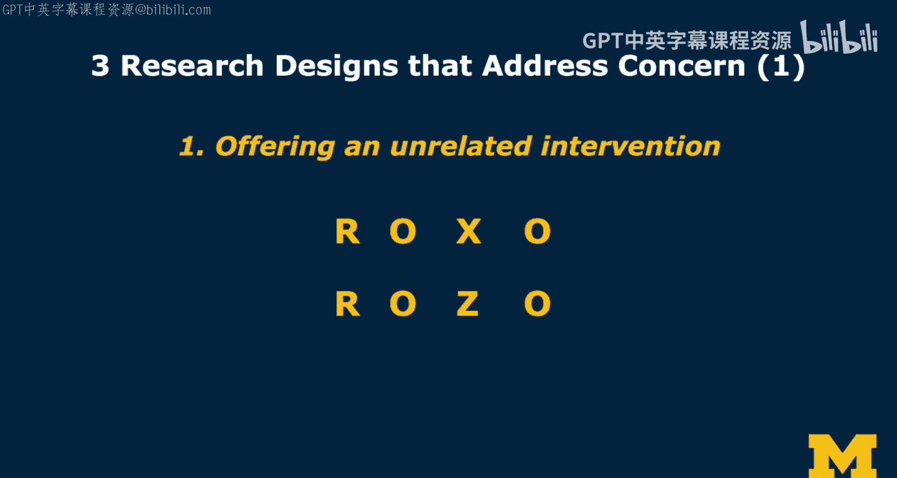
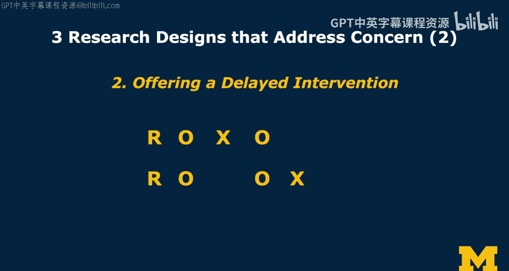
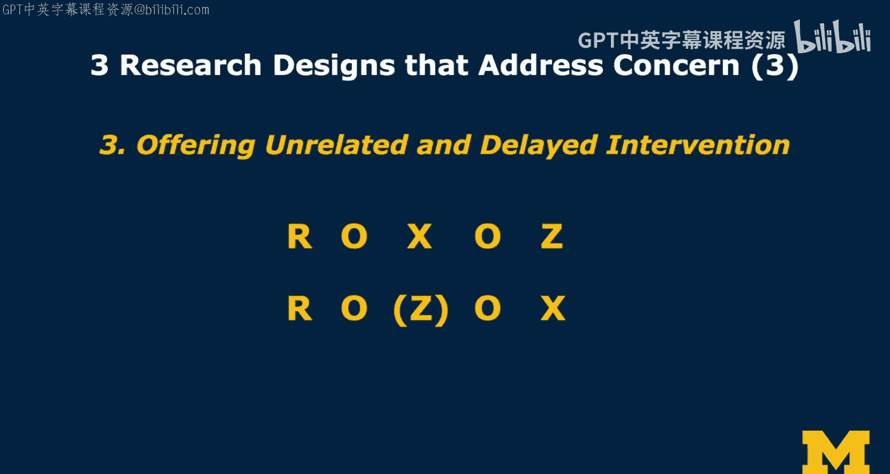

# 密歇根大学《公共部门的R数据分析（基础、数据探索、决策支持、）｜Data Analytics in the Public Sector with R》中英字幕 p134 10_随机对照试验中的伦理问题.zh_en -BV1YZ421J7Fx_p134-

Hi， welcome back。In this session， we're going to circle back to thinking about the strong research design of randomized control trials now as we discussed in course three。

 randomized control trials or RCTs。Have the strongest internal validity because they allow us to really isolate and understand the effects of a program。

 policy or other kind of intervention randomized trials vary a bit in their design now just want to refresh your memory here's the classic design of a randomized control trial where there are two groups that are randomly assigned to be exposed to an intervention or not with observations those O's both before and after the time of the exposure to the intervention in group one In another version of a randomized control trial。

 you can have three groups in the study where the groups are randomly assigned to get one of two different interventions or status quo with no intervention in the control group Also in this third example you can have an experimental design in which two groups are randomly assigned to receive an intervention or not and then there are multiple observations of the groups。

Over time after the exposure in this particular example。

 there are four observation points after the time of the intervention Now again there are lots and the of themes variations in experimental designs with the common factor here being there's random assignment to exposure to an intervention or not because of this random assignment and the fact that this is an experiment。

 there are a number of ethical issues that come along with using this type of research design we're going to talk about three of the main ethical concerns with randomized control trials first withholding a potentially effective intervention from people for the sake of science second offering placebo or shadow interventions and third experimenting on populations without their informed consent okay let's consider ethical concern number one it is the opinion of many people that withholding an intervention。

Service or a policy benefit from a group of people for the sake of research or science or policy analysis is unethical people should not be used as guinea pigs especially because withholding resources or beneficial services could be hurting them some people say that if it's good enough to try out on a group of people in a research study you should not use a research design that actually withholds it from some people However。

 others say that we'll never really know if an intervention works or not before we evaluate it and lots of interventions have unintended consequences or harms the worst case scenario is not that an intervention doesn't work or that it's benign in its effects sometimes interventions actually do hurt people in ways that weren't predicted in their design so we won't know all this we won't know if an intervention actually works or not or if it's bringing unintended harmful consequences unless we use a strong study design with good internal validity so there's really to compete。

So what can we do？To address the ethical concerns about withholding potentially effective interventions from people in an experiment。

 there are actually some alternative research designs that can be used here I'm presenting a picture of one such design let me explain it in words here you have two groups of people that are randomly assigned to get one of two totally unrelated interventions the groups serve as comparison or control groups for each other but each group is getting a potentially effective service or program there are observations both preimposed about the potential effects of both the interventions now for this design to work again both groups are getting an intervention the interventions though have to be totally unrelated there cannot be a chance that exposure to one of the interventions would actually have an impact on the effects of other one example of this that I am familiar with is that a visiting home nursing intervention。

For isolated elderly people where one group got randomly assigned to get an influenza vaccine in their home while the other group was randomly assigned to get an intervention to prevent falls especially in the bathtub Now a second design that's used to address some of the ethical concerns about withholding interventions from people is called a delay intervention in which the control or comparison group actually gets the intervention at some point in the future after the experiment is complete and the researchers know if it works or not if the intervention has positive effects。

 then the control group can receive it at a delayed or later time and a third design that could be considered is actually a combination of the two we just talked about。

 it provides both an unrelated and a delayed intervention two groups are randomly assigned to get one of two unrelated interventions and then after the effects are evaluated。

The interventions are then given to the other group。

 the technical term for this design is a delayed intervention crossover approach。

