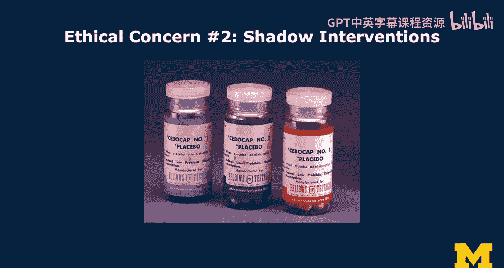
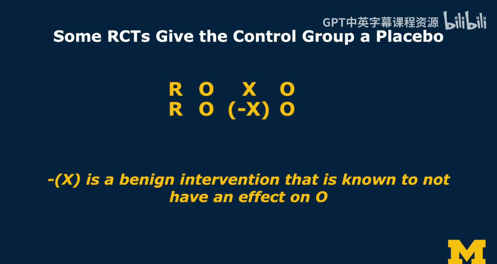
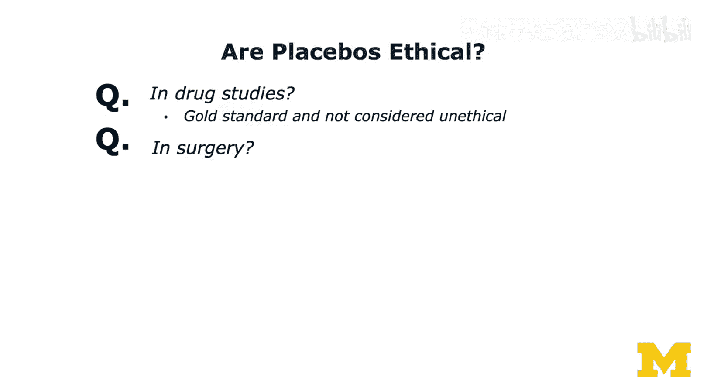
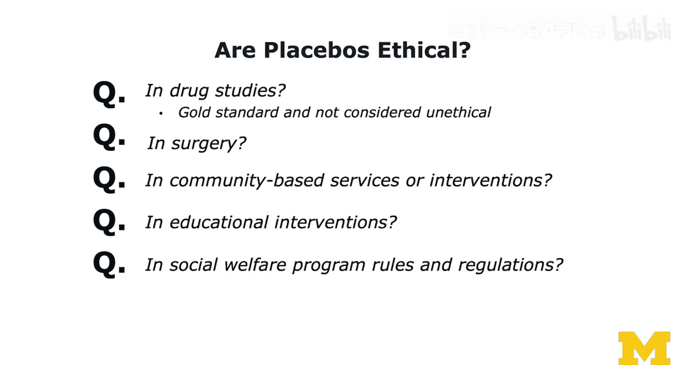
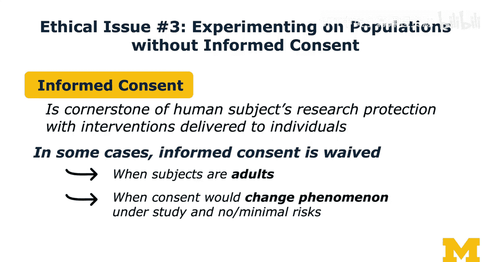
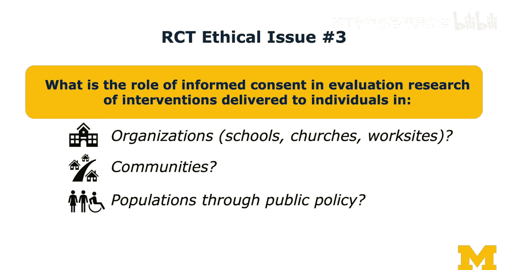
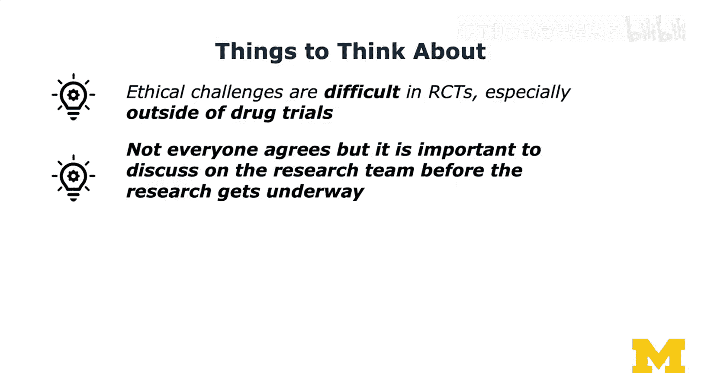
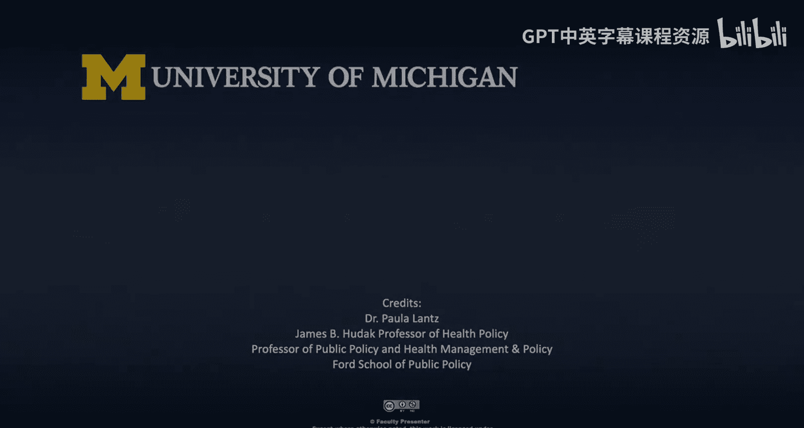

# 密歇根大学《公共部门的R数据分析（基础、数据探索、决策支持、）｜Data Analytics in the Public Sector with R》中英字幕 p135 11_影子干预的伦理考量.zh_en -BV1YZ421J7Fx_p135-

Continuing our discussion of ethical concerns related to experimental designs。

 let's now talk about concerns regarding shadow interventions or what is technically called giving people a placebom sure you're all familiar with placebos a placebo is some sort of intervention giving to people that we know has zero effect on the outcomes under study but it's given to people anyway to see if there's some level of response to having received any kind of intervention or attention Now this is done in drug trials to see if people respond to just getting any kind of medical intervention and you know what？

People do respond placebo interventions have been found to be very effective Our bodies sometimes respond to the thought of getting a medication or an intervention even if that intervention is something benign like an injection of saline or water or a sugar pill or some other sort of placebo now randomized control trials of nonmedical interventions also like to give placebos。

 just to see if people are reacting to getting again some sort of attention。

 then the effect of the true intervention， which we we call X in our designs is compared to the effect of the placebo to really understand the level or strength of the intervention effect let me say that again。

The design using a placebo is to find out what is the level of effect of the intervention above and beyond a placebo effect in this case。

 you need to find an intervention we're not going to use a sugar pill in the public sector work we need to find an intervention that really does nothing it has no effect and this could be comparing an intervention with some sort of tangible service to people with something else that we know doesn't have an effect like just giving people a brochure or short pamphlet to read Now our question for today is if giving people placebos is actually ethical it is considered to be ethical and drug trials simply because we know that people do respond to getting placebo drugs and this needs to be understood in the context of drug research what is the effect of the actual medication or drug above and beyond the well-known placebo effect but is this ethical and other context。

Actually， I want to take a moment to tell you there have been some controversial medical experiments in which people have gotten fake or placebo surgery on their knees or backs and these fake surgeries were compared to the real surgical intervention to see what happens with pain control The question is is people pain improving after surgery just because they got some kind of intervention and they're expecting improvement guess what people getting fake surgery and in these experiments people are literally cut open nothing's done and then their own backup。

These people have had the same level of pain improvement lasting over time as people getting real surgical procedures。

This is interesting and helps advance medicine。

But is it ethical and are fake interventions ethical in regard to research on communitybased services or interventions in educational curriculum changes and social welfare programs and regulations are there potential placebo effects that we need to understand and do they warrant randomly signing people to benign or fake interventions to better understand the effects of the real ones these are tough questions I'm not solving them for you I'm raising them and finally here's another ethical issue to consider？

Should public policy research allow experimental designs that randomly assign interventions to populations or large groups of people without their informed consent and all of the medical interventions I just discussed。

 including the fake surgery？People did give their informed consent to be in the research project this includes people who agreed to be randomly assigned to getting fake surgery as I said they were not told if they got real surgery or the fake surgery until three to six months later after the follow-up observations were completed informed consent is a cornerstone of ethical human subjects research in the medical field Now in some cases informed consent can be waived and the research can still be considered ethical in these cases the research subjects have to be adults and it has to be a situation in which informed consent would actually change the phenomenon under study if people knew they were in a research study because they agreed to be in it。

 it would change their behavior and the intervention has to be considered to be no risk or minimal risk and their standards for that so what's the role of informed consent and evaluation research of intervention。

Such as policy changes that are delivered to individuals in organizations such as schools， churches。

 work sites， in communities， or even populations through large public policy change remember when we talked about rural areas in Mexico were randomly assigned to be part of the rollout of the prospera program communities were assigned to be part of it or not for its evaluation it would be hard if not impossible to get informed consent from people for these kinds of interventions。

And also think about it if communities were asked， oh。

 do you want to be part of an experiment where you're randomly going to get a policy change or not。

 I mean people would say no who wants to be part of a government experiment。

So having to get informed consent for social welfare， environmental。

 labor market or other kinds of policy interventions would actually make using experimental designs to evaluate them impossible all of these ethical issues raise tough questions for sure they require a lot of discussion and attention from the research team here' are some things for you to keep in mind if you're ever involved with such discussions the challenges are difficult and there are no easy answers and there are indeed tensions between the strongest research approach and the protection of human subjects both in and outside of drug studies and not everyone agrees even among people who strongly value the ethical conduct of research there can be disagreements but it's important for you to think deeply about all the ethical implications of the policy evaluation and program evaluation work in which you get involved and do this as a research team before the research approach finalized there are many helpful guides out there regarding ethical standards。

For research and good examples to help you along the way。

Thanks for taking a moment to think about the important ethical challenges that go along with experimental research designs。

