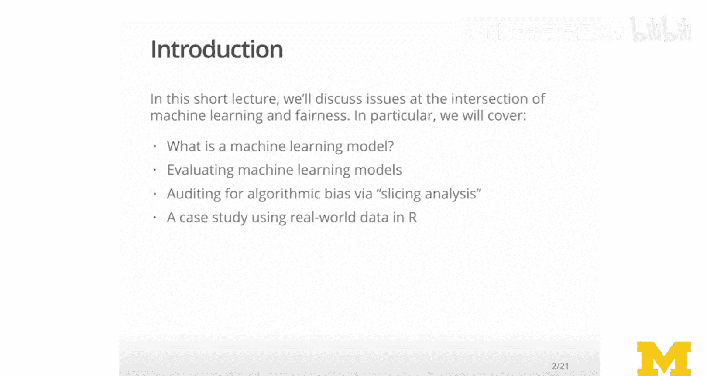
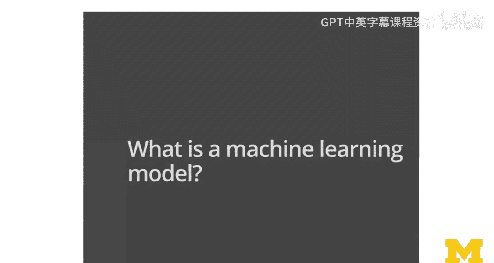
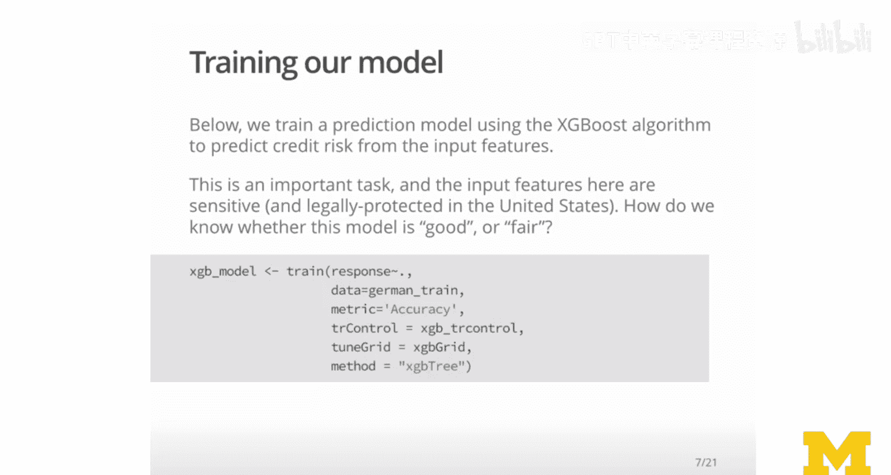
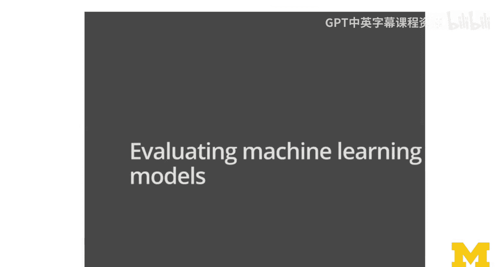
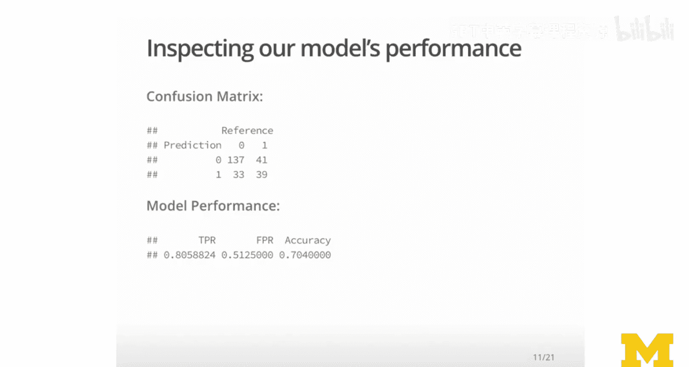
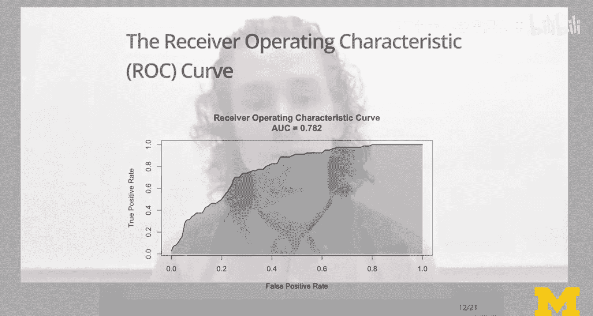

# 密歇根大学《公共部门的R数据分析（基础、数据探索、决策支持、）｜Data Analytics in the Public Sector with R》中英字幕 p136 12_模型偏差评估方法.zh_en -BV1YZ421J7Fx_p136-

It's my great pleasure today to introduce you to Josh Gardner。

 a PhD candidate at the University of Washington。 Now I've had a lot of time to work with Josh over the years。

 he was actually a masters student here at the University of Michigan where we started doing work and Josh and I have done a lot of collaborative research with one another and with others looking at education at the University of Washington。

 he's dove in a little bit more into machine learning。

 which is I think a really powerful topic and an important topic for us today and today he's going to be talking a little bit about bias in machine learning。

 how we detect bias in some of his work there。 Josh， thank you for joining me。😊。

Thanks Chris and I'm excited to share a little bit about bias and fairness in machine learning I think this is a really important topic for anyone starting to think about data analysis and machine learning in the field of public policy or really any other field and so we'll try to do today is give an overview of some of the key considerations in this area。

 some of the concepts that you should start thinking about as you're working with data and in your own explorations and also along the way try to give you some our code so that you can replicate these kinds of analyses and the problems that you encounter so we'll talk a little bit today about the following four things I'll introduce you to just the concept of a machine learning model we'll talk about how we evaluate machine learning models so how we know whether they're doing a good job we'll talk about auditing those models for algorithmic bias using。

Technique that we call slicing analysis and in order to do this。

 we'll do a case study on some real world data for credit modeling。

I'll add that I'll show you some of the code that's producing the analysis along the way as we talk about these things。

 but some of the code under the hood is hidden from the slides that I'll be presenting and you can see the full notebook with the course resources to see all the code that's producing the model and our analysis of。

So let's talk about what a machine learning model really is。

For the purposes of this discussion you can think about a machine learning model as a mathematical function that relates inputs to outputs here our input can be any kind of observation usually representing person but it could be anything else like an image or a clip of audio we'll think about this as the function shown here where Y hat is a prediction that our model produces we'll call our model F theta of X and the reason we do that is to make explicit that there's this set of parameters theta that we'll be learning when we train our machine learning model and we use that to make predictions。

And here， like I said， x is an input observation， that could be whatever kind of data we want to make predictions about。

So specifically the case study that we'll be thinking about today is a credit risk model where we see a loan applicant and some features about them。

 and we want to predict whether that individual is a high or low risk to repay their loan and we'll do this using a historical data set of loan applications so X or inputs to our model here will be a set of features about that loan application applicant such as their checking account status。

 their age， their job， and I'll show you an example of what the data looks like on the next slide。

And why what we're trying to predict is whether that individual was high or low risk。

 so whether they were able to repay their own and this historical data。

And when we talk about training a machine learning model。

 what we're talking about really is estimating this set of parameters data that our model will use to make a decision about whether it thinks an individual is higher or low risk。

Let's look at an example of our data so here I selected a few sample columns in A and you can see that our data has about  a thousand00 individuals and here we're displaying nine variables this includes what type of account they have how long they've had it。

 some information about their credit history the purpose of the loan and some demographic data this is a public data set so you can read more about the features and what they mean and what these various categories are with the link that we'll provide on the course set。

So our goal is to use these features to try and predict whether an individual is likely to pay back their loan or not。

 this is a common real world machine learning scenario， as you probably are aware。

So below I give a sample of the code that we would use to train a machine learning model or we're estimating those parameters that we call theta in order to predict credit risk from this set of features we know that this is a critical task applying for a alone is in many cases a life-changing decision and it can have real worldorld impacts on the individuals that are affected by these models。

 we also know that the input features here are sensitive。

 you saw that there's information about the age and gender of the applicants and in addition to being things that we want to treat with respect these are also legally protected demographic categories in many places including in the United States。

So once we've trained this model， the key question that we're interested in here is how we know whether this model is any good and in particular。

 how we know whether the model is fair or might exhibit as signs of bias。

So now let's talk about how we might evaluate a machine learning level。

Often what we'll do is we will take the data that we're given to train our model and we'll split it into pieces where one piece we use for training our model estimating those parameters data and the other piece of our data we use to test the model it's a set of unseen data that we don't use to train it and we use it to instead evaluate the quality of our model so what we'll do here is we'll make predictions using our trained model each element in the test set will compare it to the correct labels for the observations in the test set。

And we'll compute various measures of predictive accuracy and of model bias。

 which we'll introduce here。So some common sets of metrics that we might use to evaluate the effectiveness of a machine learning model include things like accuracy。

 which is just the proportion of samples that we correctly predicted a label for。The cross entropy。

 which is a measure of the probability mass that's assigned to the correct class。

And also measures from something called the confusion matrix， which I'll show on the next slide。

 and these include measures such as the false positive rate and the true positive rate。

 which maybe even are familiar to you without having used these for machine learning before。

So let's talk a little bit about what the confusion matrix is and when we might use it。

In order to do that I'm just showing an example here of a set of the true labels and also of the predictions of our model on the test data set you can see for the most part these correspond to each other but there are clear examples here where the labels don't align with the predictions so our model is imperfect even if it might be getting many of these predictions correct so we'll use these predictions and labels to form something called a confusion matrix。

The confusion matrix is shown on top here and essentially what it is is a cross tabulation of our model's predictions for each data point and the true label for each data point。

 so when the prediction and reference in the confusion matrix are the same our model is correct and when they're not the same which would be the off diagonal entries in the confusion matrix。

 our model is incorrect。A positive example is one where the label is one here。

 and a negative example would be one where the label reference is zero。

And so the true positive and false positive rates correspond to when an example had a positive label。

 what what fraction of those。What fraction of our models that were predicted to have a positive example actually did and similarly for the false positive rate it's what fraction of examples that our model predicted to be positive were incorrect and actually had a negative label Yeah Josh so in this case the positive prediction is that they're going to be able to repay their loan where the negative would be that they're not going to repay their loan is that correct that's a good question so in this case the positive label is that they're a high credit risk actually and negative label is that they're a low risk credit applicant so a zero or a negative label would actually correspond to the bank being more likely to grant an individual along I think what I've always found really nice about the confusion matrix is at a glance you can sort of sum up the columns or the rows to get a little bit more information and really class imbalance is a huge。

Problem so often when people come in there's not a 50-50 chance that they'll be able to repay or not and so we see here in the reference column of zero is quite a bit larger than the reference column of one indicating that there's sort of more people who would be in a risky category once we actually have that resulting data Yeah I think that's a key observation and it's one that will be important when we talk about what metrics we actually use to evaluate our model。

So below I just display the true positive and false positive rates。

 as I mentioned before we could compute them from this confusion matrix directly along with the accuracy。

 so just the fraction of examples that are on that diagonal entry there where we predicted the correct label for that as I mentioned before。

 the R code to actually compute these measures will be available as part of this notebook on the course website。

So another thing that we can do is explore how the true positive rate and false positive rate change as we change our classification threshold。

 so our model doesn't just output predictions of  zero1。

 although those are what I showed on a previous slide。

 but it actually outputs a score for each individual observation here and based on that score which is a。

Deimal value between zero and1 we can choose a threshold that we use as a cutoff essentially to determine whether we assign someone high or low risk and as we change that threshold we obtain different true positive rates and false positive rates which are shown here this is a common visualization that's used to assess the predictive performance of a classifier known as the receiver operating characteristic curve and the way this is formed is by sweeping over all potential classification thresholds from zero to one。

And the left hand side of this curve would be when our classification threshold is close to zero。

 and the rightmost extreme of this curve would be when our classification threshold is close to one。

And as we do that， the true positive and false positive rates of our model change。

And we can also compute a useful metric here， which is the area underneath this curve and if the area underneath this curve is large。

 so the curve kind of approaches the upper left part of the plot。

 this means that our model achieves a high true positive rate while having a low false positive。嗯。

The measure of the area underneath this curve， which is shaded in gray。

 is effectively a metric of the relationship between these two values and is often used as a measure of our classifier's performance across all potential classification thresholds。

And sometimes it's abbreviated as AUC， and you can see here that our model achieves an AUC of around 0。

8。

