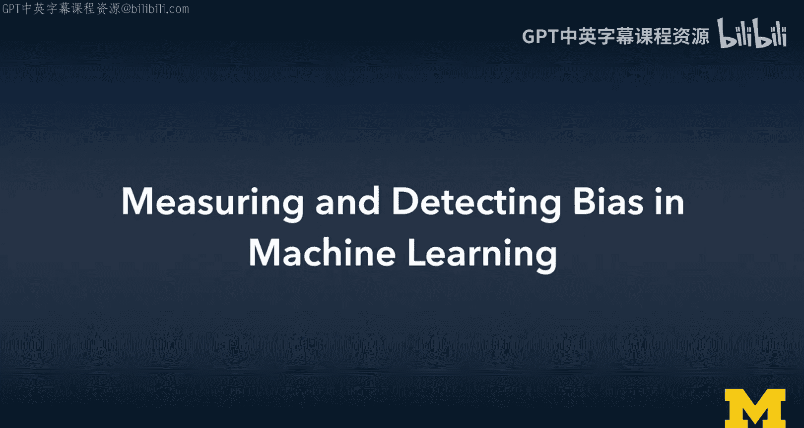
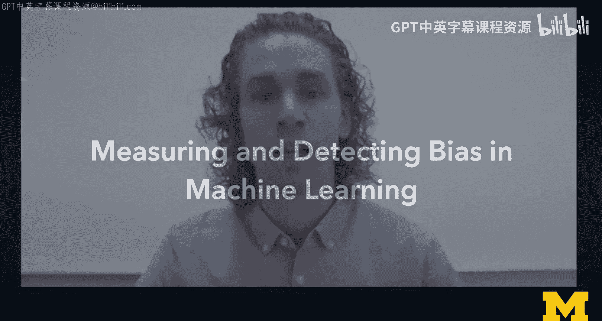
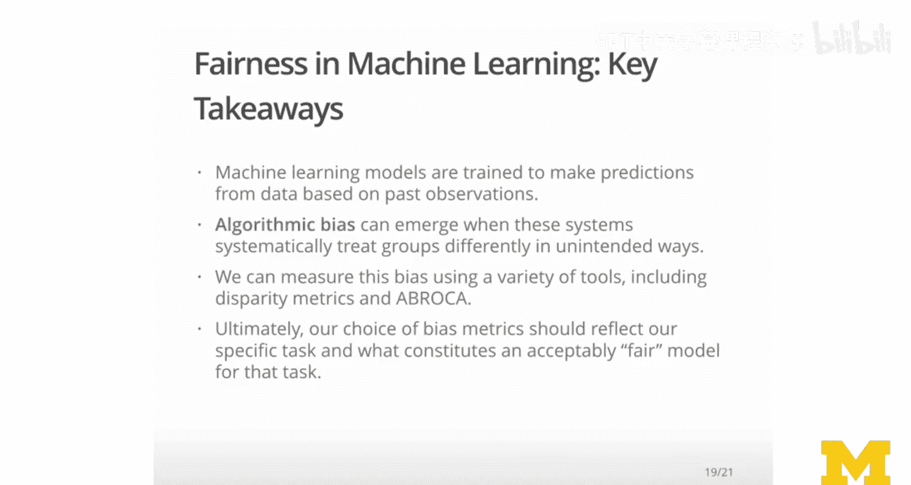

# 密歇根大学《公共部门的R数据分析（基础、数据探索、决策支持、）｜Data Analytics in the Public Sector with R》中英字幕 p137 13_机器学习算法偏差检测技术.zh_en -BV1YZ421J7Fx_p137-

So now let's talk about how we can use measures like accuracy or AUC to detect bias in machine learning algorithms because this is a critical issue in real worldor policy problems that involve machine learning algorithmic bias is sometimes defined as systematic and repeatable errors in a computer system that create unfair outcomes such as priing one category over another in ways that are different from the intended function of the algorithm。

So what that might mean is our model could， in an unintended way， privilege。

 say certain ages or genders or other characteristics of applicants in a systematic way that advantages or disadvantages certain groups。

And of course， that would be undesirable。The field of machine learning is actively developing techniques to try and audit models for this bias and also try to mitigate this bias when it's been detected。

One way that we do this is called slicing analysis and the idea here is simple we essentially slice our test data set along demographic lines to look at different slices of the population。

 we assess the model's performance on those slices and we compare it to see whether our model is。

Performance is systematically different across these different groups or slices of our data set。

And we'll do that here。So there are many ways that we might slice our data and also many different measures that we might use to compare differences in the model' predictive performance across these groups。

One metric we might compute to compare performance across groups is called accuracy disparity。

 and it's exactly what it sounds like we compare differences in accuracy across groups。

Here what I've done is created a variable that measures whether an applicant's age is greater than or equal to 30。

 and we compare the accuracy on these two groups below。

You can see that for individuals who are greater than 30 years old。

 the model's accuracy is 10% higher compared to individuals who are less than 30 years old。

So our model shows clear evidence of accuracy disparity and the accuracy disparity is exactly 10% here。

嗯。Depending on what this model might be used for and what kinds of restrictions we might have on our performance for different groups。

 this could potentially be a concern for our model in deployment。

Another way we can measure algorithmic bias is by slicing our data。

 plotting the ROC curves for each group separately and measuring the difference between them we can do this with a metric called the absolute between ROC area or a BroA。

 which I developed in some work with Chris and our collaborator Ryan Baker and thebroA is formed。

 as I mentioned by plotting the ROC curve separately for two or more groups in our data and measuring the area between those curves。

 which is shaded here in。As that area becomes larger。

 our model shows increasingly large performance disparities between groups。

 and we might take this as evidence of more algorithmic bias or performance disparity between groups。

So again， it does seem that our model shows evidence of performance disparity where for the majority group。

 individuals who are greater than or equal to 30 years old。

 their curve is higher and further to the left， that's the red curve here。

 whereas is the blue curve for younger loan applicants is lower。

 indicating slightly worse predictive performance for our model on the tested data。

So this was an example of just two metrics we might use for slicing analysis。

 accuracy disparity in particular， we might choose to use sometimes when our model desired to have low algorithmic bias at a specific threshold and in our case the threshold we used to decide whether an individual's prediction was high or low risk was whether this predicted score was higher than 0。

5。A brokerA in contrast we might use when we would like to have a classifier that has low algorithmic bias across all classification thresholds。

 so not just greater or lower than 50% predicted probability of being high risk。

 but also when we want our model to be well calibrated for very high risk and very low risk in prediction。

We also might choose to use a BroA when we want a model to have a good performance even on unbalanced data sets。

Zooming out beyond just accuracy， disparity or Bro。

 I would like to emphasize that the correct evaluation metric always depends on context。

 so it's up to you and every other individual that's involved in a model's development from data collection to deployment to ensure that your model is evaluated with appropriate metrics for inspecting bias and these are only two of the many options that you may consider。

So the key takeaways here are first that machine learning models are mathematical tools that we estimate in order to make predictions from data based only on past observations。

When we do that， algorithmic bias can emerge and we define that as systematic treatment of groups differently in unintended ways。

It's important to inspect our models for these and in particular to inspect the models using appropriate bias metrics that reflect our specific task and that reflect what constitutes a fair model for that task。

We discussed a couple of metrics that we might choose to use in certain situations。

 including accuracy and disparity and a broker， but I hope that you dive a little bit further into this emerging literature and machine learning world to really ensure that。

The methods that you choose for your problems reflect the bias considerations for that task So Josh。

 thanks for that great introduction to the issue of bias in machine learning and I think that there's so many different things that come to mind when I think of bias and of course being in a school of information at a public university we think about bias a lot and there's a lot of talk about algorithmic bias in particular and I think one of the questions that always comes to my mind is magnitude how much bias is too much bias and you've said several times in your lecture here that I think it's really important is it well it depends it depends on your problem and it depends on your context but this is a really challenging issue that I don't know of a lot of work that's been able to look at it from different kinds of models are you aware of any work in this area that is kind of coming out with some recommendations about how much bias is too much。

And what I guess even better what you should be doing about that bias。Yeah。

 so I think there are two separate and critical questions there the first in terms of trying to understand what's an acceptable degree of bias in terms of the magnitude。

 I would be extremely reluctant to give any recommendations there。

 because I really do think that it depends so much on which problem we're solving how it might affect the individuals that will interact with that model or be predicted on by it and it can also reflect things like the legal landscape in whatever policy context that that model is used in。

 so I think this is a question that everyone is really grappling with now and the question becomes more and more pressing as machine learning models are deployed for more and more tasks。

 including things like credit modeling， which we were talking about here but also in the field。

Healthca， other economic models， hiring， which is heavily regulated in many countries including the United States。

 so I think it's a real challenge to know how much bias is enough and it's also not usually satisfactory to say that our model must be biased free because that's also very challenging as well。

嗯。And I think。That relates to your second question which is how can we mitigate these types of biases when we observe them and there's a whole literature going back quite a long time。

 actually in particular in the field of education and goes back several decades in looking at how to measure bias in educational tests for example。

 but even in the past decade， the field of machine learning has really honed in on this question as well。

In terms of how can we eliminate bias from our models， there are several techniques to do this。

 usually they fall into one of three categories， those are preprocessing in processing and postproces and briefly preprocessing usually attempts to make data fair by removing associations between sensitive attributes and the rest of the data so it would actually change your data to try and remove bias from it before you've trained a model in processing would try and change the learning process of your machine learning model so that the process by which you estimate those parameters data to ensure that your model does it in a more fair way so maybe it makes predictions that are less associated with the sensitive attributes that you want to remove bias for and the last is postproces which might take a trained model and change its predictions either。

in a stochastic like a randomized way or or in a deterministic way and it might change those predictions in a way that makes them less biased so those are just three of the kind of main families of techniques that are used for this there are many。

Specific methods that fall within each category， but I think this is an important。

Emerging area of machine learning research and it's another one where you need to choose the tool that you use carefully and with some knowledge of what the implications of that might be Yeah another issue that I think is really interesting and really comes up when you look at that a broker curve is that when you're measuring the bias and you're using just one of these individual metrics it doesn't necessarily tell you which group is being biased against where your accuracy is changing or how and then you always have to translate that into what is actually the question what is it that we're actually predicting as well and so we've seen some some work where certain thresholds there could be quite a gap between two groups and at other thresholds that can actually twist and that can actually flip between those and those are both evidence of bias but some of those might be related more to a historic bias against one of the groups and others might。

Not and so it brings in a lot of questions for decision makers and leaders who want to try and make sense of this and try and bring public policy out of that and I think we're just on the cusp of starting to figure out how to do that I mean this is really a challenge that Dr。

 Lance and others have to get the help of analysts to understand what the bias actually is in the model in order to understand how that model might be might be deployed。

Yeah I think these are challenging issues and it really does take a diversity of perspectives in order to address from the computer science and engineering side where I sort of live to the policy side where I hope many of your students will continue to grow so I think that's a part of why it's so exciting to be introducing new folks to this through R and through this course and I would really encourage the folks taking this course to be a part of that conversation and to start those conversations in the tasks that they're tackling in our work Josh thanks very much for joining me thank you for sharing with us an example of algorithmic bias and machine learning it's a big topic right you can spend many degrees studying this as you are and so this is just a taste of it and I hope that the learners here will start to dig into that in some of the other courses that are available on this platform and others Thanks for having me Chris it was a great conversation。

。

