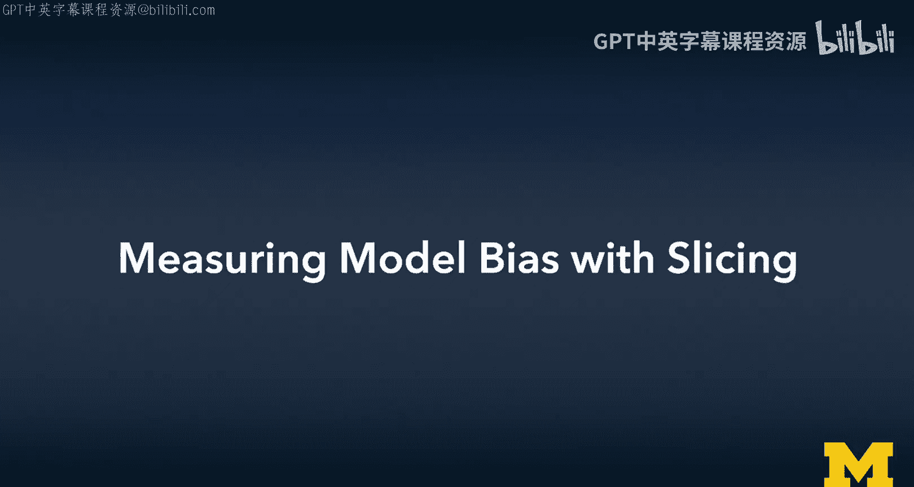
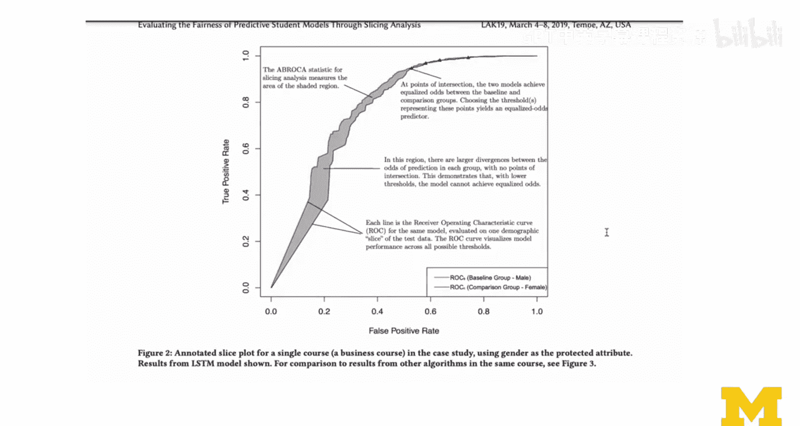
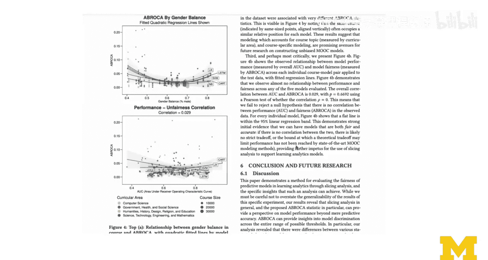
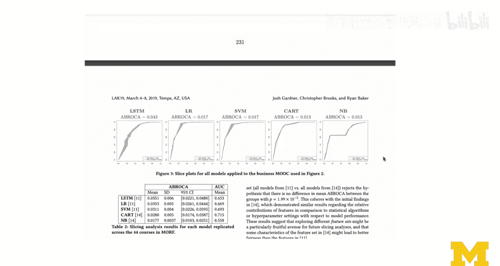

# 密歇根大学《公共部门的R数据分析（基础、数据探索、决策支持、）｜Data Analytics in the Public Sector with R》中英字幕 p138 14_切片法测量模型偏差.zh_en -BV1YZ421J7Fx_p138-

I'm joined once again today by Josh Gardner， a PhD candidate at the University of Washington Now Josh and I have gotten to do some work together and as I may have mentioned in this class my field of study is learning analytics。

 I'm interested in how people learn how we can predict whether there're going to learn or where there might be a deficiency and then of course how we can intervene in that。

This work actually won best paper at the Learning analyticslytic conference in 2019 Josh led it and I was a collaborator along with my colleague Ryan Baker at the University of Pennsylvania Josh thanks again for joining me It's great to be here great to talk about our work Yeah one of the things that's very special about this work to me is that it looks at Michigan MOC data so the exact kinds of students who are taking this course right now In fact we've had millions of students on the Coursera platform and others taking our courses online and this has presented us a huge opportunity to try and understand global learning at scales we've never been able to do before and really in the MOO area one of the things we were interested in predicting is what we call dropout attrition or completion rates and so in this work we're actually looking across a number of different courses to see if we can build a good predictive model。

Of MOO dropout and then whether there's a bias in that model across different demographic characteristics。

So why don't we dive right in and look at some of our results and I think the first one there's a great image in the paper and the paper is actually going to be linked in the core shellll it's open access and there's a great image in here that actually shows our metric。

 a broker and shows it across two different slices so a reminder that this is a slicing analysis we take our category that we're interested in in this case it's demographic I think it's gender split between male and female and we plot both of those curves and maybe Josh you can walk us through the results here。

Yeah， and for students who are curious， we give a little bit more background on the curves that are plotted here in my guess lecture in the course on fairness and bias and machine learning。

 but what we're looking at is a plot of one line per group but the line for each group shows the same information。

 and what that is is the true positive rate and the false positive rate of a predictive model on the data for individuals in that group as we change the cutoff threshold for our predictions。

 so a model predicts a score， a number between zero11 that can be thought of as the probability that the model estimates that an individual will not complete the course and as we change our cutoff for the completion so what we treat as a likely completer or non-completr this curve forms as we。

That cut off that we applied to the predictions between zero and one。

This curve is called the receiver operating characteristic curve。

 and often we use the area underneath it as a measure of our model's quality。

But what we can also do as shown here is separately create the curves for each group and look at the gap between them and this tells us about differences in the quality of the models predictions for these two groups how likely it is to correctly assign a score that reflects the。

True status with respect to completion for that individual and as these two curves for the groups become further apart。

 that's a sign that our model might be exhibiting systematic signs of differences in。

The quality of its predictions between the two groups。

 which we might interpret as evidence of algorithmic bias。

Now Josh in this example and well I guess all examples of the ROC curve as the curve hugs the upper lefthand corner right up by the zero false positives and one true positives that's a better curve it's evidence of a better fitting model and we see here pretty interesting difference because we've got this one red line that's much closer I would say or at least somewhat closer to hugging that that's the better model and then we've got the blue line which is actually deficient in comparison and so in this example this would be the model for males would be a better model than the model for females isn't that right Yeah and so it's important to keep in mind too here that we have one model and we're looking at its performance on two separate subgroups or slices of the population which is why we call the slicing analysis and I think this is real worldorld example of something。

That occurs for many predictive models where quite simply it works better for one group than the other。

 or it makes systematically different predictions for the two different groups and they happen to be better for one group than the other and if we never chose to disaggregate the performance of our model this way and look at these curves separately。

 we might be completely unaware of these systematic differences in prediction and so I think this illustrates why it's important to audit or inspect machine learning models at sort of every phase of the lifecycl from when we're exploring them to when we're tuning them to when we might deploy them for a real world task。

Yeah， and I think that this model is interesting， so we ran this specifically I think this was a business class but one of the interesting things about the MichiganO portfolio is that we actually have a large number of different courses that we've offered again to millions of learners and so we also started to apply this curve to many different courses can you walk us through a little bit how you make sense of that I mean if we had to look at hundreds of these curves。

 I think it would be a little overwhelming I know it was I was digging through it when we were writing this paper so what can we do to look across a larger portfolio to see if there's any trends in the ways our models might have bias。

Yeah， I think this points to why these metrics are often useful， of course。

 disilling down the bias or predictive accuracy of our model into one number is a bit reductionist。

But there are also benefits in that it allows us to potentially compare this metric across many different。

 as you say courses or subgroups or models， and that's exactly what we did next than this analysis was look at how different characteristics of the population of a course might be associated with this measure of algorithmic bias broke up and what we found were some some clear evidence of systematic relationships between this measure of bias and characteristics of the course population and in particular the percentage of students in the course that identify as male and we found that in general as the course became more imbalanced toward male students there was evidence that the disparities。

Tended to increase and similarly as the course became imbalanced toward having a much lower fraction of male students so becoming more an imbalanced in the other direction。

 the bias also tended to increase and another way to put that might be as the course was more or less equally balanced between the two groups it tended to have the lowest bias。

 but when more people came from one subgroup or the other the model perhaps naturally tended to work better for those groups and again I think this is a common thing that we see and in real worldd machine learning models is who is represented in the data can affect the quality of the model for those groups Yeah another thing I really liked about this a broker statistic is that you can compare different kinds of predictive models so over the last 10 especially 15。

there's been an explosion in the number of opportunities and different ways of framing a predictive model and so there's so many different techniques。

 there's deep learning techniques， there's classical e Baysian techniques。

 decision trees and so forth and one of the things we did with this work is we actually looked at how different modeling techniques actually relate to bias as well and how they might produce different ROC curves maybe we could just take a look at that image and talk through that。

Yeah， I think this gets a really interesting issue。

 Chris that your students will encounter as they dive deeper into the machine learning landscape and this is something that sometimes in the machine learning literature is called the bias variance tradeoff。

Specifically， what I just want to point out here is as our models become more sensitive to individual features in the data and their relationships to each other。

 they might capture。more subtle relationships and be able to produce more accurate predictions。

 but at the same time these more sensitive algorithms might also be more susceptible to greater algorithmic bias and picking up on associations that we actually don't want them to be sensitive to。

And it's hard to disentangle some of these effectss。But we did the。

In our work that these more sophisticated flexible deep learningbased models such as one called the long shortter memory network or LSTM did tend to obtain a better predictive performance but also bigger gaps between the groups as measured by a Broca and in contrast some of the simpler methods such as a classical Bayesian technique that you mentioned called naive based tended to have lower predictive quality but also smaller gaps between the groups and this is indicative of some of the tradeoffs that we often have to think about when we're choosing a model to use for a given problem in the real world Yeah and I think that a lot of work and this has certainly been true in the field of education over the last 15 years or educational data mining and learning analytics a lot of the work has tended towards finding an accurate model and doing a little bit of a model shootout and looking at accuracy or another measure of。

But as you show here， there's also a fairness element at play that we need to be discussing and looking at as well。

 and so I think that this measure， the a broker measure along with these curves that kind of describe it is really powerful for understanding what model we should use。

 not necessarily which is the best， because there's dimensions of what's best and better。

 but which one we would actually want to maybe deploy in a platform like this。

Yeah I agree and Chris I just want to emphasize too that you know。

 if students are curious to look at the paper， they'll see that there are some specific things about the way these models are used that led us to believe that a Bro was a good method for evaluating bias in models in MOCs。

 but there are also。Many different types of problems out there and many different ways to measure algorithmic bias and it's up to the modeler and everyone who's involved in the machine learning modeling process to make sure that the metric that they choose is appropriate for the problem that they're working on so I would also encourage students to think about whether this is a suitable measure of bias for the problem that they're analyzing and also to explore the other measures that are out there that might be more appropriate depending on what they're tackling Josh thanks again for joining me to share some more information about the topic of bias in machine learning to share this award winningning work I appreciate it for the students if you're interested this paper is linked in the course shell please feel free to take a look at it and discuss It's a great discussion thanks for having me Chris。

