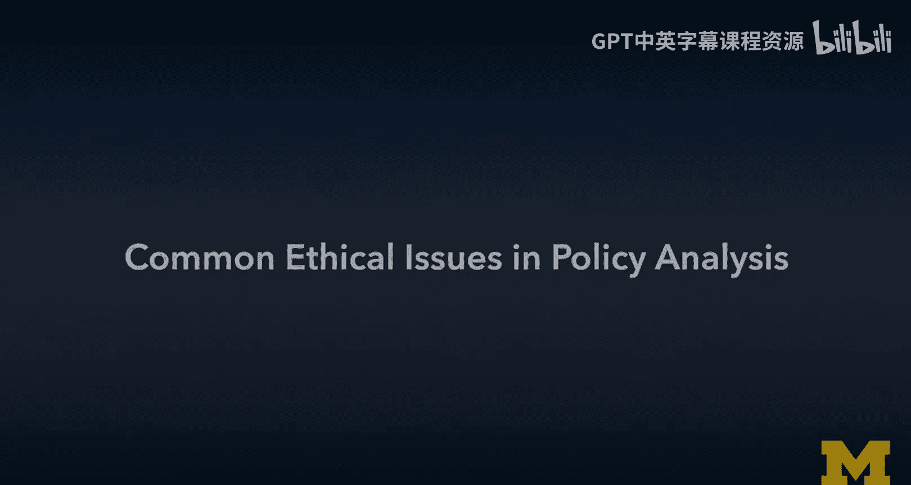
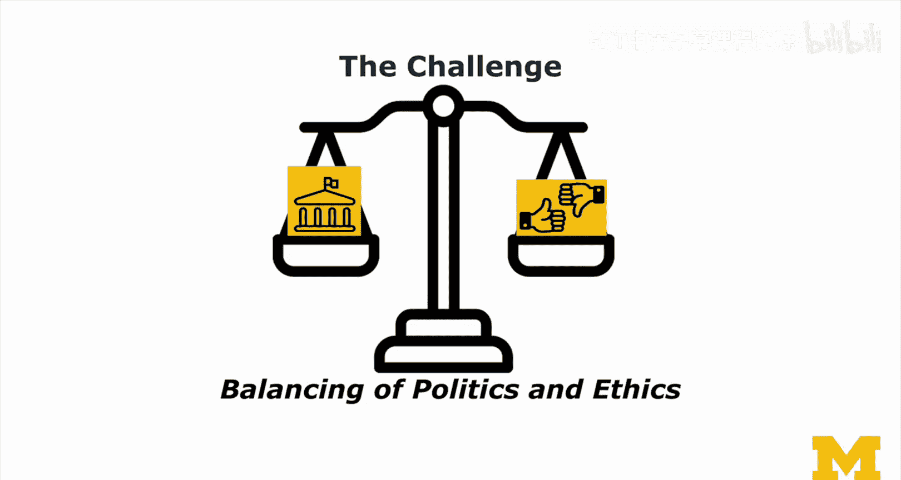
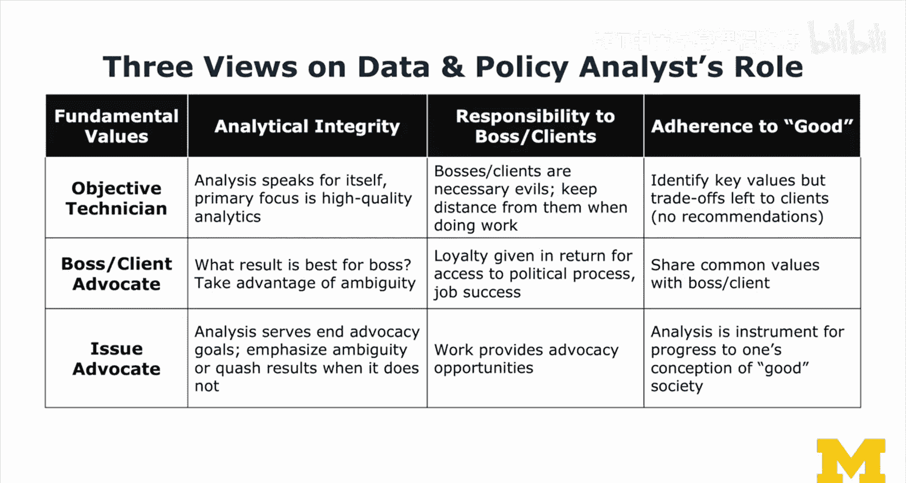
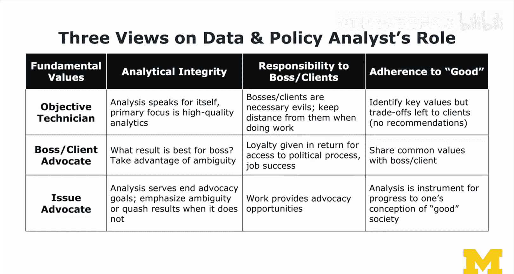
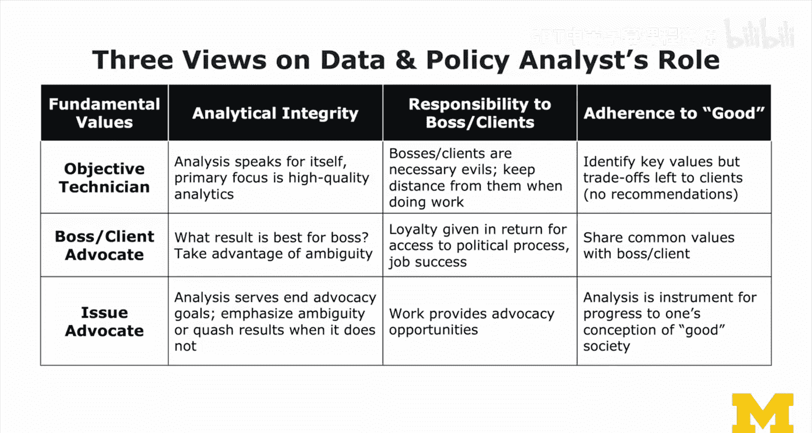
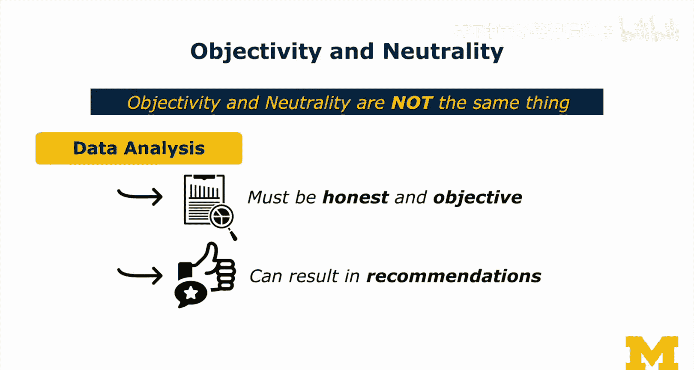
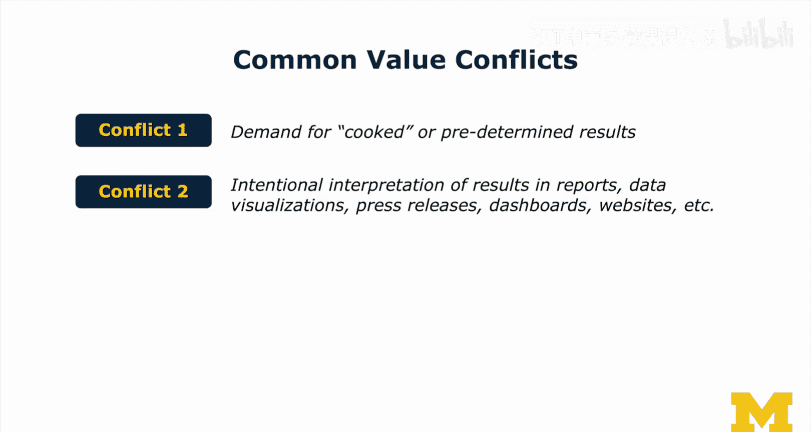
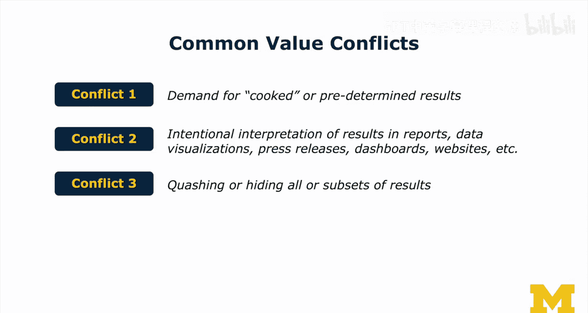

# 密歇根大学《公共部门的R数据分析（基础、数据探索、决策支持、）｜Data Analytics in the Public Sector with R》中英字幕 p139 15_政策分析常见伦理问题.zh_en -BV1YZ421J7Fx_p139-

Welcome back。As we've been talking about， there are many examples of ethical challenges or ethical issues that can complicate program evaluation。

 policy analysis and data analytics in the public sector many of these challenges are the result of trying to balance ethical practices and research and data analysis with the pressure that comes from politics。

 which as we discussed is a normal but challenging part of decision making in general and particularly in the public sector some of the challenges for data and policy analyst flow from differing perspectives regarding the role of the analyst and the process of using analytics and decision making I'm now going to walk you through a table showing three general yet differing perspectives on the analyst' role。

And how these differing perspectives lead to different notions of loyalty and the implications of dealing with value trade offs。

Which is what most of the politics is about so the three different general views of data and policy analysts' role in decision making processes are first one the objective technician this is a perspective that the data analyst's primary focus is on the integrity of the analysis adherence to sound analytic practices and objectivity In the end。

 the data and results of the analysis should speak for themselves the analytic work is what is of primary importance doing high qualityality objective and technically sound work bosses or clients in in our case。

 the clients are the people who are asking for the a bosses and clients are necessary but they should be kept at a distance during the actual work so that they cannot influence the process or the results the second view of the role of the data analyst is that of an advocate and an advocate for an immediate boss or some。

of client this other kind of client could be an executive leader of a unit， a legislator。

 an elected official etc in this view， the best results of the data analysis is the one that is best for the boss or the client whomever asked for the analytics to be conducted This type of analyst feels a responsibility and even a loyalty to the boss or client primarily in turn not only for job security but also for access to political power and influence Now this doesn't mean that an analyst will make up results or use terrible analytic practices but it does mean that there is some pressure to take advantage of ambiguity when you can as an analyst it can also involve not releasing results saying results were inconclusive or presenting only partial results The third view is that the analyst is more of an advocate for a social or policy issue at hand。

Issue analyst here the analyst is really doing the work and motivated by using data analytics that could lead to improvements in that particular area of concern this could be in the area of public health education national security climate change and so forth the analytic work being done provides opportunities for advancing progress and advocacy for issues that the analyst feels strongly about in this view the analyst is motivated to produce results that will serve some end goals in regard to advocacy and positive policy change since the focus is more in the end results than the actual analytic work this perspective also increases incentives for taking advantage of ambiguity when possible and also might involve not releasing or quashing results okay so in the last column of this table you also see that across these three different general。

data analyst there are value-based notions of what constitutes good data analytic work and that these vary somewhat across the three different views for the objective technician。

 this type of analyst can and should identify core important values and tradeoffs in different policy options according to those values。

 however， the objective technician does not make a recommendation and in fact is uncomfortable doing so objective technicians just want the data and results to speak for themselves。

 for the boss or client advocate there is often a shared set of values between the analysts and the boss or among all the team members regarding the optimal impact of the work This then allows the team to identify value tradeoffs and also to make recommendations keeping the larger political environment in mind for the issue advocate the strongest values are the ones that align with what is considered to be good that's value-based good progress in regard to。

Isue area The analysis is viewed as an instrument that will help fuel progress towards a value based vision of the future in regard to the particular issue for social problem  individual people who engage in policy and data analytic work can find themselves and all of these roles over the course of their careers I certainly have I've been in roles where I was only supposed to be the objective technician just provide the facts ma'am。

 thank you and no interpretation or recommendation。

I've also been in the role of engaging in analysis that had a political agenda behind it with high stakes for my boss and other leaders。

And I definitely have been an issue advocate working on data and policy analysis that I hope to would advance progress towards societal improvements on issues that I care about。

Now， in all cases， you absolutely should do your best and high quality objective work。

None of these different views on the data analyst suggests that the goal should be to use sloppy techniques。

 to use misleading analysis or data visualizations， absolutely not。

But I do want to make one point that's important， an important distinction here in all of these cases。

 please remember the following being objective is not the same thing as being neutral being objective means being honest and using the best analytic and scientific practices avoiding bias when you can shining a light on problematic data issues。

 highlighting caveats and interpreting the results as data analysts we should always strive to be objective Being neutral however is something different being neutral is not having an opinion about what the results reveal and not engaging in recommendations or the promotion of certain decisions over others based on the results。

The point here is that engaging in recommendations does not mean you are not being objective in the analysis。

 you can be objective。But not be neutral about the results of an objective analysis。

 I hope that makes sense。

Winmer and Ving， who have written a great textbook on policy analysis。

 argue that the most common ethical conflicts for policy and data analysts pit responsibility to the client or to an issue against other values they also note that factors that can really complicate an analyst's ethical judgment in the face of such conflicts include the status of their current and future employment。

 continued access to a policy issue or an environment of interest， loyalty to a boss or to a client。

 and also their reputation both in good and bad ways。

 they also note that the most common values conflicts that analysts face include first of all。

 the demand for cooked or predetermined results this is the demand from a client or a boss to do some analysis that shows X or Y or can you please run some numbers that illustrate。

This has being asked to come up with the result before you've even done the analysis The second most common value conflict is the intentional representation of misrepresent and interpretation of results。

 data visualization， press releases， dashboards and websites saying intentional representation。

 that's a nice way of saying misrepresentation。

Or misinterpretation of results the quashing or hiding of all of a subset of results that doesn't support a narrative or desired set of recommendations is also a common problem and then forth making recommendations that do not match the analytic results So what can and should you do if you're ever faced with such dilemmas？

We will talk about this in the next video。

