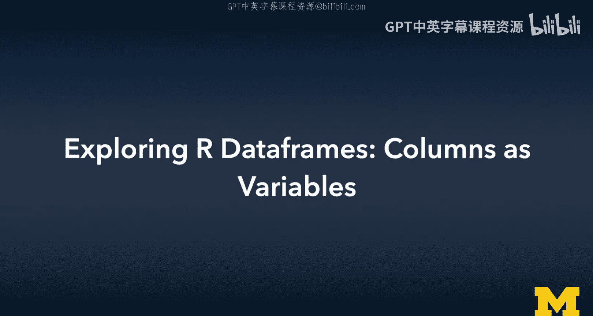
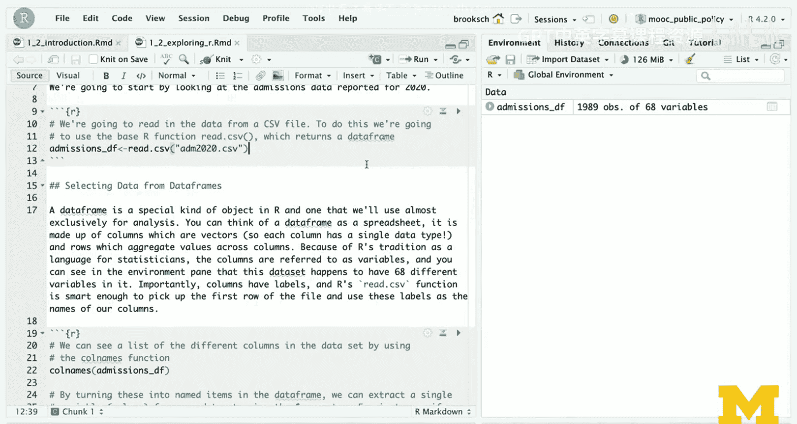
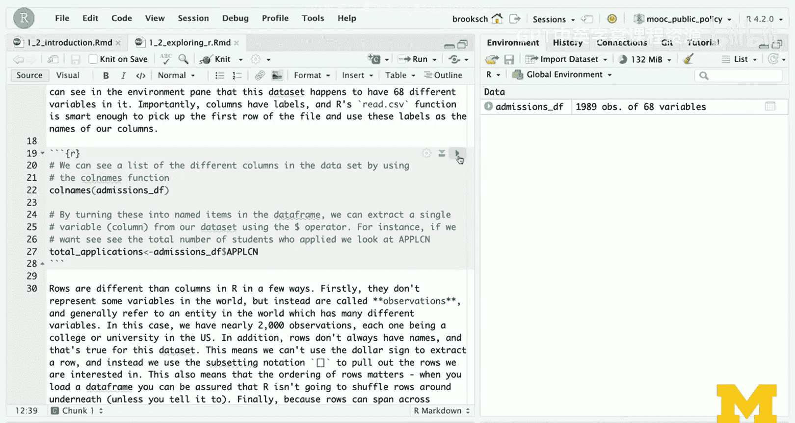
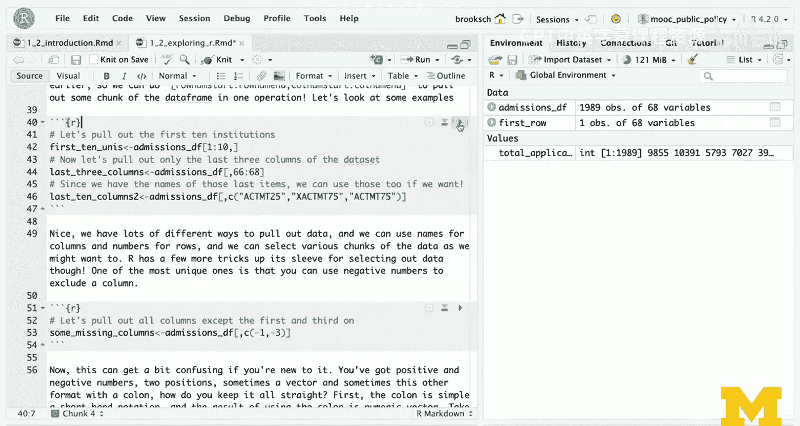

# 密歇根大学《公共部门的R数据分析（基础、数据探索、决策支持、）｜Data Analytics in the Public Sector with R》中英字幕 p14 13_R数据框：变量列操作技术.zh_en -BV1YZ421J7Fx_p14-

Through my teaching， I like to use real and authentic data sets wherever possible。

 And in this course， we're going to be using a variety of different sources for data which relate to issues of interest to the public sector。

 I'm actually going to start with a piece of data that's very near to my own research work。

 higher education data in the United States。Specifically。

 we're going to look at some of the integrated postsecondary educational data system or iPads data sets。

 Now， these data sets are created annually and cover 12 different topics relevant to the performance of colleges and universities in America。

 from enrollment and library information to graduation rates and financial aid。

We're going to start by looking at the admissions data reported for 2020。

So we're going to read in the data from a CSV file to do this， we're going to use the R function。

 read dot CSv， and that's included in base R， and this is going to return a data frame。

 So let's execute that and we can see admissions underscore Df where Df we're using as data frame is in the upper right hand corner for data we can expand this and we can look at all of the columns in there just going to close it for the moment。

Now， a data frame is a special kind of object in R and one that we're going to use almost exclusively for analyses。

 You can think of a data frame as like a spreadsheet。 It's made up of columns which are vectors。

 and so that means each column has a single data type and rows which aggregate values across columns。

Because of our's tradition as a language for statistician， the columns are referred to as variables。

 and you can see in the environment pan that this data set happens to have 68 different variables in it。

Importantly， columns have labels， and the R read CSV function is smart enough to pick up the first row of the file and use these labels as the names of our columns。

So we could see a list of the different columns in the dataset by using the columns function。

 So here I'm going to use call names and then just pass in that admissions Df and that'll return a list of the columns by turning these into named items in the data frame。

 we can actually extract a single variable， a column from our data using this dollar sign operator。

 So for instance， if we want to see the total number of students who applied。

 we can look at this APPLCN application。 So I'm going to take that out。

 I'm going to say admissions Df dollar sign application。

 just pull that one vector out and assign it to total applications。 we can just execute that。

 All right， so you see the call names is quite large and then we've got a value up here of the total applications。

Now， rows are different than columns in R in a few ways。 Firstly。

 they don't represent some variables in the real world。 Instead， we call them observations。

 and they generally refer to an entity in the world， which has many different variables。

 In this case， we have nearly 2000 observations。 Each one being a college or a university in the United States。

In addition， rows don't always have names。 And that's true for this data set。

 This means that we can't use this dollar sign to extract a row。 And instead。

 we have to use this subting notation。 the sub indicator of the block indicator， the square brackets。

 Sometimes it's called to pull out the rows that we're interested in。

 This also means that the ordering of rows matters。 When you load a data frame。

 you can be assured that R isn't going to shuffle around rows underneath unless you actually tell it to do so。

Finally， because rows can span across multiple columns。

 they have many different data types or they can， which means that we won't be extracting them as vectors。

 but instead they'll be extracted as lists or data frames themselves。

So let's extract the first few observations in this data frame in this data each row is a single institution。

 so I'm going to say first row and I'm going to assign it to admissions Df sub1 comma and we'll just run that All right so we see the first row comes up here。

Now， reflect on that code for a minute。 Do you see the comma I snuck in here。

 Let's talk about that When you're using this subsetting operator on a data frame。

 you actually have some choices to make。 and R allows you to select rows in this way or columns or both。

 So the syntax is actually really important here。 and you'll get used to that。 in the general form。

 We can select a column by its position with square brackets and the column number。

 We can select a row and a column combination with the square brackets and a row number and then a column number。

 So we just put put a comma between them。 And if we want all of the columns。

 We just use leave the column value to blank。And then we can connect this with the slicing notations showed earlier so we could do a square bracket。

 row number start， colon， row number end， comma， call number start， colon。

 call number end to pull out some chunk of the data frame in one operation。

 so let's look at some examples。So let's pull out the first 10 institutions。

 so I'll make a new variable， the first 10 unis and I'm going to say admissions DF now I just want the first 10 rows。

 so I'll say one colon 10 and then comma， and then I'll leave it blank because I want all of the columns。

We could also pull out the last three columns of the data set。

 so here I'll make some new variable last three columns and assign it to admissions Df。

 Now here I'm going to start with a blank and then a comma。

 So that means I want all of those rows and then 66 through 68。

 remember whenever you're doing the slicing， it's inclusive。 So I'm going to take 66，67 and 68。

And since we actually have names for those last items， we can use those two if we want to。

 So I can actually say admissions D F。 I can have a blank with a comma saying I want all of the rows。

 and then I can use the combined to create a new vector of the strings， which are the names。

 So let's execute that。😊。

So we can see up here in the data our first 10 unis is actually just those 10 observations。

 but we have all 68 variables in it， and then we've got these two other ones。

 two other variables that we created which are the last three columns you can't see one of these is named with a two after it and we see that those are all of our observations because we left the row number blank with just the comma。

 but we only have three variables in each one of those。

