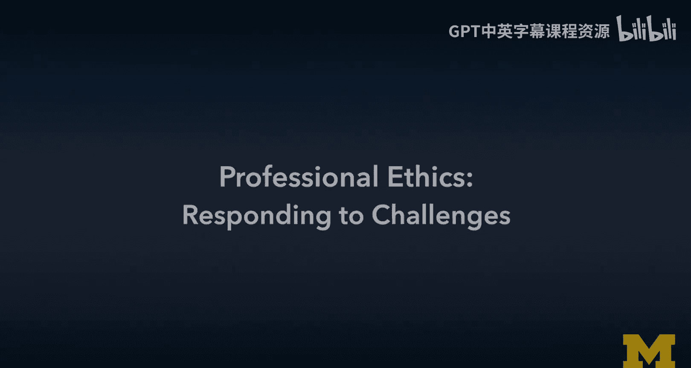
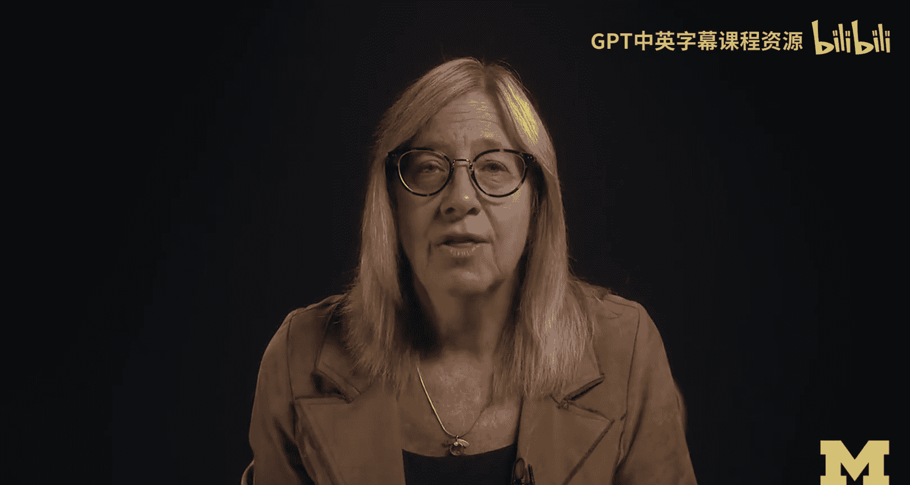
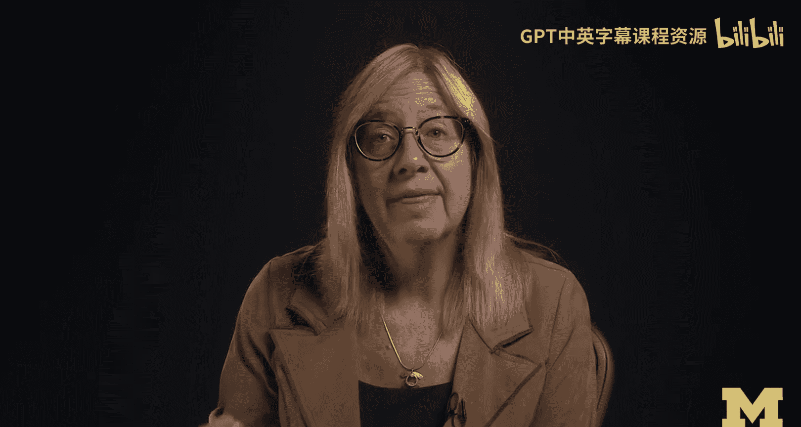
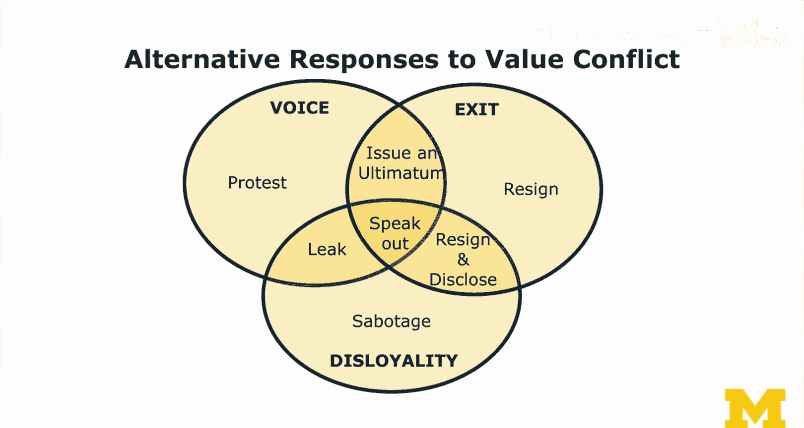
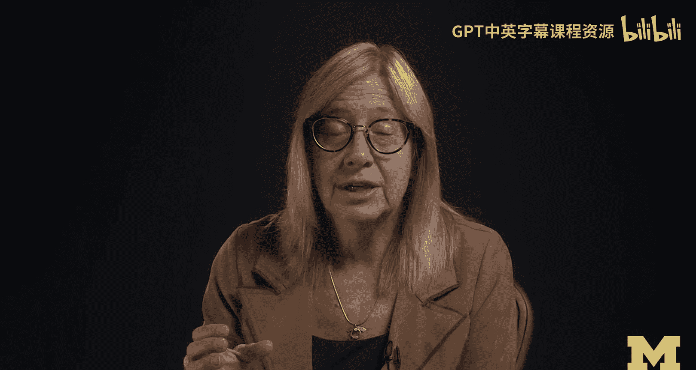
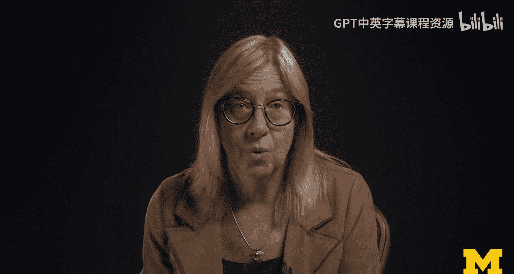
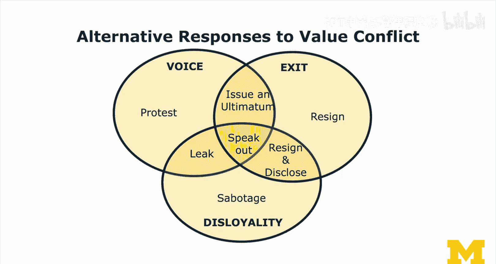
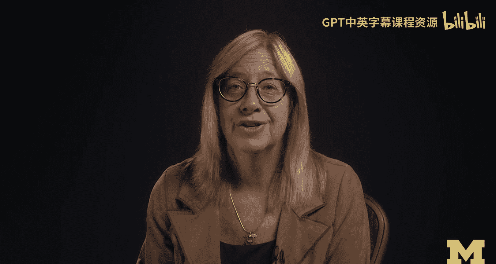
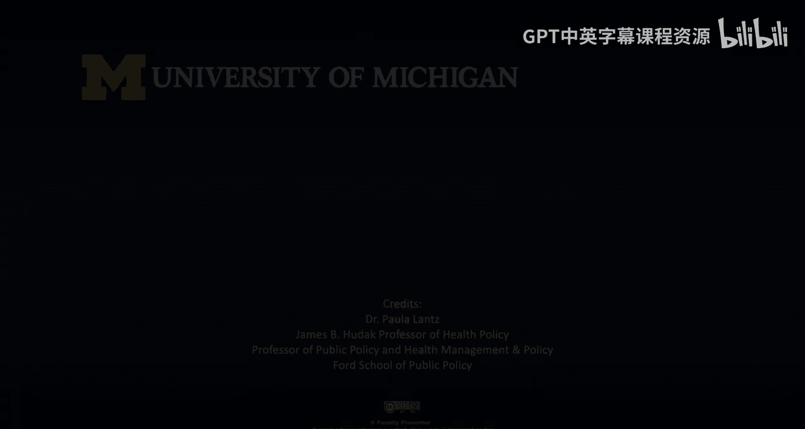

# 密歇根大学《公共部门的R数据分析（基础、数据探索、决策支持、）｜Data Analytics in the Public Sector with R》中英字幕 p140 16_职业伦理：应对挑战的策略.zh_en -BV1YZ421J7Fx_p140-

Hi， welcome back。We've been spending a lot of time talking about a number of different ethical challenges that are actually quite common in data analytics and policy analysis within the public sector。

In this session， we're going to talk about some general options you have for how you might respond if you find yourself facing an ethical challenge over which you have no control think about some scenarios。

You might be asked to produce a very misleading data visualization。

You might be asked to conduct a data analysis that omits a subpopulation that would make the overall data look better。

You might be asked to hide or quash or keep secret some specific analytical findings。

That some key stakeholdersers would not like。What would you do？Well， first。

 remember that your reputation as a good data analyst who follows basic best practices and whose work can be trusted is very important。

It really takes only one time of being part of a team that produces misleading or dishonest results。

That hide certain findings or misleads in interpretation to ruin your reputation。

 so you need to be really careful。And please know that you do have some options。

 one of which is to violate your ethical standards and do the work anyway。

 of course I'm going to advise you not to do that， but that is an option let's focus in on your other options which are shown in this Venn diagram It's a little bit complicated I'm gonna walk you through it in general you have three options to start and these are shown by the three large circles in the diagram your three options are voice exit or be disloyal Now what do we mean by that voice meansvoicing or communicating your concerns to your boss or the person giving you instructions to behave unethically you can push back and explain why have a conversation about it so the first thing to do is to voice concern exit means leave or quit the project or quit your job altogether rather than deal with the pressures of these ethical challenges The third general response。

Is to be disloyal and that means go ahead and behave as your ethics direct you to do not produce the bad visualization。

 do not produce misleading results do the opposite of what you're being asked to do that is giving you an ethical challenge it is highly recommended again that you start with some type of voice you should feel comfortable articulatinging your concerns in what's behind them you might convince others on your team they hadn thought about it they might come to see your position express your concerns in person rather than in writing but you could be prepared if you're going have a meeting with your boss to have some notes Also express your concerns more in terms of the risks and downsides for your team and your organization not for you personally don't phrase it as these are your ethical principles being challenged they are the ethical principles that should be directing the work of。

Now in voicing concern you can do that by just sustaining your concerns。

 you could also sort of up the ante a bit if you will or if you voice concerns and there's no response。

 your next step could be to voice concerns with the threat of exiting or quitting and this is called issuing an ultimatum you can see that where the circles of voice and exit overlap Now if you're worried that voicing concern would result in you being fired and you would rather quit than be fired then you could exit without voice。

However， it turns out that you're likely to have options in exiting you could resign quietly and not go public speak out or anything else。

 however， now let's bring in the disloyal circle you could first issue an ultimatum that you will resign if some work goes forward in an unethical way and then do so by disclosing it as you resign。

 disclose what happened to a reporter or to a higher authority within your governmental organization。

 so here you're exiting and you're being disloyal and being disloyal means again you're going against the what you've been asked to do and in this case it's in a public sort of way you can sabotage which means become a whistleblower in which you would go undercover without voicing concerns to anyone and without quitting。

And you could secretly anonymously report your concerns to some sort of watchdog office to human resources or to someone in higher authority than your immediate boss you also could voice concerns internally and also anonymously leak information about the issue to the press or some office or person outside of your team of course。

 again， as you see how these different circles overlap in individual ways and combinations。

 there are lots of permutations of what you could do with the general actions of voice exit and sabotage if you do all three voice your concerns。

 exit the organization and go public in a way that shames your organization and is thus disloyal。

 then you would be in that brave area that is the overlap of all three of the circles which is labeled as speaking out Of course whatever you choose to do is up to you and it will depend on so。

Many things and every situation will be different。Obviously。

 you cannot be threatening to quit if this is not really an option for you and it's not going to be for most people I can tell you that I've been in very challenging ethical situations three times in my life such that I first voice concern。

And then when that did not seem to do anything， I issued an ultimatum to exit。

I also once threatened to exit and go public I happen to know reporters at major newspapers and I shared that it was such an ethical。

Problematic situation to me that I thought I can't be part of it and also the public should know。

I'm not going to share details but advice it to say that these were some of the most stressful experiences of my life。

 so I hope that you are not ever faced with an ethical challenge that requires you to do more than voice your concerns。

