# 密歇根大学《公共部门的R数据分析（基础、数据探索、决策支持、）｜Data Analytics in the Public Sector with R》中英字幕 p141 17_职业伦理应对挑战实例.zh_en -BV1YZ421J7Fx_p141-

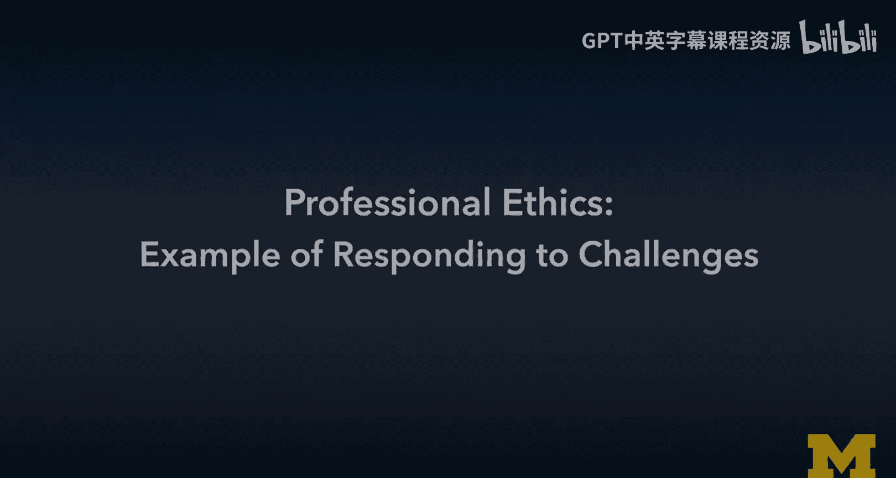

In your career you will likely face at least some minor ethical challenges in which you have to voice some concern。

 so it's good to think about how you might respond to some scenarios before they happen。

Let's go through one example that unfortunately is not that rare。

Let's put ourselves in a professional situation that has to do with facial recognition technology applications in a smart city Okay first what are smart cities quickly smart cities are in general municipalities that are intentionally using modern information and communication technologies to advance public sector goals and the public good this covers a wide array of activities with some common characteristics of smart cities including infrastructure development and this includes physical institutional social and economic infrastructure。

 new data collection activities especially through the use of sensors， cameras。

 social media and crowdsourcing the integration of information systems and advanced data analytic techniques so these are all important elements of smart cities Now some common focus areas for smart city initiatives include communications such as global highpe。

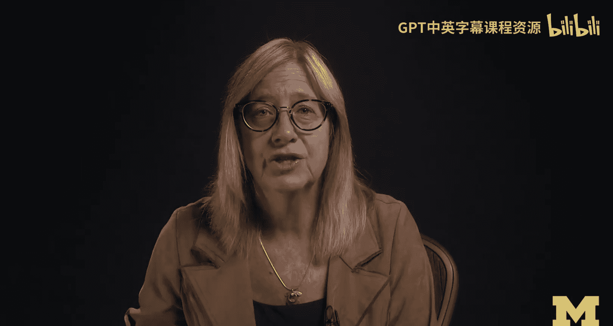

Internet mobility or transportation systems， environmental quality and sustainability， egnment。

 moving government services online and safer neighborhoods with a strong focus on crime reduction the main goals of smart city initiatives center on our pillars of economy efficiency and effectiveness however smart city activities also bring with them a host of concerns related to equity this includes concerns related to privacy digital inequity and also how these new activities might be reinforcing existing problems related to systemic racism or institutional discrimination this includes facial recognition technology which has been a popular element in many smart city initiatives facial recognition technology is being used in multiple ways in smart cities including to help find missing people including missing children lost people with dementia。

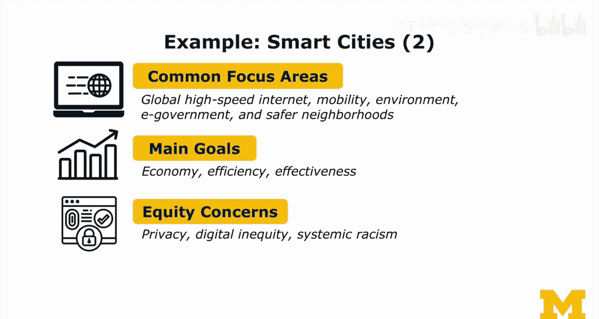

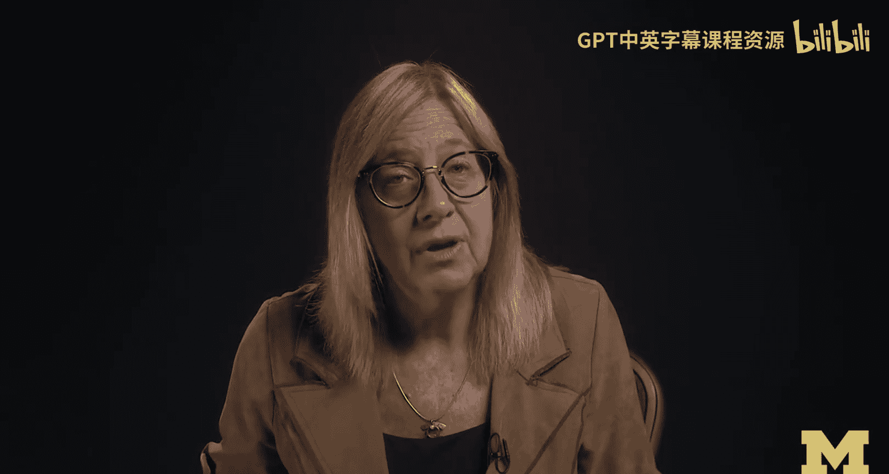

or missing people in a natural disaster facial recognition technology is being used to identify。

 catch and also deter criminal behavior and offenders it's also being used to assist differently abled people toor and enhanced shopping experience and so forth some of the ethical concerns about facial recognition technology are probably fairly obvious to you and in fact many cities have passed laws that ban the use of this technology the concerns that have led to these bands include first and foremost that almost all facial recognition algorithms show serious racial bias and accuracy especially for people of color and especially black women the biases and inaccuracies in the technology could lead to racial and other forms of discrimination there's also a lack of informed consent for the use of this technology and often a lack of transparency regarding its use and the purposes behind it and also their legitimate public concerns about mass surveillance is the。

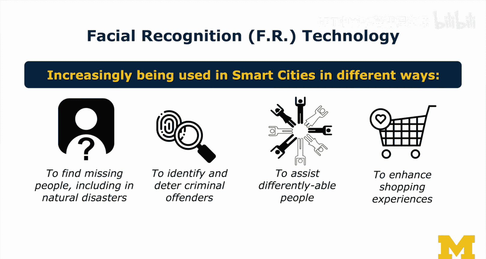

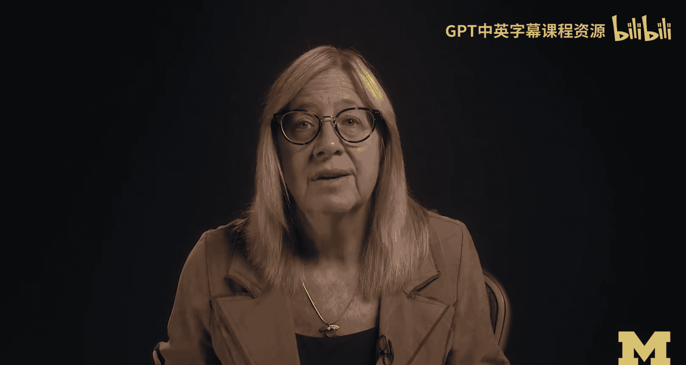

all the timeI mean this is off big brother vibes for sure there are myriad concerns about privacy invasion and then of course there are concerns about potential data breaches all right so with this background。

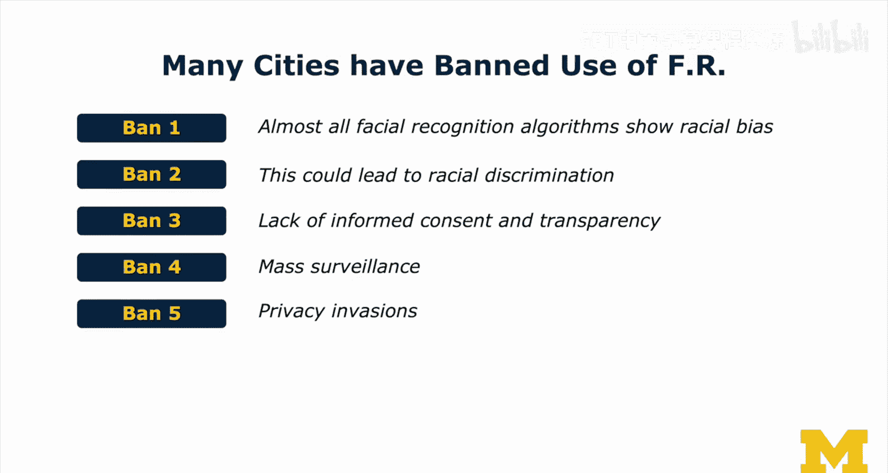

Here's your scenario and what would you do in this scenario assume that you're a data analyst and the planning department for a large city developing a smart city strategic plan this plan includes increased camera surveillance to improve safety by helping law enforcement find criminal offenders you've been asked to contribute to the planning process by writing up the section of the report that discusses the data infrastructure investments that are going to be needed to analyze the data captured by these cameras that are being placed all over the city you write up the section but note racial and gender equity concerns about the potential algorithms that are being used for facial recognition and also general privacy concerns boss reads what you've written your draft text for this report but then tells you to please remove all that stuff about the downside and concerns from the strategic plan which。

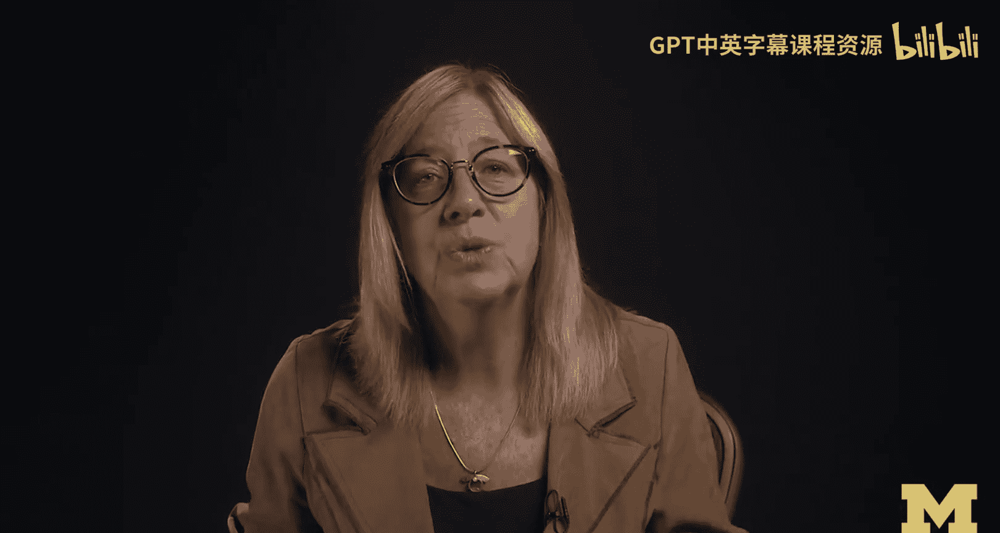

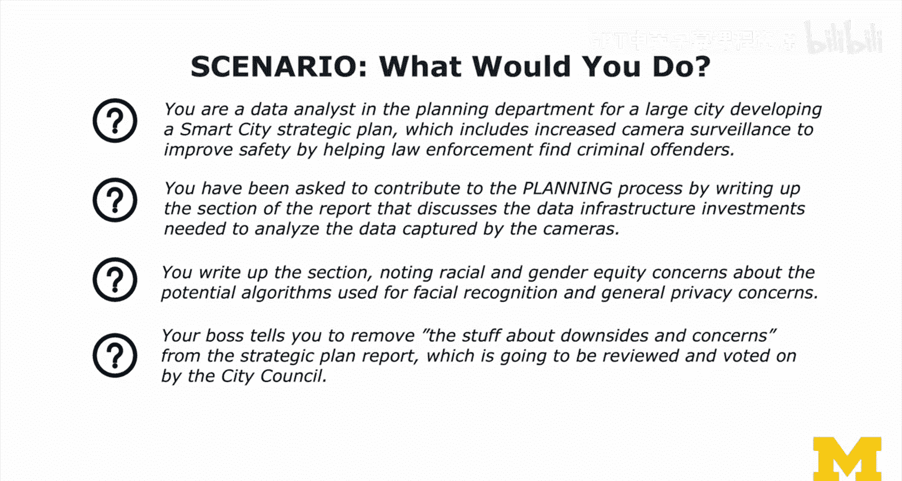

To be reviewed and voted on by the city council so your boss has asked you to not talk about bias in facial recognition。

 algorithms or other concerns with this kind of technology。

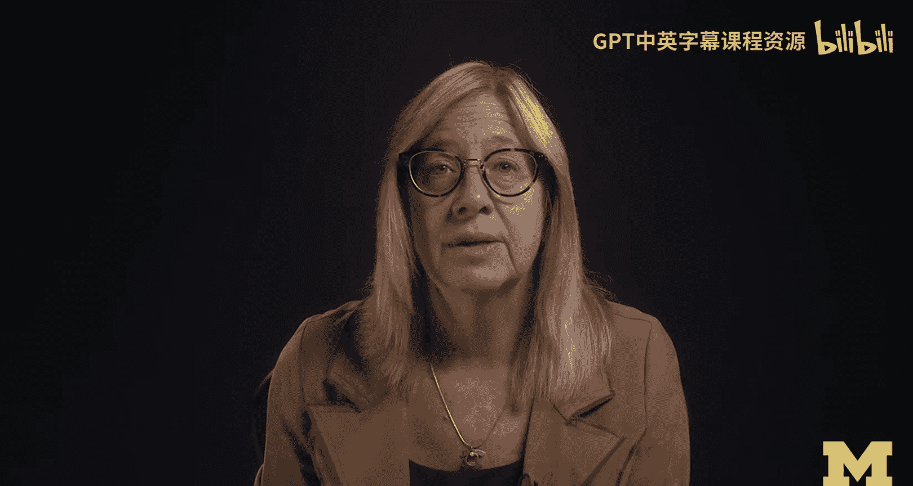

So what would you do again， you have some options and as I've already said。

 you should likely just start with voicing your concern and trying to convince your boss that you think it is important to note some of the ethical issues that have arisen with the use of facial recognition technology your boss should probably also know that many cities have banned its use and the reasons why hopefully that would be enough。

 but then you can also think if it's not， then you need to think about well what else。

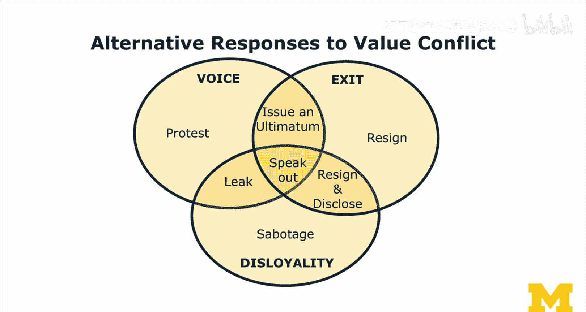

Can you do can you on your own inform the city council of your concerns should you talk to a reporter should you speak to someone else in your organization and human resources etc again you have some options and I am you know telling you to think about these kinds of scenarios before you find yourself in one in general your options are as we talked about before carry out the analysis as you were instructed by your boss option two。

 as I already described， you could voice concern and try to change the instructions you could voice concern and threatened to quit that's dramatic right but you might feel so strongly about it you might you know that might be the line you put in and you not going cross it again you could voice concern and threatened to go public or threatened to go public or anonymously leak your concerns or you could just quit。

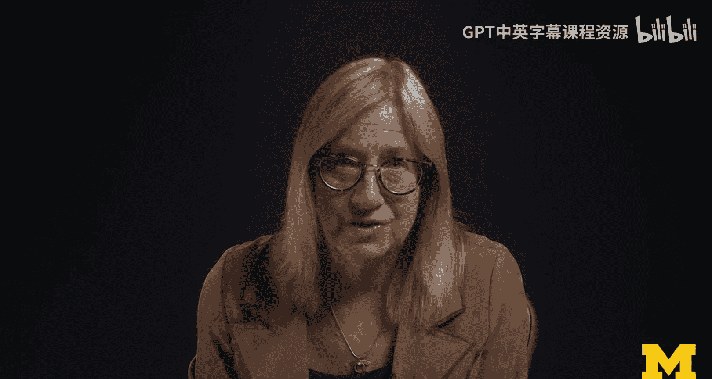

it's good to think about what you might do in a certain situation。

 I urge you to talk to your friends， even family members about it that might reveal to you too some of the nuances in thinking about a specific ethical situation and how you respond to it these situations are tough there's no right or wrong answer but you can be a little bit better prepared for it if you think through some scenarios before you find yourself in one。

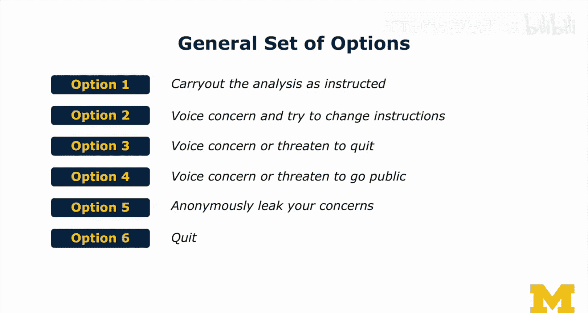

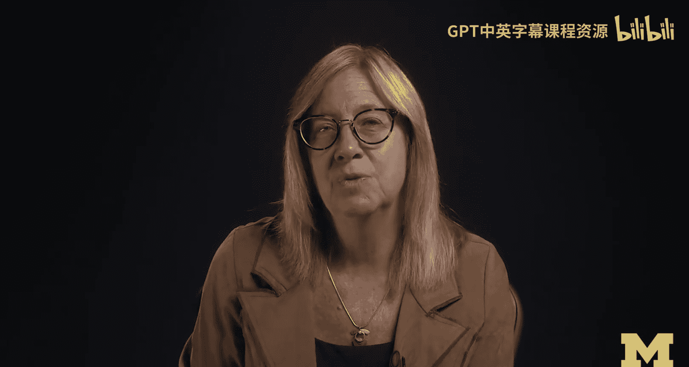

Thank you。

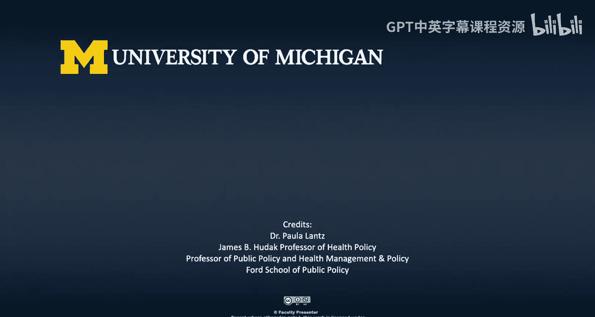