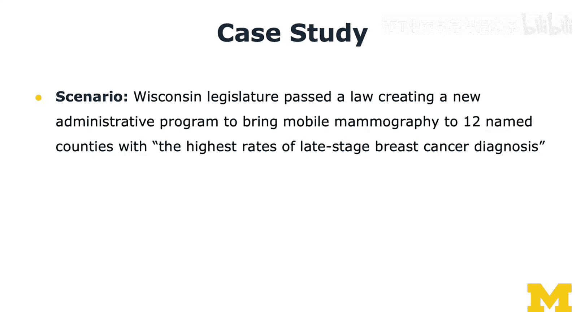
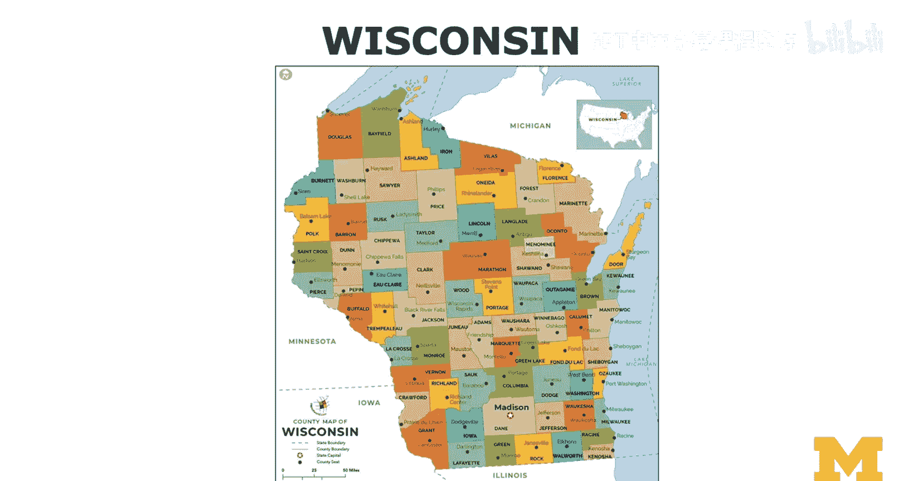
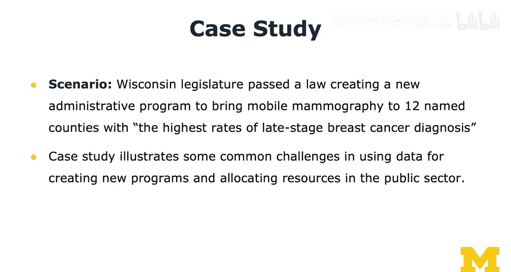
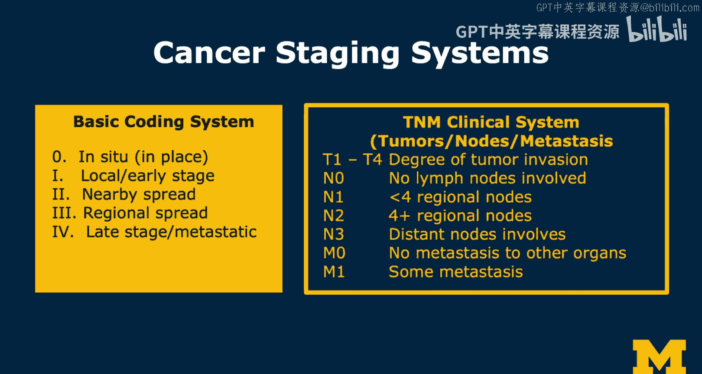
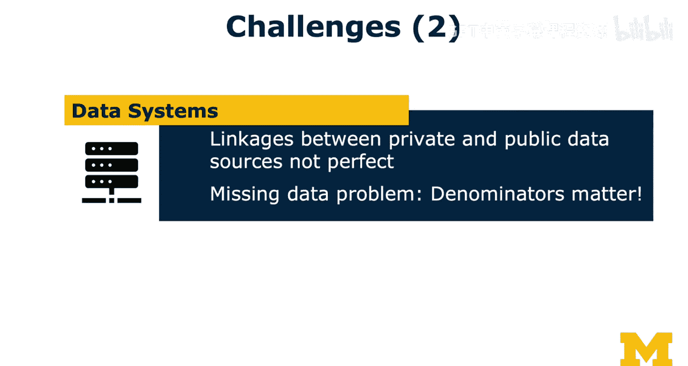
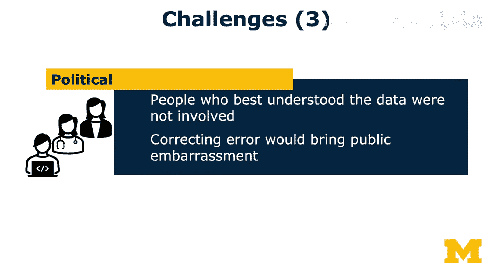
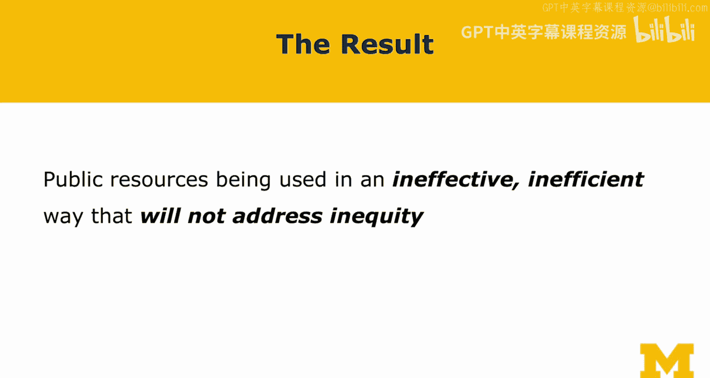

# 密歇根大学《公共部门的R数据分析（基础、数据探索、决策支持、）｜Data Analytics in the Public Sector with R》中英字幕 p142 18_威斯康星癌症分期系统案例研究.zh_en -BV1YZ421J7Fx_p142-

In this session， I'm going to be sharing with you a case study of a situation I experienced when I was working as an epidemiologist for the state of Wisconsin earlier in my career。

I believe this is an interesting case study for you。

 not because what happened was unique or unusual in any way。

 but because it illustrates a number of the challenges that are typical or common for data analytics in the public sector。

At the time this happened， I was doing a lot of data analytics regarding breast cancer。

In the state of Wisconsin， and a lot of information I was producing was being given to the state legislature。

 I woke up one morning to read in the newspaper that the Wisconsin lawmakers had just voted to pass a new law that would create a new administrative program implemented by the executive branch of government。

 And this was a program that would bring mobile mammography services。

And mammography is radiologic imaging of breasts to look for cancer that is too small to be detected in other ways。

So this new program would bring mobile mammography radiology services to rural countries in the state that had the highest rates of later stage diagnosis of breast cancer an important thing to know is that this legislation named the 12 counties with the highest rates of late stage diagnosis where the prognosis or path for treatment is less successful。

The good news here is that the legislature wanted to implement a new public health program。

And addressing a very serious problem， however， the bad news was I when I looked at the counties that were named。

 I knew immediately that a mistake had been made。

I'd been collecting and analyzing data about mammography use and stage of cancer diagnosis for over a year。

 and I knew that most of the counties named actually had the best rates or the highest rates of mammography screening and the lowest rates of late stage diagnosis。

I reran some analysis to confirm my suspicions。 and indeed， the new law had named the wrong counties。

For this program， 10 of the 12 counties named were wrong。Well， in summary。

 what happened was a data problem， let me explain it。A lawyer。On the legislative side。

 a lot of lawyers draft legislation。For the lawmakers。And in doing so。

 in drafting the legislation had asked for county specific data about the stage at diagnosis of breast cancer。

Without telling the analyst why he wanted the information。

So the analysis was done and the results were shared without any assistance in the interpretation of the results or any discussion with me or any of the other experts that could have helped with this。

Now it's common and actually by law in many states that people in the executive side of government may not reach out without being invited to the legislative side of government and certainly may not provide opinions about what might be a good new law or good new policy。

 etc ce， so sometimes there is what's called a firewall between these different branches of government。

 that's common。But again， we had a data problem and because of this lack of communication。

 the people on the legislative side didn't understand what was happening with the data。

So here's a map of Wisconsin。And right in the middle of the state is an excellent healthcare system that had been doing a great deal of education and promotion of mammography screening for women in the rural counties that they served。

 kind of starting in the middle of the state and going up north。

 which is very rural and then sort of east to west in the northern part of the state。

 which is also quite rural。This healthcare system serving in rural Wisconsin had some of the highest rates of mammogram screening in the state。

 I knew this from other data。

Also， this excellent healthcare system uses a sophisticated way。

 a sophisticated way of indicating cancer stage at diagnosis within its data system。

 this is called the TNM system， which you can see on the right in this slide， the tumor。

 nodes and metastaases system。

Well， the state cancer registry system uses a much simpler format for this variable of stage at diagnosis。

And unfortunately， the two staging systems did not merge。Correctly。

 when this health system reported their data， which they are mandated to do by law to the state。

The two data systems talked well to each other for late stage diagnosis cancer cases， however。

 for the earlier stages， the two formats for this variable indicating stage at diagnosis did not converge well。

And that led to the state system indicating missing data for most of the early stage diagnoses for this large rural health system。

All right， let's review what were the challenges in this case？First。

 there were some organizational challenges， including barriers to effective communication between the branches of government。

 very common。Second， there were some data system challenges。 this includes blinking。

Or coordinating data from private and public sources。

This is also common。And in this particular case， the data linkage problem created a lot of missing data that produced biased and inaccurate results。

Missing data are always important to understand when interpreting the results of analyses。

To complicate it even more， there were some political challenges。Again。

 these are common when doing data analytics in the public sector。In this case。

 there was a challenge in that the people who best understood the data。And I'll say。

 including me were indifferent silos and not included in this confidential process of crafting new legislation。

 Another challenge was that once I brought the error to the attention of my boss and other leaders。

 A decision was made to keep it quiet and a secret as correcting the error would bring some embarrassment to both the legislators who crafted and championed the bill and made it move。

Very， very fast through the legislative process， which is not typical。And also。

 it could bring some embarrassment to the staff on the administrative side who produced a flaw analysis that wasn't caught。

 So the very unfortunate end result in this case was that public resources were used for three years until later。

 the right counties were actually named when the program was reauthorized。

 Public resources were used for three years to launch a program that was not going to meet those four pillars of public good that we've talked about before。

 economy efficiency effectiveness。

And equity So what are some of the lessons from this case study for you？As a budding analyst。Well。

 first， when asked to do some analysis， make sure want you know who wants it and why。

 what questions are trying to be answered and for what purposes？In addition。

 make sure you help in the interpretation of the results as best you can。

 especially in regard to any biases or problems that might arise from missing data。

Data linkage or other data issues。I have to say that this was a sad but eye opening experience for me to have early in my career。

And again， I share this story with you not because it's so unusual and certainly not to criticize anyone。

Who I worked with back in the day， but because it reveals some very common challenges in the important work of data analytics in the public sector。

