# 密歇根大学《公共部门的R数据分析（基础、数据探索、决策支持、）｜Data Analytics in the Public Sector with R》中英字幕 p143 19_墨西哥贫困人口养老金案例（第一部分）.zh_en -BV1YZ421J7Fx_p143-

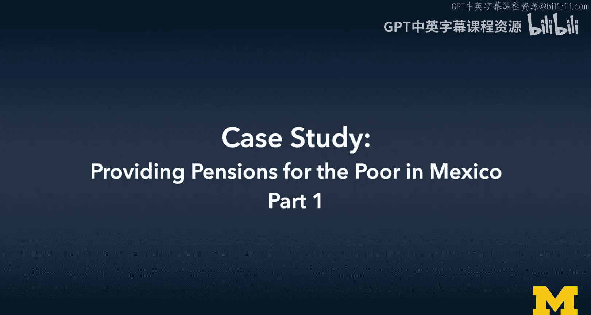

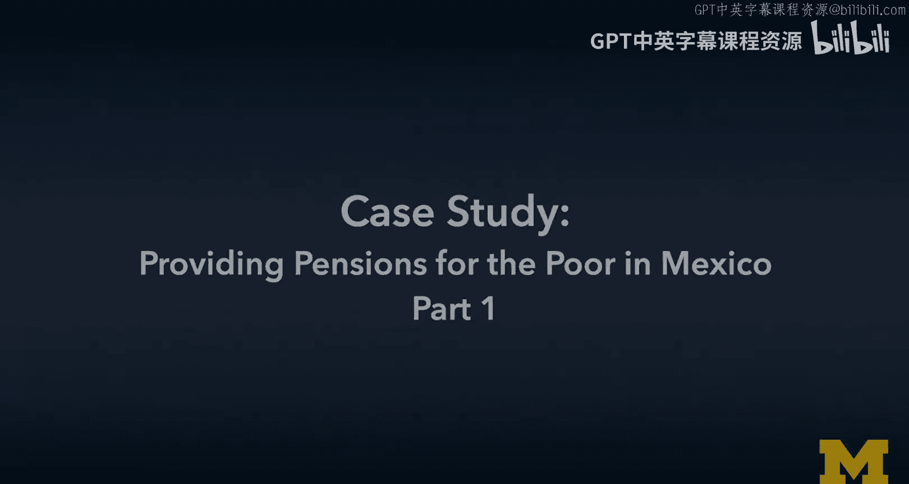

Hi， I'm Professor Paula Lance and I'm really happy today to be introducing you to a case study that Professor Brooks and I think just brings it all together for you throughout this series we've been talking about the important role of data and data analytics in the public sector how it's used to help decision makers the important role of different kinds of policy analysis。

 the very important role of data visualization and other kinds of data analytics。

 and really how it matters for really important things that governments do。

 and so we have a case study for you that I'll be explaining the background of it。

 and then we have a couple of assignments for you so we'll talk about that more in a minute and then also you'll have your assignments in writing as well all right。

 this case study is about an important social welfare policy。

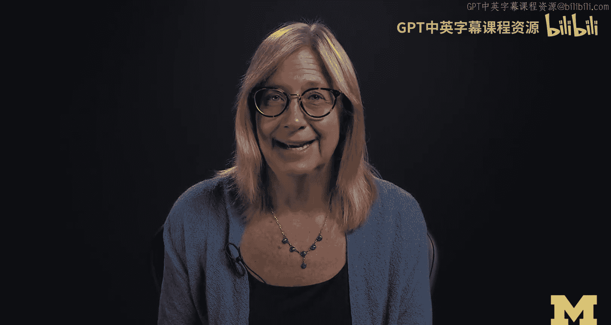

Issue it's also in a scenario where you're going to be part of a policy options analysis in a time crunch which is definitely the real world and the scenario is that you are working as a data analyst on a team that works with the deputy director of general planning in Mexico and we're time traveling back to 2006 but I want to tell you this is a real world scenario what we're talking about here in this case study actually happened all right now in Mexicoco in 2006 a new poverty program that was targeting the rural elderly in Mexicoco was introduced to Congress and Congress approved it except there weren't any criteria for who was eligible for the program as it moved through the legislative process so here's a little bit more background on this so previous。

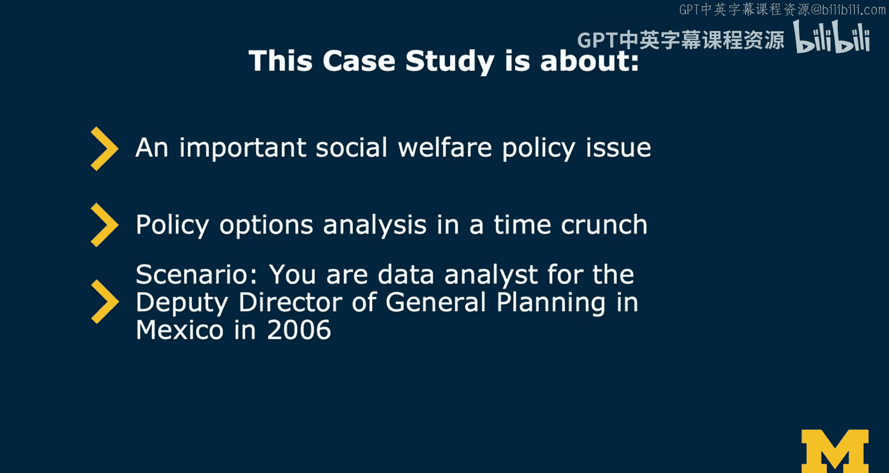

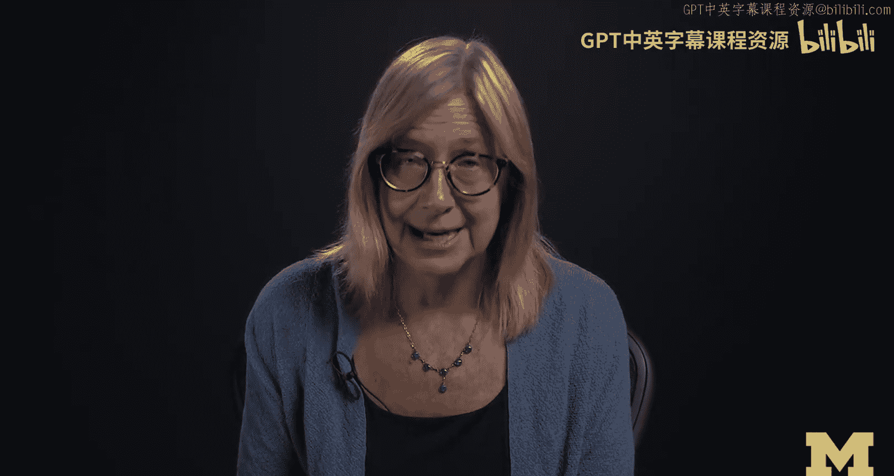

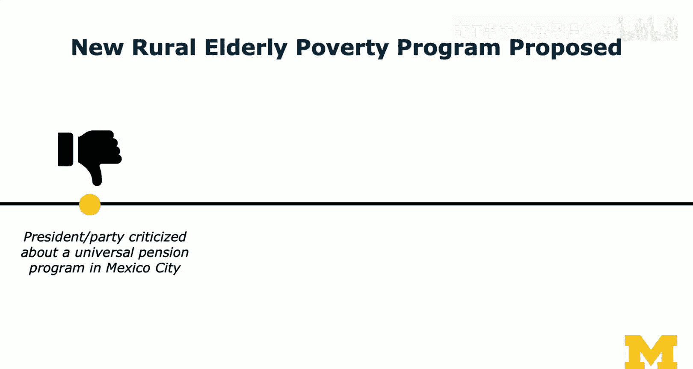

The president and also his party had been criticized about a different poverty reduction program in Mexico。

 and this was a universal pension program that had been implemented in Mexico City and that program all。

Older people defined as 70 and older， started getting a pension， but people were worried about， well。

 some people who aren't poor are getting this pension with public dollars and they don't need it。

 so that doesn't seem efficient， especially if you're targeting the problem of poverty。

So a new program was introduced that would try to focus more on rural elderly and again reduce poverty and the president。

 President Calalderone asked the minister of planning who you work with to present eligibility criteria to ensure that pensions go to seniors in need and so your team has been assigned to conduct a policy options analysis and the policy issue here is that the criteria for this new program so to do the analysis and also to make a recommendation and it's due tomorrow my friends。

 again that is not。

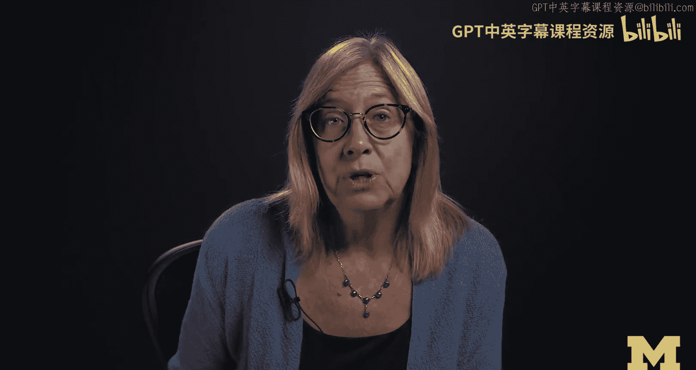

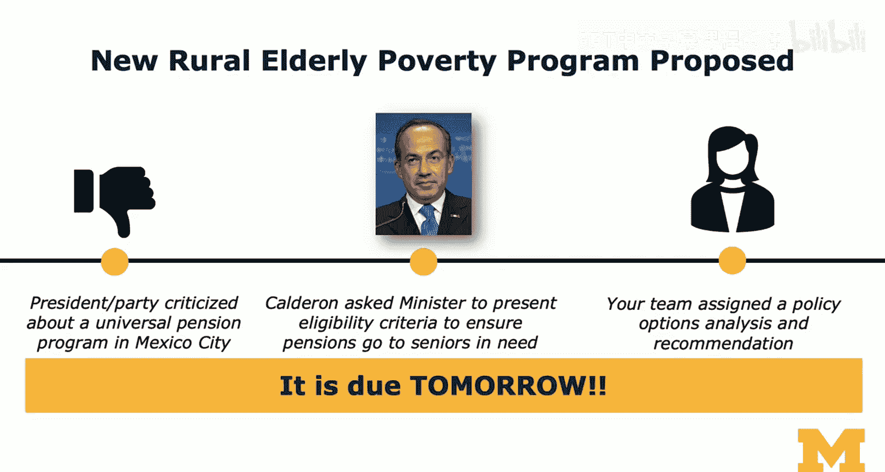

Out of the question this happens a lot and as I mentioned the budget。

 the president's budget's about to be passed but people are saying will give you the money for it。

 but we have to know what the criteria are okay so remember what our steps are in a classic policy options analysis step one。

 what's the problem that's trying to be addressed so we have to define and get some details on the problem step two we have to identify some alternative policies in this case alternative ways to set criteria for who would get this new pension step three identify the criteria for evaluating the policy changes or options step four then we analyze and compare and contrast the different policy options using a clear set of criteria and then step five clearly communicate the information to decision。

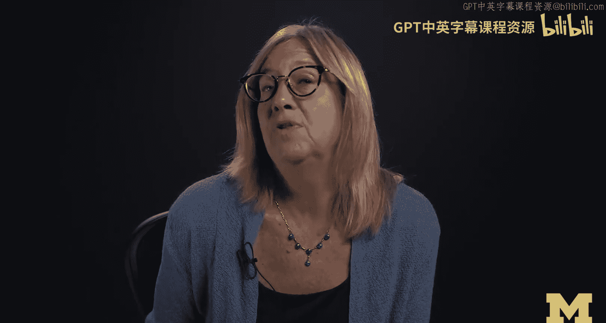

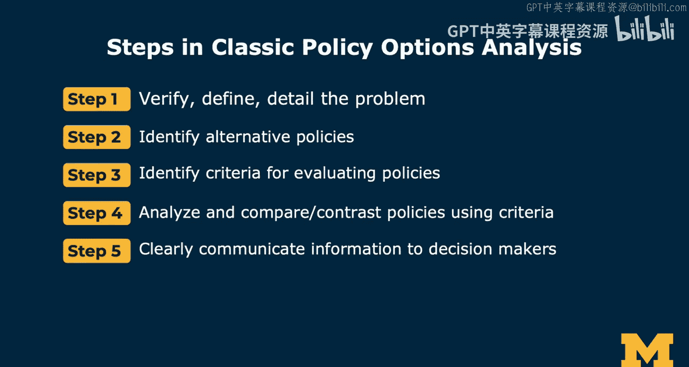

All right， so step one， what was the context in Mexico in 2006 Well here are some data on poverty rates and oftentime our data don't come exactly as we want it sometimes but here we have some data on poverty rates for people's ages 65 and older not 70 and older as the new policy was designed but anyway we know that in urban areas in Mexico the poverty rate among people 65 and older is 35。

6% at this moment in time and about 10% of people have pensions that they can rely on now in rural areas the poverty rate is higher it's 54。

7% back in 2006 and less than 1% of older people living in rural areas have pensions so we do see that the problem of poverty is higher in rural areas in Mexico so the new program that's being proposed。

Builds on a number of existing social welfare programs in Mexico and I hope you remember when we talked about the Mexico opportunityun program when we were talking about program evaluation and randomized controlled trials。

 there was an RCT of this program that was conducted to see what its impact was on reducing poverty by providing conditional cash transfer payments to families in exchange for regular school attendance of their kids and then health clinic visits and nutrition and education supports for the family members and especially moms so this new program is sort of building on the opportunityundas program that was focused on rural communities because one of the concerns about this program was it did not target and it was not reducing poverty rates among the elderly。

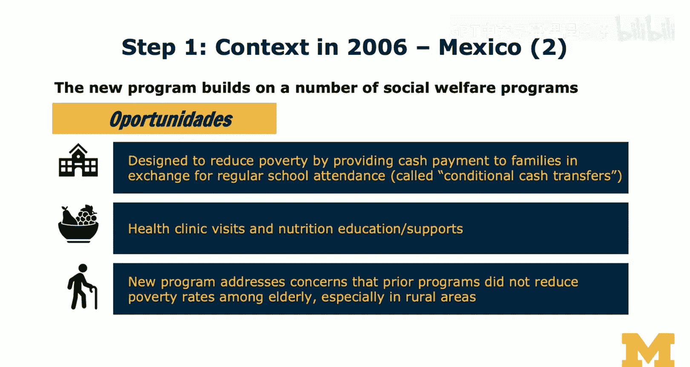

right and the other piece of information， as I mentioned， here's a little more detail。

 so on December 23rd in 2006 the Congress of Mexico approved a 2007 budget and what they did was say rural appropriate $8。

5 billion peos to provide pensions to seniors age 70 and older targeting rural poverty and that transfers to a monthly payment of about 500 peos and that's $45 in the US。

Currency， but again， the budget did not specify eligibility criteria and the final approval of this budget wasn't going to happen until it was able to be stated。

Who exactly is getting this new pension Okay， so that's step one， a lot of background。

 but this is important for you to understand as now we get into more of the details of our policy options analysis So we're on we're on a time crunch So in this case。

 it's already provided to us what the three policy options are for eligibility criteria option number one is and this is why you mentioned the opportunity that program criteria one option is that let's just target this new pension program to individuals who are age 70 and older who live in households who are already determined to be eligible for this opportunity that A program So this cash transfer program that didn't that it didn't really impact the older people in the household Second criteria is all right。

 people are saying， well we're targeting rural areas let's just target the smallest。

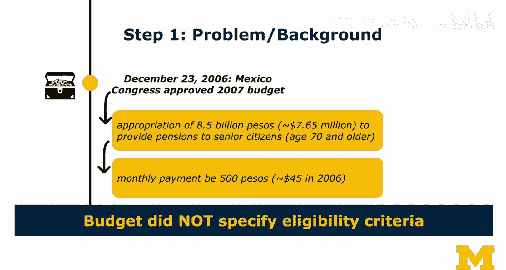

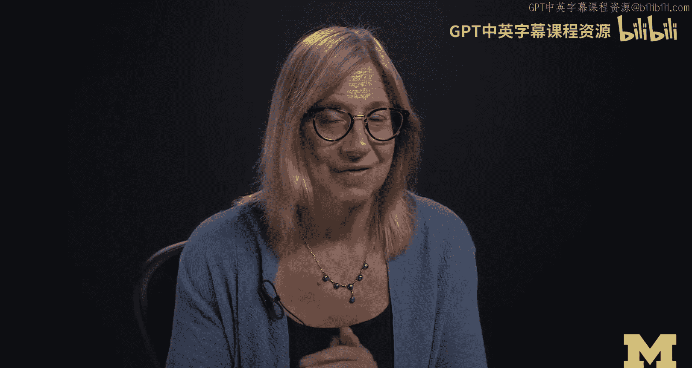

Towns and Pueblos in Mexico so criteria number two would be that this new program would target people a 70 and older in rural locales with a population of under 2500 people。

 and then our third policy option criteria for eligibility for the new pension program is using something that Mexico has already established and that's called the social marginalality index。

 Mexico has already at this point in time started using this social marginalality index。

 which has identified。

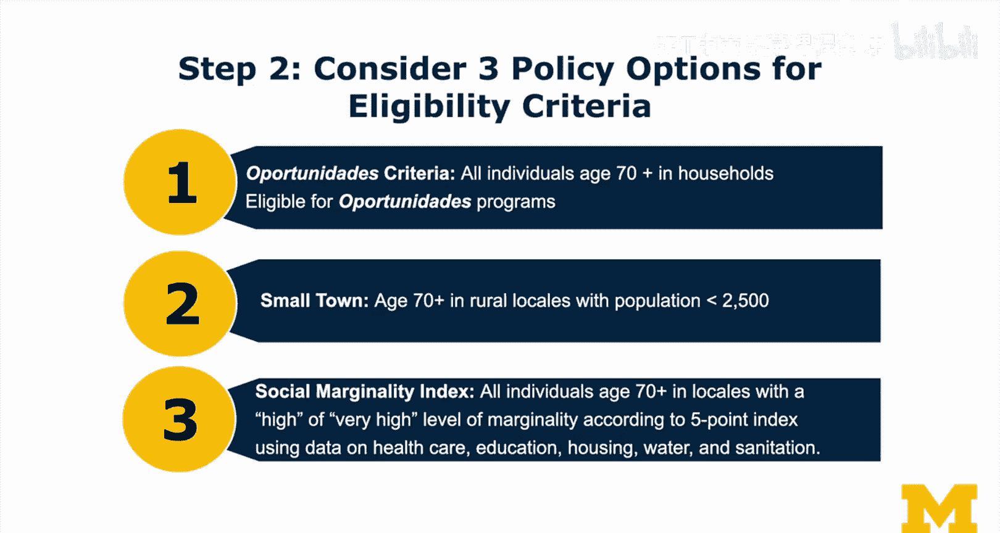

Every area in Mexico is being at a one to five point level ranging from low to very high level of marginality using data on healthcare access。

 education， housing， water and sanitation in that area so again all areas in Mexico have already been labeled on this social marginality index scale and the proposal is to take localities that have a high or very high level of marginality using the scale and then target the older people in those areas for the new pension program All right so we have our three policy options the next step in a policy options analysis is to establish our criteria for analysis and in this case。

 this has already given to us as well we don't have to take the time to figure。

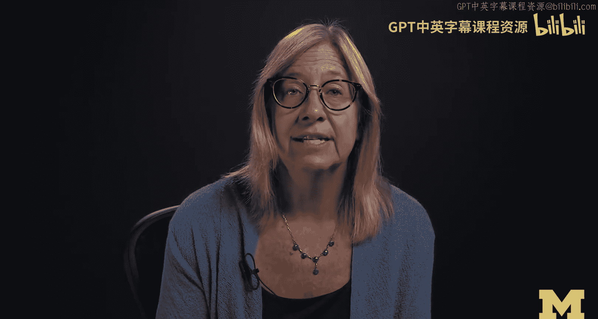

What are our criteria going to be， the president handed it down to us so the criteria for comparing and contrasting our three policy options are first of all。

 efficiency and that in this case means will people in need？

Receive the pension and also people not in need should not receive the pension so is the targeting going to be well Also financial feasibility you might recall I told you that there is a budget constraint that Congress is ready to approve a budget that allows and allocates 8。

5 billion peos to this program but we need to know if we use different eligibility criteria will there be enough money to meet the demand using that criteria Also we do want to think about things like administrative feasibility will the criteria be easy to implement logistically and administratively Also politics I don't expect you to know much about Mexican politics back in 2006 but we do want to think about this know do the options differ in terms of their political feasibility will there be different pushback from different political factions or might they agree on an approach so we do want to think about。

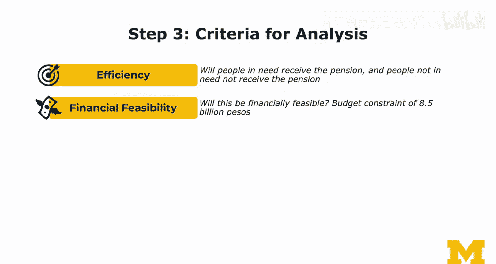

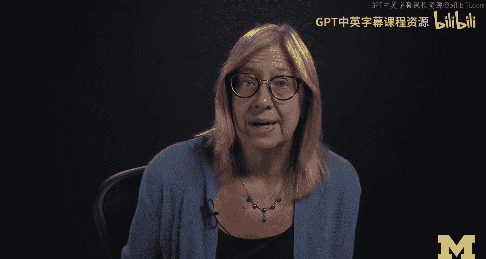

what some of the politics might be， especially as this is something going through the legislature。

 and then also what are the ethical implications of the different policy criteria is an option fair to all those who would be affected by it。

 and also do you think it might create or widen inequities that already exist？

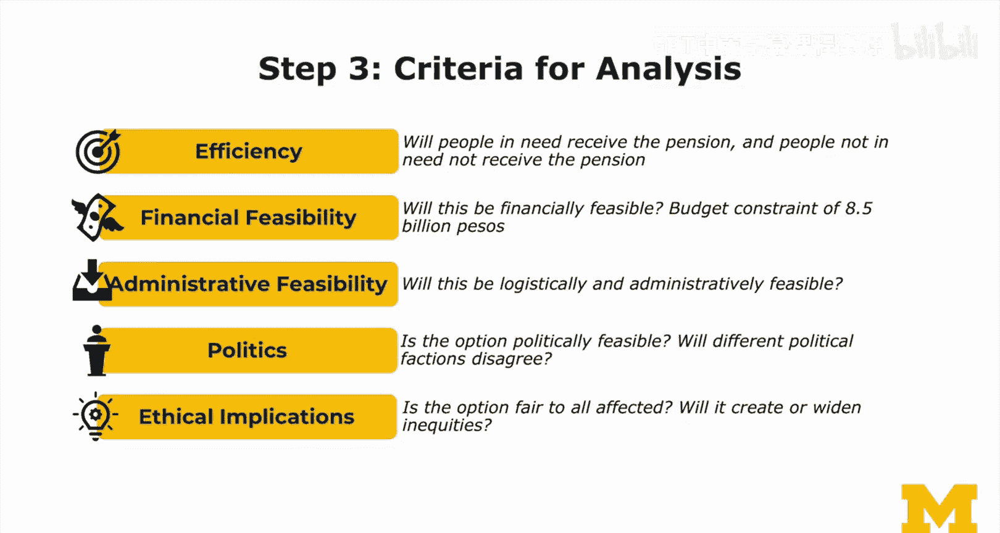

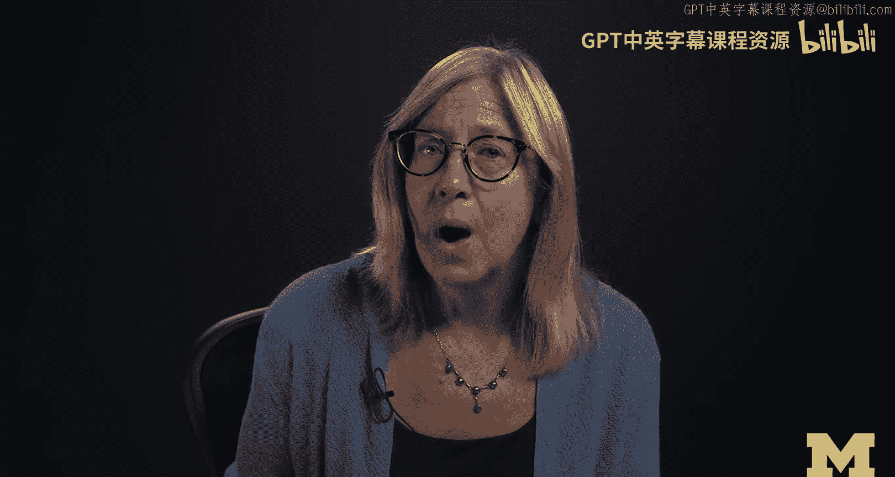

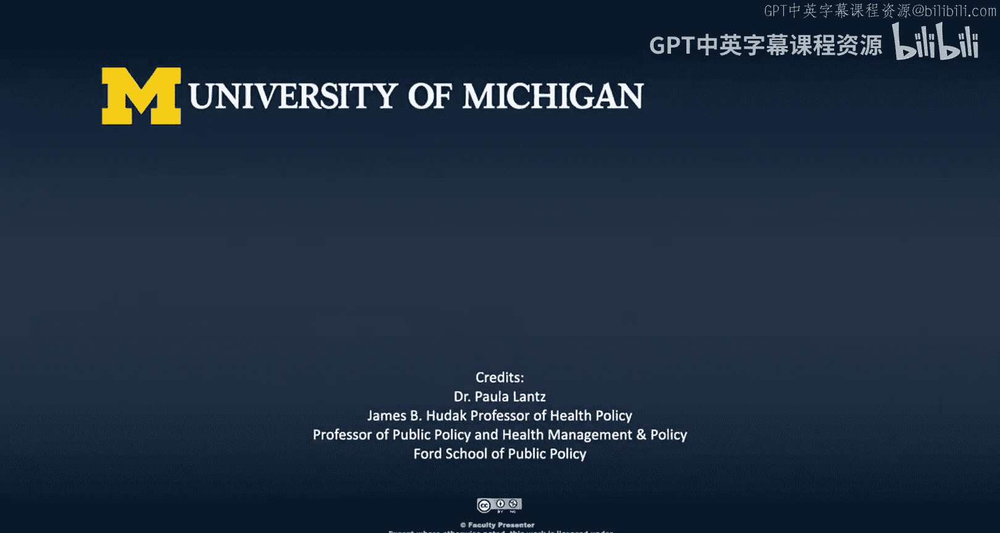