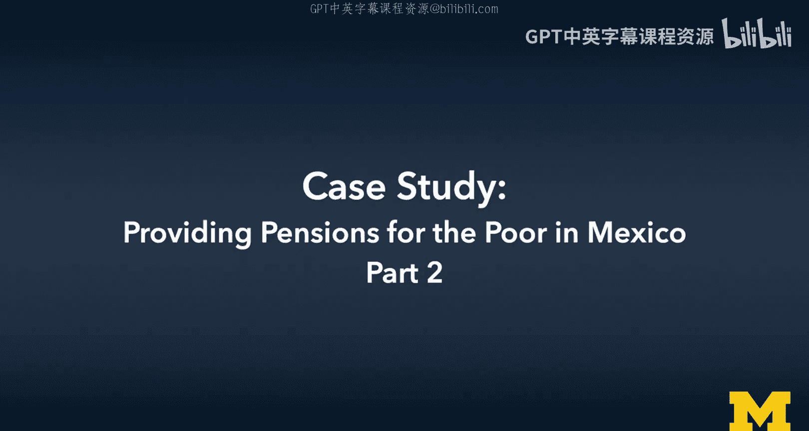
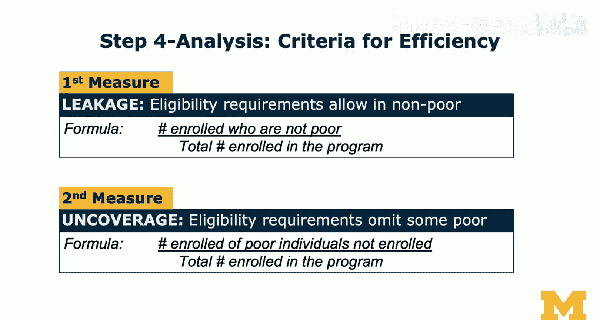
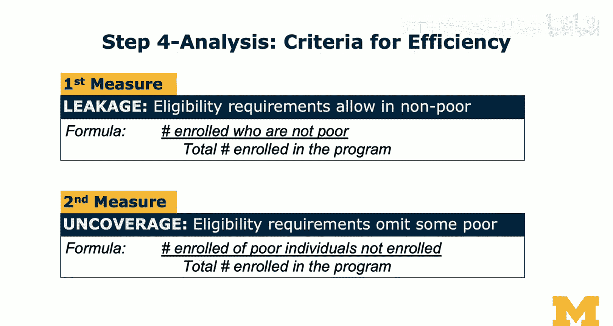

# 密歇根大学《公共部门的R数据分析（基础、数据探索、决策支持、）｜Data Analytics in the Public Sector with R》中英字幕 p144 20_墨西哥贫困人口养老金案例（第二部分）.zh_en -BV1YZ421J7Fx_p144-

So we've already talked about the first three steps in our policy options analysis。 What's the stage。

 What's the problem。What are our policy options that we're going to consider and then what criteria are we going to use to evaluate the different policy options and now we're in step four。

Let's do some analysis All right， as you might recall， I hope you recall。

 we're really going to be focusing on efficiency as an important criteria in our analysis。

 and we have been given to important indicators or measures of efficiency This gets a little technical and again。

 you'll have some detailed information about this in your written instructions。

 but let me go through this pretty pretty quickly for you。 Okay。

 the first measure of efficiency is something called leakage and this is used in a lot of public programs leakage is when eligibility requirements actually allow people you're not targeting to get a resource of program or service so in this case we're going to worry about leakage。

If the eligibility requirement is going to allow in non poor elderly。

 the formula for this is pretty simple， it's just the number who are enrolled。

 who aren't poor over the total number enrolled in the program。

For a particular eligibility criteria option。 So that's leakage。 On the other hand。

 we also then want to think about under coverage。 And that's when eligibility requirements。

Omit people that you really do want to be targeting in this case of our three policy options are they actually omitting people and in this case older poor rural residents are the eligibility requirements omitting people that we want to target in this program again simple。

 simple formula， it's the number of poor individuals not enrolled in the program。

Over the total enrolled in the program。

