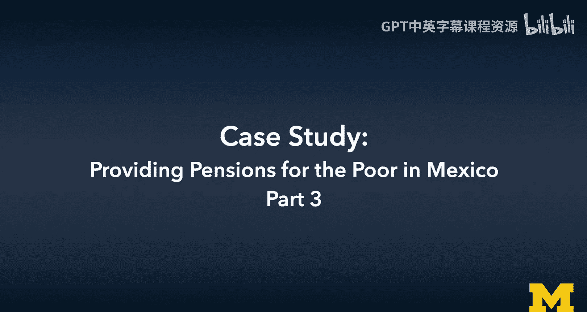
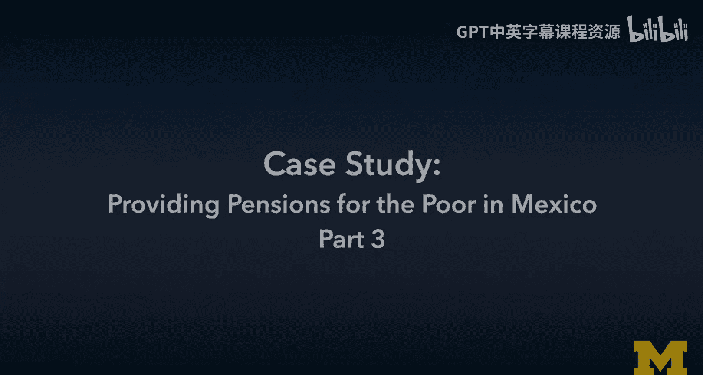
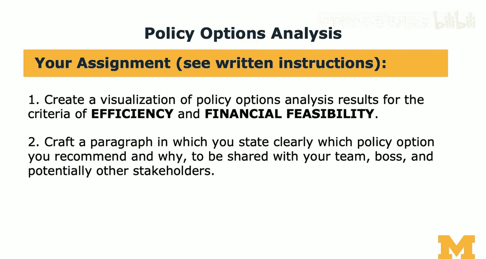
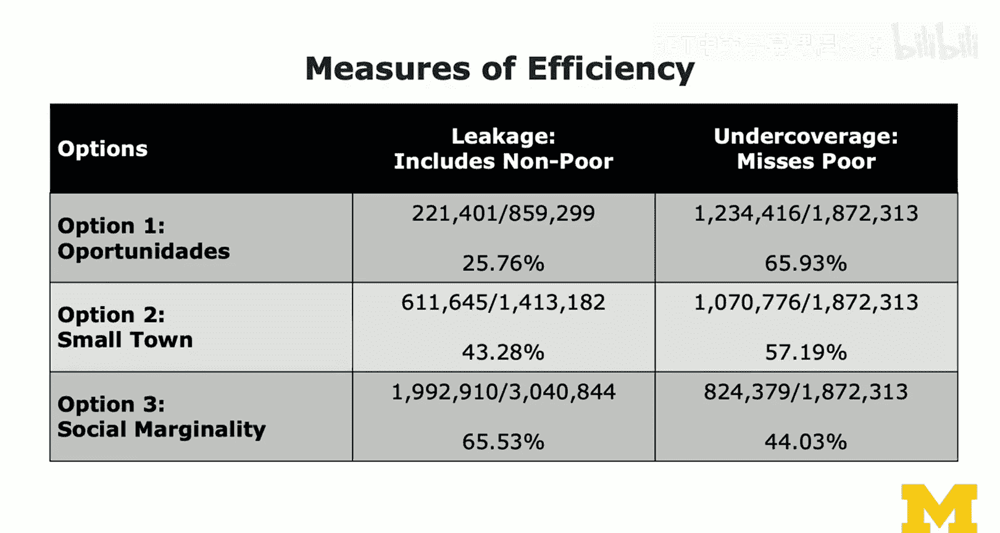
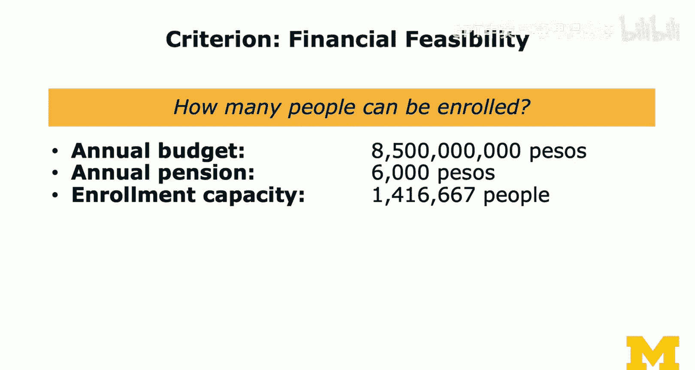
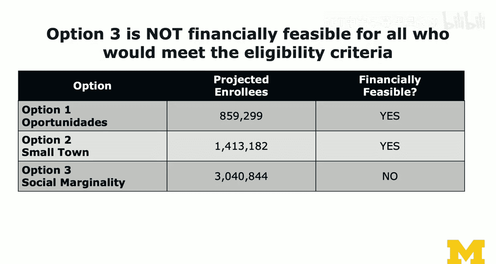
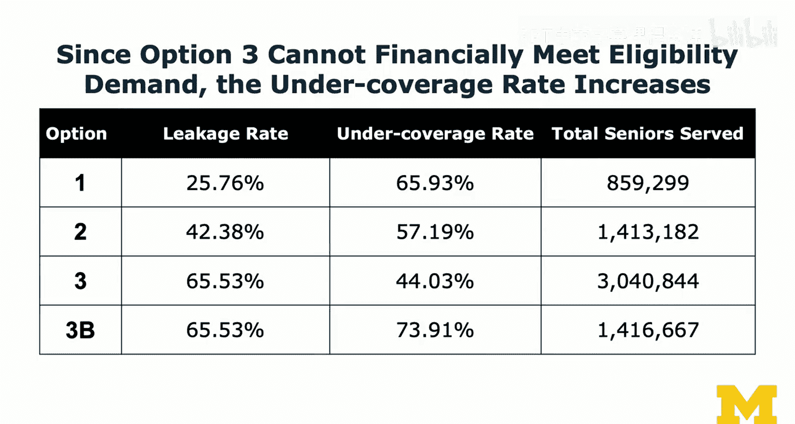
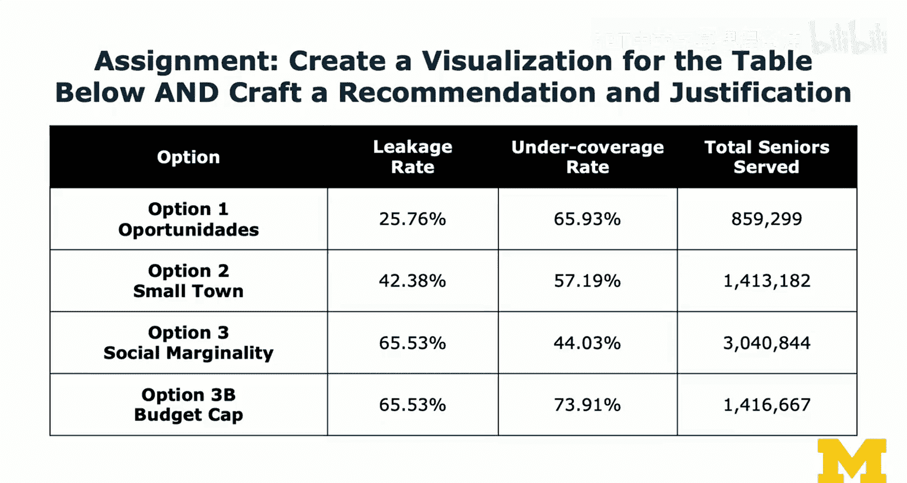
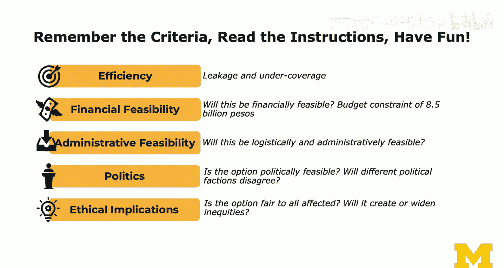
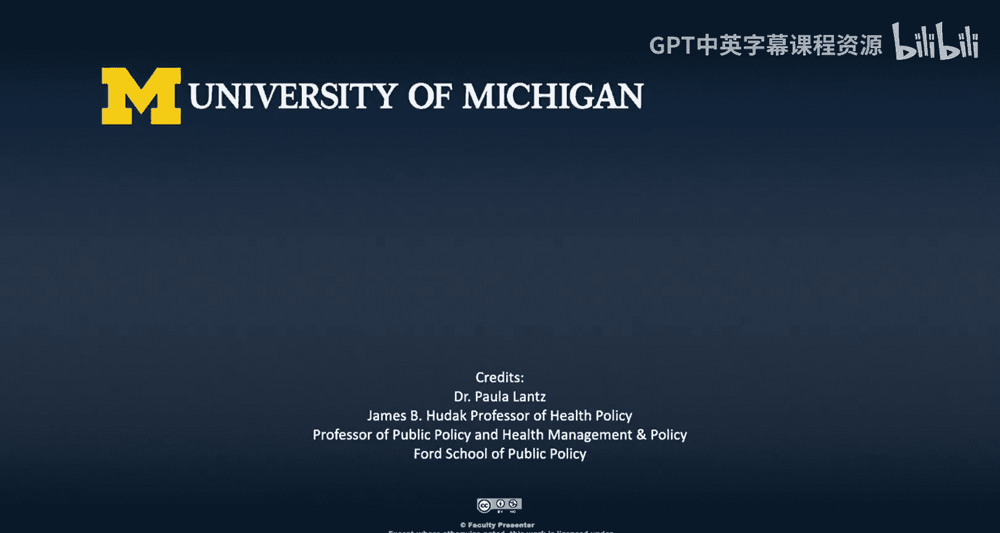

# 密歇根大学《公共部门的R数据分析（基础、数据探索、决策支持、）｜Data Analytics in the Public Sector with R》中英字幕 p145 21_墨西哥贫困人口养老金案例（第三部分）.zh_en -BV1YZ421J7Fx_p145-

Okay， we've gone through the scenario for this case study and the first steps in a policy options analysis。

But let me not wait a moment longer to tell you what your final assignment for this series is going to be so what we would like you to do in this scenario of a policy options analysis is first of all。

 create a visualization of the results of the policy options analysis for both the criteria of efficiency。

And financial feasibility。 and then also we want you to craft a paragraph in which you're going to state which policy option you would recommend and why and this would be shared with your team and your boss but also potentially other stakeholders so here we're really inviting you to not only create a data visualization and participate in the analysis。

 but also take a moment to think about what would you recommend。

 and it's not exactly clearcut what to do in this case so it'll be fun we hope for you to think about。

Please see the written instructions for this assignment they have much， much more detail in them。

 but again what you're going to be asked to do is to create a data viz of a couple aspects of the policy options analysis and then think a bit about what the results are saying and what you think the Mexican government should do okay for the policy options analysis much of this is already going to be done for you so let me walk through quickly through some data。

 more detail in the written instructions but we're basically handing you the results so you're not going have to crunch any numbers in this case we're giving them to you but we do have some data available that are going to help us in are comparing and contrasting the three different policy options and that includes you know the percent of people 70 and older who meet the different criteria again we have these three。

ter the percent two live in opportunity that these households。

 the percent who live in a locality with a population of 2500 or less and then the percent to live in alllocity with a high or very high marginality index and you can see the percents here among all individuals who are 70 and older and then among poor individuals 70 and older in those different criteria rose and also some important denominator information。

 the number of individuals in the whole country of Mexico are provided at the bottom there All right and again。

 the written documentation explains more how these percentages for both the leakage and the undercoverage rates were actually calculated。

 but here you do see the results for these measures of efficiency so for leakage the different options range from 25。

76 up to 60。5。53% so again leakage is if that criteria lets people who aren't pour into the program So social marginality。

 65% of the people earmarked with that criteria would not be poor and then undercover the criteria missed people who are poor and don't have them included you see that also ranges from about 66% for option1 to 44% for option3s So the measures of leakage and undercover are different for the different policy options Also the next criterion that we have been asked to use for our options analysis comparing and contrasting the different options is financial feasibility Now I hope you recall that the budget for this program is set at 8。

5 billion peos with an annual pension of 600 peos we just do some simple division here and that means that the most。

Number of people who can be served in the program is 1416667 people。

 there is not money for anymore people to get a pension and so we need to know if the different criteria are going to work in terms of meeting the demand that they would create and you could see here in this table that option3 is actually not financially feasible for everyone who would meet that eligibility criteria so using the social marginality index of high or very high would create a situation where there be a projected over 3 million eligible enrollees in the program that's not financially feasible for the amount of money that's been appropriated in the budget so there would have to be a cap if we use that criteria there would have to be a cap on it not all those people could be served and since option 3 cannot financially meet the eligibility demand。

And this means that the undercoverage rate increases so there's a new line in our table a new row3B。

 so this is a reworking of option 3 because we can't meet the full demand and that means that the undercoverage rate has increased from 44% if we had enough money to reach 3 million people to almost 74% we just don't have enough money to meet all the demand So these are the basic results from the policy options analysis that is focused on the efficiency of the different options and then the financial feasibility of the different options The first part of your assignment is to create a visualization for this table and then craft a recommendation and justification Now there's many ways in which you could go about creating that visualization again please see the written instructions。

For a bit more detail and in regard to the justification。

Please see the instructions as well and remember the criteria， efficiency， financial feasibility。

 those are the two things we want you to create the data visualization about。

 but there are other criteria。 administrative feasibility， politics and ethical implications。

 So remember all the criteria when you're pulling your opinion about it together。

 I have said this many times I'm going to say it again， Please read the instructions。

 but most importantly have fun。 This whole scenario was crafted in a way that we hope allows you to take the many things you've learned in this the series and apply them in a real live policy setting。

