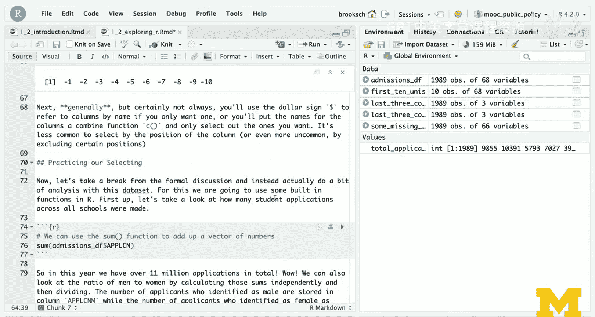
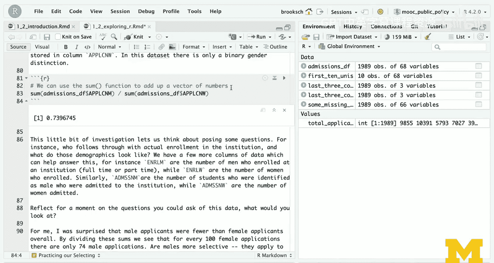

# 密歇根大学《公共部门的R数据分析（基础、数据探索、决策支持、）｜Data Analytics in the Public Sector with R》中英字幕 p15 14_向量选择与数据分析方法.zh_en -BV1YZ421J7Fx_p15-

Great， so we've got lots of different ways to pull out data。

 and we can use names for columns and numbers for rows。

 and we could select various chunks of the data as we might want to。

 Our's got a few more tricks up at sleeve for selecting out data， though。

 And one of the most unique ones is that you can use negative numbers to exclude a column。

 So let's take a look at that。 So here if I wanted to actually pull out all columns except for the first and third。

 I could just say admissions Df。 I want all rows。 So I leave that blank comma。

 And then I just have a vector here， an integer vector of -1 and-3。😊。

Now， this can get a bit confusing if you're new to it。 We' got positive and negative numbers。

 We've got two different positions。 Sometimes it's a vector。

 and sometimes it's this other format with a colon。 How do you keep it all straight。 Well， first。

 the colon is simply a shorthand notation。 And the result of using the colon is a numeric vector。

 Let's take a look。 So why don't we just make a vector of the numbers 1 through 10。

 So if we print one colon 10， we see after we execute this。

 that that actually just creates a vector of 10 numbers。

 So all this colon notation isn't anything too crazy。

 It's just are taking those two numbers and creating a vector out of it。😊。

Ours equally well set to create vectors of negative continuous numbers2。

 so if I take minus1 colon to minus10 and execute that。

 we see that ours just created a vector for us out of that。

Now， generally， but certainly not always， you're going to use the dollar sign to refer to columns by name if you only want one。

 or you're going to put the names for the columns in some sort of combined function， create a vector。

 and then only select out the ones you want。 It's less column to select by the position of the column。

Now， let's take a break from this formal discussion and instead actually do a bit of analysis with this data。

For this， we're going to use some built in functions of R。 First up。

 let's take a look at how many student applications across all schools were made。

So here I'm going to use the sum function to add up the vector of numbers。 So this is in base R。

 so it's imported already for you。 So you just say sum。

 and then I'm just going to pull out this one vector Ads Df dollar sign application。

 Remember when you're pulling out a column， it's all going to be a vector because it's going to be of one kind。

So in this year， we have over 11 million applications in total wow。

We could also look at the ratio of men to women by calculating those sums independently and then dividing the number of applicants who identified as male are stored in the column application with an M at the end。

 while the number of applicants who are identified as female are stored in the same column。

 but with a W at the end in this data set， there is only binary gender distinction。

We can use the sum function to add up a number of vectors。

 so I'm going to take this application for men and I'm going to create the sum of that and the application for women's and the sum for that and I'm going to divide these and we can just execute this code junk。

So we see here that in this year in the data set， it's 0。74。

 which means we had quite a few more women making applications than men， right。

 the divisor is bigger for women than the numerator for men。

This little bit of investigation， lets us think about starting to pose some questions for the data set。

 For instance， who follows through with actual enrollment in the institution and what do those demographics look like。

 Well， we've got to actually a few more columns of data in this data set。

 which might help us answer this。 For instance， there's this enroll M as the number of men who are enrolled at the institution。

 and that's full or part time， So they combine those while enroll W are the number of women who are enrolled。

 Similarlyly， we've got。Addd some for the number of students who are identified as male who are admitted to the institution。

 while adsu are the number of women who are admitted。 Now。

 reflect for a moment on the questions that you could ask of this data set。

 What are some things that you would love to know about higher ed admissions in the United States or elsewhere。

For me， I was surprised that male applicants were fewer than female applicants overall。

 by dividing these sums， we see that for every 100 female applicants。

 there's only 74 male applicants。Are males more selective that is they apply to fewer schools than females。

 are women more likely to go to college in the United States， and if so。

 does this actually translate into more acceptances to going to college too？

I want to keep practicing or selecting to try and answer some of these questions。 First。

 let's calculate the ratios of men to women across the three variables of application。

 admissionmission and enrollment。 The easiest way to do this is just copy and paste what we wrote previously。

 So I'm going to take the application ratio admissions ratio and enrollment ratio just creating three new variables there。

 and I'm just kind of pulling out the columns as appropriate。

 And now I want to print them out in one string。 And for this we're going to use this paste zero function。

 this function converts all of the arguments to character vectors。

 and then concatenateates them together。 So it's really useful when you're going to be trying to print out numbers or other things。

 So here I'm just saying pay0， the application ratio was。

 and then the application ratio while the admissions ratio was， and then the admissions ratio。

 and then the enrollment ratio。😊，One nice thing about this is that you can actually put each item on its own line aiding in the readability of your code because there're separate arguments to this paste zero。

 All right， let's run this cell。Okay。The application ratio was 0。739 while admissions ratio was NA。

 and the enrollment ratio was NA。Oh， what's happened here？

What does it mean to actually have an NA for admissions ratio？

So it's important to be aware that when you work with data that might be missing。

 the missing attribute tends to be infectious when it comes to arithmetic operations。

Most functions that deal with data， such as this sum function we're using。

 will return an N A if any of the data has an any value in it。 In this case。

 one or more of our institutions is applicants from both men and women。 And we know this。

 This was evidenced by the application ratio variable being okay。

 but they did not record an admission or an enrollment number。

 One of these two for both men and women。Now， working with missing data isn't just a technical challenge。

 as we're facing here， but it's a data policy and knowledge challenge。

 Did this happen Because one of the groups was never admitted or did the institution just report N A for that value。

 We don't know。 And it seems that we need to do a bit of sleuthing to look into this。

