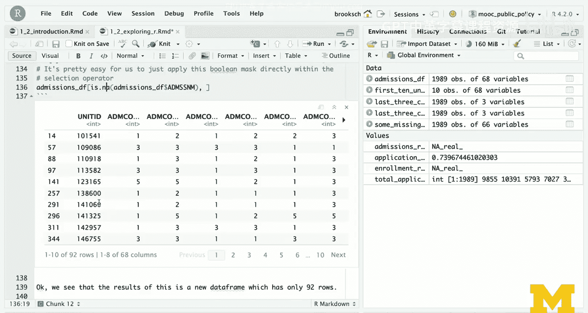
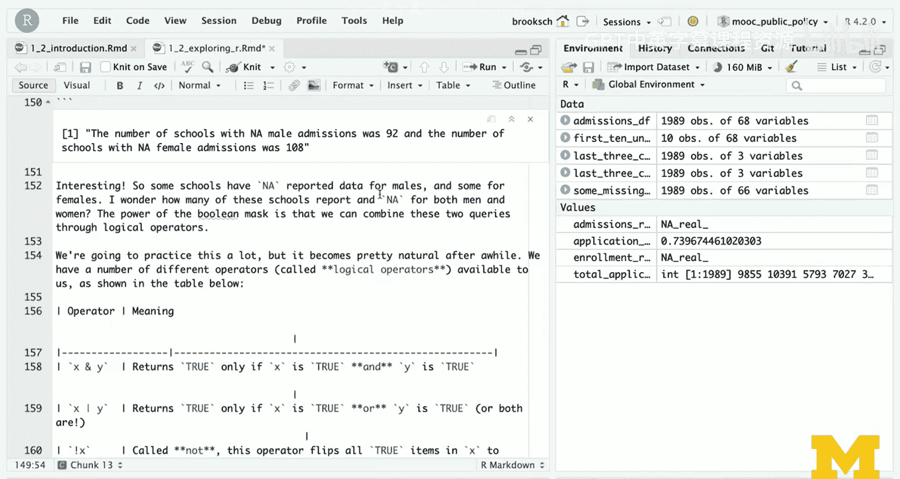
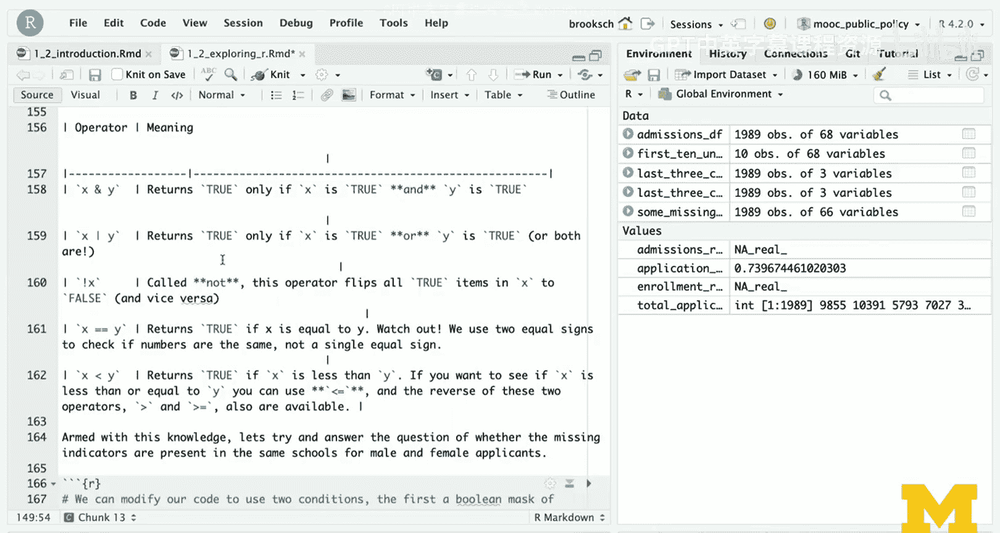

# 密歇根大学《公共部门的R数据分析（基础、数据探索、决策支持、）｜Data Analytics in the Public Sector with R》中英字幕 p16 15_数据框缺失值处理：布尔掩码技术.zh_en -BV1YZ421J7Fx_p16-

Our first step is going to be to consider where there might be missing values。

 We can use the I N function to look through a column of data to see what's reported as NA。

 So let's look first as to whether there's any mail reports missing from the applications column。

 So I'm just going to run is N on admissions D F of applications。 Whoa， that's a lot of output。

All right， so we see some truths in there， a lot of falses in there， but there's some。

 that's a bit of a mouthful。 Our return to us a giant vector of Boolean values， either true or false。

 depending on whether the column was N A for a given observation。 In this case。

 a college or a university。 we could see to glance that there's clearly some missing values for males。

 But what if we want to quantify this。 or if there wasn't a missing value in the first thousand entries that we could just eyeball。

What might seem is a bit of a pain here are actually has a really nice way of dealing with this data。

 And we call that boolean masking。 A Boolean mask is a vector of truer falses that we overlay on top of our data through selecting。

 The result is that the selection returns only those observations for which there was a true value and does not return the false one。

 Let's look at an example。 It's pretty easy for us to just apply this boolean mask directly。

 So I'm going to take admissions Df。 And then I'm going to use the square brackets。

 And now I want to limit my rows。 And I want to limit my rows。

 only where this one column here is not is an N。 So I only want to find things where the admissions for males are actually going to be N。

 So what's actually happening here is this is creating that giant boolean vector and then it's being overlaid on our 2000 rows and only the trues are going to be emitted as a result of this。

 So when we execute this。

We could see it's a much more manageable data frame， we've got 92 rows。

 we could see all of the columns because they're supplied here， but only 92 rows。😊。

Okay this technique of boolean masking is very powerful and you're going to use it all the time。

 by the end of this course， you're going to feel like it's second nature。

 but let's do a little bit more right now。 So for instance。

 let's count the number of schools that reported no admissions for males or females And so here I'm going take I'm going to use the paste function。

 the number of schools with a male admission was and I'm just going to print out exactly what we did。

 I'm going to use this N row function。 it just counts how big that data frame is in the number of rows。

 and then I'm going do the same thing and I'm just going swap it over to the women and I'm going to look at whether the women were is NA and print out the number of rows there and let's just execute that。

All right， so the number of schools with NA and male admissions was 92。

 and the number of schools with NA and female admissions was 108。Okay。

 so some schools have NA reported for males and some for females。

 I wonder how many of these schools report for NA for both men and women。

 So the power of the Boolean mask is that we can actually combine these two queries through logical operators。

 And we're going to practice this a lot。 but it becomes pretty natural after a while。

 we have a number of different awesome operators we can use。 and these are called logical operators。

 And here's a table that shows those。 So we've got X and y。 So we use a single n percent here。

 and that's going to return true only if both x and y are true both the lefthand side and the righthand side。

 We've got x。 and this is called pipe Y。 and I'm only going to say that once because pipe is pretty special in R but this actually returns true if X is true or y is true。

 And of course， if they're both true， also it will return true。 So we call that x or Y。

 Then we have an exclamation mark X。 And so this only has one data value。

 And all it does is negate it。 So this is called the not。

OAnd this flips all the true items in x to false and vice versa。

 We've already seen lots of x double equal Y。 So this is going to return true only if x is equal to y。

 You got to watch out。 we're going to use the two equal signs here to check if numbers are the same。

 not a single equal sign。 And then we've got a bunch of operators for less than greater than less than or equal to and greater than or equal to。

 So we use these angle brackets。 less than signine is going to return true of x is less than y。

 We've got a greater than sign。 And then we can use these in combination with a single equals to see if it's less than in equal to or greater than or equal to。

😊。

So armed with this knowledge， let's try and answer the question of whether the missing indicators are present in the same schools for male and female applicants。

So we can modify our code to use two conditions， the first is a boolean mask of the missing entries for male and the second for female and then we can add these together with a mask。

 which is only true for schools that meet both criteria so I'm going to say missing schools and I'm going assign that to admissions Df and I'm going to put up my first mask in here is NA the admissions for men and is in NA the admissions for women and then again because we're using the slicing technique or the subsetting technique we're going to put a comma because we want all columns and then I'm just going to paste the number of rows in there so let's execute that。

All right， we've got 24 schools which were reported in A for both men and women。

So we have 24 schools which have reported missing data for both men and women。

 which means that we've got 68 schools which have reported missing data for men alone and 84 schools which have reported missing data for women alone。

Now， this is a place where the data scientist needs to make some choices。

 since the question we're trying to answer here with respect to acceptance and attendance ratios can't be answered with missing data。

We're going to talk more about missing data techniques in future classes as this issue affects most analyses that you're actually going to run in practice for the purposes of this lecture though I'm going to exclude observation so I'm going to get rid of individual schools if they've got missing data in any of the six variables that we're interested in。

So we're in for a fair bit of typing here。 We know how to make a Boolean mask for missing data。

 So now we just have to negate that。 so we only get data where it's not missing。

 And remember we negate with this exclamation mark symbol。

 and we're going to combine all of those masks together with an and condition or an and percent。

 I like to do this over multiple lines for clarity。 So here I'm going to take admissions Df。

 And I'm going to say not is NA for applications for men。

 and then I'm going to end that to the exact same thing for applications for women。

 I also want to exclude this for admissions where there's NAs for admissions and exclude this for enrollment。

 And this is a lot of work a lot of typing。 We'll see some ways to make this a little faster。

 but it's important to know how these boolean masks can work。

 and you can have any number of boolean masks that you want in your data set and it's really important to be able to embed those in your narrative when you're talking with decision makers and stakeholders。

I'm just going to print out the total number of rows in that final clean DF。 Let's execute that。

All right， we've got 1790 schools in our clean data set。 Now， that's a lot of typing。

 but that's how our works。 And it's important to know what's going on when you're cleaning your data。

 Thankly， we've got some people who' have done a great job extending our with other functions。

 And that's going to make it much easier。 But before we go there。

 let's go back to actually answering the question that we wanted on the ratios of these three variables。

 applications， admissions and enrollment across two genders， male and female。😊。

