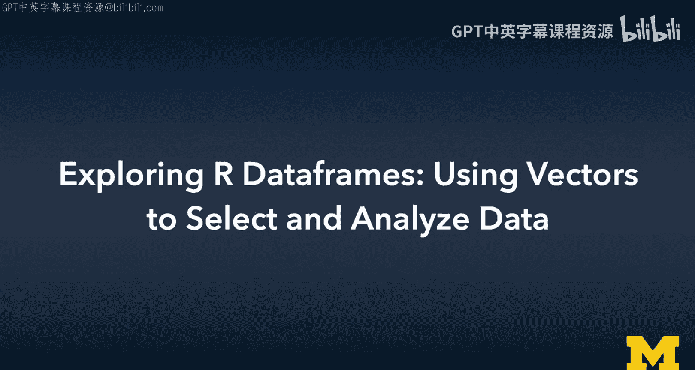
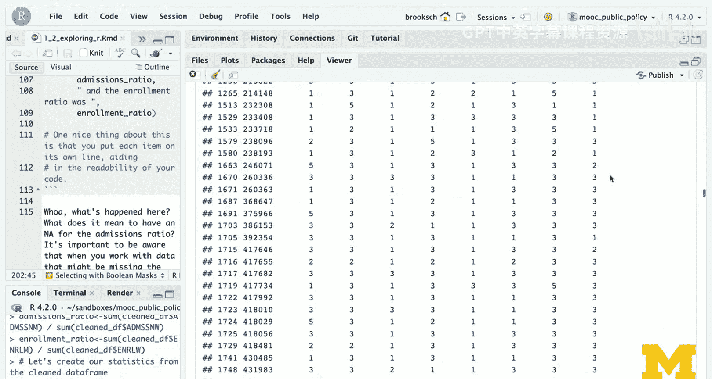

# 密歇根大学《公共部门的R数据分析（基础、数据探索、决策支持、）｜Data Analytics in the Public Sector with R》中英字幕 p17 16_数据清洗后统计量生成方法.zh_en -BV1YZ421J7Fx_p17-

So let's create our statistics from the clean data frame and this is actually pretty quick to do now that we have the clean data frame so we're going to take the sum of the clean data frame of the application males over the application females and we're going to do the same thing for admissions and the same thing for enrollment so this is what we wrote early on let's execute that。

Okay， we could see in our environment tab that we have these three ratios。

 Now I didn't print them out though， because I want to show you a neat feature of the R markdowns where we can embed variables within noncode chunks just by starting with a back tech followed by the letter R and then the variable name。

 This allows you to write a narrative that includes all the elements of your computation right in it。

 Now you don't execute these text chunks。 but instead render them through the knitting process。

 So you get to see those results when you click on the visual tab in our studio。 All right。

 to see the rendered copy of this， we're just going to go up to the knit button and we'll press the knit button by default。

 we're gonna get an H file created。 and you can see that we've got a view of it here。

 I'm just going to drag that aside， make it a little bit easier And this is really nice because you could show this off to people。

 You can provide this as a report， for instance， to stakeholders。 you can make again。

 Pdf's word documents etc。 and you can see all of our code is here。

The analysis that we did all of the actual executable code you'll be able to see there are tables that we've written are here and so forth。

 Now one of the challenges is we also get all of that output And so here we have that giant thousand item boolean mask which not really all that interesting and we can also get sometimes the whole data frames where often we're not interested in that。

 So I'm just going to zip down here though to the bottom because that's what I really want to show you which is really quite neat and here so in this case we could see that it was male to female ratio of and the number is embedded right in that report And so if our data changes if we have to go back and manipulate our scripts or change some things maybe there's new assumptions or we learn something more about that data we could just rerun this knitting process and all the numbers automatically update with the narrative that we've already written and so that's pretty cool and that's something that's pretty unique to R Now if we look at these numbers。

A lot of things that we could think about here， so we've got this male to female ratio for applications of 0。

74， so many more women are applying over the set of all of the colleges。

 the admissions ratio is even tighter so it's 0。69 so even more women are getting admissions but the enrollment ratio is actually a little less so 0。

77 and so that makes sense because women are getting。

 my guess is admitted to more different schools but they can only actually enroll in one of those schools。

But I'd love to hear from you。 this was just scratching the surface of a great public data set。

 What are some of the kinds of questions that you would love to answer about this data。

 let me know in this little pop up and I'll be sure to read it。

