# 密歇根大学《公共部门的R数据分析（基础、数据探索、决策支持、）｜Data Analytics in the Public Sector with R》中英字幕 p19 18_调查数据分析：重要性、类型及公共领域应用案例.zh_en -BV1YZ421J7Fx_p19-

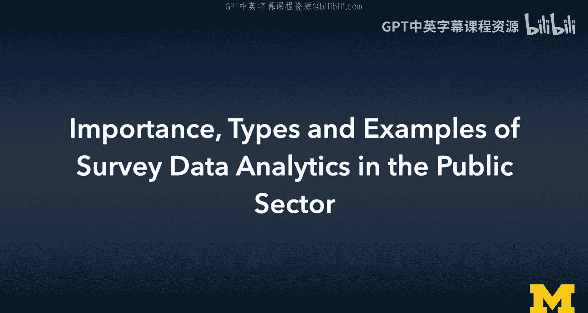

There are so many different types of data that are important for all the different core functions of public administration。

 and this includes survey data。Now the methods involved with designing。

 implementing and analyzing the data from surveys are an entire field of social science。

 you can get a master's degree or even a PhD in survey research Our roadmap for our next few sessions together is to provide you with a basic introduction to the role of survey data analysis in public administration This includes some definitions and examples of different types of surveys and also an introduction to the cross-cutting issues and using surveys。

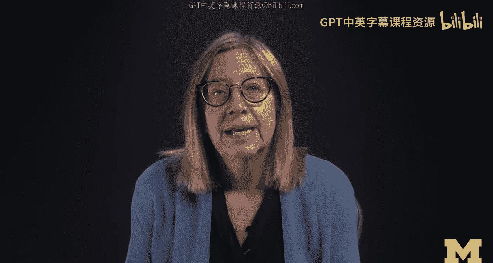

This will include some terminology and the important role of the code book in Sur analytics。

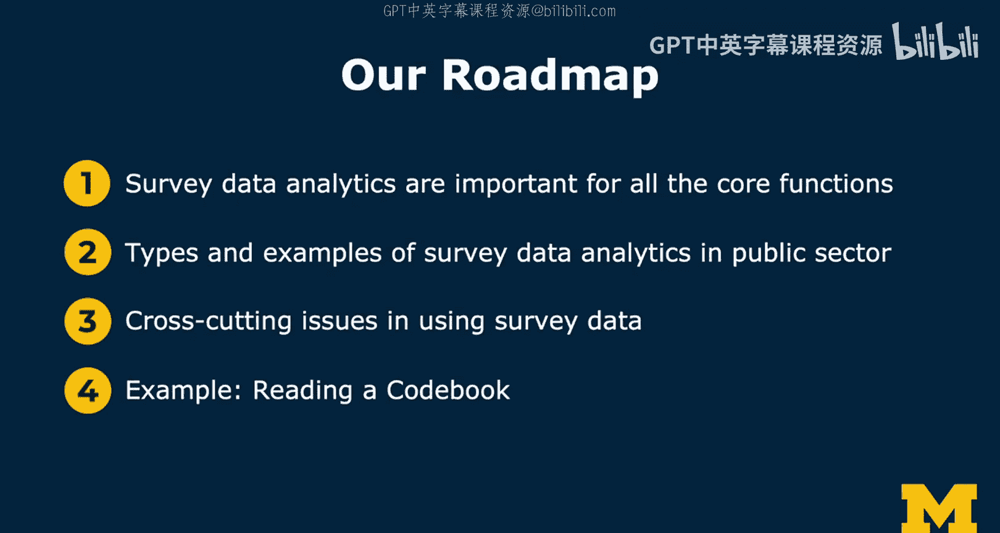

So let's start with what are the main purposes for surveys in government and particularly in public administration？

This includes。To collect information on attitudes， experiences， and opinions directly from users。

 clients， citizens， employees and other stakeholders of government， goods and services and programs。

Another core purpose is to inform all the core functions of public administration。

Surveys are also used to measure government performance。

 both objectively and subjectively gathering opinions from stakeholders。

 and also to engage with the public to solicit feedback， gather ideas， help establish priorities。

 and also to improve trust in government。

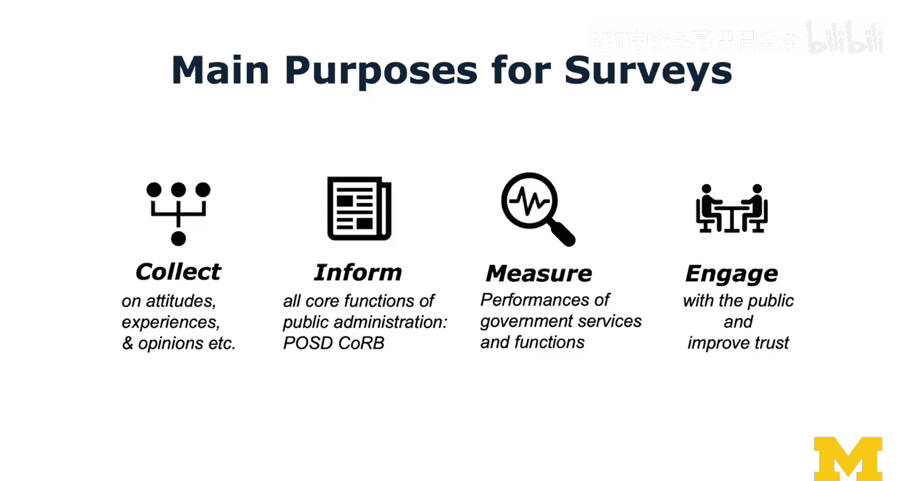

Here are just a few examples of how surveys can be helpful in the core functions of public administration。

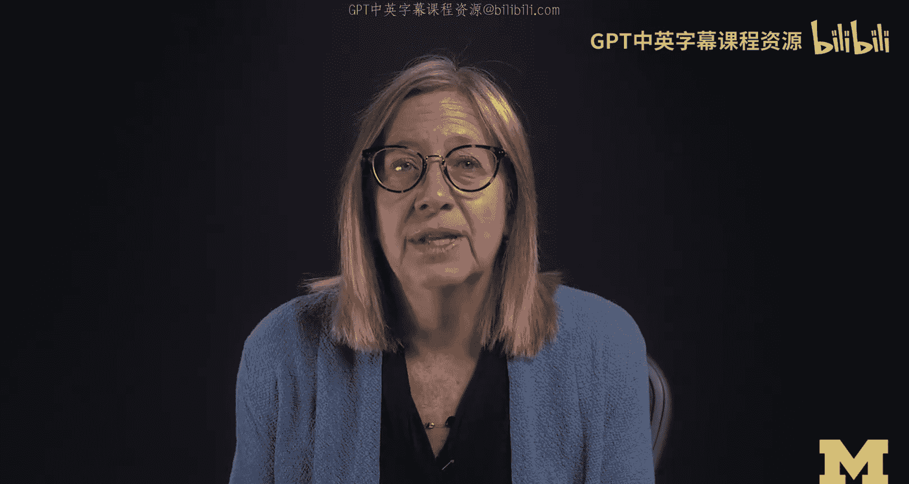

In the organizing function， an example is families in a school or educational district could be surveyed to get more accurate information on the number of children in the district and also families' intentions for enrolling their kids in public school。

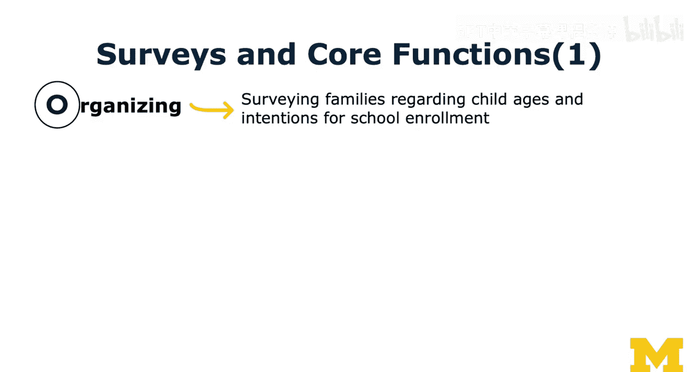

Survey data from families can also be used to find out if children will need childcare before or after school。

 if a child will need special educational services。

 what language is spoken at home by the family and other information that will help the school organize its services and programs for the planning function。

 surveys are often used to solicit systematic feedback from citizens regarding their ideas for new initiatives for the government。

 what they believe priorities should be in the near and long-term future etc。

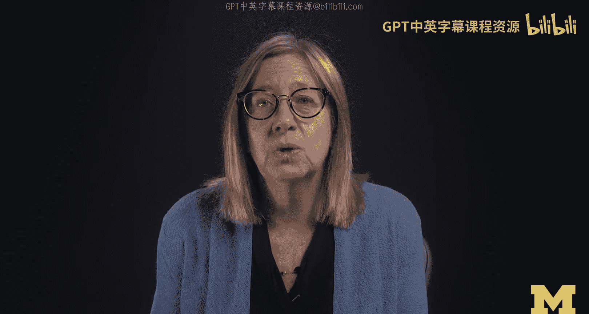

For the directing function， client feedback and satisfaction surveys are often used on an ongoing basis。

 For example， some jurisdictions survey crime victims several months after their reporting of a crime to get information from the victim's perspective regarding if and how the case was resolved if a victim was satisfied with the process and again。

 feedback for improvement。

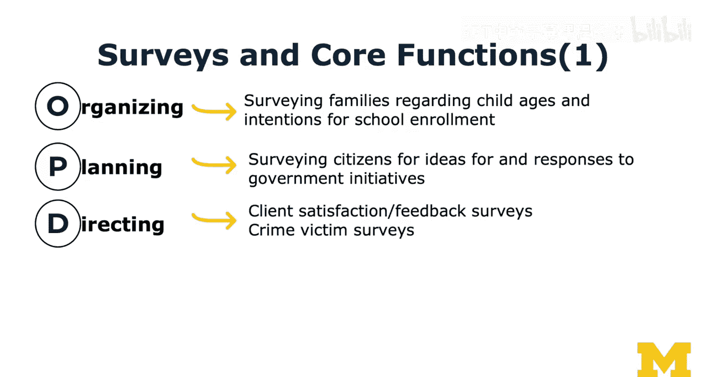

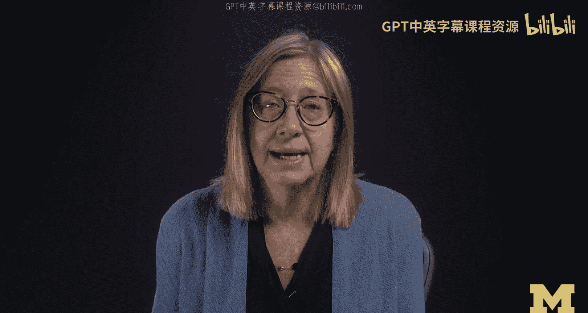

For the staffing function of public administration。

 public sector employees are often surveyed to get feedback from them regarding their job satisfaction。

 their compensation satisfaction and whether or not they are currently or planning to look for a different position。

 both within or outside of the government。

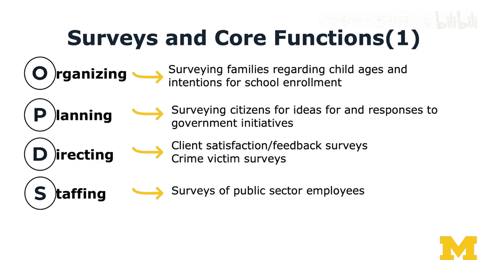

There are also a number of examples of surveys that cut across multiple public administration functions。

This includes public opinion surveys， which can be used for informing， planning， directing。

 organizing。Actually all of the functions In addition。

 many governments use survey data to augment what is collected through the population census。

 collecting more detailed information about individuals and households。

 which is then used for multiple core functions and purposes。

Now let me underscore an important point right now。

 governments in many countries and their subnational units fund or pay for survey research that is conducted by researchers outside of government。

Researchers in academia in the private and nonprofit sectors。

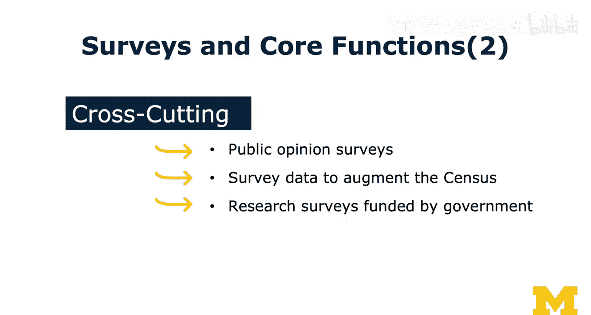

In this case， the government is subsidizing survey research that it believes will provide some sort of public benefit back to the public sector。

Also， importantly， after most government surveys are conducted and the data are analyzed。

 it's often the case that the data need to be made anonymous。

 meaning every bit of identifying information is removed。

And then made public so that others can have access to and analyze the data。

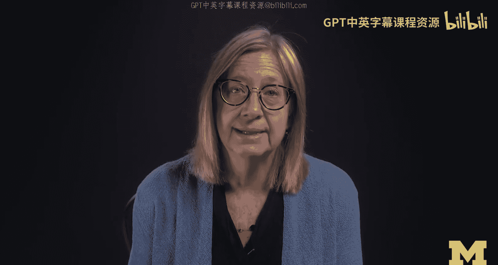

All right。 Well， where do survey data that are used in the public sector generally come from。

This has been implied in the examples I just provided to you。

 but let's be a little more clear about this。 First。

 governments collect their own data through surveys that they design and implement。Second。

 governments use survey data collected externally by other governments。

 by NGOs or nongovernmental organizations， by academic researchers， by think tanks。

 and also by the private sector。Third， the government uses survey data from research that it has funded。

 but in turn is made available for public use。For anyone to use， including the government。

 let me give you a quick example of this last point。

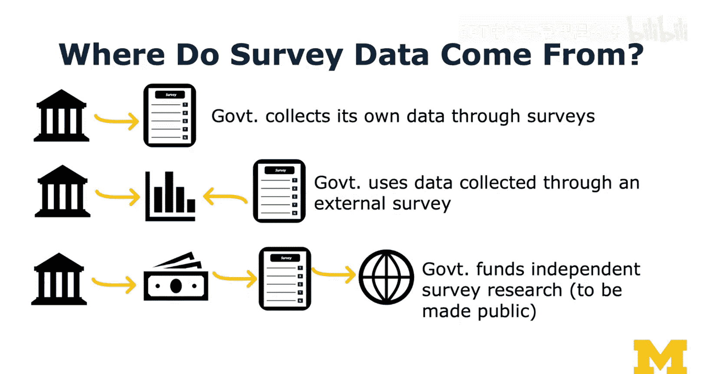

I receive funding from the U。S。 government to conduct a national survey of how people interpret guidelines that are issued by the government regarding clinical preventive services。

 such as who should get different cancer screening tests。

 what immunizations should people get at different ages， things like that。

A condition of my receiving this funding from the federal government was that the survey data without any identifying information about the respondents would be made available to other researchers and analysts after I completed the initial analysis of the data。

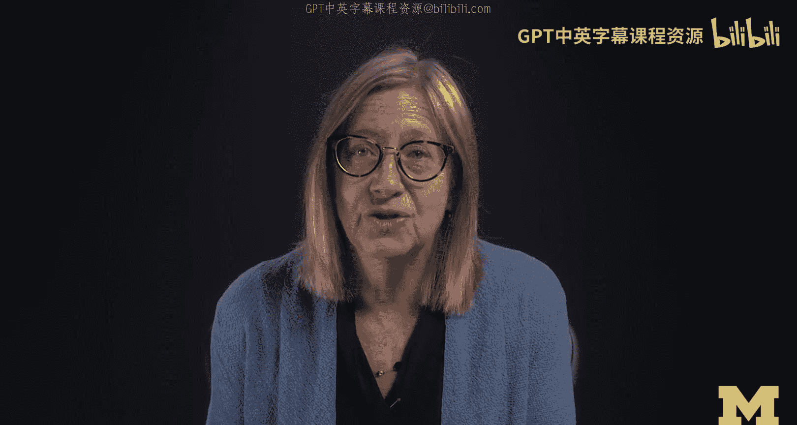

To continue our discussion of where survey data used in the public sector comes from。

Most national and subnational governments invest a lot of resources in conducting their own surveys。

Some of which are implemented just once。Others are ongoing。The U。S。 federal government， for example。

 conducts about 100 surveys annually。Here's another example。

 Many countries conduct ongoing surveys that are designed to represent the national population。

And they collect important information from households regarding labor force participation。

Income status， and this is where poverty statistics come from。

Other information about their what kind of housing they live in and information related to a number of other economic and social welfare issues。

This survey is called the PNAD in Brazil or the National household sample Survey in English。

It's called the National Sam Survey in India， and it's called theCurrent Population Survey in the United States。

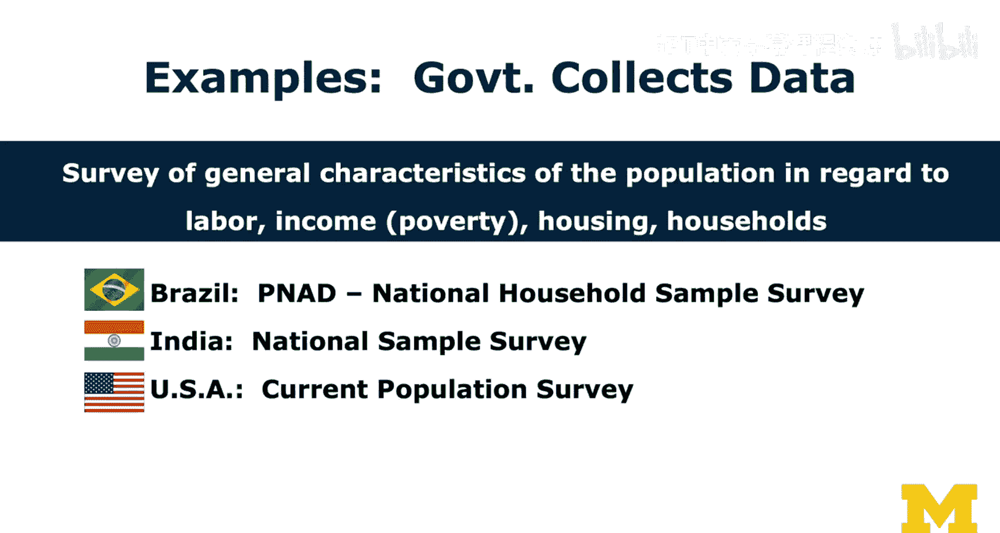

Also， governments use survey data that were collected outside of or external to the public sector Quick examples include United Nations statistics。

 there are so many great statistics from the UN because the UN conducts numerous social。

 economic and demographic surveys on a routine basis。

The World Bank also conducts a large number of surveys。

 including what is called the enterpriseprise surveys。

 these focus on a core set of economic and labor indicators and are conducted in over 150 countries。

 also local or community surveys are often conducted by academic researchers， nonprofit agencies。

 local businesses， health systems， and these in turn provide useful information to the local government。

And also， the government can learn a lot from market research and other kinds of surveys that are conducted by the private sector I am not ashamed to admit to you that I am a survey data nerd。

 I cannot count the number of surveys that I've designed and conducted for both academic research but also in my work with the public sector。

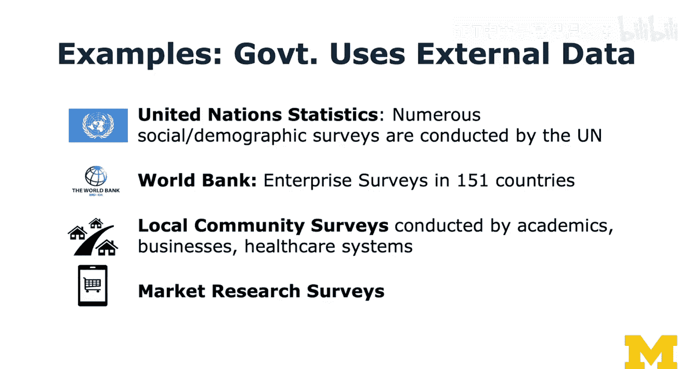

I hope you share my appreciation for the power and importance of survey research and survey data analytics and the important work and functions of public administration。

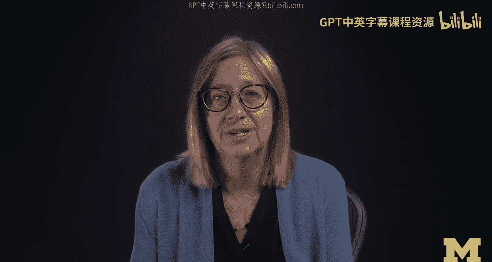

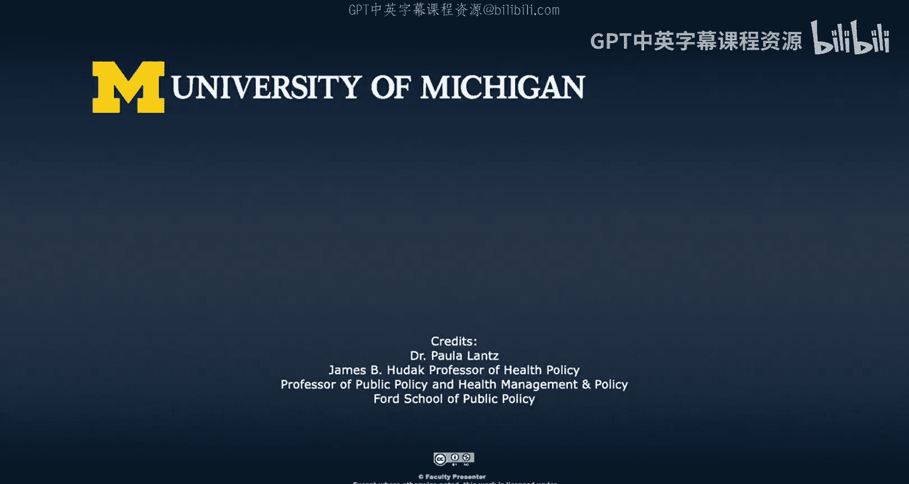