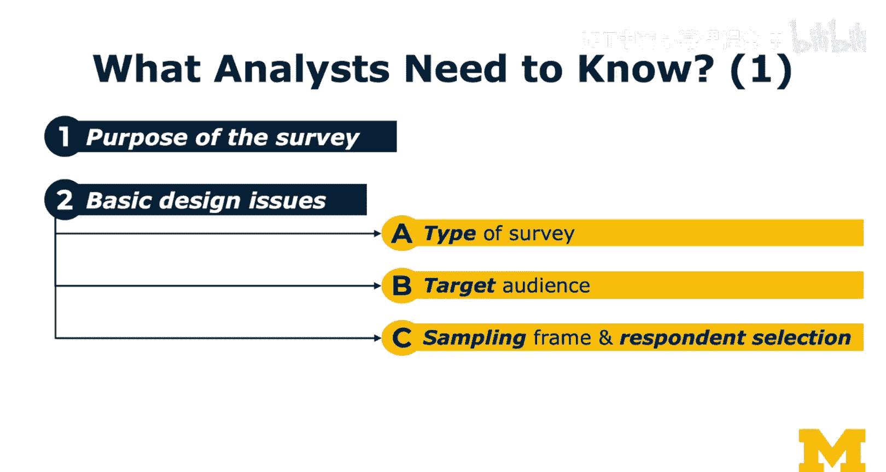
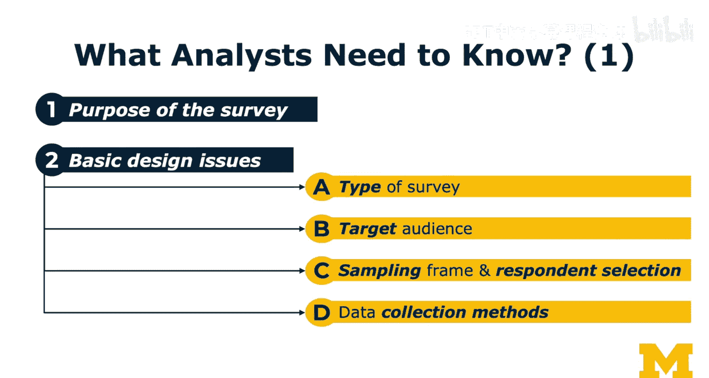
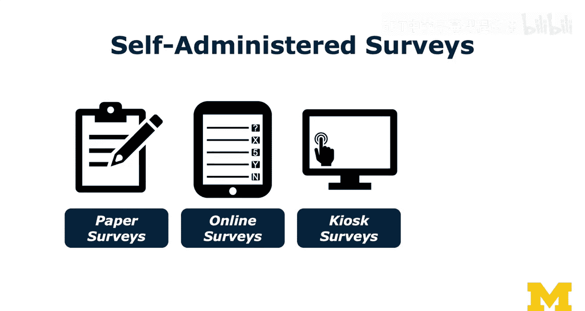
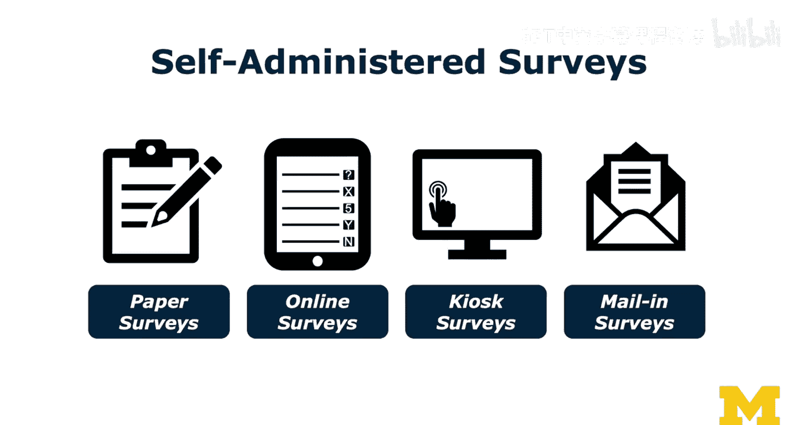
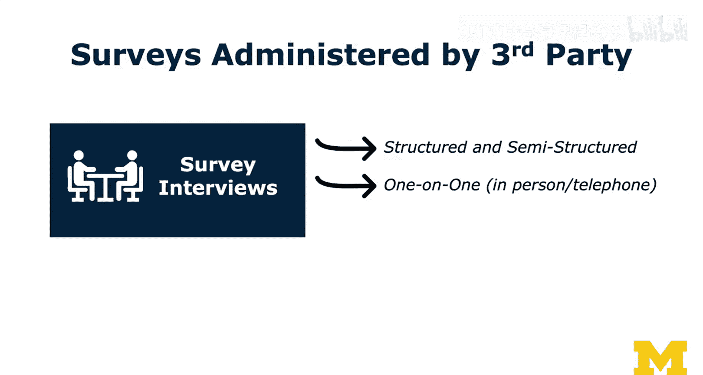
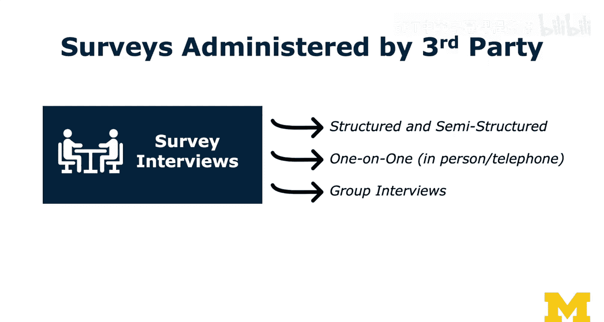
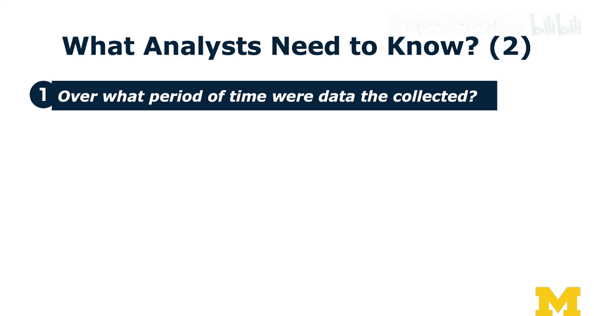
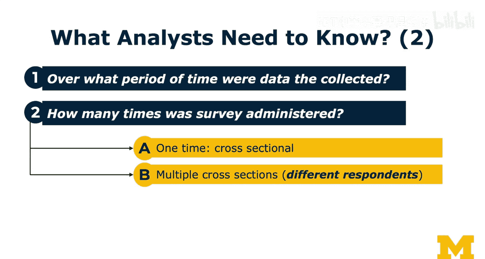
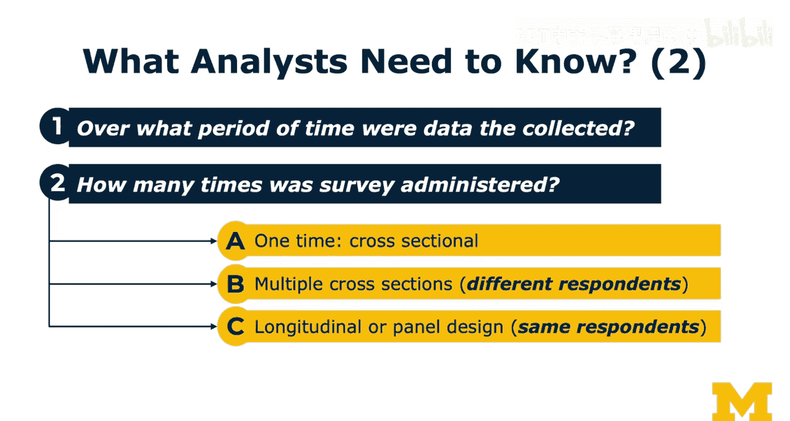

# 密歇根大学《公共部门的R数据分析（基础、数据探索、决策支持、）｜Data Analytics in the Public Sector with R》中英字幕 p20 19_分析师必备：调查设计类型解析.zh_en -BV1YZ421J7Fx_p20-

Survey research methods are fairly technical and complex。

 and we're not going to get way into the details of designing and implementing surveys， however。

 from a data analysis perspective， there are a number of basic things that you need to know when you're embarking upon survey data analysis this includes first understanding what is the purpose of this survey who created it and for what aims or purposes。

And then second， you need to understand what's the design of the survey。

 and that means knowing the following types of things。What kind of survey is it。

 we'll talk about all this more in a minute。Also， who's the target audience or target set of responders to the survey？

You also need to know what was the sampling frame and the respondent selection from it。

 this means what were the methods used to specify the people in the intended audience or population for the survey and how were they selected。

For example， a local government might want to survey all the businesses in its jurisdiction。

It could get a list of businesses that paid taxes last year from its tax branch。

And then could take a random sample of businesses from that list to survey。

Now the government doing the survey could survey all of the businesses。

 but that requires more resources and is much more time consuming。

 so often a random sample from this bigger universe or total pool of businesses could be taken。

When done correctly， the data taken from a random sample can be used to represent the total of the sample so again you don't have to survey all the businesses。

 you could take a random sample that costs less， it's more efficient。

 but it represents all the businesses。

Another important element of basic survey design is how the data were actually collected。

And this brings us back to understanding the type or kind of survey that was used。

Now， in general， surveys can be self administered， a respondent answers the survey themselves。

Or a survey could be administered by someone else who is asking the respondent the survey questions and then records the answers。

In terms of self administered surveys， we have pen to paper surveys。

 respondents fill out a piece of paper that has the survey questions on it themselves。

Also online surveys， so respondents answer questions on a survey via internet。

 usually from their homes。There also are kiosk service surveys， governments use these a lot。

 these are stations usually in a public place like a government building where people are invited to walk up and answer some survey questions on a screen。

The kiosk obviously is connected to the internet where the answers are collected and then stored in a data set。

Finally， surveys can be mailed to people this is another example of a paper survey。

 but this uses the postal service to mailed surveys to people。

 the response rate for mailed surveys is typically pretty low。

 it's much higher if when the surveys are mailed to people they get a return envelope with postage already paid。

Makes it so much easier for them to return it in terms of surveys that are administered by someone else。

 this is often much more expensive， but it's done for a wide variety of reasons。

One reason is that it's a much better approach when a survey is lengthy。

 or when some of the questions involved are complex and require more narrative or qualitative responses than a simple checkbox on a survey form。

 a survey that's administered by a person to someone else is also a good approach when trying to reach a large sample of people through a telephone survey。

Obviously， and in addition， when some people in the target audience for a government survey cannot read。

 a survey approach with an interviewer is really the only way to go。

There are many different types of surveys that are administered by someone else rather than someone doing a survey themselves。

This includes survey interviews that are both structured versus semistructured。Now。

 structured means that all of the questions are determined beforehand and simply read by the interviewer with the respondent answers recorded。

Semistructure means that many of the questions are defined and determined beforehand。

 but the interviewer can also probe and follow up with additional questions and really enter into a conversation with the respondent in an attempt to get more detailed。

 clear and useful information。Another quick example for my own experience。

I conducted a series of over 200 semistructured interviews for the US Centers for Disease Control and Prevention with local tribal government officials to learn more about their experiences with implementing a government program that had initially been designed for states rather than tribes。

These were one on one structured interviews and I interviewed one person at a time with each of the interviewers taking over an hour obviously this is a very labor intensive approach but you get very different information than if you just gave people a simple pen to paper form to fill out themselves。

Other kinds of survey interviews include group interviews。

 and this is a method in which a group of people are in the same place or space at the same time。

 and they're all asked a question at the same time by an interviewer。

 but then everyone writes down their own answer on a survey form privately in response。

 there's no discussion among the group or sharing of answers。

And this is different from what's called focuscus group interviews。

 and this is where a small group of people are in a room or on a Zoom call at the same time。

 and they are asked questions by an interviewer， but in this case the group answers the questions out loud and they not only answer the questions but they discuss their opinions and their perspectives with each other。

The point in a focus group interview is actually to solicit a group discussion so that you can learn things that you really often wouldn't learn just asking people questions one on one。

 All right， so what else do survey data analysts need to know before they jump into the fun of playing around with and analyzing the actual data。

Well， one thing you know， need to know and understand is over what period of time were this survey data collected。

Where they collected over many weeks， months， a year， more than a year。

 you need to know all this to understand what period of time the results that you will be producing represent。

Also， if a survey is being collected both before and after， say a natural disaster。

 some sort of government crisis， or some other sort of shock as we say， or event。

 you need to know this in order to see if the results are different before and after that event。

Analysts also need to know if a survey is cross sectional。

This means that it was implemented at one point in time。And thus。

 the responses represent only that one point in time。Or a survey could be a cross- sectional design。

 but what we call a multiple cross sectional design。

 and this means that the survey gets repeated on an ongoing basis， but with different people。

 or there are different crosssections of the population that are surveyed at each point in time。

This is often the case with annual surveys， their are multiple cross sectional surveys。

However， a survey could also be ongoing and following the same group of people over time。

 in which case this is referred to as a longitudinal or a panel survey。

